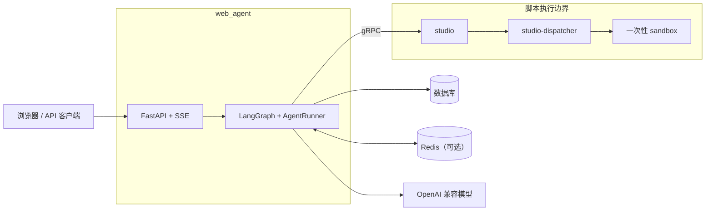

# 多 Agent 协作 Web 服务

基于 Python、FastAPI 和 LangGraph 的多 Agent 协作服务。Agent 与 Workflow 以数据库配置驱动，多个节点按 DAG 并行或串行执行，通过 SSE 输出实时事件并支持断线续传。

根 README 只作为项目与文档目录。模块说明放在对应源码目录中，便于在阅读代码时直接找到设计、配置和测试说明。

## 文档目录

| 模块 | 文档 | 内容 |
| --- | --- | --- |
| 主服务 | [app/README.md](app/README.md) | 架构图、快速开始、配置、模块地图 |
| API | [app/api/README.md](app/api/README.md) | REST 接口、SSE ticket、事件协议、恢复策略 |
| 核心运行时 | [app/core/README.md](app/core/README.md) | Workflow、LangGraph、审批、工具、Redis 和敏感内容过滤 |
| 设计总目录 | [docs/design/README.md](docs/design/README.md) | V1–V4.7 版本、迭代记录和设计入口 |
| 设计 TODO | [docs/design/TODO.md](docs/design/TODO.md) | 尚未完成的工作与优先级 |
| Web 页面 | [web/README.md](web/README.md) | 功能验证台与后台管理 |
| 独立服务 | [services/README.md](services/README.md) | studio、dispatcher、sandbox 的拓扑与信任边界 |
| studio | [services/studio/README.md](services/studio/README.md) | 脚本执行、档位、资源限制和运维入口 |
| studio 设计 | [services/studio/design/README.md](services/studio/design/README.md) | gRPC 契约、进程隔离、沙箱和部署设计 |
| dispatcher | [services/dispatcher/README.md](services/dispatcher/README.md) | isolated 档控制面、HTTP 接口和环境变量 |
| sandbox | [services/sandbox/README.md](services/sandbox/README.md) | 一次性执行容器、控制帧和容器安全属性 |
| 脚本 | [scripts/README.md](scripts/README.md) | 数据、压测、模型训练、proto 与文档检查 |
| 性能报告 | [scripts/PERFORMANCE.md](scripts/PERFORMANCE.md) | 实测吞吐、并发容量和压测偏差 |
| 测试 | [tests/README.md](tests/README.md) | 测试层次、并行隔离和端到端验证 |
| 部署 | [deploy/README.md](deploy/README.md) | Docker Compose、安全配置和运行方式 |
| Proto | [proto/README.md](proto/README.md) | 唯一契约来源、桩代码生成和一致性检查 |

## 按任务查找

| 我要做什么 | 从哪里开始 |
| --- | --- |
| 第一次启动项目 | [app/README.md](app/README.md#快速开始) |
| 调接口或接入 SSE | [app/api/README.md](app/api/README.md) |
| 配置 Workflow 或排查 run | [app/core/README.md](app/core/README.md) |
| 修改 Web 验证台 | [web/README.md](web/README.md) |
| 配置用户 OAuth 或排查登录态 | [V4.6 用户 OAuth](app/design/v4.6-user-oauth-conversation.md) |
| 设计独立 admin-web、平台超级管理员或 Ludic SSR | [V4.7 管理员体系与 UI](app/design/v4.7-oauth-admin.md) |
| 接入 Skill 脚本或 MCP | [app/core/README.md](app/core/README.md#审批与工具) |
| 部署脚本执行服务 | [deploy/README.md](deploy/README.md) |
| 运行测试或压测 | [tests/README.md](tests/README.md) 与 [scripts/README.md](scripts/README.md) |
| 修改 studio 契约 | [proto/README.md](proto/README.md) |
| 查版本演进或已移除方案 | [docs/design/README.md](docs/design/README.md) |
| 继续开发设计能力 | [docs/design/TODO.md](docs/design/TODO.md) |

## 系统边界



完整架构图见 [主服务架构总览](app/README.md#架构总览)。

## 最小启动

```bash
copy .env.example .env
python run.py
```

启动后访问：

- 功能验证台：<http://127.0.0.1:8000/>
- 后台管理：<http://127.0.0.1:8000/admin>
- OpenAPI：<http://127.0.0.1:8000/docs>

## 文档维护约定

- 模块文档放在对应模块目录，根 README 只维护导航。
- 新增模块时同时新增 `README.md`，并在本页补充入口。
- 主设计按版本拆分；新增迭代写新版本页，并在设计总目录登记“新增、替换、移除”。
- 未完成事项只写进 [`docs/design/TODO.md`](docs/design/TODO.md)，不要在设计正文另建待办清单。
- Python 函数必须有 docstring；新增或修改公共函数时补充参数、返回值、异常和副作用说明。
- 文档移动后同步更新代码、测试和脚本中的路径引用。

函数注释覆盖率检查：

```bash
python scripts/check_docstrings.py
```

历史迭代计划保留在 [`docs/superpowers/plans/`](docs/superpowers/plans/)。
