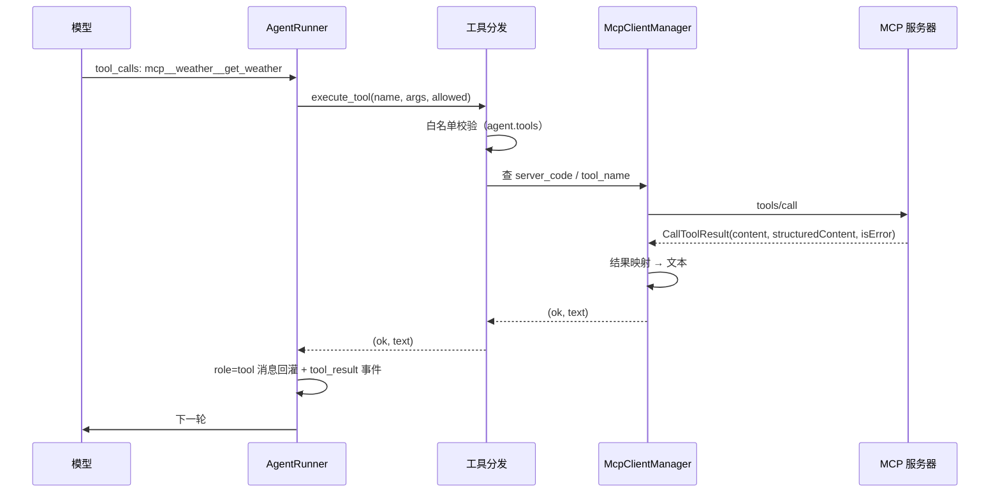
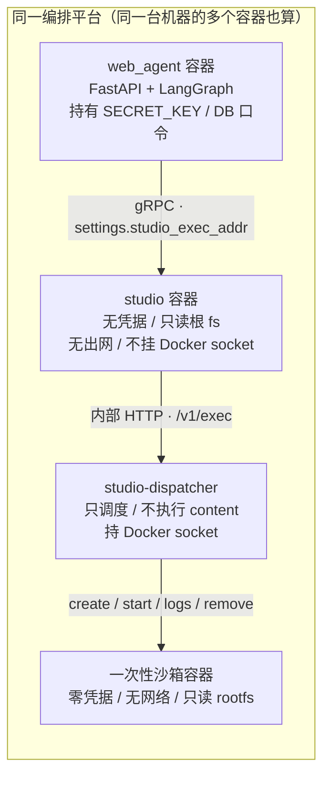

# V4：MCP、Skill 与脚本执行

> V4 把工具来源扩展到 MCP，并把 Skill 作为可复用领域知识与受控脚本执行单元接入。

> 状态：已实现。Docker isolated 后端与真实 MiniMax 五场景均已验证。

> 总目录见 [docs/design/README.md](../../docs/design/README.md)，未完成事项见 [TODO](../../docs/design/TODO.md)。

> 章节编号沿用拆分前文档，便于旧链接与讨论继续使用。

> 导航：[上一版：V3](v3-orchestration.md) · [主服务索引](README.md) · [studio 服务侧](../../services/studio/design/README.md)

---

## 21. V4：MCP 工具（外部工具来源）

### 21.1 目标与边界

V3.2 把「模型要了工具，run 就结束了，模型从没见过工具结果」这个断口补上了，但工具的**来源**
被刻意钉死在代码里：注册表 `TOOL_REGISTRY` 里就 `now` 与 `calc` 两个（§17.2）。本轮把来源扩到
**MCP 服务器**，让「工具从哪来」不再等于「工具必须是我们自己写的」。

本轮要做的：

- **MCP 客户端**：本项目作为 MCP **host / client**，连接外部 MCP 服务器（stdio 子进程 /
  Streamable HTTP 远程端点）；
- **工具目录并表**：内置注册表与 MCP 工具目录合成一张表，`agent.tools` 仍然是「工具名列表」，
  只是允许出现 `mcp__` 限定的名字；
- **调用链复用**：模型要工具 → 服务端执行 → 结果以 `role=tool` 回灌 → 模型继续——§17.3 的闭环
  **一个字都不改**，只在「工具名 → 执行器」这步多一条分支；
- **工具目录接口**：`GET /api/tools` 的形状不变，条目多一个 `source` 字段。

本轮**不做**（每一条都有理由，不留「以后再说」）：

| 不做的东西 | 为什么 |
| --- | --- |
| 实现 MCP **服务器** | 本项目是客户端。做一个 server 是另一个产品线的事 |
| MCP 的 **resources / prompts** | V4.4 已接入 resources、resource templates、资源读取和 prompts；早期 V4 只做 tools |
| 服务端**主动推送**（`notifications/tools/list_changed`、`subscriptions/listen`） | V4.4 已处理工具目录变更通知；`subscriptions/listen` 仍未接入 |
| **OAuth 授权流** | MCP 的授权是一整套（OAuth 2.1 + 动态注册 + RFC 9728 资源元数据 + `iss` 校验）。本轮只支持管理员配好**静态 header**（如 `Authorization: Bearer …`）的服务器 |
| **MRTR**（多轮往返请求） | 2026-07-28 新增的 `input_required` 结果类型。本轮一律当失败处理（§21.9） |
| MCP 工具的**代码级沙箱** | 见 §21.10 第 1 条——这是本设计里唯一一处「配置能决定执行什么代码」的地方，必须正面处理而不是绕过 |

### 21.2 MCP 解决的是「来源」问题，不是「能力」问题

§17.2 立的规矩是：**「模型能调的」与「服务端能执行的」必须是同一张表**，否则透传一份
function schema 就等于让配置决定执行逻辑（≈ RCE）。

MCP 不推翻这条规矩，它换的是**这张表由谁填**：

| | V3.2 内置工具 | V4 MCP 工具 |
| --- | --- | --- |
| 表项由谁提供 | 我们自己写的代码 | 第三方进程 / 第三方服务 |
| schema 与执行器 | 同一处（`ToolSpec`） | 同一处（MCP 服务器：它给的 `inputSchema` 就是我们要发的 `arguments`） |
| 配置能否决定执行什么 | **不能**——配置只能填名字 | **stdio 能**——配置里就有 `command` / `args`（见 §21.10） |
| 保存期能否校验 | 能，注册表即全集 | 只能对**已发现过的**服务器校验（§21.8） |
| 参数危险等级 | 低（`now` / `calc`） | **未知**，取决于那台服务器 |

关键点是第二行：MCP 工具的 schema 与执行器**天然同源**——服务器自己声明参数形状，自己执行。
这正是它相对「用户自定义 HTTP 工具」的根本优势：后者要么透传 schema（回到 RCE 问题），要么
服务端自己猜参数形状（模型看到的与执行的会对不上）。

所以本轮的设计目标不是「把 MCP 接进来」，而是**在不动 §17.2 那条契约的前提下，把表的另一半
交给外部**。为此需要一张**工具目录快照表**（§21.6）：它让「模型能调的」与「服务端能执行的」
在**快照层面**仍然对得上。

### 21.3 协议版本：钉在哪一版

MCP 规范按日期版本化，且**版本之间有破坏性变更**。截至本设计定稿，规范的最新修订是
**2026-07-28**，它在 2025-11-25 基础上做了大改：

| 维度 | 2025-11-25 及更早（握手时代） | 2026-07-28（现代时代） |
| --- | --- | --- |
| 连接建立 | `initialize` 握手协商版本 | **无握手**，每个请求在 `_meta` 里带协议版本与客户端能力 |
| 会话 | `Mcp-Session-Id` 头维持会话状态 | **移除协议级会话**；跨调用状态改由服务端自己铸一个 handle 当普通参数传 |
| 服务端身份 | `initialize` 结果里返回 | 每个结果的 `_meta.io.modelcontextprotocol/serverInfo` |
| 能力发现 | `initialize` | 新增 `server/discover`（服务端必须实现） |
| 服务端推送 | GET 长连接 SSE + `resources/subscribe` | 改为 `subscriptions/listen`（单一长连接 POST 响应流） |
| 结果形状 | 无此字段 | **所有结果必带 `resultType`**：`complete` / `input_required` |
| 列表结果缓存 | 无 | `tools/list` 等结果必带 `ttlMs` + `cacheScope` |
| HTTP 必填头 | `MCP-Protocol-Version` | 再加 `Mcp-Method`、`Mcp-Name` |

**对本项目最要紧的一条是「无会话」。**

§13 的多实例架构里最难啃的是「状态归属」：Redis Stream 把事件归属解决了，但任何**有状态的
外部连接**都会带来会话亲和性问题——实例 A 建立的会话，实例 B 接不上。审批暂停点能跨实例恢复
（§16.7），是因为它存在 Redis 里；而 MCP 会话是协议层的活连接状态，没地方放。

2026-07-28 把会话从协议里删掉，正好撞上本项目「核心状态在 MySQL / Redis，进程内只放无状态
计算」的原则。所以：

- **目标协议版本：2026-07-28**（无状态）。Python SDK 会优先使用它。
- **最低可接受：2025-06-18**（握手时代）。更早的不支持。
- **本项目不自己写版本协商代码**，只声明「支持哪些版本」，协商交给 SDK
  （`mcp.types.SUPPORTED_PROTOCOL_VERSIONS` 覆盖两个时代）。

**但现实是握手时代的服务器仍然占多数**，它们会拿到 `Mcp-Session-Id`，也就把会话亲和性问题带
了回来。本设计的处理口径是：

> 架构上按 2026-07-28 的无状态模型设计（**不依赖**会话存在）；握手时代服务器能连，但接受
> 「同一会话要落在同一实例」这个代价，并在 §21.14 第 1 条如实列出。

具体做法：握手时代服务器的 `Mcp-Session-Id` **存进 Redis**（键 `mcp:sess:{server_code}`），
任何实例都能用它继续对话，而不是把连接钉死在发起它的进程里。连接本身仍是进程内的（stdio
子进程没法跨实例），所以**子进程型服务器天然单实例**——这是物理限制，不是设计选择。

### 21.4 传输：stdio 与 Streamable HTTP

选两种，是因为它们覆盖两类真实用法；旧的 HTTP+SSE 双端点传输**不实现**（它在 2025-03-26
被废弃，2025-11-25 起进入正式 Deprecated 生命周期）。

| 传输 | 典型场景 | 本项目怎么接 |
| --- | --- | --- |
| **stdio** | 本地子进程：文件工具、脚本工具、代码执行器 | 以子进程拉起，stdin/stdout 走 JSON-RPC 消息；**stderr 单独收进日志** |
| **Streamable HTTP** | 远程服务：云 API 封装、内部平台 | 单端点 POST；服务端要主动推消息时走响应流 |

三个必须记住的细节：

1. **stdout 只能有协议消息**。stdio 模式下服务端的普通日志**必须走 stderr**，写 stdout 会污染
   JSON-RPC 帧流。同理，本项目作为客户端拉起子进程时，要**主动把子进程的 stdout 收干净**，
   不能让它继承父进程的 stdout——否则子进程随手一句 print 就把协议打乱了。
2. **`MCP-Protocol-Version` 头**（2025-06-18 起）：每个 HTTP 请求都要带协商好的版本；缺失时
   服务端按 2025-03-26 处理，收到非法值返回 400。
3. **SSE 断流 = 这次请求丢失**。2026-07-28 移除了 SSE 的可续传性（`Last-Event-ID` 与事件 ID
   不再是规范的一部分），规范明确要求客户端**用新的请求 ID 重新发起**。这对工具调用有直接
   含义：**重试一个超时了的 MCP 工具调用，必须假设它可能已经执行过**（§21.9）。

### 21.5 工具命名空间：`mcp__<server>__<tool>`

内置工具叫 `calc`、`now`；MCP 工具有自己的名字，两台服务器的同名工具会撞。

OpenAI function-calling 的函数名约束是 `^[a-zA-Z0-9_-]{1,64}$`——**没有点号**。所以
`weather.get_weather` 非法，`weather__get_weather` 合法。

采用 Claude Code 的约定：

```text
mcp__<server_code>__<tool_name>
```

- `server_code`：服务器在本项目 `mcp_server` 表里的 `code`，**不是** MCP 协议里的 `serverInfo.name`
  ——后者是服务端自报的，不同服务器可能重名，不能拿来当主键；
- `tool_name`：MCP 服务器自己的工具名，原样保留。导入时按 OpenAI 的字符集与长度卡，
  不满足的**不导入**（并在服务器健康检查里报出来）；
- 长度上限 64 是 OpenAI 的限制，不是我们的选择：`mcp__`(5) + `server_code` + `__`(2) +
  `tool_name` ≤ 64。超长的**不导入**，**不截断**——截断会把两个不同的工具撞成同一个名，
  那比不导入更糟。

于是 `agent.tools` 的**形状变了，语义没变**：它还是「工具名列表」，只是现在可能混着内置名与
`mcp__` 限定名。§17.2 立的契约依然成立：**模型能调的名字，必然是服务端能执行的名字**——
只是「服务端」从「本进程里的注册表」扩展到「注册表 ∪ 已发现且在线的 MCP 服务器」。

### 21.6 数据模型

#### `mcp_server` — MCP 服务器注册表

```sql
CREATE TABLE mcp_server (
  id          BIGINT PRIMARY KEY AUTO_INCREMENT,
  code        VARCHAR(64)  NOT NULL UNIQUE,
  name        VARCHAR(128) NOT NULL,
  transport   VARCHAR(16) NOT NULL,        -- 'stdio' | 'http'（不用 ENUM：三方言通用）
  -- stdio：启动命令与参数
  command     VARCHAR(512) DEFAULT NULL,
  args        JSON        DEFAULT NULL,
  -- stdio：子进程环境变量（**值加密**）
  env         JSON        DEFAULT NULL,
  -- http：端点 URL
  url         VARCHAR(512) DEFAULT NULL,
  -- http：请求头（**值加密**）
  headers     JSON        DEFAULT NULL,
  -- 工具白名单：只导入这些工具；为空 = 全导
  allow_tools JSON        DEFAULT NULL,
  timeout_sec INT         DEFAULT 30,
  enabled     TINYINT(1)  DEFAULT 1,
  version     INT         DEFAULT 1,
  created_at  DATETIME DEFAULT CURRENT_TIMESTAMP,
  updated_at  DATETIME DEFAULT CURRENT_TIMESTAMP ON UPDATE CURRENT_TIMESTAMP
) ENGINE=InnoDB DEFAULT CHARSET=utf8mb4;
```

`env` 与 `headers` 里装的就是凭据，加密口径与 `agent.api_key_cipher` 完全一致
（`app/core/crypto.py` 的 Fernet）。这两列**只写不读**：任何 API 响应里都不回显明文。

回显的口径是**只给键名**（响应里的 `env_keys` / `header_keys`）——不是把值替换成
`***`。理由是：连键名都没必要藏（管理员本来就知道自己配了哪些键），而给出一堆
`***` 只会让前端分不清「配了但值是空的」和「配了有值」。值一个字节都不回。

#### `mcp_tool` — 工具目录快照

```sql
CREATE TABLE mcp_tool (
  id             BIGINT PRIMARY KEY AUTO_INCREMENT,
  server_id      BIGINT      NOT NULL,
  qualified_name VARCHAR(128) NOT NULL,   -- mcp__<code>__<tool>
  tool_name      VARCHAR(64)  NOT NULL,   -- MCP 服务器自己的名字
  description    TEXT         DEFAULT NULL,
  input_schema   JSON         DEFAULT NULL,
  output_schema  JSON         DEFAULT NULL,
  annotations    JSON         DEFAULT NULL,
  discovered_at  DATETIME(3)  DEFAULT CURRENT_TIMESTAMP(3),
  UNIQUE KEY uk_qualified (qualified_name),
  KEY idx_server (server_id)
) ENGINE=InnoDB DEFAULT CHARSET=utf8mb4;
```

这张表有**三个**用途，缺一不可：

1. **保存期校验**：`normalize_tool_names` 遇到 `mcp__` 前缀的名字，去这张表查——查不到就拒
   （§21.8）；
2. **展开 schema 的数据源**：`build_openai_tools` 从这里取 `input_schema` 拼 OpenAI 的 `tools`
   参数。但**离线服务器的工具不展开**（§21.9）——快照只负责「有哪些工具」，「现在能不能用」
   由在线状态决定；
3. **后台勾选框的数据源**：`GET /api/tools` 要回答「这台部署上有哪些工具可用」，MCP 工具的
   来源就是这张表。

快照是**发现时写入**的，不是实时的。`tools/list` 有分页，而服务端推送本轮不实现（§21.1），
所以工具清单在**连接建立时取一次**，之后以快照为准。

### 21.7 连接管理

`McpClientManager` 是**进程内单例**，按 `server_code` 管理连接。

| 关注点 | 口径 |
| --- | --- |
| 什么时候连 | **惰性**：第一次用到该服务器的工具时才连。服务启动不因为某台 MCP 服务器挂了就失败 |
| 什么时候断 | 空闲超时（默认 5 分钟）后主动关闭——**stdio 子进程必须回收**，否则会攒出一堆僵尸进程 |
| 断了怎么办 | 下次调用时重连，指数退避，最多 3 次；仍失败则该服务器标记为不可用 |
| 同一服务器的并发 | **并发**调用（JSON-RPC 的 `id` 天然区分请求），但每个服务器有并发上限信号量（默认 4），避免把远端打爆 |
| 跨实例 | 连接是进程内的。握手时代服务器的 `Mcp-Session-Id` 存 Redis（§21.3），让任意实例都能续上对话 |

**为什么不预热**：预热会让启动变慢，且一台慢服务器拖慢整个启动。**为什么不因为连不上就启动
失败**：MCP 服务器是**可选依赖**，不是服务运行的前提。一台 MCP 服务器挂掉，影响的是**配了它的
那几个 Agent**，不是整个服务。

> 这与 §13.5 的 Redis 策略**故意不同**，理由要说清楚：Redis 不可用是**全局**能力失效
> （事件收不到、流会卡死），静默退回进程内总线会造成「看起来能跑、实际跨实例收不到事件」的
> 分裂大脑；而 MCP 服务器不可用只让**部分 Agent** 退化成「没有这个能力」，且这个退化是
> **显式且可观测**的（§21.12）——离线服务器的工具不会展开给模型，模型压根看不见它。

### 21.8 工具目录：发现、快照与保存期校验

三段式，和 §17.2 的「写的时候严格，读的时候宽容」是同一个思路，但**严格的对象变了**。

**① 发现**：连接建立后调 `tools/list`（注意分页，`nextCursor` 要翻到底），把每个工具写进
`mcp_tool` 快照。写之前先删掉该服务器旧的快照行再整体插入（快照是全量替换，不是增量合并
——增量合并会留下服务器已经删掉的工具）。

**② 保存期校验**（`normalize_tool_names`）：

| 名字形态 | 校验方式 | 不通过时 |
| --- | --- | --- |
| 内置名（`calc`） | 在 `TOOL_REGISTRY` 里 | 400，配置存不进去 |
| `mcp__<code>__<tool>` | 在 `mcp_tool` 快照里 | 400，配置存不进去 |
| 其它形状 | 既不是内置名也不是 `mcp__` 限定名 | 400 |

**MCP 服务器从未连过时**，`mcp_tool` 里没有它的任何工具 → 保存期直接 400，报错写明
「服务器 X 尚未发现工具，先刷新一次目录」。这是有意的严格：宁可让配置保存失败并给出可执行的
提示，也不要留一个「配了但模型看不见」的哑配置。

**③ 运行期宽容**（`known_tool_names` 的同类）：读历史脏数据时，未知名字**丢掉**而不是报错——
一个脏值不能让整个 Agent 列表接口 500（这是 §17.2 已经踩过的坑）。

### 21.9 工具调用链：从模型请求到结果回灌



**分发规则**（`execute_tool` 里加一条分支，闭环其余部分不动）：

```
name.startswith("mcp__")
    → 解析 server_code / tool_name
    → 白名单校验（allowed 列表里必须原样含这个限定名）
    → McpClientManager.call(server_code, tool_name, args)
else
    → 现有 TOOL_REGISTRY 路径，一字不改
```

**结果映射**——MCP 的 `CallToolResult` 和我们的 `(ok, text)` 之间需要一个明确的转换：

| MCP 侧 | 我们的侧 | 说明 |
| --- | --- | --- |
| `content: [TextContent]` | `ok=True`，`text` 为其文本 | 常规路径 |
| 多个 `TextContent` | `ok=True`，用 `\n` 连接 | 顺序保留 |
| `structuredContent` 且无 text | `ok=True`，`text` 为其 JSON 序列化 | 规范要求有 structured 时**同时**给一份 text，这条兜底 |
| `isError: true` | **`ok=False`**，`text` 为其内容 | 工具**执行**错误——模型有机会自己纠正，与 §17.5 同一口径 |
| JSON-RPC 协议错误 | **`ok=False`**，`text` 为错误说明 | 未知工具、参数非法等 |
| 超时 / 连接断开 / 服务器不可达 | **`ok=False`**，`text` 为错误说明 | 同样**不失败节点**，回灌给模型 |
| 非文本内容（image / audio / resource_link / embedded_resource） | `ok=True`，`text` 为占位说明 | 见下 |

**非文本内容为什么要占位**：OpenAI 的 `role=tool` 消息只接受字符串内容，图片/音频塞不进去。
所以 `ImageContent` / `AudioContent` / `ResourceLink` 在文本位置写一句占位
（如「返回了 1 张图片（image/png，20480 字节），本通道暂不支持直接回灌」），让模型知道
「有东西但你看不到」，而不是让它以为工具返回了空结果。`EmbeddedResource` 里 `mimeType`
是 `text/*` 时可以把 `text` 成员提取出来当普通文本用。

**所有错误一律回灌，不失败节点**——这是 §17.5 的规矩，MCP 不例外。真正兜不住的是「模型一直调
同一个必失败的 MCP 工具」，那由 §17.6 的轮次上限收口。

**一个例外：服务器被证明不可用时，不把它的工具展开给模型。**

`build_openai_tools` 只展开**可用**服务器的 MCP 工具。不可用服务器的工具仍然在
`mcp_tool` 快照里（保存期校验、后台勾选框都要用），但**不给模型看**——模型看不见
就不会去调一个调不通的工具。这比「照常展开、每次调用都失败」好：后者会让模型反复
重试同一个坏工具，白烧轮次与 token，最后撞上轮次上限失败。

这里的「可用」是「**没被证明不可用**」，不是「已连接」。连接是惰性的（§21.7），一台
注册好但还没被用过的服务器并没有连接，可它的工具是该给模型看的——按「已连接」
判定会形成「模型看不见 → 调不到 → 永远连不上」的死结。所以记的是**失败**：连不上
就标不可用（之后不再展开），连上了就清掉标记（重新展开）。

**幂等性提醒**：§21.4 已经说过，2026-07-28 之后 SSE 断流要求重新发起请求。因此**超时后重试一个
MCP 工具调用是有副作用风险的**——第一次可能已经执行了（比如删了一条记录）。本轮**不做
幂等键**（MCP 协议没提供），列为已知限制（§21.14 第 6 条）。对于有副作用的工具，运维应在
服务器侧自己做幂等。

### 21.10 安全边界

这一节是本章最重要的部分。MCP 把「外部代码」接进了本服务，必须把每一条边界写死。

#### ① stdio 是「配置决定执行什么代码」——本设计唯一的例外

§17.2 立的是「配置不能决定执行逻辑」，因为工具参数直接来自模型、会受提示词注入影响。MCP
stdio 打破了这条例外：配置里写着 `command` 与 `args`，**配置确实决定了执行什么**。

这不是 bug，是 MCP stdio 的本质。处理方式不是「假装它不存在」，而是**改变它的信任级别**：

- **MCP 服务器注册不是普通配置操作，是部署级操作**。只能由管理员在后台完成，需要鉴权、
  需要审计留痕。普通用户能做的只有「在已注册的服务器里勾选工具」。
- **命令路径必须在白名单前缀内**（`settings.mcp_allowed_command_prefixes`，默认空 = 禁止
  stdio 注册）。这挡住「注册一个 `/bin/sh -c '…'`」这类构造。
- `env` 与 `headers` 的值加密存储，响应里永不回显明文。
- **不把 MCP 服务器的配置下放给普通租户**。

一句话对比：内置工具的配置是「名字」，MCP stdio 的配置是「程序」。前者是数据，后者是代码——
所以后者的操作权限必须比前者高一个级别。

#### ② Streamable HTTP 是 SSRF

URL 来自配置，指向 `169.254.169.254` 或内网服务就能打穿内网。缓解：

- 出网**地址白名单**：非白名单地址一律拒绝（默认白名单为空 = 允许全部，但生产部署必须配）；
- 默认**拒绝私网与回环网段**（`10/8`、`172.16/12`、`192.168/16`、`127/8`、`169.254/16`、
  `::1`、`fc00::/7`），除非显式放行；
- **重定向后要重新校验**：跟随重定向到私网的地址同样拒绝；
- 单次请求**超时上限**（`timeout_sec`，默认 30 秒），避免慢速服务挂住事件循环。

#### ③ 工具注解不可信

MCP 规范明确写了：客户端 **MUST** 把工具注解（`readOnlyHint` / `destructiveHint` /
`idempotentHint` / `openWorldHint`）当作**不可信数据**，除非来自可信服务器。

所以：**注解只用于前端展示与提示，永远不用于权限判定**。授权的唯一依据是 `agent.tools`
白名单（§21.8）。一条声称自己 `readOnlyHint: true` 的工具，照样要进白名单才能被调用。

#### ④ 工具结果是不可信输入

工具结果会**直接进 prompt**。它来自第三方服务器，可能包含提示词注入内容，也可能是敏感内容。

- **敏感词前置过滤**（§20）必须同样覆盖工具结果。§20 的过滤点在「用户输入进 LLM 之前」，
  MCP 工具结果是「服务器返回的内容进 LLM 之前」——**位置一样，性质也一样**，不能只过滤用户
  输入。命中时同样按「拒绝」处理（422 语义的等价物：不把该结果回灌给模型）。
- 工具结果的文本要**限长**（复用 `tool_result_max_chars`，默认 4000 字符），否则一次
  超长返回就能挤爆下一轮 prompt。

#### ⑤ 不实现客户端特性

MCP 的 roots / sampling / elicitation 允许**服务端反过来驱动客户端**：让我们的 LLM 去替它
生成内容、让我们的文件系统暴露目录、让它发起交互。这是一条完整的放大链（服务端 → 我们的
模型 → 我们的文件系统/外部 API），在本项目里没有任何一层是需要的。

**本轮一律不实现客户端特性**：MCP 服务器请求这些能力时，一律回 `method not found`。这既是
范围收敛，也是安全收敛。

### 21.11 API 设计

| 方法 | 路径 | 说明 |
| --- | --- | --- |
| GET | `/api/tools` | 工具目录（内置 + MCP）。条目加 `source` 字段（`builtin` / `mcp`）与 `server` |
| GET | `/api/mcp/servers` | MCP 服务器列表 + 在线状态 + 工具数 |
| POST | `/api/mcp/servers` | 注册服务器（**管理员**，§21.10 第 1 条） |
| PUT | `/api/mcp/servers/:code` | 更新，`version+1`，失效连接与快照 |
| DELETE | `/api/mcp/servers/:code` | 删除（连带删 `mcp_tool` 快照） |
| POST | `/api/mcp/servers/:code/refresh` | 重连并刷新工具快照 |
| GET | `/api/mcp/servers/:code/tools` | 该服务器已发现的工具 |

错误码沿用 §8 的约定：

| HTTP | 场景 |
| --- | --- |
| 400 | 服务器配置非法（传输与字段不匹配、命令不在白名单前缀、URL 被 SSRF 策略拒绝） |
| 401 | 未认证主体尝试注册/更新 MCP 服务器（环境引导 Key 或数据库管理员 Key，与 §22.11 同一口径） |
| 404 | 服务器不存在 |
| 409 | 服务器 code 重复 |
| 502 | 服务器可达但协议握手/初始化失败（错误详情写进 `error_msg`，不回显凭据） |

**MCP 的七条接口全部是管理员专属**（含两条只读的）。只读的两条也要密钥——它们虽然
不写，但 MCP 服务器列表本身就透露了部署的内部结构（有哪些外部工具服务、连的什么
地址），没有必要为「看看有哪些服务器」单独开一套鉴权。

**凭据字段只写不读**：`env` / `headers` 的值加密存储，任何响应里都只回显**键名**
（`env_keys` / `header_keys`）。这与 `agent.api_key_cipher` 是同一套密钥边界。

### 21.12 事件与前端

延续 §17.7 的口径：工具事件都是**非终止事件**。

| 事件 | 载荷 | 说明 |
| --- | --- | --- |
| `tool_call` | `{"toolCalls": [...], "source": "builtin" \| "mcp"}` | 源信息让前端能区分「内置工具」与「外部服务器工具」 |
| `tool_result` | `{"tool", "ok", "summary", "source", "server", "durationMs"}` | `server` 是服务器 code，`durationMs` 是外部调用的耗时——外部工具比内置工具慢得多，前端要给不同的超时观感 |
| `mcp_unavailable` | `{"server": "<code>", "reason": "..."}` | 服务器掉线时发一次（非终止）。前端据此提示「该 Agent 的一部分能力不可用」 |

前端：后台的 Agent 编辑器里，工具勾选框从 `GET /api/tools` 取（§17.7 已经这么做了），
MCP 工具在勾选框里**分组显示**（按服务器分组），避免一个长列表里 `mcp__weather__get_weather`
和 `mcp__weather__get_forecast` 混在一起看不出来自哪台服务器。

### 21.13 与 V3.2 的差异清单

「闭环本身不用改」这句话要落到文件上。实现时**只有这几处**会动：

| 位置 | 改动 |
| --- | --- |
| `app/core/tools.py` | 拆成「内置注册表」与「MCP 目录」两个来源。`normalize_tool_names` / `known_tool_names` / `build_openai_tools` / `execute_tool` 四处按 `mcp__` 前缀分流 |
| `app/core/mcp/`（新） | `manager.py`（连接池与生命周期）、`transport.py`（stdio / HTTP）、`mapping.py`（结果映射）、`catalog.py`（发现与快照）、`naming.py`（命名映射） |
| `app/core/agent_runner.py` | **闭环不变**。只有 `_allowed_tools()` 的白名单要能装下 `mcp__` 限定名；`tool_call` / `tool_result` 事件多带 `source` / `server` / `durationMs` |
| `app/core/sensitive.py` | 工具结果回灌前过一遍（§21.10 第 4 条） |
| `app/models/`（新） | `mcp_server.py`、`mcp_tool.py` |
| `app/repo/`（新） | `mcp_repo.py`（`mcp_server_repo` + `mcp_tool_repo`） |
| `app/api/routes/tool.py` | 目录接口加 `source` / `server` 字段 |
| `app/api/routes/mcp.py`（新） | 服务器管理接口 |
| `app/schemas/`（新） | MCP 服务器的请求/响应模型（含凭据字段的写入-only 处理） |
| `requirements.txt` | 官方 MCP Python SDK（`mcp`）+ 它用的 httpx 分支（`httpx2`） |
| `alembic/versions/` | 新增迁移：`mcp_server`、`mcp_tool` 两张表 |

### 21.13.1 实现时与原文的偏差

有几处实现下来发现原案不够细，记在这里：

1. **`build_openai_tools` 必须改成 async**。MCP 工具的 schema 要从 `mcp_tool`
   快照里查，那是一次数据库查询。它是四个对外函数里唯一一个会变成异步的。
2. **可用性判定是「没被证明不可用」，不是「已连接」**。连接是惰性的（§21.7），
   一台注册好但还没被用过的服务器并没有连接，可它的工具是该给模型看的——按
   「已连接」判定会形成「模型看不见 → 调不到 → 永远连不上」的死结。所以记的是
   **失败**：连不上就标不可用，连上了就清掉。
3. **保存期与连接期的 SSRF 检查要分档**。保存期做 DNS 解析并把「解析失败」当
   拒绝，会把内网 MCP 服务器（最典型的用例）挡在门外——内外网分裂 DNS、服务
   还没上线、DNS 抖动，都会「此刻查不到」。所以保存期用 `require_dns=False`
   （解析失败放行并记日志），连接期用 `require_dns=True`（解析失败拒绝）。
   **IP 字面量**（最常见的 SSRF 载荷）不需要 DNS 就能判定，保存期照样拒。
4. **从限定名反推 server code 是脆弱的**。`mcp__<code>__<tool>` 里按第一个
   `__` 切能切对，靠的是「code 的正则不允许 `_`」这个约定。哪天约定破了，反推出
   的就是另一台服务器，而且**不会报错**。所以关联走 `mcp_tool.server_id`。
5. **命令前缀匹配是目录级的，且要跨平台**。前缀 `/opt/tools` 命中
   `/opt/tools/run`，不命中 `/opt/tools-evil/run`；Windows 上路径要先统一成
   正斜杠再比，否则 `C:\...\python.exe` 永远匹配不上 `/` 分隔的前缀。
6. **子进程的 stderr 要接一根真管道**。SDK 把 `errlog` 直接当 `subprocess` 的
   `stderr=` 用，要的是**文件描述符**而不是「一个能写字符串的对象」。开一根
   OS 管道（写端交给子进程、读端由后台线程收进 logger）才能既收编日志、
   又不污染服务的 stderr。
7. **`known_mcp=None` 在「写严读宽」里有两种含义**：`normalize_tool_names`
   （写）把它当「没有可用的 MCP 工具」→ 全部拒绝；`known_tool_names`（读）把它
   当「不筛选」→ 全部保留。这是刻意的不对称，不是笔误。

### 21.14 已知限制

1. **握手时代服务器的会话亲和性**。`Mcp-Session-Id` 存 Redis 后可以跨实例续上**对话**，但
   **连接本身**是进程内的：stdio 子进程无法跨实例（物理限制）。Streamable HTTP 的握手时代
   服务器若在实例 A 建连、请求落到实例 B，B 会用 Redis 里的 session id 重连——通常可行，但
   第一次请求会有额外延迟。
2. **工具清单是缓存快照，但会响应目录变更通知**。V4.4 已处理
   `notifications/tools/list_changed` 并在后台刷新；`subscriptions/listen` 仍未接入。
3. **MCP resources / prompts 已接入**，包括模板、读取和 prompt 获取；OAuth 仍未接入。
4. **不实现 OAuth 授权流**。远程服务器只能靠管理员配静态 header（`Authorization` 等）认证。
   带 OAuth 的 MCP 服务器接不进来。
5. **同一轮多个工具可并行，同名工具受策略限流**。V4.4 的 `tool_policy` 控制并发与超时。
6. **超时后重试有副作用风险**。MCP 没提供幂等键；一次超时后重试，第一次可能已经执行了。
   有副作用的工具要由服务器侧自己做幂等。
7. **工具审计由 V4.3/V4.4 的 `tool_call_audit` 承担**，参数与结果脱敏、限长并带租户。
8. **工具名长度 64 是硬上限**。长名字的 MCP 工具会被拒绝导入——这是 OpenAI 的约束，不是
   MCP 的。
9. **stdio 子进程的资源回收依赖空闲超时**。进程崩溃或网络卡死时的回收不够干净，需要额外的
   僵尸进程巡检。
10. **没有工具级权限分级**（沿用 §17.10）。MCP 工具的权限与内置工具一样，只靠白名单区分。
11. **空闲连接由应用生命周期周期回收**。管理器在应用启动时启动巡检，默认按
    `MCP_IDLE_SWEEP_INTERVAL_SEC` 调用 `close_idle()`；有在途请求的连接不会被回收。
    应用关闭时先停止巡检，再关闭全部连接。实现见
    [V4.2](v4.2-admin-maintenance.md#2-mcp-空闲连接回收)。
    在那之前，连接会一直留到进程退出。
12. **可用性状态是进程内的**。`mcp_manager` 是进程内单例，多实例部署下每个实例各有一份
    「不可用」标记：实例 A 连不上标了不可用，实例 B 那边仍认为可用（于是照常展开工具，
    调用时才失败）。不影响正确性（失败会回灌给模型），但前端的「在线状态」在多实例下
    不准。
13. **Streamable HTTP 传输没有端到端验证**。传输层与出网策略有单测，但本轮没有真的连过
    一台 Streamable HTTP 的 MCP 服务器——测试环境里没有可用的远程服务器，也没有起一个本地
    HTTP 版 MCP 服务器。stdio 那条路是完整的 e2e。

### 21.15 实施要点与验收标准

实现时下面每一条都要能验（**Phase 2 已落地**，勾选项后标了钉它的测试）：

- [x] `GET /api/tools` 同时列出内置与 MCP 工具，条目带 `source`；MCP 工具按服务器分组。
      → `tests/test_mcp_api.py::test_tools_endpoint_lists_builtin_and_mcp`
- [x] 配一个未注册的 `mcp__xxx__yyy` → 保存 Agent 返回 400，且错误信息说清是「服务器未发现
      工具」还是「工具不存在」。→ `tests/test_mcp_api.py::test_agent_cannot_bind_unknown_mcp_tool`
- [x] 配置一个真实 MCP 服务器（stdio 与 Streamable HTTP 各一个）→ 刷新目录 → 快照表里出现
      对应工具行，`qualified_name` 与 OpenAI 函数名约束一致。
      → stdio：`tests/test_mcp_e2e.py::test_refresh_discovers_tools_into_snapshot`；
      Streamable HTTP **本轮未做 e2e**（见 §21.14 第 13 条）。
- [x] 一次真实调用：模型要 `mcp__weather__get_weather` → 服务端执行 → 结果回灌 → 模型继续；
      **断言第二轮请求里确实带着 `role=tool` 的结果**（沿用 §17.9 的 e2e 断言方式）。
      → `tests/test_mcp_e2e.py::test_mcp_tool_is_executed_and_fed_back_to_model`
- [x] 停掉 MCP 服务器 → 该服务器的工具**不再展开给模型**（断言发给 LLM 的 `tools` 参数里
      没有它），且已有 Agent 仍能正常跑完（退化成「没有这个能力」）。
      → `tests/test_mcp_e2e.py::test_offline_server_tools_are_not_expanded`、
      `test_agent_still_runs_when_its_mcp_server_is_offline`
- [x] MCP 服务器返回 `isError: true` → 节点**不失败**，错误文本回灌给模型，`tool_result`
      事件的 `ok` 为 `false`。
      → `tests/test_mcp_e2e.py::test_mcp_is_error_does_not_fail_the_node`
- [x] MCP 工具返回图片 → 回灌文本里是占位说明，不是空字符串；`tool_result.summary` 有内容。
      → `tests/test_mcp_e2e.py::test_mcp_image_result_becomes_placeholder`
- [x] 工具结果命中敏感词 → **不回灌**，run 以敏感内容错误收尾（与 §20 的口径一致）。
      → `tests/test_mcp_e2e.py::test_sensitive_tool_result_is_not_fed_back`
子进程把普通日志打到 stdout 时的隔离测试仍是缺口，已记录在
[全局 TODO](../../docs/design/TODO.md)。
      → **本轮未做**：没有为此加一个「脏 stdout」的 fixture 服务器。协议层不会因此乱
      （SDK 自己只读 stdout 的协议帧，服务端随便 `print` 会污染帧流），但这条没被测到。
- [x] 重启服务后，MCP 工具目录快照仍在，且离线服务器的 Agent 不会调它。
      → 快照在库里，进程重启不受影响；离线部分由
      `test_offline_server_tools_are_not_expanded` 覆盖。
- [x] 全量回归不破：现有 166 个测试（§17.9）全绿。
      → Phase 2 落地时全量 **428 passed / 19 skipped**（新增 67 个 MCP 相关用例）。

---

## 22. V4：Skill 指令包（可复用的领域知识）

### 22.1 目标与边界

Agent 的 `system_prompt` 是一个字符串。它能装下一段话，装不下一套「怎么做某类事」的可复用
流程——因为流程往往要带参考资料、模板、示例、脚本，一段纯文本装不下，而且没法被多个 Agent
复用、没法单独版本管理。

本轮引入 **Skill（Agent Skills）**：一个**技能包**，里面有一个 `SKILL.md`（元数据 + 指令正文）
和若干可选的资源文件。技能包**存放在数据库里**（§22.4），Agent 绑定它，指令正文进系统提示词，
资源文件按需读，`scripts/` 里的脚本交给**独立的 studio 容器**执行。

本轮要做的：

- **Skill 包格式**：采用 [Agent Skills 开放格式](https://agentskills.io/)（`SKILL.md` + YAML
  frontmatter + `references/` `assets/` 等目录），保证技能包能通过导入 / 导出与别处互通；
- **绑定关系**：Agent 绑定技能，绑定表落 DB；
- **正文注入**：绑定技能的 `SKILL.md` 正文作为独立的一条 system 消息追加在 Agent 自己的
  system prompt 之后；
- **资源读取**：内置工具 `skill_resource`，让模型按需读 `references/` 里的文件；
- **脚本执行**：内置工具 `skill_exec`，把 `scripts/` 里的脚本交给**独立的 studio 容器**执行
  （gRPC 调用，见 §22.8）——**不在 web_agent 进程里起子进程**；
- **配置与治理**：技能内容与资源全部存数据库（§22.4、§22.5），后台可增删改查，**仅管理员
  可写**，正文变更全部审计留痕；支持从目录或 zip **批量导入**（§22.11）；
- **绑定关系**：Agent 绑定技能，绑定表落 DB。

本轮**不做**：

| 不做的东西 | 为什么 |
| --- | --- |
| **在 web_agent 进程内执行脚本**（`subprocess`） | 执行任意代码需要沙箱。沙箱是**studio 容器**，不是 web_agent 进程——理由见 §22.8.1 |
| **模型自己挑技能**（动态发现） | 本项目是**配置驱动**的编排服务：运维明确知道每个节点需要哪些技能。模型「挑技能」这一步没有决策价值，只有一类新的失败模式（挑错、挑漏） |
| **多租户技能隔离** | V4.4 已增加 `tenant_id`、数据库管理员和管理员租户过滤；公开读默认使用 `default` 租户 |

### 22.2 Skill 是什么

一个技能包**导出后**的目录形态（§22.4：这是导出格式，不是存储格式）：

```text
financial-report/                    # 导出时的目录名 = skill.code
├── SKILL.md          # 必需：frontmatter + 指令正文
├── scripts/          # 可选：可执行脚本（交给 studio 容器跑，§22.8）
│   └── extract.py
├── references/       # 可选：参考资料（按需读）
│   ├── METRICS.md
│   └── TAX_RULES.md
└── assets/           # 可选：模板、表格、示例
    └── report-template.xlsx
```

**它怎么落在数据库里**：

| 目录里的东西 | 数据库里的位置 |
| --- | --- |
| 目录名 | `skill.code` |
| `SKILL.md` 的 frontmatter | `skill` 表的若干列（§22.5） |
| `SKILL.md` 的正文 | `skill.body` |
| `scripts/` `references/` `assets/` 里的文件 | `skill_resource` 表，一行一个文件 |

`SKILL.md` = YAML frontmatter + Markdown 正文：

```markdown
---
name: financial-report
description: 生成季度财务分析报告。需要产出财报分析、指标解读或经营回顾时使用。
license: Proprietary
metadata:
  author: finance-team
  version: "1.0"
---

# 季度财务分析报告

## 步骤

1. 先用 `get_quarter_metrics` 拉取本季度与去年同期指标；
2. 按 `references/METRICS.md` 里的口径计算同比；
3. …（完整步骤见正文）

模板可放在技能资源的 `assets/report-template.xlsx`，通过 `skill_resource` 按需读取。
```

frontmatter 字段（规范原样，本项目**不做扩展**——扩展字段放 `metadata` 里）：

| 字段 | 必填 | 约束 | 本项目的用法 |
| --- | --- | --- | --- |
| `name` | 是 | 1–64 字符，小写字母/数字/连字符，不以连字符开头结尾，不连续连字符 | 同时是 DB 里的 `skill.code`（两者必须一致） |
| `description` | 是 | 1–1024 字符 | 后台列表展示 + 「这技能干什么用」的说明 |
| `license` | 否 | 许可证名或文件名 | 原样存 |
| `compatibility` | 否 | ≤ 500 字符 | 原样存（如「需要内网访问」） |
| `metadata` | 否 | 字符串键值对 | 原样存（作者、版本等） |
| `allowed-tools` | 否 | 空格分隔，**实验性** | **仅作建议**（§22.9），不用于授权 |

正文部分**没有格式约束**，写什么都行。本项目额外加两条自己的约束（§22.6）：正文长度有上限，
引用文件路径只能相对技能根目录。

> **为什么沿用开放格式而不是自定义一套**：`SKILL.md` 是**可移植资产**——别人写的技能包能直接
> 导入进来用，本项目也能把技能导出成目录给别人。格式一旦自定义，生态就用不上了。
> **注意存的是 DB、不是目录**：可移植性由「导入 / 导出」这对接口保证（§22.4），不需要靠
> 部署目录来保证。参考实现见 [agentskills.io](https://agentskills.io/) 与其校验工具
> `skills-ref`。

### 22.3 渐进披露在本项目里的三种形态

Agent Skills 的标准做法是**三级渐进披露**：

1. **发现**：启动时只加载每个技能的 `name` + `description`（约 100 token），够模型判断「这事跟
   我有没有关系」；
2. **激活**：任务匹配上，才把完整 `SKILL.md` 正文读进上下文；
3. **执行**：按需读 `scripts/` `references/` `assets/` 里的文件。

**第 1、2 级在本项目里都不成立**，得说清楚为什么：

- 本项目的 Agent 是**配置驱动**的：`agent.skills` 里点名的技能才会出现在这个节点的提示词里。
  模型**没有「挑技能」这一步**——运维已经替它挑好了。于是「发现」阶段的产物（目录清单）根本
  不需要进上下文，绑定关系本身就是发现结果。
- 既然绑定即确定，「激活」也没有单独一轮的必要：被绑定的技能，正文直接注入。

于是落地形态是：

| 标准形态 | 本项目的落地 |
| --- | --- |
| ① 发现（name+description 全量） | **替换为绑定表**——不进上下文 |
| ② 激活（SKILL.md 正文） | **绑定即注入**：正文作为独立 system 消息追加在 Agent 的 system prompt 之后 |
| ③ 执行（按需读资源文件） | **保留**：模型用 `skill_resource` 工具按需读 |

第 ③ 级是**成本控制的主力**：`references/` 里的资料往往比 `SKILL.md` 正文长得多，全量注入
既贵又稀释注意力。规范的建议也是「SKILL.md 控制在 500 行以内，详细资料拆到 `references/`」。

省掉 ① ② 的代价是明确的：**技能绑多了，提示词会变长**。这由 §22.6 的预算处理。

### 22.4 存放：全部在数据库里

**技能内容（正文 + 资源文件）全部存在数据库里。没有「部署目录」这回事。**

理由只有一条，但它压过了开放格式的便利：

> 本项目第一条设计原则是「**配置即数据**」（§1.2）——Agent 与 Workflow 全部存 MySQL，运行期
> 热加载。Skill 放在部署目录里，是**同一份配置的两套存储**。两套存储就是两套真相：目录里的改了
> DB 不知道，DB 里改了目录不知道；部署时还得处理「这个目录怎么进镜像」这种跟业务无关的事。

Agent 的 `system_prompt` 在 DB 里、`tools` 在 DB 里、`workflow.definition` 在 DB 里——唯独技能
在磁盘上，这个不一致没有道理。

**开放格式怎么办**：`SKILL.md` 从「**存储格式**」降级为「**导出格式**」。

- DB 里的**规范形态**是「若干列（frontmatter 字段）+ 一段 body（Markdown 正文）」；
- **导出**时按 Agent Skills 规范重新拼出 `SKILL.md`（frontmatter + body），资源按原路径还原
  成文件——导出的目录**就是**别人能直接用的目录，可移植性一点没丢；
- **导入**时反过来解析：读 `SKILL.md` 的 frontmatter 填列，读 body 存正文，读资源文件入库。

导入与导出因此是**同一个格式转换的两个方向**，只有一个实现，不会出现「导出能出、导入进不去」
的不对称。

> **顺带得到的一个好处**：技能可以被**程序化**创建与修改，不必先在本地写好文件、走部署流程。
> 这是「配置即数据」真正的兑现——运营在后台就能改技能，改完立即生效。

### 22.5 数据模型

三张表 + Agent 上的一个 JSON 列。

#### `skill` — 技能定义

```sql
CREATE TABLE skill (
  id            BIGINT PRIMARY KEY AUTO_INCREMENT,
  code          VARCHAR(64)   NOT NULL UNIQUE,   -- 技能标识，须与 frontmatter 的 name 一致
  name          VARCHAR(64)   NOT NULL,          -- frontmatter 的 name
  description   VARCHAR(1024) DEFAULT '',        -- frontmatter 的 description
  license       VARCHAR(128)  DEFAULT '',        -- frontmatter 的 license
  compatibility VARCHAR(500)  DEFAULT '',        -- frontmatter 的 compatibility
  metadata      JSON          DEFAULT NULL,      -- frontmatter 的 metadata（字符串键值对）
  allowed_tools VARCHAR(512)  DEFAULT '',        -- frontmatter 原样存，**仅建议**（§22.9）
  body          MEDIUMTEXT    NOT NULL,         -- SKILL.md 的正文（frontmatter 之外）
  origin        VARCHAR(16)   NOT NULL DEFAULT 'manual',  -- manual | import
  content_hash  VARCHAR(64)   NOT NULL,         -- 正文 + 全部资源一起算的 sha256
  enabled       TINYINT(1)    DEFAULT 1,
  version       INT           DEFAULT 1,        -- 每次变更 +1（与 agent 表同口径）
  created_at    DATETIME(3) DEFAULT CURRENT_TIMESTAMP(3),
  updated_at    DATETIME(3) DEFAULT CURRENT_TIMESTAMP(3) ON UPDATE CURRENT_TIMESTAMP(3)
) ENGINE=InnoDB DEFAULT CHARSET=utf8mb4;
```

`body` 存的是 **frontmatter 之外的 Markdown 正文**——frontmatter 已经拆成列了，不必在 body
里再存一份 YAML。导出时按规范重新拼回去（§22.4）。

`name` 恒等于 `code`：规范要求 frontmatter 的 `name` 等于目录名，而本项目里「目录名」
就是 `code`。所以 `POST /api/skills` 传了 `name` 就必须与 `code` 一致，不一致直接 400
（§22.10 第 5 条）。这样导出的 `SKILL.md` 永远是合规的。

时间列用 `DATETIME(3)`：裸 `DATETIME`（fsp=0）在 MySQL 上把时间截到整秒，而且与 ORM 的
`DATETIME3` 对不上——`alembic` 开了 `compare_type=True`，此后每次 autogenerate 都会持续产出
一条多余的 ALTER 差异。

`content_hash` 的算法：

```text
sha256( body ‖ 逐个资源按 path 排序后的 ( path ‖ sha256(content) ) )
```

它同时管两件事：**变更检测**（后台能看出「技能有没有被改过」）与**幂等键**（`skill_exec` 的
`request_id` 里带上它，同一版脚本的结果可复用）。

#### `skill_resource` — 技能的资源文件

```sql
CREATE TABLE skill_resource (
  id         BIGINT PRIMARY KEY AUTO_INCREMENT,
  skill_id   BIGINT       NOT NULL,
  path       VARCHAR(255) NOT NULL,        -- 相对技能根，如 references/METRICS.md
  mime_type  VARCHAR(64)  DEFAULT 'application/octet-stream',
  is_text    TINYINT(1)   DEFAULT 1,       -- 文本资源才进 SKILL.md 的引用回滚
  content    LONGBLOB     NOT NULL,        -- 文件内容（文本与二进制同列）
  size_bytes INT          NOT NULL,
  updated_at DATETIME(3)  DEFAULT CURRENT_TIMESTAMP(3) ON UPDATE CURRENT_TIMESTAMP(3),
  UNIQUE KEY uk_skill_path (skill_id, path),
  KEY idx_skill (skill_id)
) ENGINE=InnoDB DEFAULT CHARSET=utf8mb4;
```

`references/` `assets/` `scripts/` 里的文件**全部**是这张表的一行。`is_text` 区分「能直接塞进
提示词 / 能回灌给模型」与「只能下载」——`skill_resource` 工具对二进制资源只报元信息，不把
字节塞进上下文。

**一张表存文本与二进制**：MySQL 的 `LONGBLOB` 对两种都够用，且避免了「文本在一张表、二进制
在对象存储」带来的跨源一致性问题。代价是单行不能太大——**单资源上限 5 MB、单技能资源总量
上限 20 MB**，超了拒。

#### `skill_revision` — 变更审计

```sql
CREATE TABLE skill_revision (
  id         BIGINT PRIMARY KEY AUTO_INCREMENT,
  skill_id   BIGINT      NOT NULL,
  version    INT         NOT NULL,
  body       MEDIUMTEXT  NOT NULL,          -- 正文快照
  resources  JSON        DEFAULT NULL,      -- 资源清单：[{path, sha256, is_text, size_bytes, text?}]
  author     VARCHAR(64) DEFAULT '',        -- 谁改的
  note       VARCHAR(255) DEFAULT '',       -- 改了什么（一句话）
  created_at DATETIME(3) DEFAULT CURRENT_TIMESTAMP(3),
  UNIQUE KEY uk_skill_version (skill_id, version),
  KEY idx_skill (skill_id)
) ENGINE=InnoDB DEFAULT CHARSET=utf8mb4;
```

**为什么需要它**：技能进了 DB 就没有 git 了，改错了没法回滚。这张表是 DB 版的版本历史。

`(skill_id, version)` 是唯一的，所以**每一次写入都要让 `skill.version` 往前走**——改正文、
写资源、删资源、回滚都算。于是「版本号」唯一对应一份内容，回滚到 `v3` 才有确定含义。
回滚本身是**新版本**（内容回到旧样子，版本继续递增），版本号单调递增、不会自我覆盖。

`skill_revision.resources` 保存可读清单；V4.4 另建 `skill_revision_resource` 保存原始字节，
因此文本和二进制资源都可以逐字节回滚。

#### `agent.skills` 列

```sql
ALTER TABLE agent ADD COLUMN skills JSON DEFAULT NULL;
```

与 `tools` **同形**：存技能 code 的数组，不存正文。理由同 §17.2——**配置只放名字，内容从
`skill` / `skill_resource` 取**。这样「模型能用的技能」与「服务端能提供的技能」仍然是同一张
表，对不上就在保存期拒。

**读的时候宽容，写的时候严格**（与 §17.2、§21.8 一致）：

- 写（`normalize_skill_codes`）：未注册的 code **保存期就拒**（400）；被禁用的技能
  （`enabled=0`）也拒——绑一个用不了的技能是配置错误，不该留到运行期才发现；
- 读（`known_skill_codes`）：历史脏数据里的未知 code **丢掉**，不能让 Agent 列表接口 500。

**绑定不级联删除**：删技能**不**自动解绑 Agent。但删的时候会被拦下——还被 Agent 绑着的
技能，`DELETE /api/skills/:code` 直接 **409**，并在报错里列出是哪几个 Agent 绑着它。
理由：删掉技能会让那些 Agent **静默失去**那段指令，而模型行为的变化不会在界面上显式提示，
那是最难排查的一类问题。想停用就 `PUT enabled=false`，或者先解绑。

读路径上仍然是宽容的：技能被删掉之后，Agent 上残留的绑定在读的时候被丢掉（`known_skill_codes`
按「库里已存在的 code」过滤），不让一个 NULL 或失效引用把整个列表接口带崩。

### 22.6 Skill 怎么进入提示词

**拼装顺序**：

```text
messages[0] = { role: "system", content: <Agent 自己的 system_prompt> }
messages[1] = { role: "system", content: <技能 1 的 SKILL.md 正文> }
messages[2] = { role: "system", content: <技能 2 的 SKILL.md 正文> }
...
```

两个决定：

**① 技能作为独立的一条 system 消息，不拼进 Agent 的 system_prompt 字段。**

拼进去的话，后台页面上「提示词」那一栏显示的内容就和实际发给模型的不一致——运营改提示词时
看到的不是模型真正收到的东西。独立成条，差异是**可见的一层**：后台要显示「生效提示词预览」
（§22.11），预览内容与实际发送逐字一致。

**② 技能在前，Agent 的 system_prompt 在后——不对，反过来。**

顺序是 **Agent 的 system_prompt 在前，技能正文在后**。理由：system_prompt 说的是「你是谁、
你在这条流程里干什么」，技能说的是「这类事具体怎么做」。先定身份与目标，再给方法，与人读的
顺序一致；反过来会让技能里的方法论盖过角色设定。

> 技能正文之间按 `agent.skills` 数组的**声明顺序**注入，运营可以靠顺序表达优先级。

**预算与截断**：

| 上限 | 默认 | 挡什么 |
| --- | --- | --- |
| 单个技能正文字符数 | 20000 | 一个巨型技能撑爆上下文 |
| 技能正文**总**字符数 | 4000（`settings.skill_prompt_budget`） | 绑了太多技能 |
| 参与注入的技能数 | 5（`settings.skill_max_count`） | 同上 |

**截断策略是「宁少勿半」**：超过总预算时，**按声明顺序保留靠前的技能，后面的整个不注入**，
并记一条日志与一条 `skill_skipped` 事件说明「因为预算没注入哪个技能」。

**不做半个技能的截断**——半个 `SKILL.md` 里的指令可能自相矛盾（前一半说「用 A 方法」，被砍掉
的后一半说「用 B 方法」），比不给更糟。

`skill_prompt_budget` 与 §4.4 的 `context_max_tokens` 是**两层**预算，不是一层：后者管的是
**会话历史**（用户与助手消息），前者管的是**技能正文**（系统侧配置）。两者都计入最终发给
模型的 prompt，LLM 边界那次裁剪（§14.3 / `_split_turns`）是最后一道。

**技能正文不过敏感词过滤**。§20 的前置过滤拦的是**用户输入**——那是不可信输入。技能正文是
**管理员写进数据库的部署内容**。在它上面套一层敏感词过滤，只会制造「改个技能正文要绕过
过滤器」的荒唐场面。技能正文的准入靠的是**写权限与审计**（§22.10）。

### 22.7 Skill 资源读取工具 `skill_resource`

`references/` 里的文件不进上下文，模型需要时用内置工具读。

```python
# app/core/tools.py（新增一条内置工具）
async def _skill_resource(args: dict) -> str:
    """读取技能的一个资源文件。"""
    code = args.get("skill")
    rel = args.get("path")
    # 1. 校验 code 在该 Agent 绑定的技能里（白名单）
    # 2. 校验 path 的**格式**（相对路径、无 ..、字符集白名单）
    # 3. 按 (skill_id, path) 精确查 skill_resource
    # 4. 文本按 tool_result_max_chars 截断；二进制只回元信息
```

参数：

| 参数 | 类型 | 说明 |
| --- | --- | --- |
| `skill` | string | 技能 code |
| `path` | string | 相对技能根的路径，如 `references/METRICS.md` |

#### 路径穿越问题消失了

这是「技能从文件系统挪进数据库」最实在的一个收益，必须写清楚。

原来这个工具的**全部**风险都在路径解析上——要防 `../../etc/passwd`、要防符号链接指向目录
外、要防绝对路径。现在**没有任何目录可解析**了：

```python
row = await db.execute(
    select(SkillResource).where(
        SkillResource.skill_id == skill_id,
        SkillResource.path == rel,      # 精确匹配，不是路径拼接
    )
)
```

`path` 是**一个查表的键**，不是一条路径。`../../etc/passwd` 查不到任何一行，就什么也读不到。
**没有 `resolve()`，没有 `is_relative_to`，没有符号链接**——一整类漏洞从根上没了。

但**输入格式校验还是要做**（防御性，且挡住无意义的查询与脏数据）：

| 校验 | 规则 |
| --- | --- |
| 长度 | ≤ 255 |
| 绝对路径 | 以 `/` 开头 → 拒 |
| 上跳 | 任何路径段是 `..` → 拒 |
| 空段 | 出现 `//` → 拒 |
| 反斜杠 | 含 `\` → 拒（Windows 风格分隔符） |
| 字符集 | 只允许 `[A-Za-z0-9._/-]` |
| 深度 | 路径段 ≤ 8 |

**写入期做同样的校验**（`skill_resource` 表的写入路径）：不合规的 path 直接 400，不入库。
读宽松、写严格——与 §17.2 同一口径。

#### 大小与类型

- **文本资源**：最多读 `tool_result_max_chars`（默认 4000 字符）——与工具结果回灌同一条上限，
  避免一次读取把上下文撑爆；
- **二进制资源**（`is_text=0`）：**不把字节塞进上下文**，只回「文件名 + 大小 + mimeType」，
  模型知道有这么个文件在就行。

#### `scripts/` 里的文件

也可以读（当参考资料读）。但**读 ≠ 执行**：执行是另一条路——`skill_exec` 工具把脚本正文交给
studio 容器（§22.8），web_agent 自己**从不**执行它。

### 22.8 脚本执行：gRPC 调用 studio 容器

> 本节是**调用侧**视角。studio 服务自身的内部架构、进程隔离、沙箱加固、资源治理、运行时
> 矩阵、部署扩缩、威胁模型与测试策略，见独立文档
> **[`studio V4`](../../services/studio/design/v4-current.md)**。

#### 22.8.1 为什么不在 web_agent 进程里跑脚本

前面的边界里写着「不执行 `scripts/` 里的脚本」，理由是「执行任意代码需要沙箱」。现在这个
沙箱有了：**沙箱就是容器**。

不在 web_agent 进程里 `subprocess` 跑脚本，有三条硬理由：

1. **逃逸面**：脚本的参数直接来自**模型**，而模型会被提示词注入影响。脚本跑在 web_agent
   进程里，它能看到 web_agent 的一切——环境变量（含 `SECRET_KEY`、数据库口令）、文件系统、
   进程空间；这些都能被 `stdout` 读出来，再由工具结果回灌进 prompt 带出去。
2. **资源失控**：脚本要 CPU、内存、磁盘、时长。在 web_agent 进程里没法真正限制——
   `resource.setrlimit` 是**进程级**的，一个跑飞的脚本能把整个服务拖垮；§13 的多实例设计里，
   一个实例的 CPU 打满就等于该分片不可用。
3. **依赖地狱**：脚本要 numpy、pandas 或某个 CLI。装进 web_agent 的镜像 = 污染服务运行时；
   每个技能各带各的依赖 = 镜像膨胀到不可维护。

容器把这三条一次性解决掉：**studio 容器里没有 web_agent 的任何凭据。**

#### 22.8.2 studio 是什么

| 项 | 口径 |
| --- | --- |
| 形态 | 独立容器、独立镜像，与 web_agent 同级部署 |
| 职责 | 接收「一段脚本 + 一组参数」，在受限环境里执行，回传 stdout / stderr / exit code |
| 状态 | **无状态**：不落盘、不缓存、不认识用户、不认识技能 |
| 与 web_agent 的关系 | 只被 gRPC 单向调用；它不依赖 web_agent 的任何接口 |

#### 22.8.3 契约

```proto
syntax = "proto3";
package webagent.studio.v1;

// studio：技能脚本的受限执行容器。
// 调用侧视角见主设计文档 §22.8。
service Studio {
  // 执行一个脚本，同步返回结果
  rpc Exec(ExecRequest) returns (ExecResponse);
  // 探活：容器是否就绪、装了哪些运行时
  rpc Health(HealthRequest) returns (HealthResponse);
}

// 执行档位。请求里带上它，服务端只能升、不能降；响应里回显**实际**档位。
enum ExecProfile {
  EXEC_PROFILE_UNSPECIFIED = 0;  // 老客户端：沿用服务端路由
  EXEC_PROFILE_FAST = 1;         // 容器内独立进程组（默认）
  EXEC_PROFILE_ISOLATED = 2;     // 每次执行起一次性沙箱
}

// 执行结果的状态。
// **gRPC 层面成功 ≠ 脚本成功**：脚本自己 exit 1 是 COMPLETED + exit_code=1，
// 业务失败要靠 status/exit_code 表达，不能用 gRPC status 报错——调用方要把
// 失败信息回灌给模型（主设计 §17.5）。
enum ExecStatus {
  EXEC_STATUS_UNSPECIFIED = 0;
  EXEC_STATUS_COMPLETED = 1;  // 脚本跑完了，exit_code 有意义
  EXEC_STATUS_FAILED = 2;      // 没能跑起来（运行时缺失、启动失败、非法脚本）
  EXEC_STATUS_TIMEOUT = 3;     // 超时被杀
  EXEC_STATUS_LIMITED = 4;     // 被资源限制杀掉（OOM / cgroup 限额）
  EXEC_STATUS_CANCELLED = 5;   // 调用方取消
}

message ExecRequest {
  string skill = 1;           // 技能 code（审计用）
  string script = 2;          // 相对技能根目录的脚本路径，如 scripts/extract.py
  string language = 3;        // python | bash | node
  string content = 4;         // 脚本正文（调用方读出来随请求带上）
  repeated string argv = 5;   // 传给脚本的参数
  string stdin = 6;           // 标准输入（文本）
  int64 timeout_ms = 7;       // 执行时限；服务端还会再按上限收一道
  string run_id = 8;          // 关联一次 run（审计）
  string node_id = 9;         // 关联一个节点
  string request_id = 10;     // 追踪键；同键在去重窗口内不重复执行
  ExecProfile profile = 11;   // 调用方请求的档位；服务端只能升、不能降
  string image = 12;          // 镜像目录名（不是完整 ref）；空 = default
  string traceparent = 13;    // W3C Trace Context；贯穿 studio / dispatcher / sandbox
  string tenant_id = 14;      // 租户标识；只用于共享配额与计费标签，不传给脚本环境
}

message ExecResponse {
  ExecStatus status = 1;
  int32 exit_code = 2;        // 仅 COMPLETED 时有意义
  string stdout = 3;
  string stderr = 4;
  bool truncated = 5;          // 输出被截断
  int64 duration_ms = 6;
  string error = 7;            // 服务级错误说明（不是脚本的 stderr）
  string stdout_digest = 8;    // stdout 的 sha256，用于审计与去重
  ExecProfile profile = 9;     // **实际**使用的档位，必须回显
  int64 startup_ms = 10;       // 沙箱启动耗时（fast 为 0）
  string error_code = 11;      // 稳定枚举字符串；见 services/studio/design/v4-current.md §5.1
  int64 image_startup_ms = 12; // 容器启动调用本身的耗时（fast 为 0）
  double cpu_seconds = 13;     // 沙箱 cgroup 统计的 CPU 秒数
  int64 peak_memory_bytes = 14; // 沙箱 cgroup 内存峰值
}

message HealthRequest {}

message HealthResponse {
  bool ready = 1;
  string version = 2;
  repeated LanguageInfo language_info = 3;
  int32 max_concurrency = 4;
  string profile = 5;          // 当前隔离档：fast | isolated（兼容字段）
  repeated ProfileInfo profiles = 6;   // 按档位报能力
  repeated ImageInfo images = 7;       // isolated 可用的镜像目录
  int64 isolated_startup_budget_ms = 8;  // 沙箱启动预算（毫秒）
}

// 一个档位现在能不能用。`ready=false` 时 `detail` 说明原因。
message ProfileInfo {
  string name = 1;             // fast | isolated
  bool ready = 2;
  int32 max_concurrency = 3;
  int32 queue_depth = 4;
  string detail = 5;
}

// isolated 可用的镜像（目录名，不是完整 ref）。
message ImageInfo {
  string name = 1;             // 如 default / ml-py311
  repeated string languages = 2;   // 该镜像能跑的运行时
  string digest = 3;           // image@sha256:...
}

message LanguageInfo {
  string name = 1;             // python
  string version = 2;          // 3.11.9
  repeated string extensions = 3;   // .py
}
```

> **服务侧展开见 [`studio V4`](../../services/studio/design/v4-current.md)**：容器的内部架构、执行生命周期、
> 进程隔离、沙箱加固、资源治理、运行时矩阵、部署扩缩、威胁模型、测试策略。
> 两份文档贴的 proto 片段**必须逐字一致**——proto 文件在仓库里只有一份
> （`proto/webagent/studio/v1/studio.proto`），CI 会校验一致性。

字段上的四个决定：

- **脚本正文随请求走**（`content`），不共享卷：studio 保持无状态，web_agent 与 studio 之间
  没有卷依赖，两个容器可以独立扩缩、独立升级。代价是请求体变大——脚本通常几 KB 到几十 KB，
  可接受。
- **`script` 与 `content` 分开**：`script` 是**审计用的标识**（哪个技能、哪个文件），`content`
  才是真正被执行的东西。studio **不**校验 `script` 路径，也**不**解析技能——它没有技能的概念，
  技能在 web_agent 的数据库里（§22.4）。路径校验因此必须留在 web_agent 侧（复用 §22.7 的
  格式校验）。
- **`error` 与 `stderr` 分开**：脚本自己写到 stderr 的是「脚本的输出」，原样回灌给模型；
  `error` 是「studio 这次没跑起来」（超时、容器被杀、镜像缺运行时）。两者语义不同，模型
  看到它们的反应也不同。
- **`ExecStatus` 独立于 gRPC status**：脚本自己 `exit 1` 是 `COMPLETED` + `exit_code=1`，
  **不是** gRPC 错误。理由见 §17.5 的口径——业务失败要回灌给模型，服务不可用才是 gRPC
  错误。gRPC status 只用来表达 studio 自己的问题。

#### 22.8.4 新增的内置工具：`skill_exec`

```python
# app/core/tools.py（新增一条内置工具）
async def _skill_exec(args: dict) -> str:
    """在 studio 容器里执行技能脚本。"""
    code = args.get("skill")
    script = args.get("script")
    argv = args.get("args") or []
    # 1. 校验 code 在该 Agent 绑定的技能里（白名单）
    # 2. 校验 script 的路径格式（复用 §22.7 的格式校验）
    # 3. 从 skill_resource 读脚本正文（限长）
    # 4. 调 studio 的 Exec
    # 5. 拼成「退出码 + stdout (+ stderr)」返回给模型
```

返回给模型的文本形状——模型要能据此判断成功与否：

```text
exit_code: 0
--- stdout ---
{"rows": 128, "file": "q3.csv"}
--- stderr ---
(warning) 2 rows skipped
```

失败时：

```text
exit_code: 2
--- stdout ---

--- stderr ---
Traceback (most recent call last):
  ...
```

**脚本输出不落库**：它可能含敏感数据（§22.10）。只作为 `role=tool` 的内容回灌，并截断到
`tool_result_max_chars`。

**`skill` 参数的描述要按当前上下文动态生成**：模型判断「调哪个技能」的唯一依据就是提示词
与工具 schema，而技能正文（§22.6）注入的是**正文**——正文里不一定写着自己的 code。所以
`skill` 参数的描述里必须列出**实际可用的技能 code**（与执行期白名单同一份），否则真模型
只能猜。实测见 §22.14 的第 7 条。

#### 22.8.5 超时、取消与僵尸进程

- 超时由 `timeout_ms` 指定，**上限由 web_agent 侧强制**（`studio_exec_max_timeout_ms`，默认
  60 秒）。模型请求的时限只能在这个上限之内。
- studio 侧必须**自己也有一道时限**，并且超时后要杀掉**整个进程组**——只杀父进程的话，孙进程
  会继续跑并占着容器。
- web_agent 侧同时设 gRPC deadline（`timeout_ms + 2 秒`宽限），先到哪个算哪个。
- 用户点「停止」时，编排器中断 gRPC 调用；studio 再把取消传播到 dispatcher，由 dispatcher
  强制删除一次性容器。studio 侧的自设时限仍是网络或清理失败时的兜底。

#### 22.8.6 studio 不可用时

`skill_exec` 返回 `ok=False` + 错误说明，按 §17.5 的口径**不失败节点**（回灌给模型让它自己
换条路）。

但更早一道防线在**启动期**：studio 不可达 → **启动失败**。理由与 §20.7（敏感词模型缺失即
启动失败）一致——studio 是部署的一个组成部分，它挂了说明部署不完整，让问题在部署时暴露，
而不是在用户的一次 run 里暴露。确实需要降级的场景（本地开发没有 studio）可以用
`STUDIO_EXEC_REQUIRED=false` 显式关掉；此时 `skill_exec` **不注册**，且配置期直接拒。

#### 22.8.7 部署拓扑



`isolated` 档的信任边界是**两段**的：studio 不持容器运行时凭据（它跑 fast 档和
模型指定的代码），dispatcher 持凭据但**从不执行 `content`**——它只按固定模板
create / start / logs / remove。沙箱本身零凭据、禁出网、只读 rootfs、非 root。

studio 容器应满足：

| 项 | 要求 | 为什么 |
| --- | --- | --- |
| 凭据 | **一个都没有** | 它执行的是模型指定的脚本 |
| 根文件系统 | 只读 | 脚本只往 `/tmp` 写 |
| 可写目录 | 只有 `/tmp`（tmpfs 或空卷），写完即弃 | 不留痕 |
| 出网 | **禁止**（或严格白名单） | 否则它可以从里面往外拉数据 |
| 资源 | CPU / 内存上限 + 时限 | 一个跑飞的脚本不能拖累宿主机 |
| 用户 | 非 root、无特权、无宿主挂载 | —— |

#### 22.8.8 新增配置项

| 配置 | 默认 | 说明 |
| --- | --- | --- |
| `STUDIO_EXEC_ADDR` | 空 | studio 的 gRPC 地址（如 `studio:9000`）。为空 = 未启用脚本执行 |
| `STUDIO_EXEC_REQUIRED` | `true` | studio 不可达时是否启动失败 |
| `STUDIO_EXEC_TIMEOUT_MS` | 30000 | 单次执行默认时限 |
| `STUDIO_EXEC_MAX_TIMEOUT_MS` | 60000 | 模型能请求的时限上限（写死在配置里，模型改不了） |
| `STUDIO_EXEC_MAX_SCRIPT_CHARS` | 200000 | 脚本正文长度上限 |
| `STUDIO_EXEC_LB_POLICY` | `round_robin` | 多后端 DNS 下使用的 gRPC 负载均衡策略 |
| `STUDIO_EXEC_MIN_VERSION` | `1.0.0` | studio 的最低版本。默认不卡 fast-only 部署；声明 isolated 的技能另要求 `>= 2.0.0` |
| `STUDIO_EXEC_HEALTH_TTL_SEC` | `30` | studio 能力缓存的 TTL；isolated 调用前按它刷新（0 = 每次刷新） |

**「地址为空」与「连不上」是两件事**，别混：

| 情形 | 结果 |
| --- | --- |
| 地址为空 | **未启用脚本执行**：服务正常启动，`skill_exec` 根本不注册（配置期也拒） |
| 地址有 + 连上了 | 启用 |
| 地址有 + 连不上 + `STUDIO_EXEC_REQUIRED=true` | **启动失败**（§22.8.6） |
| 地址有 + 连不上 + `STUDIO_EXEC_REQUIRED=false` | 正常启动，`skill_exec` 不注册，只记一条警告 |

**技能怎么声明档位（2.0.0）**：SKILL.md 的 `metadata` 用扁平键声明——
`runtime-profile: isolated` / `runtime-image: ml-py311` / `runtime-timeout-ms: "60000"`。
档位是脚本的**事实**，随技能走；`STUDIO_ISOLATED_SKILL_CODES` 只是运维的**升级覆盖**。
服务端只能升、不能降，响应里的 `profile` 必须回显实际档位，调用方拿它做最后一道断言
（不对账就拒绝结果，见 skill-service §14.3）。声明 isolated 的技能要求 studio
`>= 2.0.0` 且 `Health.profiles[isolated].ready=true`。

**`STUDIO_EXEC_LB_POLICY` 为什么必须有**（skill-service §13.4）：gRPC 使用 HTTP/2
长连接，默认的 `pick_first` 只会使用第一个 DNS 解析结果。若一个名字对应多个 studio
健康实例，客户端需要加 `dns:///` 前缀并使用 `round_robin`，请求才能分散到全部地址。
只有单实例时使用默认策略即可。

#### 22.8.9 落地情况（Phase 3）

| 关注点 | 代码在哪 |
| --- | --- |
| 契约（唯一来源） | `proto/webagent/studio/v1/studio.proto` |
| 生成的桩代码 | `webagent/studio/v1/`（包名就是 proto 的 `package`，生成代码一行都不用改） |
| 契约一致性检查 | `scripts/check_proto_contract.py`（proto 文件 vs 本节 vs `services/studio/design/v4-current.md` §5） |
| gRPC 客户端 | `app/core/studio.py`（`StudioClient` / `init_studio` / 错误码翻译） |
| 每次调用的执行上下文 | `app/core/studio_context.py`（`request_id` 靠 run + 节点 + tool_call_id 算） |
| `skill_exec` 工具 | `app/core/skill_exec.py`（校验 + 规整）、`app/core/tools.py`（handler + 注册开关） |
| 技能运行档声明 | `app/core/skill_runtime.py`（`runtime-profile` 解析/校验/启动期审计） |
| 启动期检查与注册联动 | `app/main.py`（lifespan）、`app/core/tools.py::set_optional_tools_enabled` |
| 敏感词兜底 | `app/core/tools.py::_screen_tool_output`（MCP 与 skill_exec 共用） |
| **服务侧参考实现** | `services/studio/`（gRPC server + 进程隔离 + 超时 + 截断 + 限流 + 去重 + 优雅停机） |
| **isolated Docker 后端** | `services/sandbox/`（runner + 控制帧 + 镜像）、`services/dispatcher/`（只调度的控制面）、`services/studio/dispatcher_runtime.py`（studio 侧 HTTP 客户端） |
| 探针 / 启动巡检 | `services/studio/healthcheck.py`、`services/studio/reaper.py` |
| 部署产物 | `services/studio/Dockerfile`、`services/sandbox/Dockerfile`、`services/dispatcher/Dockerfile`、`deploy/docker-compose.yml` |

**为什么本仓库同时交付服务侧**：§22.13 的验收项「脚本在 studio 容器里跑、web_agent
进程内没有起任何子进程」必须有一个**真的** studio 才能验证。只做调用侧 + mock，
这条验收就变成空话。

### 22.9 Skill 与 MCP 的关系

三者的分工，一句话讲清：

> **Skill 负责「什么时候用、怎么用」，MCP 负责「能用什么」，白名单负责「准不准」。**

`SKILL.md` 的 frontmatter 里有一个 `allowed-tools` 字段（规范标注为**实验性**），形如
`allowed-tools: Bash(git:*) Read`。本项目对它的口径是：

- **它只是建议，不是授权**；
- **授权的唯一依据仍然是 `agent.tools`**（§17.2 的规矩：模型能调的与服务端能执行的必须是同一
  张表）；
- 实现上：后台在 Agent 编辑页提示「技能 `financial-report` 声明要用工具 `get_quarter_metrics`，
  但本 Agent 的工具白名单里没有它」——**提示，不拒绝**。

为什么是提示不是拒绝：技能的正文里可能只是**提到**某个工具名（"这个报告需要配合
`get_quarter_metrics` 使用"），并不是真的要调它。按名字硬拒会误伤。按名字硬放行则是把授权
交给技能作者——那就把 §17.2 的护栏拆了。

**MCP 工具不知道技能的存在**：MCP 工具的 schema 里没有技能上下文。模型知不知道「这个技能要我
用它」，取决于技能正文有没有把话说清楚。这是技能作者的责任，不是协议的责任。

### 22.10 安全边界

**Skill 是提示词内容。进了 prompt 的文字，模型会当成指令执行。**

所以技能的可信级别 = **能写 `skill` 表的人的级别**。这句话必须写在文档最显眼的地方：

> 能写 `skill` 表的人 ≈ 拿到了提示词注入权限 ≈ 能改模型的行为。
> 这与「拿到代码仓库写权限 ≈ 能改代码」是同一句话。

**但技能进了数据库之后，这句话的重量变了，必须重新说清楚。**

技能放在部署目录里时，「能改技能」需要**改代码 + 走部署**——那是一道物理阻力。现在技能在
DB 里、后台就能改，这道阻力**没了**。所以权限必须从别处补回来，而且要明确补在哪：

1. **写技能是管理员专属**，与「注册 MCP 服务器」同一级别（§21.10 第 1 条）。**能编辑 Agent
   配置的用户不能编辑技能**——Agent 配置影响「用哪些工具」，技能正文影响「模型按什么步骤
   做事」，后者更接近代码。
2. **每一次正文与资源的变更都写审计**（`skill_revision`）：版本号、谁改的、改了什么。
3. **导入路径要单独设一道闸**：导入的技能 `origin='import'` 且**默认 `enabled=0`**，必须由
   管理员显式启用才能被 Agent 绑定。理由：导入内容的来源**不可信**（别人写的技能包），
   而手工创建的技能来源可信（管理员自己写的）。这条是「手工 / 导入」唯一的差别。
4. **`allowed-tools` 不授权**（§22.9）。技能正文不能扩大 Agent 的工具白名单。
5. **frontmatter 与字段在保存期就拒**：缺 `name` / `description`、`name` 超过 64 字符、含
   大写字母、`code` 与 `name` 不一致 → **API 直接 400**，不落库。（原来是「不导入」，现在是
   「不让它进来」。）
6. **长度与预算上限**（§22.6）：正文单文件上限、资源单文件 5 MB / 单技能总量 20 MB、技能正文
   总预算、注入技能数上限，四道都卡死。
7. **web_agent 进程里没有脚本执行器**。正文里的代码块不会被运行；`scripts/` 里的脚本**只**能
   经 `skill_exec` 交给 studio 容器执行（§22.8），web_agent 侧**没有** `subprocess` 这条路。
8. **技能正文不参与敏感词前置过滤**（§22.6）。它是管理员写进数据库的内容，不是用户输入。

**导入路径的三道额外防护**（`POST /api/skills/import`）：

| 防护 | 挡什么 |
| --- | --- |
| **zip slip**：逐个 entry 校验目标路径必须在解压根内，拒绝绝对路径与 `..` | 解压把文件写到目标目录之外 |
| **拒绝符号链接 entry**（zip 里的 symlink） | 软链到宿主文件 |
| **zip bomb**：限制 entry 数、单文件大小、**解压后总大小**、压缩比 | 一个 zip 撑爆磁盘/内存 |
| 无关文件（`.DS_Store`、`__MACOSX/`）**跳过**；路径非法的 entry **报错**（不静默跳过） | 静默跳过会让「导入成功但少文件」 |

**脚本执行是另一条信任边界**，单独说：

> 技能脚本会**真的被执行**。它由**模型指定的参数**驱动，而模型会被提示词注入影响。
> 所以「谁能写 `skill` 表」的级别 = **能让任意代码在 studio 容器里跑**的级别。

studio 容器是这条边界的**唯一**实现手段，它必须满足（§22.8.7）：**零凭据、只读根文件系统、
仅 `/tmp` 可写、禁出网、CPU/内存/时限受限、非 root**。

三条由此而来的硬约束：

1. **凭据不进容器**。studio 容器里**一个凭据都没有**——它不需要数据库口令、不需要
   `SECRET_KEY`、不需要任何 API key。需要凭据的技能**做不了**，这是有意的。
2. **脚本输出不进数据库**。stdout 可能含从容器里读到的数据，落库就是留副本；它只作为
   `role=tool` 的内容回灌并截断（§22.8.4）。
3. **studio 的出网要禁掉**。容器禁出网后，脚本拿不到外网，也没法把容器里的东西往外送；
   需要出网的技能走 MCP 工具，而不是在脚本里 `curl`。

### 22.11 API 设计

技能进了数据库，就有了**读**与**写**两套接口。写接口全部是**管理员专属**（§22.10）。

#### 只读（普通运营可用）

| 方法 | 路径 | 说明 |
| --- | --- | --- |
| GET | `/api/skills` | 技能列表：`code` / `name` / `description` / `origin` / `version` / `content_hash` / `enabled` / 被哪些 Agent 绑定 |
| GET | `/api/skills/:code` | 详情 + 正文 + frontmatter 字段 |
| GET | `/api/skills/:code/resources` | 资源清单（path / 大小 / mimeType / sha256） |
| GET | `/api/skills/:code/resources/*path` | 单个资源内容（二进制走 `Content-Disposition: attachment`） |
| GET | `/api/skills/:code/export` | **导出标准技能包**：重新拼出 `SKILL.md`（frontmatter + body），资源按原路径还原。`?format=zip`（默认，打包成 zip）/ `?format=md`（只给 SKILL.md 原文） |
| GET | `/api/skills/:code/revisions` | 变更历史（版本 / 作者 / 说明 / 时间） |
| GET | `/api/agents/:code/prompt-preview` | **生效提示词预览**：`system_prompt` + 各技能正文，与实际发给模型的逐字一致 |
| GET | `/api/studio` | studio 状态：可达性、版本、可用运行时（`HealthResponse`）——**Phase 3 才实现** |

#### 写入（**管理员**）

| 方法 | 路径 | 说明 |
| --- | --- | --- |
| POST | `/api/skills` | 创建技能。`origin='manual'`，写审计 |
| PUT | `/api/skills/:code` | 更新（正文 / frontmatter）。`version+1`，写审计 |
| DELETE | `/api/skills/:code` | 删除技能（含资源与修订历史）。**还被 Agent 绑着 → 409**，先解绑或停用 |
| POST | `/api/skills/:code/resources` | 上传或替换一个资源文件。请求体是**原始字节**（`Content-Type` 别用 `application/json`），路径放 query 参数或 `X-Resource-Path` 头 |
| DELETE | `/api/skills/:code/resources/*path` | 删除一个资源文件 |
| POST | `/api/skills/import` | **导入（zip 形式）**：multipart 传一个 zip。`origin='import'`，**默认 `enabled=0`** |
| POST | `/api/skills/import/entries` | **导入（目录结构形式）**：JSON `{entries:[{path, content_base64}], enabled}`。同样默认 `enabled=0` |
| POST | `/api/skills/:code/rollback` | 回滚到指定历史版本（正文 + 文本资源；二进制资源不回滚，§22.12） |

**导出的对称性**：`export` 出的东西正好是 `import` 能吃进去的东西——`import` 吃一个「导出物」，
`export` 吐一个「导出物」。这条对称性是 §22.4 那段「只有一个格式转换实现」的落地保证。

**导入的两种输入形式**：

| 形式 | 入口 | 注意 |
| --- | --- | --- |
| **zip** | `POST /api/skills/import`（multipart） | 必须防 zip slip 与 zip bomb（§22.10 的三道防护） |
| **目录结构**（JSON：`[{path, contentBase64}]`） | `POST /api/skills/import/entries` | 走**同一套**路径格式校验，不需要解压逻辑 |

两者最终都落到同一组校验上：**path 格式合规 + 内容大小上限 +（仅 zip）zip slip / bomb 防护**。

**为什么分成两个端点而不是一个**：multipart 与 JSON body 在 FastAPI 里没法塞进同一个函数
签名（`UploadFile` 与 JSON 模型二选一）。分成两个端点后，它们仍然落到**同一组**校验上
（同一套 `validate_resource_path` + 同一套体积上限 + 同一个 `parse_skill_package`），
所以「两条路会不会校验得不一样」这个问题不存在。

**版本号与修订快照的对应关系**：`skill_revision` 的唯一键是 `(skill_id, version)`，
所以**每一次写入都要让 `skill.version` 往前走**——改正文、写资源、删资源、回滚，都算。
于是「版本号」唯一对应一份内容，回滚到 `v3` 才有确定的含义。回滚本身是**新版本**
（内容回到旧样子，版本继续递增），所以版本号单调递增、不会自我覆盖。

**请求体上限的按路径放宽**：全局上限是 2 MB（§8），而「单资源 5 MB」这条领域约束在
HTTP 上够不着——技能包根本传不进来。所以 `/api/skills` 前缀有专属上限
（`SKILL_UPLOAD_MAX_BYTES`，默认 8 MB），但**只对带对管理员密钥的请求生效**：
未认证的调用方在同一条路径上仍然受 2 MB 全局上限约束。加个上传功能不该顺手把
未认证流量能撑的缓冲口放大。

#### 工具目录

`GET /api/tools` 里会多出两条内置工具（与 `now` / `calc` 同级），运营可以在 Agent 的工具
白名单里勾上或取消——**不勾模型就用不到**：

| 工具 | 不勾的后果 |
| --- | --- |
| `skill_resource` | 模型读不到技能资源（`references/`、`assets/`） |
| `skill_exec` | 模型执行不了技能脚本（studio 未启用时这条工具**根本不注册**，配置期直接拒） |

### 22.12 已知限制

1. **脚本只能跑在 studio 容器里**（§22.8）。web_agent 进程内没有任何脚本执行器——这既是
   安全设计，也意味着**本地开发必须起一个 studio 容器**（或用 `STUDIO_EXEC_REQUIRED=false`
   显式关掉，那就没有脚本执行能力）。
2. **studio 是单点**。它挂了，脚本执行能力整体不可用；本设计的对策是**启动期就失败**
   （§22.8.6），不是运行期降级。
3. **studio 容器里没有凭据、不能出网**（§22.10）。需要凭据或需要外网的技能**做不了**——
   这类需求应该走 MCP 工具，不该在脚本里硬凑。
4. **取消需要逐层传播**。gRPC 取消不会自动到达远端容器；studio 调用 dispatcher
   强制删除一次性容器，服务端时限仍作为网络或清理失败时的兜底（§22.8.5）。
5. **模型不自己挑技能**（§22.3）。技能绑多了只能靠预算截断，靠后被砍掉的技能模型完全看不见。
6. **技能正文占固定成本**。每个绑定的技能，每一轮模型调用都要带一遍（system 消息在多轮里
   会被重复发送）。技能多、正文长时 token 成本上升明显。
7. **二进制资源回滚保存完整副本**。V4.4 的 `skill_revision_resource` 保存原始字节，
   因此文本与二进制都能逐字节回滚；代价是修订表的存储占用随资源大小增长。
8. **资源总量有上限**。单资源 5 MB、单技能总量 20 MB。这挡得住「把整个数据集塞进技能」
   这类用法，但也意味着**技能不能当数据仓库用**。
9. **租户隔离是应用层边界**。`tenant_id` 已用于管理员、Agent、Skill 与审计查询过滤，
   但数据库层没有按租户强制行级安全。
10. **正文与资源存在数据库里，没有 git 的 diff/review**。`skill_revision` 给的是「谁在什么时候
    改了什么」与版本快照，**不是**逐行 diff。真要 review 文本改动，得靠导出后在外面比。
11. **V4.4 已增加草稿态**。更新或回滚后的技能回到 `draft`，必须显式发布才会被注入。
12. **删除是软删除**。`DELETE /api/skills/:code` 归档技能并保留资源与修订；恢复后先回到草稿。
13. **`allowed-tools` 不做自动授权**，只做提示（§22.9）。
14. **`skill_resource` 只能读技能自己的资源**，读不了部署里别处的文件——本项目没有通用的
    文件读取工具（模型侧的文件访问能力为零）。
15. **脚本语言受 studio 镜像限制**。镜像里装了哪几种运行时就是哪几种，`HealthResponse.language_info`
    把它报出来；配置期按它校验（§22.8.8），但**新增语言要改 studio 镜像**。
16. **V4.4 已增加数据库管理员体系**。环境 `ADMIN_KEY` 只负责引导；日常操作记录具体
    用户名、租户和角色，Key 可单独轮换、停用和撤销。
17. **后台已提供技能管理界面**。`web/admin.html` 覆盖创建、编辑、启停、删除、ZIP
    导入导出、资源管理、修订回滚，以及 Agent 的 Skill 勾选绑定。API 与后台共享同一组
    服务端校验，见 [V4.2](v4.2-admin-maintenance.md#4-skill-管理后台)。
18. **技能正文不过敏感词前置过滤**。§20 那道过滤只拦**用户输入**；技能正文是管理员写的，
    准入靠 admin 权限 + 审计留痕，而不是靠过滤器。
19. **技能上传的请求体上限只对已认证的 operator/admin 生效**。环境引导 Key 和数据库
    管理员 Key 都可触发放宽，未认证或权限不足的请求仍只受全局上限约束。
20. **`isolated` 隔离档使用 Docker 后端**。档位路由、独立并发池、
    请求/回显、`Health` 按档位报能力、启动审计都在（skill-service §2.4、§8.4）；
    `services/sandbox/` 提供 runner、控制帧与镜像，`services/dispatcher/` 是只调度的
    控制面（Docker socket 只在这里）。schema 是
    「studio 不挂 socket，dispatcher 按固定模板起一次性容器」。**真 Docker e2e 已于
    2026-11-04 跑通**：三种运行时、只读 rootfs、非 root、无网络、零凭据、资源限制、
    payload 只读挂载和自动删除均已验证。
21. **studio 服务侧是参考实现，不是生产就绪的服务**。`services/studio/` 做完了契约、进程隔离、
    超时、截断、限流、去重、优雅停机这些**功能**，指标导出与结构化日志也已补上
    （§12.1、§12.2），isolated 的 Docker 执行体也已落地。
    它的定位是「把调用侧与服务侧的边界钉清楚，并让验收能真的跑起来」，不是直接上生产。
22. **真实模型那一环已在真部署上实测**（§22.14）。用的是 MiniMax 的 **M Plan /
    Coding Plan 专用 key**——它与按量付费接口**不通用**（按量付费那把 key 在国内站与
    海外站一律 `402 insufficient_balance` / `401 invalid api key`），端点与 key 一换就通了。
    五个场景（正常 / 超时 / 忙不过来 / studio 宕机 / sandbox OOM）全部符合预期。

### 22.13 实施要点与验收标准

> 勾选状态对应 **Phase 1（Skill 基础）**与 **Phase 3（studio 与 `skill_exec`）**的落地情况。
> 每条后面标了钉它的测试；Phase 3 的测试在 `tests/test_studio_*.py`。

- [x] `POST /api/skills` 建一个技能 → `skill` 表出现对应行，`content_hash` 与
      `sha256(body ‖ 各资源摘要)` 一致，`version=1`，`origin='manual'`。
- [x] 建一个 `code` 与 SKILL.md 的 name 规则不符（大小写、下划线、连续连字符）的技能 →
      **API 直接 400**，库里没有这行（是「不让它进来」，不是「先存着再说」）。
- [x] **非管理员**调 `POST` / `PUT` / `DELETE /api/skills*` → **401**，且**不写任何数据**。
      （用 401 而不是 403：共享密钥判的是「你是谁」，不是「你能不能」——没带对密钥就是
      没认证过；等有了用户体系，403 才是对的。）
- [x] 管理员改一次正文 → `version` +1，`skill_revision` 多一行（作者、note、时间），资源清单
      也在快照里。
- [x] `GET /api/skills/:code/export` → 拿到的包能被 `POST /api/skills/import` 原样吃回去
      （导出物 = 导入物）。
- [x] 导入一个 zip → 技能 `origin='import'` 且 **`enabled=0`**；Agent 绑它 → **保存期就拒**。
- [x] 导入一个含 `../../etc/passwd` 条目的 zip → **导入失败并报错**，不落库（zip slip）。
- [x] 导入一个解压后远超上限的 zip → **导入失败并报错**（zip bomb：条目数 / 单文件 / 总量 /
      压缩比四道，压缩比在**解压之前**判）。
- [x] 导入一个含符号链接条目的 zip → **导入失败并报错**。
- [x] Agent 绑定技能 → 发给 LLM 的 messages 里出现一条独立的 `role=system` 消息，内容是
      技能正文，**且在 Agent 自己的 system_prompt 之后**。
- [x] 后台的「生效提示词预览」与实际发给 LLM 的内容**逐字一致**（同一份拼装函数
      `Orchestrator._build_skill_plan`）。
- [x] 绑超过上限的技能 → 只有靠前的几个被注入，后面的**整个**不出现，且事件流里有一条
      `skill_skipped` 说明是哪个、为什么。
- [x] `skill_resource` 读 `references/METRICS.md` → 返回文件内容。
- [x] `skill_resource` 读 `../../../../etc/passwd` → **查不到任何资源行**，返回错误说明，
      **不泄露任何内容**（不再有文件系统可穿越）。
- [x] `skill_resource` 读一个没绑定的技能 → 拒绝（白名单校验），且回复**不因技能存不存在
      而不同**（否则那是个探测接口）。
- [x] `skill_resource` 读一个二进制资源 → 只回「文件名 + 大小 + mimeType」，**不把字节塞进
      上下文**。
- [x] 上传一个路径含 `..` 或绝对路径的资源 → **400，不入库**。
- [x] `skill_exec` 执行 `scripts/extract.py` → 脚本**在 studio 容器里**跑，web_agent 进程内
      **没有**起任何子进程（用 `ps` 或打桩断言验证）；退出码与 stdout 原样回灌给模型。
      → `tests/test_studio_e2e.py::test_skill_exec_runs_script_in_studio_and_feeds_model`
      （真 studio + 真 uvicorn + 假 LLM；脚本的 stdout 确实进了下一轮请求的
      `role=tool` 消息）
      → **真部署上的实测**：真 Docker + 真 MySQL + 真 MiniMax，脚本在 studio 容器里
      跑，模型把退出码与 stdout 逐字转述（§22.14.2）
- [x] **模型知道该传哪个技能 code** → `skill` 参数的描述里列着实际可用的 code，
      模型第一次就调对，不用猜。
      → `tests/test_skill_exec.py::test_skill_param_lists_the_actual_bound_codes`
      （这条是**真模型**逼出来的：原先 schema 里只有一句举例，真模型连猜十来个全被拒）
- [x] `skill_exec` 的脚本参数含 `../../etc/passwd` 式的路径 → **在 web_agent 侧**就被拒，
      请求**根本没发出去** studio（studio 收到的一定是已校验过的脚本正文）。
      → `tests/test_studio_e2e.py::test_rejected_request_never_reaches_studio`
      （断言 studio 的 `Exec` 调用次数**一次都没涨**）；另有路径穿越、不在 `scripts/`
      目录、argv 含 `..` 三种形态
- [x] 脚本超时 → studio 侧超时生效、进程组被杀；web_agent 侧拿到 `status=TIMEOUT` 与 `error`
      说明，节点**不失败**（§17.5 口径）。
      → `tests/test_studio_e2e.py::test_script_timeout_is_reported_not_hung`
- [x] studio 不可达 → **服务启动失败**（§22.8.6），而不是运行期才炸。
      → `tests/test_studio_startup.py`
- [x] `STUDIO_EXEC_REQUIRED=false` 且 studio 不可达 → 服务正常启动，但 `skill_exec` 不注册，
      且保存期拒绝把 `skill_exec` 加进 Agent 的工具白名单。
      → `tests/test_studio_startup.py`、`tests/test_skill_exec.py::test_skill_exec_cannot_be_configured_when_unavailable`
- [x] 脚本 stdout 里包含一段敏感内容 → 回灌前**被 §20 的过滤器拦下**（与 MCP 工具结果同一
      条规矩，§21.10 第 4 条）。
      → `tests/test_tool_output_sensitive.py::test_sensitive_script_output_is_not_fed_back`、
      `test_sensitive_script_stderr_is_not_fed_back`（**失败的**脚本其 stderr 同样要筛——
      它照样会被回灌）
- [x] **gRPC 成功 ≠ 脚本成功**：脚本自己 `exit 3` 是 `completed` + `exit_code=3`，不是错误；
      stderr 原样回灌给模型，节点**不失败**。
      → `tests/test_studio_e2e.py::test_nonzero_exit_is_fed_back_to_model_not_a_service_error`
- [x] **studio 挂掉时节点不失败**：工具失败（`ok=false`）+「连不上 studio」回灌给模型，run 正常结束。
      → `tests/test_studio_e2e.py::test_studio_down_fails_tool_but_run_survives`
- [x] **studio 忙不过来时节点不失败**：`RESOURCE_EXHAUSTED` 翻译成「忙不过来」回灌给模型。
      → `tests/test_studio_e2e.py::test_studio_saturated_is_reported_to_model`
- [x] **技能没绑到 Agent 上**：白名单校验先于存在性检查，拒绝且不泄露「它在不在」；
      请求同样没发出去。
      → `tests/test_studio_e2e.py::test_skill_not_bound_to_agent_is_refused`
- [x] **契约在仓库里只有一份**：proto 文件 + 本文档 §22.8.3 +
      `services/studio/design/v4-current.md` §5 三处
      逐字一致，CI 脚本比对不一致时打印 diff 并非 0 退出。
      → `scripts/check_proto_contract.py`、`tests/test_proto_contract.py`
- [x] **优雅停机先摘 readiness 再 drain**（§13.5）：停机时在跑的执行能跑完，不是被腰斩。
      → `tests/test_studio_service.py::test_graceful_shutdown_drops_readiness_before_draining`
技能声明了 Agent 白名单之外的 `allowed-tools` 时，后台应提示但不拒绝保存。字段已存、
授权仍只看 `agent.tools`；后台已在 Agent 编辑页展示 Skill `allowed-tools` 与 Agent
白名单的差异，但该提示只用于运营复核，不参与授权。
- [x] 全量回归不破：现有 166 个测试（§17.9）全绿（Phase 1 落地后为 **358 passed / 19 skipped**）。
      → Phase 3 落地时全量 **546 passed / 22 skipped**（Phase 2 终态是 428 / 19，新增 118 个
      studio 相关用例；22 个跳过里 3 个是本机没有 bash 与没有 `/proc` 导致的）。

---

### 22.14 真实环境实测记录（2026-11-03）

> 这一节记的是**在真 Docker 上跑出来的**结果，不是设计意图。
> 机器：Alpine 3.24 / Docker 29.9.2 / Compose v5.6.1 / 4 vCPU / 1884 MB；
> 数据库用宿主机的 MySQL 8 系与 Redis；编排用 `deploy/docker-compose.lab.yml`。

#### 22.14.1 实测到了什么

| 项 | 结果 |
| --- | --- |
| 迁移链**从零**跑通 | `alembic upgrade head` 在真 MySQL 上从空库建出全部 14 张表，`alembic_version` 落到 head |
| `skill_exec` 真链路 | 真 DB 读脚本 → 真 gRPC → 真 studio 容器 → stdout 回灌，web_agent 进程内**没起任何子进程** |
| 三道校验在 web_agent 侧 | 白名单 / 脚本路径格式 / argv 形态共 20 条用例全过；**校验不过的请求根本没发出去 studio** |
| 容器加固 | 只读 rootfs、非 root、drop capabilities、no-new-privileges、禁出网、零凭据、环境变量白名单——**11 项全过** |
| 禁出网的落地方式 | studio 只挂 `internal: true` 的网络（无默认网关）：容器内解析外网域名失败，但能连到 `web-agent:8000` |
| 进程组隔离 | 脚本起子进程后超时 → **整个进程组被杀**（子进程状态变 `Z`） |
| 队列闸门 | 并发上限 2 + 队列 4，发 12 个请求 → 接受 6 个、拒 6 个（`RESOURCE_EXHAUSTED`） |
| studio 宕机 | `docker stop studio` → web_agent 侧拿到「连不上 studio（studio:9000）」，**不抛异常打断 run** |
| gRPC 成功 ≠ 脚本成功 | 脚本 `exit 1` → `COMPLETED` + `exit_code=1`，stdout/stderr 都保留 |
| 容器级 OOM | 256 MB 限额的容器里跑一个申请 1 GB 的脚本 → 内核 OOM killer **杀脚本、studio 存活** → `LIMITED` + `exit_code=-1` + 「内存超出容器限额」的说明；cgroup 的 `oom_kill` 计数 +1 |

#### 22.14.2 真实模型端到端（五个场景）

用的是 MiniMax **M Plan / Coding Plan 专用 key**，端点 `https://api.minimax.cn/v1`，
模型 `MiniMax-M3.1-Flash`。五个场景全部符合预期：

| 场景 | 模型的第一次工具调用 | 工具结果 | run |
| --- | --- | --- | --- |
| **happy** | `skill_exec(skill=lab-happy-xxxxxx, script=scripts/hello.py)` | `ok=true`，`exit_code: 0`，stdout 含 `hello from studio container` / `cwd=/tmp/studio-xxxx` / `whoami=studio` | ✅ |
| **timeout** | 同上，`scripts/slow.py` | `ok=false`，`status: timeout`、`exit_code: -1`、`已杀掉进程组` | ✅ **没失败** |
| **busy** | 同上（studio 被占满） | `ok=false`，`studio 忙不过来（studio:9000）：等待队列已满（4）` | ✅ **没失败** |
| **down** | 同上（studio 被停掉） | `ok=false`，`连不上 studio（studio:9000）：… Connection refused` | ✅ **没失败** |
| **oom** | 同上，`scripts/hungry.py`（申请 1 GB） | `ok=false`，`status: limited`、`exit_code: -1`、`脚本被 OOM killer 杀掉（退出码 -9（信号 9））：内存超出容器限额` | ✅ **没失败** |

happy 场景的**最终回答**里，模型把工具返回的内容**逐字转述**了：

```text
脚本已执行完成，工具返回内容原样如下：

exit_code: 0
--- stdout ---
hello from studio container
argv1=none
cwd=/tmp/studio-_5jpft4k
whoami=studio
--- stderr ---
```

这就是 §22.13 那条验收项「退出码与 stdout 原样回灌给模型」在真部署上的证据。

**oom 场景**（本轮新增）里，模型把工具返回的 `LIMITED` 原样转述，还自己读懂了原因：

```text
脚本执行失败了，工具返回的内容原样如下：

错误：status: limited
exit_code: -1
error: 脚本被 OOM killer 杀掉（退出码 -9（信号 9））：内存超出容器限额。请减少内存占用、分批处理，或改成流式处理。
--- stdout ---

--- stderr ---
```

关键点：**工具失败没有变成 run 失败**（§17.5）——模型看到「脚本被 OOM 杀了」之后，
还能给出「可以再跑一次并尝试降低内存占用」这样的下一步建议。

#### 22.14.3 实测挖出来的七个 bug

这七个**全都是本地测试全绿、真部署才炸**的——这也是为什么 §22.13 的验收要能在
真环境里跑。

| # | 现象 | 根因 | 修法 |
| --- | --- | --- | --- |
| 1 | studio 容器起不来：`ModuleNotFoundError: No module named 'google'` | 生成的桩 `from google.protobuf import descriptor`，但 studio 镜像只装了 `grpcio`——protobuf 是**运行期依赖**，不能靠 `grpcio-tools` 传递带进来 | `services/studio/requirements.txt` 显式加 `protobuf`；加 `tests/test_studio_deps.py` 用 `importlib.metadata` 静态查（`google`→`protobuf` 靠猜是猜不出来的） |
| 2 | 只读 rootfs 下 `run.py` 崩在写 `.env` | `ensure_env_file()` 无条件 `write_text` | 捕获 `OSError` 并提示「容器化部署请用环境变量注入配置」 |
| 3 | MySQL 建表失败：`1101, "BLOB, TEXT, GEOMETRY or JSON column 'prompt' can't have a default value"` | 迁移给 TEXT 列带了字面量 `server_default`——MySQL 不允许，SQLite 与 PostgreSQL 都接受 | 去掉该列的 `server_default`，改用 ORM 侧的 Python `default`；加 AST 静态守卫 |
| 4 | MySQL 改列失败：`1067, "Invalid default value for 'requested_at'"` | SQLAlchemy 渲染 `CREATE TABLE` 时会把 `sa.func.now()` 包成 `(now())`，渲染 `ALTER TABLE ... CHANGE` 时却原样输出 `now()`——**MySQL 的表达式默认值必须带括号** | 迁移里改用 `sa.text("(now())")`；加一条**离线渲染 MySQL DDL** 的守卫测试（`alembic upgrade head --sql`，不需要数据库） |
| 5 | 脚本间歇性以 `exit_code=-6` 收场，stdout/stderr 全空 | **在跑 gRPC 的进程里 fork**：gRPC 的 `pthread_atfork` 处理器在「fork 时别的线程正在 gRPC 里」时放弃清理，子进程带着坏掉的 epoll 状态去 exec，exec 之前被 glog 的断言 `abort()` 掉 | `GRPC_ENABLE_FORK_SUPPORT=0`，且必须在 `import grpc` **之前**设（`services/studio/__init__.py`）；加 `tests/test_studio_runtime_guards.py` |
| 6 | 容器里攒僵尸进程 | 脚本被超时杀掉后，它起的子进程被重新挂到 PID 1（studio）底下；python 不是 init、不回收孤儿，被杀死的孙进程变成僵尸（`/proc/<pid>` 还在、状态 `Z`），PID 表被慢慢占满 | 镜像里用 `tini` 当 PID 1（`ENTRYPOINT ["/usr/bin/tini", "--"]`） |
| 7 | **真模型不知道该传哪个技能 code**——它连着猜了 `hello`、`hello-script`、`hello-world` 等十来个，全被白名单拒掉，最后撞上「工具调用超过 5 轮」失败 | 模型判断「调哪个技能」的唯一依据是提示词与工具 schema。技能正文（§22.6）注入的是**正文**，正文里不一定写着自己的 code；工具 schema 里原先也只有一句举例（「例如 financial-report」）。**假 LLM 的测试测不到**——它早就被写死成正确的 code 了 | `skill` 参数的描述**按当前上下文动态生成**，列出实际可用的 code（与执行期白名单同一份）。`skill_exec` 与 `skill_resource` 都改；注册表**不改**（逐层浅拷贝），否则并发节点会互相串味 |

第 3、4 两条还暴露了一个**方法论**上的问题：**SQLite 上的迁移测试抓不到服务端会拒绝的
DDL**。现在的守卫是两条——一条 AST 静态扫（禁止 TEXT/JSON/BLOB 列带 `server_default`），
一条**离线渲染 MySQL DDL 再检查**（`alembic upgrade head --sql`，连数据库都不需要，
却能看见发给 MySQL 的每一句 SQL）。

第 7 条暴露的是另一个：**假 LLM 的测试替模型做了它做不到的事**。假 LLM 被写死成
「知道正确的技能 code」，于是这个缺口在本地永远看不见——换成真模型，第一轮就撞上了。
凡是「模型自己决定填什么参数」的地方，假 LLM 都得**按真模型的盲区**来设计用例，
否则测的是自己的假设，不是产品的行为。

#### 22.14.4 补上的：容器级 OOM（skill-service §13.2）

上一轮清单里挂着「§13.2 的 137 退出码判定也还没实现」——**契约里写着的语义，代码里
根本没有那条路径**。这不是「还没测」，是**功能没做**：脚本被 OOM killer 杀掉时，
studio 报的是 `COMPLETED` + `exit_code=-9`，模型拿到一句没头没尾的退出码，
完全看不出「这个脚本是被资源限制干掉的」。

本轮补上（`services/studio/oom.py` + `services/studio/executor.py`）：

| 做什么 | 为什么 |
| --- | --- |
| 退出码是 `-9` 或 `137` → `LIMITED` + `exit_code=-1` + 说明文字 | 两种形状都要认：POSIX 的 `subprocess` 记 `-N`，容器与 shell 记 `128+N` |
| cgroup v2 的 `oom_kill` 计数作**佐证** | 退出码只说「被 SIGKILL 了」，说不了「为什么」；计数涨了才敢说「确实超了内存」 |
| 脚本子进程的 `oom_score_adj` 调到 1000 | 内核的 OOM killer 按内存占用挑进程——吃内存的脚本本来就是首选，但「碰巧」不等于「必然」 |

**实测（真容器，256 MB 限额）**：脚本申请 1 GB → 内核 OOM killer 杀脚本 → 返回
`LIMITED` + `exit_code=-1` + 「脚本被 OOM killer 杀掉（退出码 -9（信号 9））：内存超出
容器限额」；**studio 容器活着**（`ready=true`），cgroup 的 `oom_kill` 计数 +1。
真模型端到端也过了（§22.14.2 的 oom 场景）。

**顺带挖出一个「文档没写、实测才知道」的坑**：`prctl(PR_SET_OOM_SCORE_ADJ, 1000)`
在容器里**返回 0 却什么都不做**——带不带 `argtypes`、uid 1000 还是 uid 0，都一样
（原因未查清）。**写 `/proc/self/oom_score_adj` 才有效**，uid 1000 就能写，fork 出来的
子进程里写也生效。所以实现走 `/proc` 路径，并且**回读验证**（不信任何人的返回值，
包括 `prctl` 的）。另外实测：内核只允许把值往「更易被杀」的方向调，往下调要
`CAP_SYS_RESOURCE`——正好是我们要的语义。

这条方法论跟前面七个 bug 是同一个：**没实测过的实现，谁也不知道它是不是真的在干活**。
本轮还发现，即使**什么都不做**，内核也会按内存占用挑进程，脚本照样被杀、studio 照样
存活——所以 `oom_score_adj` 是把「碰巧」变成「必然」，不是唯一的防线。

#### 22.14.5 还没验到的

- **studio 自己成为最大占用者时的 OOM**：实测里被杀的永远是吃内存的脚本，studio 活着。
  但如果 studio 自己的常驻内存反而比脚本大（泄漏之类），内核可能挑中它——那就会变成
  「连不上 studio」。这条没测，也不该靠 `oom_score_adj` 兜（它只加在脚本进程上）。

---

*文档结束*
