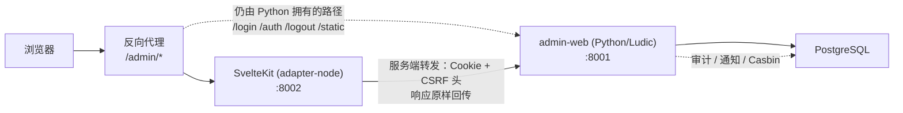

# V4.10：后台前端迁移到 SvelteKit

> 状态：**进行中**。阶段 A（骨架 + 概览页）与阶段 B（五个资源页）已完成并
> 通过真实联调；访问控制页、画布 island 化与 Ludic 下线仍待推进。旧 Ludic
> 页面通过「未匹配路由回退」与新前端共存。

## 目标

1. 把后台前端从 **Ludic SSR + 手写 DOM JS** 换成**最新版本 SvelteKit**，得到
   组件化、类型安全、可测试的前端；
2. **鉴权与授权的实现保持唯一**：会话 Cookie、CSRF 三方校验、Casbin 页面/组件
   权限、审计、Argon2 超级管理员口令**全部留在 Python 侧**，不重写、不平移；
3. 浏览器**永远不直连** Python 管理端，所有请求经 SvelteKit 服务端转发，
   Cookie 与 CSRF 令牌不出服务端；
4. 前端**可增量替换**：旧 Ludic 页面与新 SvelteKit 页面在同一套反向代理下
   并存，任何阶段都能单独回退；
5. 沉淀可复用的前端基线（主题令牌、i18n、组件、测试脚手架），后续新页面
   优先在 SvelteKit 里写。

## 现状盘点（迁移前）

| 维度 | 数字 | 说明 |
| --- | --- | --- |
| 后台路由 | 迁移前 65 条 / 现在 95 条路由条目 | 71 个唯一路径；新增的都是 `/admin/api/*` 管理面 JSON API |
| 页面注册项 | 14 个 | `services/admin_web/registry.py` 里的 `code=`，是 Casbin 页面权限的最小单位 |
| view 模块 | 31 个文件 | `services/admin_web/views/` |
| 静态样式 | `admin.css` 66 KB / **283 个 CSS 变量** | 三套主题（fluent / cloudscape / material）× 明暗 × 密度，靠变量覆盖实现 |
| 静态脚本 | `admin-ui.js` **67 KB** | 负责导航、弹窗、行内编辑、主题切换、**运行时 DOM 遍历翻译** |
| 画布脚本 | `workflow-editor.js` 66 KB + `workflow-editor-core.js` 11 KB | 拖拽画布编排器（V4.8） |
| 前端测试 | 5 个 JS 测试文件 | `tests/js/admin-ui-*.test.mjs`、`tests/js/workflow-editor*.test.mjs`；页面结构另有 34 份 Python 快照 |

结论很清楚：**页面骨架是服务端渲染的（这部分不差），真正拖后腿的是两段
手写 DOM JS 和一份 283 变量的巨型样式表**——它们没有类型、没有组件边界、
每次改主题都要同时改 CSS 和 JS。

## 为什么换

| 现状痛点 | 换掉之后 |
| --- | --- |
| `admin-ui.js` 靠 `querySelector` + 事件委托绑一切，行内编辑靠克隆 DOM 节点 | Svelte 5 runes 组件，状态是显式声明的，DOM 由框架管 |
| i18n 是**渲染后**遍历文本节点替换，文案出现在属性里就漏翻，SSR 与客户端首帧可能不一致 | 构建期固定的双语词典，文案在组件里显式取用，漏翻在类型检查里就暴露 |
| 283 个 CSS 变量靠运行时 `data-*` 属性切换，改主题要同时改 CSS 和 JS | Tailwind 4 + 语义令牌（`bg-surface`、`text-ink-muted`），主题切换只换令牌值 |
| 页面结构回归靠 Python 快照比对元素树 | 组件级单测（Vitest）+ 端到端（Playwright），失败信息直接指向组件 |
| 渲染逻辑与业务语义混在 view 里 | 视图函数只负责取数，交互归前端，业务语义留在 Python |

## 技术选型

| 层 | 选择 | 为什么 |
| --- | --- | --- |
| 框架 | **SvelteKit 3.4** + **Svelte 5.59**（runes） | 官方最新稳定版；runes 让组件状态显式化，与「不用第二份实现」的原则一致；SSR 保留，首页仍可服务端渲染 |
| 语言 | **TypeScript 6.0**（`strict`） | 前后端契约（`/admin/api/*` 的响应形状）用类型锁住 |
| 构建 | **Vite 8** | SvelteKit 官方默认 |
| 适配器 | **`@sveltejs/adapter-node` 6** | 与 Python admin-web 同为长驻 Node/ASGI 服务，可用同一套反向代理与健康检查约定 |
| 样式 | **Tailwind CSS 4**（`@tailwindcss/vite`） | 用语义令牌代替 283 个手写变量；Tailwind 4 的 `@theme` 让令牌在编译期可用 |
| 校验 | **Zod 4** | 在**服务端**校验 Python 返回的载荷形状，脏数据不至于变成运行时 undefined |
| 单测 | **Vitest 5** | 与 Vite 同源，配置成本最低 |
| 端到端 | **Playwright 1.65** | 迁移阶段的验收主力（登录 → 页面 → 写操作） |
| 运行时 | **Node 24 LTS** | 与现有部署机的运行基线一致 |

**不引入**的：UI 组件库（shadcn/Melt/Bits UI）、状态管理库（Svelte 的
runes + 路由 load 已经够）、i18n 框架（词典只有几十条，自建反而更清楚）、
CSS-in-JS。理由：后台是**内部工具**，不是产品站；组件库带来的抽象成本大于
收益，而令牌与组件我们自己完全掌控。

## 目标架构



### 职责边界（关键约束）

| 能力 | 归属 | 说明 |
| --- | --- | --- |
| 会话 Cookie 的签发与校验 | **Python** | SvelteKit 只透传，不解析、不复制 |
| CSRF 令牌 | **Python** | 令牌随会话摘要下发；写操作由服务端放进 `X-CSRF-Token` 头，浏览器全程不参与 |
| Casbin 页面/组件权限判定 | **Python** | 前端拿到的「可见页面/组件」只是**渲染依据**，不是授权依据 |
| Argon2 超级管理员口令 | **Python** | 不动 |
| 审计写入与通知 | **Python** | 不动 |
| 渲染、交互、表单状态 | **SvelteKit** | 这一层本来就是可以重写的 |
| 业务语义与数据写入 | **Python** | SvelteKit 不直连数据库 |

**为什么不让 SvelteKit 直连数据库**：那意味着在 TypeScript 里重建 Argon2
校验、Casbin 策略求值与审计事务——安全关键逻辑出现第二份实现，两边的判定
迟早不一致。这类不一致不会报错，只会**在某个生产时刻放行一个不该放行的请求**。

### 路径归属

`src/hooks.server.ts` 里用一张显式的表划分归属：

| 路径前缀 | 归属 | 处理 |
| --- | --- | --- |
| `/admin/login`、`/admin/login/super-admin`、`/admin/auth/*`、`/admin/logout`、`/admin/static/*`、`/admin/super-admin/forgot-password`、`/admin/super-admin/reset-my-password` | Python | 反向代理，`Set-Cookie` 原样带回浏览器 |
| `/admin/api/*` | Python | SvelteKit 服务端转发（浏览器不直连） |
| `/admin/health` | SvelteKit | 本容器存活探针，**不查后端**——admin-web 与数据库各有自己的探针，故障时能分清是谁挂了 |
| 其余 `/admin/*` | SvelteKit | 逐步替换旧 Ludic 页面 |

代理时必须透传的响应头：`content-type`、`location`、`cache-control`、
`x-frame-options`、`referrer-policy`，以及**全部** `set-cookie`（用
`headers.getSetCookie()` 逐条 append，不能用逗号拼接——`Set-Cookie` 里有
`Expires` 属性，逗号会被误解析）。

### Origin 的分层校验

浏览器发来的 `Origin` 是**公网地址**（如 `https://admin.example.com`），
Python 管理端看到的是**内部地址**（`http://admin-web:8001`）。Python 的
`origin_ok()` 拿 Origin 和「自己的 scheme://Host」比，于是代理过来的请求
一律被判成跨源，登录直接失败。

**解法是分层校验，而不是放行**：

|  hops | 谁校验 | 怎么校验 |
| --- | --- | --- |
| 浏览器 → SvelteKit | SvelteKit | Origin 必须等于应用自身 origin（`event.url.origin`，受 SvelteKit 的 `ORIGIN` 环境变量影响，因此 HTTPS 终止在反代后面也能算对），或落在 `ADMIN_ALLOWED_ORIGINS` 白名单里；不通过就 **403** |
| SvelteKit → Python | Python | SvelteKit 把 `Origin` **重写成 Python 自己的 origin**，Python 的同源检查因此照常通过 |

这样两侧的检查都不失效：**Python 继续防「绕过本服务直连管理端」**（那条路径
上 Origin 仍是浏览器真实地址，与 Host 对不上，照样被拒），**SvelteKit 负责
防跨源写入**。

重写 Origin 不是「关掉检查」——它把检查挪到了真正能判断浏览器来源的那一层。

### 未匹配路由回退给 Python

`hooks.server.ts` 用 `event.route.id === null` 判断「这个路径没有匹配到
SvelteKit 路由」，并把它**回退给 Python**。这是增量迁移的关键：已迁的页面
由 SvelteKit 渲染，没迁的仍然走旧的 Ludic 页面，用户看不出区别；某个页面
随时可以切回去（删掉对应路由即回到旧实现）。

**这个回退让「鉴权在哪」变得重要**：Python 独占的路径（`/login`、`/auth`、
`/logout`、`/static`）直接代理，其余路径由 SvelteKit 负责会话装载，未登录
时 302 回登录页。

## 管理面 JSON API 契约

Python 侧新增 `services/admin_web/routes/api.py`，与页面路由共用同一套
`with_auth` / CSRF / Casbin 判定，只在两点上不同：返回 JSON；未认证返回
**401**（不是 302，跳转由前端决定）。

| 端点 | 方法 | 返回 | 说明 |
| --- | --- | --- | --- |
| `/admin/api/session` | GET | `AdminSession` | 身份、界面偏好、可见页面列表、CSRF 令牌；带 `?page=dashboard` 时附带该页的组件可见性 |
| `/admin/api/dashboard` | GET | `DashboardPayload` | 概览页指标 + 组件可见性；页面无权时返回 **404** |
| `/admin/api/agents` | GET / POST | `AgentListPayload` / `{item}` | 列表（附表单候选项）与创建 |
| `/admin/api/agents/{code}` | GET / PUT / DELETE | `{item}` / `{ok}` | 读取、更新（部分更新）、删除 |
| `/admin/api/agents/{code}/toggle` | POST | `{item}` | 启停 |
| `/admin/api/llm` | GET / POST | `LlmListPayload` / `{item}` | 列表与新增 |
| `/admin/api/llm/{code}` | GET / PUT / DELETE | `{item}` / `{ok}` | 读取、更新、删除 |
| `/admin/api/llm/{code}/toggle` | POST | `{item}` | 启停 |
| `/admin/api/skills` | GET / POST | `SkillListPayload` / `{item}` | 列表与创建；更新会先写修订快照 |
| `/admin/api/skills/{code}` | GET / PUT | `{item}` | 读取与更新（部分更新） |
| `/admin/api/skills/{code}/archive` | POST | `{ok}` | 归档（软删，保留资源与修订） |
| `/admin/api/mcp` | GET / POST | `McpListPayload` / `{item}` | 列表与注册 |
| `/admin/api/mcp/{code}` | GET / PUT / DELETE | `{item}` / `{ok}` | 读取、更新、删除 |
| `/admin/api/mcp/{code}/toggle` | POST | `{item}` | 启停 |
| `/admin/api/mcp/{code}/refresh` | POST | `{ok, imported}` | 刷新工具目录；**用另一个组件权限** `mcp_refresh` |
| `/admin/api/workflows` | GET / POST | `WorkflowListPayload` / `{item}` | 列表与新建（按初始 Agent 生成单节点骨架） |
| `/admin/api/workflows/{code}` | GET / PUT | `{item}` | 读取（含图定义）与更新**元信息** |
| `/admin/api/workflows/{code}/toggle` | POST | `{item}` | 启停 |

**图定义只有画布这一条写路径**：`/admin/api/workflows/{code}` 的 PUT **只改名称
与描述**，传入的 `definition` 会被忽略。画布（`workflow-editor.js`）仍由 Python
渲染，通过「未匹配路由回退」接入——这是阶段 D「不重写画布」的落地方式。

**写操作的三条约定**：

1. **CSRF 令牌走 `X-CSRF-Token` 头**，不是表单字段——服务端持有会话 Cookie
   与令牌，浏览器全程不参与；
2. **失败是 JSON**，形状固定为
   `{"code": "<机器码>", "message": "<给人看的话>", "fieldErrors": {"<字段>": "<提示>"}}`。
   机器码稳定（`duplicate` / `missing` / `invalid_csrf` / `not_found` /
   `invalid_input` / `agent_in_use` / `endpoint_in_use`），前端据此决定是提示、
   重试还是跳登录页，不去解析文案——文案会改，机器码不会；
3. **HTTP 状态码有语义**：401 未登录、403 CSRF/同源失败、404 不存在或无权、
   409 冲突（重复、仍被引用）、400 字段不合法。

未认证统一返回：

```json
{ "code": "unauthorized", "message": "请先登录管理后台" }
```

**401 而不是 403**：未登录与无权限是两回事。前端拿到 401 就跳登录页；拿到
404 就渲染「无权访问」。混成一种会让越权用户看到登录页，从而误以为会话过期。

## 前端目录结构

```
services/admin_ui/
├── src/
│   ├── app.css                  # Tailwind 4 入口 + 主题令牌
│   ├── app.d.ts                 # App.Locals.session
│   ├── hooks.server.ts          # 归属路由 + 会话装载 + 未登录 302
│   ├── lib/
│   │   ├── i18n.ts              # 双语词典（构建期固定）
│   │   ├── paths.ts             # ADMIN_BASE / pythonPath()
│   │   ├── types.ts             # 与 /admin/api/* 对齐的类型
│   │   ├── components/          # Sidebar / Topbar / MetricCard ...
│   │   └── server/
│   │       ├── admin-api.ts     # 转发客户端（服务端专用）
│   │       └── config.ts        # ADMIN_API_BASE_URL
│   └── routes/
│       ├── +layout.server.ts    # 装载会话 + 语言
│       ├── +layout.svelte       # 侧边栏 + 顶栏外壳
│       ├── +page.server.ts      # 概览页数据
│       ├── +page.svelte         # 概览页
│       └── locale/+server.ts    # 语言切换
└── tests/i18n.test.ts
```

`#lib/*` 别名通过 `package.json` 的 `imports` 字段映射到 `./src/lib/*.js`
（TypeScript 对 `imports` 的解析要求显式 `.js` 后缀）。**Svelte 组件与静态
资源不走别名**，用相对路径引入——`imports` 字段的通配符映射会把
`Topbar.svelte` 拼成 `Topbar.svelte.js`，解析不到。

## i18n

废弃「运行时遍历 DOM 替换文本」的旧实现，改为 `src/lib/i18n.ts` 里的
**构建期固定双语词典**：

- 键集合由 `MessageKey` 联合类型约束，新增文案必须同时补齐两种语言，否则
  **编译不过**；
- 两种语言的键集合一致性由单元测试断言（`tests/i18n.test.ts`）；
- 导航标题来自服务端注册表（`registry.py`），前端词典只做**兜底翻译**——
  管理员自定义的标题永远以服务端为准。

语言存 Cookie，读取时经 `normalizeLocale()` 归一（`zh` / `zh-Hans-CN` 都落到
`zh-CN`，其余落到 `en`）。

## 主题与设计令牌

三套主题（fluent / cloudscape / material）× 明暗 × 密度，保留 V4.7 定下的
语义，但**表达方式换了**：从 283 个手写 CSS 变量，改成 Tailwind 4
`@theme` 里的一组语义令牌。

| 令牌 | 用途 |
| --- | --- |
| `bg-surface` / `bg-surface-raised` | 卡片与容器底色 |
| `text-ink` / `text-ink-muted` | 主文字与次要文字 |
| `border-line` | 分隔线与描边 |
| `rounded-card` | 统一圆角 |

主题切换通过 `<html data-admin-theme="…" data-admin-color-mode="…" data-admin-density="…">`
实现——与旧实现一致，所以 V4.7 的偏好设置页语义不变，切换是**纯 CSS**，
不需要重新渲染。

## 迁移阶段

| 阶段 | 内容 | 验收 |
| --- | --- | --- |
| **A** | 工程骨架、主题令牌、i18n 词典、会话装载、概览页 | ✅ 已完成：类型检查、单测、构建全绿；与真实 admin-web 联调通过（登录 → 会话 → 概览 → 旧页面回退） |
| **B** | 资源页：agents / skills / mcp / llm / workflows 列表与表单 | ✅ 已完成：五页全部迁移，各带管理面 JSON API、页面与浏览器实测读写 |
| **C** | 访问控制页：access/pages、access/components、access/roles、access/mappings、platform-admins、preferences、audit | 同上；**Casbin 判定仍只在 Python 侧** |
| **D** | workflow 画布 | 现有 `workflow-editor.js` 作为 island 保留，不重写；只把外壳换成 SvelteKit |
| **E** | 下线 Ludic 视图层 | 删除 `services/admin_web/views/` 的页面渲染与 `admin-ui.js`；`admin-web` 收敛为纯 JSON API + 登录页 |

**阶段 D 明确不重写画布**：`workflow-editor.js` 有 66 KB + 11 KB core，
配套 3 个测试文件与一套实时校验协议。重写它是一次独立的、需要独立验收的
大工程，与「换前端框架」是两件事。把它作为 island 保留，是**当前阶段风险
最低的选择**。

## 测试策略

| 层 | 工具 | 覆盖 |
| --- | --- | --- |
| 类型 | `tsc --noEmit` + `svelte-check` | 组件 props、载荷形状、导入路径 |
| 单元 | Vitest | 词典一致性、`normalizeLocale`、路径工具、载荷解析（Zod） |
| 端到端 | Playwright | 登录 → 导航 → 读写表单 → 权限拒绝路径 |
| 回归（Python） | pytest | 既有 1215 项 + 34 份页面快照；新增 `/admin/api/*` 已进路由快照 |

旧页面在阶段 A–D 期间**继续由 Python 渲染**，旧快照继续有效；到阶段 E 才
删除对应快照。

## 部署形态

新增一个容器，与 `admin-web` 并列：

```yaml
admin-ui:
  build:
    context: ../services/admin_ui
    dockerfile: Dockerfile
  image: webagent/admin-ui:0.1.0
  environment:
    ADMIN_API_BASE_URL: http://admin-web:8001
    PORT: "8002"
```

反向代理把 `/admin/*` 交给 `admin-ui`，而 `admin-ui` 再按上面的归属表把
仍属 Python 的路径转发回 `admin-web`（容器内网络）。

`ADMIN_API_BASE_URL` 是**容器启动时**注入的，不是构建期声明的变量——所以
服务端代码直接读 `process.env`，不用 `$app/env/private`（后者只导出构建期
在 `.env` 里声明过的变量名，生命周期不匹配）。

## 风险与回退

| 风险 | 缓解 | 回退 |
| --- | --- | --- |
| 新旧前端同时在线，导航链接指错 | 链接统一由服务端 `routeKey` 下发；SvelteKit 侧指向 Python 页面的链接走 `pythonPath()` 单一入口 | 关闭 `admin-ui` 容器，反向代理直指 `admin-web` |
| Cookie / CSRF 转发丢失导致登录态失效 | 代理显式透传 `set-cookie`；Playwright 登录态用例作为阶段门禁 | 同上 |
| Casbin 判定出现第二份实现 | 前端**只**消费「可见页面/组件」，写操作一律回 Python 判定 | 删除前端判定分支（当前没有） |
| 主题切换后对比度失衡 | 三套主题的令牌值集中在一处，逐个主题做视觉比对 | 保留旧 `admin.css` 与旧页面 |
| 画布重写引入回归 | 阶段 D 不重写 | — |
| 阶段 E 删除 Ludic 后无法快速回退 | 删除前打 tag，回退用 tag 重建镜像 | 用 tag 重建 |

## 明确不做

| 不做 | 原因 |
| --- | --- |
| 不在 TypeScript 里重建 Argon2 / Casbin / 审计 | 安全关键逻辑的第二份实现必然漂移 |
| 不让浏览器直连 Python 管理端 | 会话令牌与 CSRF 令牌会暴露在浏览器里 |
| 不在本版重写 workflow 画布 | 与「换前端框架」是两件事，风险独立 |
| 不引入 UI 组件库 / 状态管理库 / i18n 框架 | 内部工具，抽象成本大于收益 |
| 不做 SvelteKit 与 Python 之间的 gRPC / protobuf | 多一跳序列化换不来可读性；HTTP + JSON 足够 |
| 不做前端端的数据库直连 | 同「不重建鉴权」 |

## 验证

- 前端：`tsc --noEmit` 0 错误、`svelte-check` 0 错误 0 警告、`vitest` 7 项通过、
  `vite build` 通过；
- Python：全量 `1215 passed / 30 skipped`；管理端快照 34 项通过（路由快照已
  纳入 `/admin/api/session` 与 `/admin/api/dashboard`）；
- 本版尚未做端到端联调（需要与真实 admin-web 一起起容器），列为 TODO。

上面三项里需要继续做的部分只在 [TODO](../../docs/design/TODO.md) 维护，
本节不另立清单。