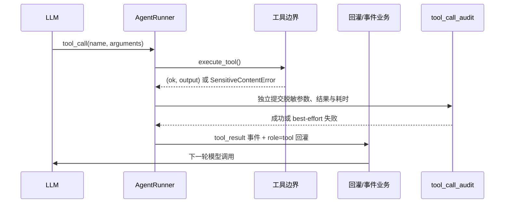

# V4.3：工具调用审计与结果持久化

## 目标

工具执行结果原先只存在于两条短生命周期路径：

- SSE `tool_result` 事件的截断摘要；
- `run_step.output_json.toolCalls` 中的调用清单。

这不足以回答“模型实际传了什么参数、工具返回了什么、失败属于哪一类、耗时
多少”。V4.3 增加独立审计账本，为每次工具执行留下可查询、脱敏、限长且自动
过期的运行事实，同时不改变工具回灌给模型的业务流程。

## 非目标

- 不把审计账本当作 SSE 回放源。事件续传仍由 `run_event` 与 Redis Stream 负责。
- 不把审计账本当作节点结果快照。节点输出仍由 `run_step` 与最终消息负责。
- 不承诺无限保存任意大小结果；默认可回看结果上限为 64K 字符。
- 不建立 PostgreSQL 实机依赖。本版本只要求现有 MySQL、Redis 与 SQLite
  测试链路通过。

## 设计原则

1. **业务优先**：审计写入是 best-effort。写审计失败只记日志，不改变工具的
   `(ok, output)`，也不把成功工具伪装成失败。
2. **立即落账**：每次工具执行后独立提交，不等待 run 收尾。后续节点崩溃或
   进程重启时，已经发生的调用仍可查询。
3. **默认脱敏**：参数和结果在入库前处理常见 API Key、Bearer 头、密码、口令、
   Cookie 与 URL 内嵌凭据。
4. **敏感输出不落正文**：工具结果触发 `SensitiveContentError` 时只记录
   `failure_type=sensitive_content`、状态和耗时，不保存命中文本。
5. **摘要与详情分离**：列表接口只返回元数据；结果正文只在管理员单条详情中读取。
6. **有限保留**：记录包含 `expires_at`，启动时清理一次，运行期周期清理。

## 数据模型

新增 `tool_call_audit` 表。它不是业务外键关系的一部分，避免工具配置或 run
清理时把已经发生的审计事实一起级联删除。

| 字段 | 用途 |
| --- | --- |
| `id` | 自增记录 id |
| `run_id` / `node_id` | 关联一次 run 与工作流节点 |
| `tool_call_id` | 模型声明的调用 id；允许为空或重复，不建唯一约束 |
| `tool_name` / `source` / `server` | 工具名与来源 `builtin`、`skill`、`mcp` |
| `arguments_json` | 脱敏后的结构化参数 |
| `arguments_redacted` / `arguments_chars` | 是否脱敏、原始参数字符数 |
| `result_text` | 脱敏且不超过保存上限的结果正文 |
| `result_chars` / `result_bytes` | 服务侧收到的原始字符数、实际保存字节数 |
| `result_truncated` | 是否因审计保存上限而截断 |
| `ok` / `failure_type` | 成功状态与稳定失败分类 |
| `duration_ms` | 工具执行耗时，不含审计写入耗时 |
| `created_at` / `expires_at` | 生成时间与保留期截止时间 |

索引：

- `idx_tool_audit_run_created(run_id, created_at)`：按 run 回看；
- `idx_tool_audit_expires(expires_at)`：小批量过期清理。

## 执行流程



审计写入发生在截断模型回灌文本之前。模型仍只得到
`TOOL_RESULT_MAX_CHARS` 限制后的结果；管理员可查看受
`TOOL_AUDIT_MAX_RESULT_CHARS` 约束的更完整版本。

## 脱敏规则

参数按结构递归处理，字段名大小写、下划线与连字符会归一化后判断。至少覆盖：

- `api_key` / `apiKey` / `x-api-key`；
- `access_token`、`refresh_token`、普通 `token`；
- `password`、`secret`、`client_secret`；
- `authorization`、`bearer`、`cookie`；
- 字符串中的 `sk-...`、Bearer 值和 URL 内嵌用户名密码。

发生任何脱敏时置 `arguments_redacted=true`。命中敏感词过滤工具输出时，
`result_text` 必须为空，不能用错误摘要、截断片段或事件载荷替代。

## 结果持久化与清理

| 路径 | 内容 | 上限 | 生命周期 |
| --- | --- | --- | --- |
| 模型回灌 | `role=tool.content` | `TOOL_RESULT_MAX_CHARS`，默认 4000 字符 | 当前模型调用上下文 |
| SSE `tool_result` | 工具、状态、200 字符摘要 | 固定摘要 | 事件保留期 |
| `run_step.output_json` | 调用清单与轮次 | 节点结果体积 | run 数据生命周期 |
| `tool_call_audit` | 脱敏参数和可回看结果 | 默认 65536 字符 | 默认 30 天 |

清理策略：

- 启动时执行一次过期清理；
- 默认每 3600 秒巡检；
- 每批最多处理 `TOOL_AUDIT_CLEANUP_SCAN_LIMIT` 条，默认 1000；
- 清理失败只记日志，下一周期继续。

## 管理员接口

接口统一要求 `X-Admin-Key`。环境引导 Key 或数据库管理员 Key 均可认证，查询结果按
管理员租户过滤；未认证时 fail-closed 返回 401。身份、角色和租户模型由 V4.4 补齐。

```text
GET /api/tool-audits?run_id=...&node_id=...&tool_name=...&source=...&ok=...
GET /api/tool-audits/{id}
```

- 列表按 id 倒序，`limit` 最大 200，返回总数和摘要；
- `source` 只接受 `builtin`、`skill`、`mcp`；
- 详情返回脱敏参数 `arguments` 和受保存上限约束的 `result`；
- 列表永不返回 `result` 正文，避免一次分页把大量长结果加载进内存。

## 配置

```dotenv
TOOL_AUDIT_ENABLED=true
TOOL_AUDIT_MAX_RESULT_CHARS=65536
TOOL_AUDIT_RETENTION_DAYS=30
TOOL_AUDIT_CLEANUP_ENABLED=true
TOOL_AUDIT_CLEANUP_INTERVAL_SEC=3600
TOOL_AUDIT_CLEANUP_SCAN_LIMIT=1000
```

关闭审计只停止新写入与周期清理，不会改变工具执行、模型回灌或 SSE 事件。

## 故障语义

| 场景 | 工具结果 | 审计 | run |
| --- | --- | --- | --- |
| 审计正常写入 | 原样返回 | 完整脱敏记录 | 按工具结果继续 |
| 审计数据库短暂不可用 | 原样返回 | 缺失并记日志 | 不受影响 |
| 工具返回业务错误 | `(false, 错误文本)` | 脱敏结果 + `tool_error` | 回灌模型自行纠正 |
| 工具敏感输出被拦截 | 不返回 | 正文为空 + `sensitive_content` | 节点按敏感内容失败 |
| 工具未预期异常 | 原异常上抛 | 脱敏异常摘要 + `exception:<type>` | 保持原异常语义 |

## 验收

- SQLite 单元测试覆盖参数脱敏、结果脱敏、限长、敏感正文保护、审计故障降级、
  管理员鉴权、过滤查询和过期清理。
- 迁移测试同时验证 SQLite 表结构与 MySQL、PostgreSQL 方言 DDL。
- 工具端到端测试执行真实内置工具，并断言 run、node、tool_call 关联。
- 本地 Docker 使用真实 MySQL 完成迁移、内置工具、Skill 与 MCP 调用验证，
  Redis 只做事件链路回归；不启动 PG。

2026-11-05 本地 Docker 实测结果：

| 项 | 结果 |
| --- | --- |
| MySQL 8.4 全量迁移 | 迁移到 `c9d4e2a71f60`，`tool_call_audit` 与两个索引已创建 |
| 健康检查 | MySQL / Redis 均为 `ok`，应用与其他容器通过同一 Docker 网络通信 |
| 内置工具 | `calc` 成功，原文 `60`，来源 `builtin` |
| Skill 资源工具 | `skill_resource` 成功，来源 `skill` |
| stdio MCP 工具 | `mcp__auditmcp__echo` 成功，来源 `mcp`，server 关联 `auditmcp` |
| 管理员查询 | 按 run 查询到 1 条摘要，详情返回脱敏参数与预期结果 |
| 保留期清理 | 插入 1 条已过期记录后重启应用，过期项为 0，正常项仍为 3 |
| 资源限制 | MySQL、Redis、应用容器均设置独立内存上限；未启动 PostgreSQL |

普通 `redis:7.4-alpine` 不包含 RediSearch。审批 checkpointer 需要 `FT.*`
命令，因此本次审计验证显式关闭 checkpoint，只验证 Redis 事件 Stream 与
Pub/Sub 链路；审批链路仍由独立测试覆盖。

## 已知边界

- 超大工具结果仍不会进入数据库；如需无限归档应接对象存储，并单独定义签名
  下载、生命周期和租户边界。
- V4.4 起支持数据库管理员、`viewer/operator/admin` 角色和租户过滤。环境
  `ADMIN_KEY` 仅作为首次引导与应急入口；审计查询记录具体认证主体。
- 审计记录通过 id 关联但不建外键，因此硬删除 run 后仍可能保留到过期；这是
  审计事实优先于业务实体生命周期的有意取舍。
