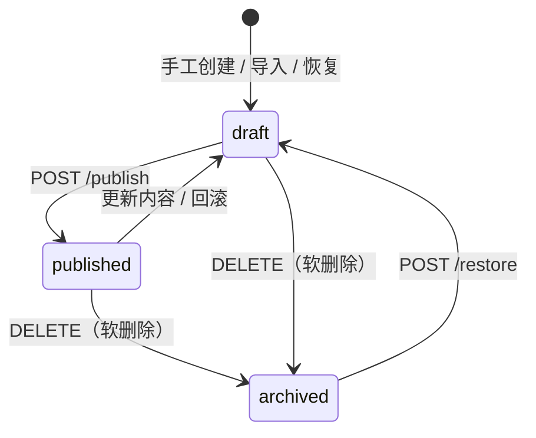

# V4.4：治理、审批与运行时收口

> 状态：已实现。PostgreSQL 18.6 已在测试机完成迁移、并发、故障恢复、备份恢复和 PgBouncer 事务池验证。V4.4 留下的物理备份、seccomp、共享准入、成本指标与 MCP OAuth 缺口已由 [V4.5](v4.5-recovery-governance.md) 关闭。

## 目标

V4.4 把此前分散在 V4、V4.1、V4.3 和 studio 边界中的生产缺口收口为一组可测试行为：

- 管理员不再是所有操作共享的一把固定字符串；
- Skill 从“可编辑配置”升级为有草稿、发布、归档、恢复和回滚的生命周期对象；
- 审批支持多人会签、去重投票和可配置超时；
- 工具拥有部署级执行策略，工具调用具备链路追踪和租户审计；
- MCP 不再只支持 tools，而是覆盖 resources、templates 和 prompts；
- isolated 执行的取消、镜像摘要校验、配额与指标形成完整闭环。

本版本不引入 Kubernetes，也不把 studio 变成业务服务。PostgreSQL 测试环境现已部署，
并已通过本版本要求的数据库运行期验收。

## 身份、角色与租户

### 认证模型

`ADMIN_KEY` 只保留为环境引导密钥和应急入口。日常管理员保存在 `admin_user`：

| 字段 | 说明 |
| --- | --- |
| `username` | 稳定用户名 |
| `api_key_hash` | 使用部署 `SECRET_KEY` 做 HMAC-SHA256，数据库不保存明文 |
| `api_key_hint` | 仅用于界面辨识 |
| `tenant_id` | 配置和审计隔离边界 |
| `role` | `viewer`、`operator`、`admin` |
| `enabled` / `version` | 停用与乐观并发控制 |

创建和轮换接口只在响应中返回一次明文 Key。管理员不能停用、降级或删除当前登录的自己；
引导 Key 不写入数据库。

### 权限

| 角色 | 读取 | Skill/MCP/LLM 写入 | 管理员管理 |
| --- | --- | --- | --- |
| `viewer` | 本租户只读 | 否 | 否 |
| `operator` | 本租户只读 | 是 | 否 |
| `admin` | 本租户只读 | 是 | 本租户用户管理 |

环境引导主体属于 `default` 租户的 `admin`，用于创建第一个数据库管理员。
Agent、Skill 和工具审计均带租户维度；公开只读路径默认使用 `default` 租户。

## Skill 生命周期

Skill 状态为 `draft`、`published` 或 `archived`：



关键语义：

- 只有 `published + enabled` 的技能注入 Agent；
- 被 Agent 绑定的 Skill 不允许归档；
- 归档保留资源和修订，恢复后先回到草稿；
- 更新正文或资源产生新版本号与内容指纹；
- 修订资源保存原始字节，文本与二进制都能逐字节回滚；
- 回滚后的内容回到草稿，必须重新发布才能影响线上模型。

## 审批会签与超时

审批节点新增：

```json
{
  "requiredApprovals": 2,
  "approvalTimeoutSec": 300,
  "approvalTimeoutAction": "reject"
}
```

投票写入 `run_approval_vote`，同一审批人对同一审批单只能投一票。计数更新使用数据库
原子自增，禁止“先读计数再写回”，避免并发投票丢票。

- 任一反对票立即驳回；
- 赞成票达到 `requiredApprovals` 才通过；
- 未达到终态时审批保持 `pending`，图不得恢复；
- 超时默认 `reject`，可选 `approve`，属于显式运维策略；
- 超时巡检通过条件更新原子收口，已被人工决策的审批不会被覆盖；
- 事件新增 `approval_vote` 与 `approval_timeout`。

## 工具策略与审计

Agent 的 `tool_policy` 支持按工具覆盖：

```json
{
  "default": {
    "enabled": true,
    "max_concurrency": 4,
    "timeout_sec": 60
  },
  "web_search": {
    "enabled": false
  }
}
```

执行器在构造模型工具 schema 时排除禁用工具，并在执行前再次拦截伪造调用。同一轮多个
工具调用可并行，同名工具由信号量限流；超时转换为工具失败结果回灌模型。

`tool_call_audit` 保存调用来源、租户、脱敏参数、限长结果、失败分类和耗时。审计写入
best-effort，不改变工具业务结果；列表接口只返回摘要，详情按租户和角色读取。

## MCP 能力

MCP 管理器除工具外支持：

- `resources/list` 与分页；
- `resources/templates/list`；
- `resources/read`；
- `prompts/list` 与 `prompts/get`；
- `notifications/tools/list_changed` 触发的后台快照刷新；
- stdio 与 Streamable HTTP 的真实协议测试。

资源模板字段按 SDK 的 `resource_templates` 读取。stdio 子进程向 stdout 写普通日志时，
SDK 会忽略非 JSON 行；测试验证的是协议流仍可继续，而不是承诺日志完全消失。

在线状态明确标记 `online_scope=instance`。多实例共享健康状态尚未实现，不在控制台伪装成集群共识。

## Trace、取消与指标

### Trace

服务接收合法 W3C `traceparent`，为工具调用生成 child span，并在响应回写当前上下文。
字段沿以下链路传播：

```text
web_agent -> studio(gRPC) -> dispatcher(HTTP) -> sandbox payload/labels/stderr
```

非法输入会被替换为新 trace，不能把任意文本注入日志或标签。

### 取消

dispatcher 增加：

```text
POST /v1/exec/{execution_id}/cancel
```

studio RPC 被取消后调用该接口；DockerBackend 对正在运行的容器执行 `remove(force=True)`。
真 Docker 验收用例要求取消后 5 秒内看不到对应容器。

### 指标

studio 新增：

- `sandbox_start_seconds`；
- `sandbox_total{phase,profile}`；
- `sandbox_duration_seconds`。

这补齐容器启动、阶段变化和执行耗时观测。V4.5 继续加入 cgroup CPU 秒、内存峰值
与按部署费率计算的估算成本。

### 配额与供应链

- studio 支持 `STUDIO_SKILL_QUOTAS=skill-a=1,skill-b=2`；
- `STUDIO_SKILL_QUEUE` 限制每个技能等待队列；
- isolated 档保留独立实例池；
- dispatcher 默认 `DISPATCHER_REQUIRE_DIGEST=true`；
- 本地 compose 因构建产物是 tag，显式设为 false；生产必须改为 digest 并保持校验开启。

这解决单技能挤占实例的问题。V4.5 将 fast/isolated 的租户与技能租约统一到共享
dispatcher；镜像在启动期预检和拉取，但预启动容器池仍不在已实现范围内。

## 数据库与缓存

新增表：

- `admin_user`；
- `skill_revision_resource`；
- `run_approval_vote`。

迁移链：

- `0009_tool_call_audit`；
- `0010_admin_tenant_skill`；
- `0011_approval_quorum_timeout`。

Redis 启动探测区分普通事件总线和 LangGraph checkpointer：普通 Redis 可承载 Pub/Sub 与
Stream；启用 checkpoint 时必须提供 RediSearch `FT.*` 命令，否则启动失败并给出明确配置
提示。

## 替换与移除

| 旧口径 | V4.4 口径 |
| --- | --- |
| 所有管理写操作共用一个固定 Key | 引导 Key + 数据库管理员、角色、租户、轮换和停用 |
| Skill 删除后内容不可恢复 | 软删除、恢复、修订资源完整回滚 |
| 二进制资源只保存摘要 | 原始字节进入修订资源表 |
| 单审批人直接决定 | 会签、去重投票、原子计数和超时策略 |
| 工具白名单只能全开或全关 | 工具级启用、并发与超时策略 |
| MCP 只接 tools | tools、resources、templates、prompts、目录变更通知 |
| 在线状态暗示为集群状态 | 明确 `online_scope=instance` |
| 取消只停在 studio RPC | 传播到 dispatcher 并强删沙箱 |
| 镜像目录允许可变 tag | 生产默认强制 `image@sha256:<digest>` |
| 只有实例级并发 | 增加静态技能级并发与等待队列 |

## 验证

自动化覆盖：

- 管理员角色、租户、Key 轮换和自锁保护；
- Skill 草稿、发布、归档、恢复、正文与二进制回滚；
- 审批会签、重复投票、不同审批人并发投票、超时收口；
- 工具策略、并发、超时、伪造禁用工具拦截和租户审计；
- MCP resources/prompts、Streamable HTTP、目录变更通知与 stdio stdout 污染；
- Trace 传播、迁移表结构、Redis 能力探测；
- dispatcher 取消路由、studio 取消与 sandbox 五秒删除真实 Docker 用例；
- sandbox 指标与技能级队列。

2026-11-05 在 `root@100.114.77.27`（约 1.8 GB 内存、无 AVX 的 x86_64 主机）
完成以下 Docker 验收：

- 当前镜像内全量测试：`739 passed, 19 skipped`；19 个默认跳过项均为真实 Redis
  用例，随后以 `REDIS_URL` 指向测试机 Redis 单独运行，结果为 `19 passed`；
- PostgreSQL 18.6 直连全量测试同为 `739 passed, 19 skipped`；并发审批、连接池
  饱和、应用启动恢复、数据库进程崩溃恢复和 `pg_dump -Fc` 恢复到新库均通过；
- PgBouncer 1.18 事务池专用并发与审批用例 `16 passed`；全量测试
  `739 passed, 19 skipped`。8 个客户端复用同一物理后端；一个连接保留事务时，
  另一连接仍在 0.049 秒内完成查询；两个实例并发执行迁移都成功且最终 head 为
  `8a5e3d0c2b11`；
- 真实 Docker sandbox：只读 rootfs、非 root、无网络、无宿主凭据，以及取消后
  5 秒内删除容器；
- 真实 MySQL：从空库执行全部 11 个 Alembic 迁移，到达 head
  `8a5e3d0c2b11`；
- 真实 MiniMax：数据库配置中不可达的高优先级接口自动切到 MiniMax，消息与
  Skill 版本正常落库；真实 stdio MCP 的 tools、resources、prompts 可读；
- 密钥边界：接口响应不回显 Key，数据库只保存密文，应用日志未出现 API Key。

真实链路烟测可重复执行 `python scripts/smoke_runtime.py`。PgBouncer 全量回归
首次暴露 psycopg 自动 prepared statement 与事务池的命名冲突，已在提交
`6f47188` 中关闭 PostgreSQL 连接的自动预编译，并由定向及全量用例复验。

## 已知边界

- PostgreSQL 的逻辑备份恢复已验证；物理全量/增量备份与 PITR 已在 V4.5 补齐；
- PgBouncer 事务池必须使用数据库/角色级 UTC，并忽略应用下发的 `options` 启动参数。
  psycopg 自动 prepared statement 已关闭，不能重新开启；
- 自定义 seccomp、共享 dispatcher 配额、真实资源成本和 MCP 机器身份已在 V4.5 实现；
- MCP 跨实例在线状态与预启动容器池仍未实现；
- 超大工具结果对象存储归档未实现。

以上均只保留在 [TODO](../../docs/design/TODO.md) 中。
