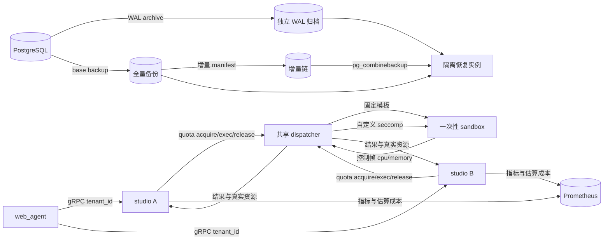

# V4.5：备份恢复、沙箱准入与成本闭环

> 状态：已实现。本版本关闭 V4.4 遗留的五项 P1：PostgreSQL 全量/增量备份与
> PITR、自定义 seccomp、跨 studio 配额与预算、真实沙箱资源指标、MCP OAuth
> 机器身份。

## 版本目标

V4.5 处理生产上线前的控制面缺口：

- 数据库不只“能备份”，还要能从前置全量、增量链和时间点目标恢复；
- 容器沙箱不只依赖运行时默认策略，而要加载项目自有的 syscall 拒绝清单；
- 多个 studio 实例不能各自计数后共同超额，租户和技能准入必须落到共享控制面；
- 成本不能只写一个耗时字段，CPU、内存峰值、启动开销必须有真实来源；
- 远程 MCP 不应要求调用方预先粘贴短期 access token。

本版本继续只使用 Docker Compose 和单机 Docker 后端，不引入 Kubernetes，也不把
PostgreSQL 或 MCP 纳入沙箱。

## 恢复与准入架构

### 权威边界

| 数据/状态 | 权威来源 | 说明 |
| --- | --- | --- |
| 租户/技能并发与活动预算 | 一个共享 dispatcher 的进程内租约表 | 多 studio 共享该 dispatcher 时一致 |
| 沙箱 CPU/内存 | sandbox 容器 cgroup | 不可读时退回 POSIX `getrusage` |
| 成本 | studio 按部署费率计算的估算值 | 不是云厂商账单 |
| 数据库恢复点 | 全量/增量备份 + 独立 WAL 归档 | 恢复演练必须使用隔离实例 |
| MCP access token | 数据库 Fernet 密文 | 明文只在进程内短暂存在 |

“跨实例配额”指多个 studio 实例共享一个 dispatcher，不是多个独立 dispatcher
之间共享。若未来拆成多个 dispatcher，必须把准入状态迁到 Redis/数据库等共享后端。

## PostgreSQL 备份与 PITR

`deploy/pitr-archive-wal.sh` 作为 `archive_command`：

- 只用完整 WAL 文件名，拒绝路径和隐藏名；
- 先写同目录临时文件，再原子 `mv`；
- PostgreSQL 重试同一 WAL 时，内容一致直接成功；
- 同名但内容不同明确失败，让 PostgreSQL 保留原 WAL 并告警，不能静默覆盖。

`scripts/pg_pitr.py` 提供三个动作：

1. `basebackup` 创建全量备份；
2. `basebackup --reference <上一备份>` 在 PostgreSQL 17+ 创建增量备份；
3. `restore --incremental ...` 用 `pg_combinebackup` 重建全量目录，再写入
   `recovery.signal`、`restore_command` 和 `recovery_target_time`。

脚本只接受带 `.webagent-basebackup` 标记的备份目录，拒绝把普通数据目录误当备份。
恢复目标必须为空；恢复动作默认 `promote`。增量备份需要 `summarize_wal=on`，
长增量链必须定期由新全量备份截断。

## 自定义 seccomp

dispatcher 从 `DISPATCHER_SECCOMP_PROFILE` 读取策略，并把 JSON 以
`seccomp=<inline-json>` 放进 Docker API 的 `security_opt`。路径只在 dispatcher
容器内有意义，不能直接交给 Docker daemon；daemon 会把路径当 JSON 并拒绝启动。

- `DISPATCHER_REQUIRE_CUSTOM_SECCOMP=true` 是默认值；
- profile 缺失、不可读或顶层形状非法时启动失败；
- `no-new-privileges`、capabilities 全 drop、非 root、只读 rootfs、禁网继续同时生效；
- 当前策略是拒绝高风险 syscall 的 allow-by-default 清单，不是通用白名单；
- 真实 Docker 验收确认 `ptrace(PTRACE_TRACEME)` 返回 `EPERM`。

## 共享准入与资源成本

studio 在 fast 和 isolated 两条路径进入执行前，都携带 `tenant_id` 向 dispatcher
申请租约；执行结束或异常时释放。租约带 TTL，studio 崩溃不会永久占额。

dispatcher 支持四类限制：

- `DISPATCHER_TENANT_QUOTAS`：租户并发；
- `DISPATCHER_SKILL_QUOTAS`：跨租户的技能并发；
- `DISPATCHER_TENANT_BUDGETS`：租户同时在跑的估算成本；
- `DISPATCHER_SKILL_BUDGETS`：技能同时在跑的估算成本。

超限返回 HTTP 429 / gRPC `RESOURCE_EXHAUSTED`，错误码为 `quota_exceeded`。
这里的预算是“活动租约占用上限”，不是累计月度账单。累计账单需要把每次真实资源
消耗写入独立计费账本，属于后续扩展。

启动期镜像预热会检查目录内镜像是否存在，缺失时拉取；这消除首个请求的镜像拉取
成本，但不预先启动容器。真正预启动容器池需要处理逐请求只读 payload 挂载和回收，
不在本版本伪装成已实现。

sandbox runner 读取 cgroup v2 的 `cpu.stat`、`memory.peak`，兼容 cgroup v1；
无 cgroup 时退回 POSIX `getrusage`。字段沿控制帧、dispatcher HTTP、studio proto
和 web_agent 客户端全链路返回。

studio 指标新增：

- `sandbox_cpu_seconds`；
- `sandbox_peak_memory_bytes`；
- `studio_estimated_cost_total{tenant,skill,profile}`。

估算费率由 `STUDIO_CPU_SECOND_RATE`、`STUDIO_MEMORY_GIB_SECOND_RATE` 和
`STUDIO_SANDBOX_START_RATE` 配置。费率为零时资源仍然采集，估算成本为零。

## MCP OAuth 机器身份

远程 MCP 新增 `oauth_client_credentials`：

- 标准 form token 请求，支持可选 refresh token；
- client secret、access token、refresh token 全部 Fernet 加密；
- 到期前 30 秒主动刷新，同一服务器使用单飞锁；
- token endpoint 和撤销 endpoint 同时经过 SSRF 校验；
- 撤销先尽力通知 RFC 7009 端点，再清本地令牌；
- MCP 服务器、工具快照和工具执行都按租户查询。

当前只支持机器身份，不实现浏览器 authorization-code 授权页面。需要用户委托的
MCP 服务应在后续版本接入独立 OAuth 前端，而不是在后端伪造同意流程。

## 数据库迁移

`0012_mcp_oauth_tenant.py` 增加：

- `mcp_server.tenant_id`；
- `auth_type` 和 OAuth endpoint/client/scope/resource 字段；
- client secret、access/refresh token 密文字段与到期时间；
- `(tenant_id, enabled)` 索引。

迁移 revision 为 `b7c1d9e2f4a6`。

## 替换与移除

| 旧口径 | V4.5 口径 | 原因 |
| --- | --- | --- |
| 只有逻辑备份 | 全量/增量物理备份 + WAL 归档 + PITR | 逻辑恢复不能提供时间点目标 |
| 依赖 `backup_label` 判断备份 | 使用工具写入的 `.webagent-basebackup` 标记 | 现代 `pg_basebackup` 不一定保留该文件 |
| 运行时默认 seccomp | dispatcher 内联自定义 profile，缺失时 fail-closed | 固定安全基线 |
| 各 studio 实例本地配额 | 共享 dispatcher 租约 | 防止多实例共同超额 |
| TODO 中的“预热池” | 镜像预检/拉取预热 | 尚未实现预启动容器池，不能过度声明 |
| 只有耗时指标 | cgroup CPU、内存峰值、启动耗时与估算成本 | 支撑容量与成本观测 |
| MCP 只支持静态 header | OAuth client credentials + refresh/revoke | 避免人工分发短期令牌 |

## 验证记录

2026-11-06 在 `root@100.114.77.27`（约 1.8 GB 内存）验证：

- P1 定向套件 `113 passed`，包含真实 Docker sandbox、自定义 seccomp 的
  `ptrace=EPERM`、取消和结果控制帧；
- PostgreSQL 18.6 独立临时库执行完整迁移链到 `b7c1d9e2f4a6`，相关套件
  `156 passed`；
- 两个 studio 容器共用一个 dispatcher，相同租户/技能并发上限为 1 时，第二个
  studio 收到 `RESOURCE_EXHAUSTED: quota_exceeded`；
- 同一真实 sandbox 返回约 `0.145` CPU 秒和约 `19.5 MB` 内存峰值；
- PostgreSQL 实际完成全量备份、增量备份、WAL 切换、`pg_combinebackup` 和按时间
  恢复；恢复结果包含目标前数据，排除目标后数据，实例已解除 recovery。

全量回归结果记录在 [设计总目录](../README.md) 的当前状态中。
