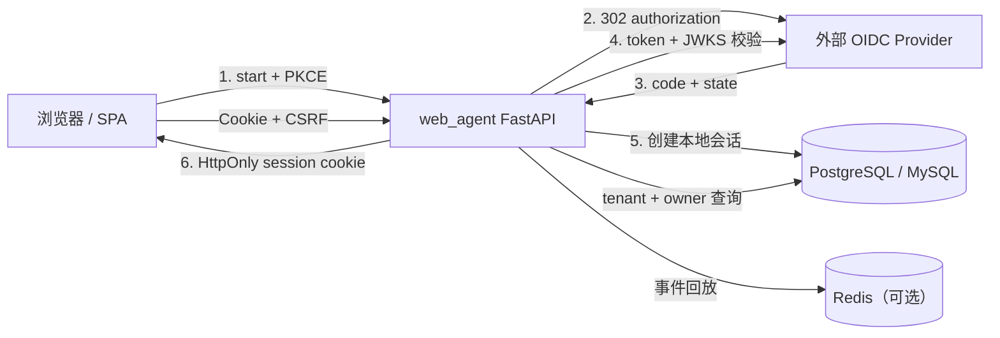

# V4.6：用户 OAuth 登录与会话历史归属

> 状态：方案设计完成，尚未实现。

## 目标

V4.6 为终端用户增加登录能力，并把会话、消息、run、审批和 SSE 续传统一收口到
已经认证的用户。核心目标不是“能拿到一个 OAuth token”，而是建立下面这条不可绕过的
信任链：

```text
外部 OIDC issuer + subject
  -> user_identity
  -> 本地不可变 app_user.id
  -> 服务端 user_session
  -> conversation.owner_user_id
  -> message / run / approval / SSE
```

完成后：

- 浏览器只持有 HttpOnly 服务端会话 Cookie，不保存长期 OAuth access token；
- 新建会话不再接受客户端提交 `user_id`；
- 认证身份使用 `(issuer, subject)`，会话归属使用不可变的本地 user ID；
- username、phone、email 是可读用户资料；username 可修改，但三者都不承担认证或外键职责；
- 用户只能列出、读取、续聊、取消、审批和订阅自己的会话；
- 跨用户访问统一返回 404，不泄露资源是否存在；
- 同一身份在多个服务实例登录后，历史和会话状态一致；
- 管理员身份与终端用户身份继续分开，避免“登录用户天然成为管理员”。

第一版建议以 OIDC 为主，支持 Microsoft Entra、Keycloak、Authing 等标准供应商。
若供应商没有 username claim，例如常见的 Google 和 GitHub 登录，由系统生成本地
`user_<随机值>` username；不能从其它用户资料推导账号。adapter 不改变本地身份和会话模型。

## 现有问题

当前 `conversation.user_id` 是客户端提交的 64 字符字符串：

- `/api/conversations` 可以指定任意 `user_id`；
- `/api/conversations?user_id=...` 可以枚举别人的历史；
- 按 `conversation_id` 读取消息、活动 run、发送消息时没有校验归属；
- `/api/runs/{id}`、取消、审批和 SSE ticket 也没有统一校验会话归属；
- 前端固定写 `demo`，SSE ticket 也由客户端决定 `user_id`；
- 现有 `admin_user` 只解决后台管理密钥，不适合作为最终用户身份表。

因此不能只在现有接口前加一个 OAuth 登录按钮。必须同时改数据模型和所有资源查询边界。

## 总体架构



### 为什么使用 BFF + Cookie

前端和 API 同源部署时，推荐后端代理登录流程：

- authorization code 只到后端；
- ID token 在后端验签，不交给前端决定用户是谁；
- OAuth access/refresh token 默认不落库、不下发浏览器；
- 浏览器只持有随机、HttpOnly、Secure 的本地会话 Cookie；
- 服务端会话可以立即撤销，比长期 JWT 更适合 Web 会话。

当前登录只用于本地身份认证，不需要调用供应商 API。如果未来需要访问第三方资源，应另建
加密的用户授权凭据表，并明确 scope、刷新和撤销，不能混同登录会话。

## 身份模型

### 表结构

建议新增以下表：

| 表 | 关键字段 | 说明 |
| --- | --- | --- |
| `oauth_provider` | `tenant_id`, `code`, `kind`, `issuer`, `discovery_url`, `client_id`, `client_secret_cipher`, `scopes`, `username_claim`, `auto_create`, `enabled` | 登录供应商配置；secret 加密 |
| `oauth_login_attempt` | `state_hash`, `browser_binding_hash`, `nonce_hash`, `code_verifier_cipher`, `provider_id`, `return_to`, `expires_at`, `consumed_at` | 一次性登录事务，防 state 重放与 login CSRF |
| `app_user` | `id`, `tenant_id`, `username`, `phone`, `phone_verified`, `email`, `email_verified`, `status`, 时间戳 | 本地终端用户；认证主键不可变 |
| `user_identity` | `user_id`, `provider_id`, `issuer`, `subject`, 时间戳 | 外部身份绑定；认证权威主键 |
| `user_session` | `token_hash`, `user_id`, `csrf_hash`, `idle_expires_at`, `absolute_expires_at`, `revoked_at`, `auth_at` | 服务端会话 |

约束与索引：

- `oauth_provider`：`UNIQUE(tenant_id, code)`；
- `app_user`：ID 为服务端生成且不可变的随机不透明值，推荐 UUIDv7；存储可统一为
  `VARCHAR(36)`，保持 PostgreSQL、MySQL、SQLite 一致；
- `app_user`：`UNIQUE(tenant_id, username)`；username 统一规范化为小写，长度和字符集在
  创建/登录/改名时校验；
- `app_user.email`：可空，统一 trim + 小写；非空时 `UNIQUE(tenant_id, email)`；
- `app_user.phone`：可空，统一规范化为 E.164；非空时 `UNIQUE(tenant_id, phone)`；
- `email_verified` / `phone_verified` 只记录验证事实，空值统一存 NULL，不存空字符串；
- `user_identity`：`UNIQUE(issuer, subject)`；
- `user_identity`：`UNIQUE(user_id, provider_id)`，同一供应商默认只绑一个身份；
- `user_session.token_hash` 唯一；数据库只保存 Cookie token 的 SHA-256；
- `app_user` 不做硬删除，停用使用 `status=disabled`；
- 除 username、phone、email 及两个验证状态外，**不保存头像、显示名等额外资料**。

### 身份绑定规则

1. 登录身份的主键是 `(issuer, subject)`，不是 username；
2. username 从 provider 配置的 `username_claim` 读取，默认使用
   `preferred_username`，不读取其它 claim 来推导 username；
3. 第一次登录可按供应商的 `auto_create` 创建本地用户和不可变 user ID；
4. provider 不提供可用 username claim 时生成 `user_<12位随机字符>`；生成后检查租户内
   唯一性，冲突则重新生成；
5. provider 提供的 username 已被其他用户占用时不自动合并，返回
   `username_conflict`，由管理员显式处理或预创建身份映射；
6. 已存在的 `(issuer, subject)` 直接映射到原用户，不因 provider 更新 username 而
   自动改名；
7. 本地 username 允许用户或管理员修改；修改只更新 `app_user.username`，不修改 user ID、
   会话归属或历史；
8. username 被释放后可以被新用户使用；旧历史仍属于原 user ID，新用户名不会因此获得旧历史；
9. OIDC 配置可请求 `email`、`phone` scope；对应 claim 缺失时 phone/email 保持 NULL，
   不阻塞登录，也不能从其它 claim 猜测；
10. phone/email 不用于判断账号是否相同；相同 phone/email 的其它 subject 不自动合并；
11. 首次登录可以为空 phone/email 填入 provider 值；已有非空值默认不被后续登录静默覆盖；
12. 主动绑定新供应商必须已经登录，并通过当前会话二次确认；
13. 管理员和终端用户是两条认证链，username 相同也不会自动授予管理员角色。

conversation 使用内部 `owner_user_id` 关联。该字段永远不是 username：用户名可变，
认证 subject 只在 provider 范围内稳定，只有本地 user ID 同时满足“稳定、租户内唯一、
可安全做外键”三个条件。API 展示 username/phone/email，但三者都不能作为认证参数。

## OAuth/OIDC 流程

### 1. 发起登录

`POST /api/auth/oauth/{provider}/start`

输入：

```json
{
  "return_to": "/"
}
```

服务端：

1. 读取启用且属于目标租户的 provider；
2. 生成高熵 `state`、`nonce` 和 PKCE `code_verifier/code_challenge`；
3. 将 state/browser binding/nonce 的 hash 和加密后的 verifier 写入
   `oauth_login_attempt`；
4. 设置短期 HttpOnly `__Host-wa_oauth_state` Cookie，其随机值只保存 hash 到数据库；
5. `return_to` 只接受站内相对路径，拒绝绝对 URL 和 `//host`；
6. 返回授权 URL，或直接 302 到 provider。

授权参数至少包含：

```text
response_type=code
client_id=...
redirect_uri=https://app.example.com/api/auth/oauth/{provider}/callback
scope=openid profile email phone
state=...
nonce=...
code_challenge=...
code_challenge_method=S256
```

### 2. 回调

`GET /api/auth/oauth/{provider}/callback?code=...&state=...`

服务端必须按顺序完成：

1. state 存在、未过期、未消费，且与 provider 匹配；
2. callback 携带的 state 与 `__Host-wa_oauth_state` Cookie 必须同时匹配同一登录事务，
   防止攻击者把自己的 callback 塞给另一个浏览器造成 login CSRF；
3. 用 code + PKCE verifier 在 token endpoint 换 token；
4. 获取并缓存 provider JWKS，验证 ID token 签名；
5. 严格校验 `iss`、`aud`、`azp`、`exp`、`nbf`、`iat` 和 `nonce`；
6. 允许 30–60 秒时钟偏差，超过范围失败；
7. 取 `(issuer, sub)` 查找或创建 `user_identity + app_user`；
8. 新用户从 provider 配置的 username claim 取得 username；缺失时生成随机本地
   username；已存在 identity 不自动改名；
9. 读取可选的 email/phone claim，规范化并记录对应 verified 状态；
10. 用户被停用时拒绝登录；
11. 创建本地 `user_session`，把一次性 login attempt 标记为已消费；
12. 清除 state Cookie，设置会话 Cookie 后 302 到经校验的 `return_to`。

回调失败统一跳转到前端登录错误页，查询参数只放稳定错误码，不放 code、token、
provider 原始错误正文或第三方用户资料。

### 三种标识的职责

| 标识 | 是否可变 | 是否对外展示 | 用途 |
| --- | --- | --- | --- |
| `(issuer, subject)` | 由 provider 决定，理论稳定 | 否 | 判断“是不是同一外部身份” |
| `app_user.id` | 不可变 | 技术接口可选 | 会话、身份、session 外键 |
| `username` | 可修改 | 是 | 用户可读名称、管理检索和展示 |

### 3. 会话

推荐 Cookie：

```text
__Host-wa_session=<256-bit random>; HttpOnly; Secure; SameSite=Lax; Path=/
__Host-wa_csrf=<256-bit random>; Secure; SameSite=Strict; Path=/
```

本地开发可用非 `Secure` cookie，但生产禁止关闭。会话策略建议：

- 空闲超时：30 分钟；
- 绝对超时：12 小时；
- 滑动空闲时间最多每 5 分钟写一次数据库，避免每个读请求产生一次会话更新；
- 登录成功、权限变化后轮换 session token 与 CSRF token；
- `POST /api/auth/logout` 只撤销当前会话；
- `POST /api/auth/logout-all` 撤销该用户全部会话；
- 每次认证按 token hash 查会话，并校验用户状态和过期时间；
- 多实例共同使用数据库作为会话权威；Redis 只能做短 TTL 缓存或撤销通知。

所有修改数据的请求要求 `X-CSRF-Token`。浏览器从非 HttpOnly 的
`__Host-wa_csrf` Cookie 读取原值，服务端保存它的 hash 并要求 header 与当前 session
记录匹配；登出时同时清除两个 Cookie。`SameSite=Lax` 是纵深防御，不是 CSRF 的唯一防线。

### 4. API 与 SSE

新增认证依赖：

- `CurrentUserDep`：必须登录，否则 401 `login_required`；
- `CurrentTenant`：从已认证用户读取，不信任请求体；
- `AdminDep`：继续只用于后台管理；
- `OwnerOrAdminDep`：仅用于明确的管理员排障接口，并写审计。

`POST /api/auth/sse-ticket` 必须：

- 从当前用户会话签发；
- 要求绑定 `run_id`；
- 先验证 run 所属 conversation 属于当前用户；
- ticket payload 使用本地 `user_id + tenant_id + run_id`；
- 流接口除验 ticket 外，再查一次数据库归属，防止会话被迁移或 ticket 被重放；
- 长连接在心跳周期按限频策略复核 session/user 状态，登出后最多一个心跳周期内断开。

## 会话历史归属

### conversation 表

迁移后目标字段：

| 字段 | 作用 |
| --- | --- |
| `tenant_id` | 租户隔离，创建时从当前用户派生 |
| `owner_user_id` | 本地 `app_user` 外键，创建时从当前用户派生 |
| `session_id` | 继续作为不透明公开标识，不承载身份 |
| `workflow_id` | 会话绑定的编排 |

现有 `conversation.user_id` 不直接改成新用户账号：

- 旧值可能是 `demo`、`u1`、`anonymous` 或测试数据，无法证明真实性；
- 自动把 `demo` 绑定到第一位 OAuth 用户会制造历史劫持；
- 建议保留一版 `legacy_user_id` 字段用于迁移审计，但业务接口不再读写它；
- 新字段 `owner_user_id` 初始 nullable，供迁移期使用；存量历史保持无主，只允许管理员
  通过显式映射脚本认领；
- 完成迁移和存量处置后，再把 `owner_user_id` 改为非空并删除 legacy 字段。

建议索引：

```text
(tenant_id, owner_user_id, updated_at, id)
UNIQUE(tenant_id, session_id)
```

`message`、`run`、`run_event`、`run_approval` 不重复保存 owner。它们统一通过
`run -> conversation` 或 `message -> conversation` 派生归属，避免同一会话出现两个不同
owner 的不一致数据。

### 查询规则

Repository 不再提供“先按 id 取出，再在路由里判断”的默认方法，而是提供带主体的方法：

```python
get_for_user(db, conversation_id, tenant_id, user_id)
get_by_session_for_user(db, session_id, tenant_id, user_id)
lock_for_user(db, conversation_id, tenant_id, user_id)
list_for_user(db, tenant_id, user_id, cursor, limit)
```

SQL 条件必须同时包含：

```sql
tenant_id = :tenant_id
AND owner_user_id = :user_id
```

不属于当前用户的资源统一返回 404，不返回 403，避免攻击者通过状态码枚举会话 ID。

当前 `session_id` 如果仍是全局唯一，应迁移为 `(tenant_id, session_id)` 唯一。这样不同
租户即使生成相同公开标识也不会互相阻塞或泄露存在性。

### 对外字段

- `ConversationCreate` 删除 `user_id`；
- `SendMessageIn` 删除 `user_id`；
- `ConversationOut` 不再向普通用户暴露 owner；
- `GET /api/conversations` 不再接受 `user_id` 查询参数；
- `GET /api/conversations/by-session/{id}` 只查当前用户；
- 消息、active-run、run detail、取消、审批、SSE ticket 全部复用同一个 ownership
  检查，不允许各路由各写一套。

## API 权限矩阵

| 路径 | 身份要求 | 说明 |
| --- | --- | --- |
| `GET /api/health` | 公开 | 部署探活 |
| `GET /api/auth/providers` | 公开 | 只返回 code、显示名和 logo，不返回 secret |
| `POST /api/auth/oauth/{provider}/start` | 公开 | 发起登录 |
| `GET /api/auth/oauth/{provider}/callback` | 公开但必须合法 state | 登录回调 |
| `GET /api/auth/me` | 当前用户 | 返回本人 username、phone、email、验证状态与 status；CSRF token 从专用 Cookie 读取 |
| `POST /api/auth/logout` | 当前用户 | 撤销当前会话 |
| `POST /api/auth/sse-ticket` | 当前用户 | 绑定自己拥有的 run |
| `/api/conversations*` | 当前用户 | 全部按 owner 过滤 |
| `/api/runs*` | 当前用户 | 通过 conversation 校验 owner |
| `GET /api/workflows?only_enabled=true` | 当前用户 | 只读取可运行编排 |
| Workflow/Agent/Skill/MCP/管理员写接口 | AdminDep | 继续后台权限 |
| 运维排障读取其他用户历史 | 显式管理员权限 | 必须审计，不能默认开放 |

登录用户不能调用管理写接口，管理员 Key 也不能直接伪装成某位终端用户创建历史。

## 前端改造

前端流程：

1. 启动时请求 `/api/auth/me`；
2. 401 时显示登录页和可用 provider；
3. 点击登录调用 start 接口并跳转 provider；
4. 回调后回到原页面，恢复 `return_to`；
5. 会话 Cookie 自动随同源 API 请求发送；
6. 修改请求自动把 `__Host-wa_csrf` Cookie 值放入 `X-CSRF-Token`；
7. 会话过期时清空页面状态并重新登录；
8. 登出后清理内存中的 run、ticket 和未发送内容；
9. 会话列表只调用 `GET /api/conversations`，不再传 `user_id`；
10. 继续发送 SSE 前重新获取用户绑定 ticket。

浏览器不读取 OAuth access token，也不根据 ID token 自行判断登录成功。用户信息只以
`/api/auth/me` 返回的 username、phone、email 为准，不保存或展示其它第三方资料。

## 多实例与并发

- OAuth login attempt、用户、身份、会话都存数据库，回调可落在任意实例；
- login attempt 的消费使用条件更新，保证只成功一次；
- session 校验以数据库为准，多实例不需要粘性会话；
- SSE 事件仍使用现有 Redis Stream/Pub/Sub；
- 会话撤销可发 Redis 通知清理本地缓存，但缓存失效不能成为唯一撤销手段；
- 用户被停用后，新请求和 SSE ticket 签发立即失败；已经建立的 SSE 最迟在下一次 ticket
  续期时失效。

## 安全边界

| 风险 | 对策 |
| --- | --- |
| 登录 CSRF / state 重放 | 高熵 state、一次性数据库记录、有效期和条件消费 |
| login CSRF | state 与 HttpOnly browser-binding Cookie 双重绑定 |
| code 被截获 | PKCE S256、严格 redirect_uri、禁止 code 落日志 |
| ID token 伪造 | JWKS 验签，严格校验 iss/aud/azp/exp/nonce |
| username 碰撞、重用或改名接管 | `(issuer, subject)` 是认证主键；username 只做展示，不用于登录或 ownership 外键 |
| 会话固定 | 登录后生成全新 session，撤销旧会话 |
| XSS 窃取 token | Cookie HttpOnly；不在 localStorage 保存 OAuth token |
| CSRF 修改数据 | SameSite + CSRF header + Origin 校验 |
| 越权读取历史 | SQL 内 owner/tenant 条件，统一 404 |
| phone/email 泄露 | 只在本人资料和管理员授权接口返回；日志、指标、错误信息不记录原值 |
| phone/email 冲突 | 租户内唯一，冲突不自动合并账号，返回稳定冲突码 |
| 开放重定向 | `return_to` 只允许站内相对路径 |
| SSRF | discovery/JWKS/token endpoint 来自受管 provider 配置，并复用私网地址限制 |
| provider 故障 | 返回稳定错误码；不降级为 username-only 登录 |
| 暴力尝试和资源填充 | 登录 start/callback 限频、attempt 表定期清理、单实例最大 pending attempt |
| 管理员越权查看 | 独立显式权限、审计与最小范围 |
| 用户注销 | 软停用、撤销全部 session；历史按数据保留策略处理 |

## 迁移方案

### 数据库迁移

建议新增 `0013_user_oauth_conversation_owner`：

1. 创建 `oauth_provider`、`oauth_login_attempt`、`app_user`、`user_identity`、
   `user_session`；
2. 给 `conversation` 增加 `tenant_id`，存量填 `default`；
3. 增加 nullable `owner_user_id` 和外键；
4. 把 conversation 的唯一键迁移为 `(tenant_id, session_id)`；
5. 增加 owner 查询索引；
6. 保留旧 `user_id` 一版，供迁移审计，但禁止业务接口继续信任。

后续清理迁移在完成存量映射后再执行：

- 把已确认归属的历史写入 `owner_user_id`；
- 无主历史由管理员归档或按保留策略删除；
- owner 改非空；
- 删除或重命名旧 `user_id` 字段。

### 兼容上线

新增配置：

```dotenv
AUTH_MODE=legacy
USER_SESSION_COOKIE_SECURE=true
USER_SESSION_IDLE_MINUTES=30
USER_SESSION_ABSOLUTE_HOURS=12
OAUTH_STATE_TTL_SECONDS=600
AUTH_DEFAULT_TENANT=default
AUTH_ALLOWED_RETURN_ORIGINS=https://app.example.com
```

`AUTH_MODE`：

- `legacy`：仅开发/迁移期，保留旧行为但记录 deprecation；
- `hybrid`：已登录用户严格按新 owner 规则，旧客户端暂时匿名；
- `required`：生产目标，用户会话接口一律必须登录。

兼容期一旦请求携带登录态，就必须忽略并拒绝客户端 `user_id`，不能允许“用登录态 +
伪造 user_id”绕过。最终版本删除 `legacy`。

## 实施顺序

### Phase 1：身份与会话基础

- 数据表、迁移和 repository；
- OAuth provider 配置与加密 secret；
- Generic OIDC discovery、JWKS、token 校验；
- state/nonce/PKCE；
- 服务端 session、Cookie、CSRF、logout；
- mock OIDC server 与安全单元测试。

### Phase 2：资源归属收口

- `CurrentUserDep` 和统一 ownership helper；
- conversation 创建、列表、按 session 查询、消息、active-run；
- run 详情、消息、取消、审批、SSE ticket/stream；
- 删除客户端 `user_id` 的信任；
- 403/404 语义、跨租户和越权测试。

### Phase 3：前端与运维

- 登录页、回调、会话恢复、登出；
- 401 自动重新登录；
- 历史列表和会话恢复；
- provider 管理、会话撤销、无主历史迁移工具；
- 登录失败、provider 故障和 session 过期的可观测性。

### Phase 4：切换

- 生产切到 `required`；
- 观察 401、state、CSRF、越权和 provider 错误；
- 完成旧历史映射；
- 删除 legacy `user_id` 兼容路径。

## 验收用例

### OAuth 与会话

- state 不匹配、过期、重复使用全部失败；
- PKCE verifier 不匹配失败；
- ID token 签名、iss、aud、exp、nonce 任一不符失败；
- JWKS key rotation 后可刷新并继续登录；
- provider 缺少 username claim 时生成唯一本地 `user_<随机值>`；
- 相同 username 不同 `sub` 不会自动合并；已绑定身份改名后，本地 username 不会自动变化；
- username 修改后，历史、session 和 ownership 不变；
- username 释放并分配给另一个用户后，新用户看不到旧历史；
- email 统一小写、phone 统一 E.164；空字符串落库前转为 NULL；
- email/phone 的 verified 状态只来自可信 claim 或后续显式验证；
- 相同 phone/email 的另一个 subject 不会自动合并，并返回冲突；
- 登录后 session token 轮换，旧 token 失效；
- Cookie 具备 HttpOnly、Secure、SameSite 属性；
- 缺失或错误 CSRF token 的写请求返回 403；
- 登出、全端登出和用户停用后旧会话立即失效；
- 开放重定向和 `javascript:` 等 `return_to` 被拒绝。

### 会话历史隔离

- 用户 A 不能列出、按 session 查、读消息、读 active-run、发消息到用户 B 的会话；
- 用户 A 不能读取、取消、审批或订阅用户 B 的 run；
- 伪造 `user_id` 查询参数或请求体不再影响结果；
- 跨租户相同 username 不能互读；
- 所有越权访问返回 404，不泄露资源是否存在；
- SSE ticket 不能跨用户、跨 run 使用，过期后不能复用；
- 同一用户两个浏览器可看到同一历史，登出只撤销当前会话。

### 多实例与迁移

- 实例 A 发起登录、实例 B 完成回调；
- 实例 A 创建会话、实例 B 列出并续聊；
- 会话撤销在实例 B 的下一次请求立即生效；
- 迁移前历史默认不可被普通用户认领；
- 显式归属映射后只对目标用户可见；
- PostgreSQL、MySQL、SQLite 的迁移与表结构契约一致。

## 明确不做

- 不把 OAuth access token 存进 localStorage；
- 只允许保存 username、phone、email 及验证状态，不保存其它第三方资料；
- 不在日志、指标标签或错误详情中记录完整 phone/email。
- 不按 username 自动合并不同供应商账号；
- 不把 `admin_user` 直接当终端用户表；
- 不让客户端提交 `user_id` 决定会话归属；
- 不用长期 JWT 代替可撤销的服务端会话；
- 不在本次同时实现“用用户 OAuth token 调用第三方业务 API”。
