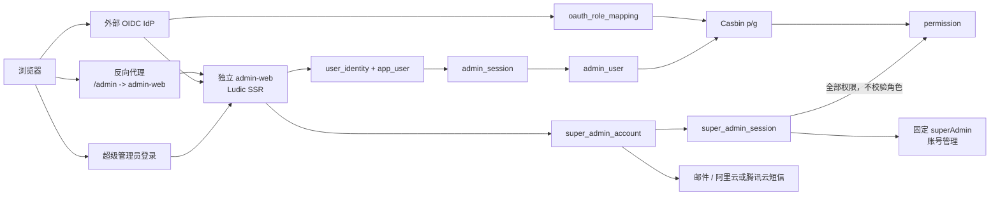

# V4.7：独立 admin-web、Casbin RBAC 与 Ludic SSR

> 状态：独立服务、认证、Casbin、UI 权限、超级管理员、通知、六类业务管理页和
> 客户端管理 API 切换均已落地。旧管理员 API Key 管理栈已退役；剩余生产事项只在
> [设计 TODO](../../docs/design/TODO.md) 跟踪。

## 目标

V4.7 将后台管理员拆成两条认证链：

1. **普通后台管理员**通过 OAuth 登录，角色从 OAuth claim 同步，使用 Casbin RBAC；
2. **平台超级管理员**使用独立账号密码登录，不校验角色，默认拥有全部权限。

其他目标：

- 后台管理员单独保存在 `admin_user`，不混入普通用户业务表；
- 后台是独立 Ludic ASGI 服务并单独运行 `webagent-admin` 容器，不再挂载进客户端进程；
- 客户端前端、用户页面和管理页面代码解耦；两者只共享数据库、身份模型和策略数据；
- 平台超级管理员单独保存在 `super_admin_account`，密码只保存 Argon2id 摘要；
- 后台不兼容旧的 `X-Admin-Key`、旧管理员用户名和 API Key；
- 除平台超级管理员外，后台没有用户名密码登录；
- 平台超级管理员密码不能自定义修改，只能点击随机重置或由定时任务轮换；
- 密码默认 8 位，只由英文字母、数字、下划线 `_` 和 `@` 组成；
- 30 天定时轮换，并通过邮件和短信通知；
- 只有固定账号 `superAdmin` 可以新增、删除平台超级管理员；
- 后台使用 Ludic SSR，支持页面级/组件级权限绑定；
- 提供 Fluent、Cloudscape、Material 三套主题，支持浅色、深色、跟随系统和移动端；
- Casbin 是 OAuth 管理员 RBAC 的唯一策略执行引擎。

## 认证与授权总览



两种管理员主体在 API 中统一成 `AdminPrincipal`：

```text
kind = oauth_admin
  -> active admin_user
  -> Casbin enforce(permission)

kind = platform_super_admin
  -> active super_admin_account
  -> allow all permissions
  -> account-management actions additionally require owner=true
```

平台超级管理员绕过 RBAC，不代表绕过 Session、CSRF、Origin、账号状态、密码有效期和审计。

## 服务与部署边界

### 独立服务

管理后台使用独立 ASGI 入口：

```text
client service:  uvicorn app.main:app --port 8000
admin service:   uvicorn services.admin_web.app:app --port 8001
```

`app.main` 不执行 `app.mount("/admin", ...)`。客户端和后台在代码入口、进程、容器、
依赖、静态资源、健康检查和发布节奏上独立。

反向代理建议：

```text
https://app.example.com/*        -> web_agent:8000
https://app.example.com/admin/*  -> admin-web:8001
```

后台容器接收 `/admin` 路径。OAuth callback 为：

```text
https://app.example.com/admin/auth/oauth/{provider}/callback
```

IdP 的 OAuth client 必须登记这个 redirect URI。后台使用独立的
`__Host-wa_admin_session` 和 `__Host-wa_admin_csrf`，不读取、不覆盖客户端
`__Host-wa_session`。

### 共享边界

可以共享：

- PostgreSQL/MySQL 数据库；
- `app_user`、`user_identity`、OAuth provider 配置；
- Casbin 策略与角色映射；
- `SECRET_KEY` 中的既有加密用途；
- Redis 策略版本通知。

不能共享：

- FastAPI 客户端路由树；
- `web/index.html` 或客户端 static 资源；
- 客户端 Session Cookie；
- 客户端 Nav/组件；
- `app.main` 进程生命周期；
- admin 专用的 Ludic、短信和密码哈希依赖不应被强制装入客户端镜像。

服务间优先通过共享领域包和数据库协作，不能让 admin-web 通过浏览器调用客户端页面接口来
完成管理动作。admin-web 的写操作进入同一领域 service/transaction，保证 Agent、
Workflow、Skill、Casbin 和审计语义一致。

### 容器

新增：

```text
Dockerfile.admin
requirements.admin.txt
deploy/docker-compose.admin.yml
services/admin_web/
```

容器建议：

```yaml
admin-web:
  build:
    context: .
    dockerfile: Dockerfile.admin
  command: uvicorn services.admin_web.app:app --host 0.0.0.0 --port 8001
  expose:
    - "8001"
  environment:
    ADMIN_DATABASE_URL: ${ADMIN_DATABASE_URL}
    ADMIN_REDIS_URL: ${ADMIN_REDIS_URL}
    ADMIN_SECRET_KEY: ${ADMIN_SECRET_KEY}
    ADMIN_PUBLIC_BASE_URL: ${ADMIN_PUBLIC_BASE_URL}
    MAIL_ENABLED: ${MAIL_ENABLED}
    SMS_ENABLED: ${SMS_ENABLED}
    SMS_PROVIDER: ${SMS_PROVIDER}
  healthcheck:
    test: ["CMD", "python", "-m", "scripts.admin_healthcheck"]
```

生产要求：

- admin-web 端口只暴露给反向代理，不直接暴露公网；
- admin 容器不挂载 Docker socket；
- 镜像使用最小基础镜像和非 root 用户；
- admin 与 client 使用独立数据库账号/连接池；client DB 角色无权读取
  `super_admin_account.password_hash`、password reset 和 admin Session；
- 双方共享同一数据库不等于共享全部 SQL 权限，生产必须按表做最小授权；
- admin 与 client 使用独立 Redis ACL/namespace（如已启用）；
- admin-only 加密字段使用 `ADMIN_SECRET_KEY` 或 KMS key id，不复用客户端配置项；
- 数据库迁移由独立发布 Job/命令执行，不在多副本启动时自动跑 Alembic；
- 30 天密码轮换在 admin-web 内运行，但通过数据库租约保证同一时刻只有一个 worker；
- admin-web 可以水平扩容，策略版本、pending reset 和 Session 都在共享数据库；
- 客户端容器不包含 admin 主题、短信 SDK、Argon2 管理页和后台 static；
- 两个服务使用独立 healthcheck、日志标签和发布回滚版本。

## 数据模型

### `admin_user`

`admin_user` 保存 OAuth 后台管理员，普通用户没有 mapped role 时不会创建 active 记录。

| 字段 | 说明 |
| --- | --- |
| `id` | 独立后台管理员 ID |
| `user_id` | 外键指向 `app_user.id`，唯一 |
| `provider_id` | 角色权威 OAuth provider |
| `status` | `active`、`disabled` |
| `last_role_sync_at` | 最近一次角色同步时间 |
| `version` | 乐观并发与缓存版本 |
| `created_at` / `updated_at` | 时间戳 |

约束与规则：

- `UNIQUE(user_id)`：一个 OAuth 人员最多一个后台管理员记录；
- 不保存 username、phone、email、密码、API Key 或 OAuth token；
- `provider_id` 只能有一个角色权威源，其他 provider 登录不能覆盖角色；
- 删除或停用 `app_user` 后，`admin_user` 立即失效；
- 无 mapped role 时记录改为 `disabled`，所有后台请求返回 403。

### `admin_session`

OAuth 后台管理员使用 admin-web 自己的服务端 Session，不复用客户端 `user_session`：

| 字段 | 说明 |
| --- | --- |
| `token_hash` | admin Session Cookie 的 SHA-256 |
| `csrf_hash` | 后台 CSRF token 的 SHA-256 |
| `admin_user_id` | 对应独立后台管理员 |
| `auth_at` | OAuth 登录完成时间 |
| `last_seen_at` | 最近访问时间 |
| `idle_expires_at` / `absolute_expires_at` | 过期时间 |
| `revoked_at` | 撤销时间 |
| `role_sync_version` | 本会话已使用的最新角色同步版本 |

OAuth callback 成功且 `admin_user` 处于 active 后才创建该 Session。角色同步、管理员停用
或显式撤销时，旧 Session 立即失效。客户端用户退出或角色变化不能直接读写 admin Session。

### `super_admin_account`

平台超级管理员使用完全独立的凭证表：

| 字段 | 说明 |
| --- | --- |
| `id` | 不可变管理员 ID |
| `username` | 唯一登录名；固定内置账号为 `superAdmin` |
| `password_hash` | 只保存 Argon2id 摘要，不保存明文 |
| `email` | 密码通知邮箱，唯一、规范化小写 |
| `phone` | 密码通知手机号，唯一、E.164 |
| `status` | `pending_activation`、`active`、`disabled`、`locked` |
| `owner_slot` | 只有固定 `superAdmin` 为 `superAdmin`；唯一约束保证最多一行 |
| `password_rotated_at` | 最近一次成功启用新密码的时间 |
| `password_expires_at` | 固定为成功启用后 30 天 |
| `password_version` | 每次成功启用新密码递增，用于 Compare-and-Set 和 Session 失效 |
| `failed_login_count` | 连续失败计数 |
| `locked_until` | 临时登录锁定时间 |
| `created_by_id` | 创建者；初始账号为 NULL |
| `version` | 乐观并发和会话失效版本 |
| `created_at` / `updated_at` | 时间戳 |

关键约束：

- `UNIQUE(username)`；
- `UNIQUE(email)`；未提供 email 时为 NULL；
- `UNIQUE(phone)`；未提供 phone 时为 NULL；
- `UNIQUE(owner_slot)`，仅 owner 行为 `superAdmin`，普通行均为 NULL；
- owner 账号不可删除、不可停用；
- 密码列只允许写 hash，应用层不提供把任意明文密码写回账户的接口；
- 该表用户不属于 `app_user`、`admin_user` 或 Casbin role；
- 这张表的所有 active 用户都默认拥有全部后台权限；
- 只有 `owner_slot=superAdmin` 可以新增、删除其他平台超级管理员。

### `super_admin_session`

平台超级管理员使用独立服务端 Session：

| 字段 | 说明 |
| --- | --- |
| `token_hash` | 浏览器 Cookie 原值的 SHA-256 |
| `csrf_hash` | CSRF token 的 SHA-256 |
| `account_id` | 对应超级管理员 |
| `auth_at` | 登录时间 |
| `idle_expires_at` / `absolute_expires_at` | 空闲与绝对过期 |
| `revoked_at` | 撤销时间 |
| `password_version` | 登录时的密码版本 |

密码成功重置、定时轮换、账号停用或 owner 删除账号时，立即撤销该账号全部 Session。

### `super_admin_password_reset`

密码重置过程单独保存：

| 字段 | 说明 |
| --- | --- |
| `id` | 重置事务 ID |
| `account_id` | 目标超级管理员 |
| `pending_password_hash` | 待激活新密码的 Argon2id 摘要 |
| `reason` | `manual_reset`、`forgot_password`、`scheduled_rotation` |
| `email_status` / `sms_status` | `pending`、`sent`、`failed`、`skipped` |
| `requested_at` / `expires_at` | 请求时间与待激活期限 |
| `activated_at` | 新密码开始生效的时间 |
| `requested_ip_hash` | 请求来源哈希，不保存完整 IP |
| `failure_code` | 稳定错误分类 |

待激活记录最多保留一个有效项；新请求原子替代旧 pending 记录。表中不保存新密码明文。

### `admin_ui_preference`

OAuth 管理员和平台超级管理员都可以保存 UI 偏好：

| 字段 | 说明 |
| --- | --- |
| `principal_kind` | `oauth_admin` 或 `platform_super_admin` |
| `principal_id` | 对应 `admin_user.id` 或 `super_admin_account.id` |
| `theme` | `fluent`、`cloudscape`、`material` |
| `color_mode` | `light`、`dark`、`system` |
| `density` | `comfortable`、`compact` |
| `sidebar_collapsed` | 桌面端侧栏状态 |
| `version` | 并发控制 |

`(principal_kind, principal_id)` 唯一。

## 平台超级管理员

### 内置账号

迁移过程只内置一个逻辑账号名 `superAdmin`，不写死默认密码。admin-web 首次启动时，
如果不存在 owner，会自动生成并创建该账号。

首次启动行为：

- 当前不存在 owner 账号；
- 生成 8 位随机密码；
- 只把 Argon2id 摘要写入数据库；
- 只在创建成功的那一次启动日志输出明文；
- 已有 owner 时重启不生成、不输出密码；
- 初始化不依赖邮件或短信渠道，避免首次安装被通知配置阻塞。

受控环境可以在首次启动前使用手工初始化命令覆盖自动流程：

```bash
python -m scripts.bootstrap_superadmin \
  --email ops@example.com \
  --phone +8613800138000
```

手工命令通过已配置的通知渠道发送密码；`--stdout` 仍只用于受控本机初始化，不能用于
定时轮换或线上忘记密码流程。

内置账号的用户名固定为 `superAdmin`，但密码每次随机生成，不保存在源码、迁移文件、
环境默认值或 Git 中。

### 全部权限

`super_admin_account` 中的 active 用户：

- 不读取 `admin_user`；
- 不执行 Casbin role policy；
- 默认通过全部 `PermissionDep`；
- 能看到全部已注册管理页面和组件；
- 可以修改 Casbin、页面和组件权限绑定；
- 可以管理 OAuth provider；
- 可以跨租户操作；
- 仍必须通过 Session、CSRF、Origin、密码有效期和审计。

“全部权限”的唯一例外是超级管理员账号表管理：

- 只有 owner=`superAdmin` 可以新增账号；
- 只有 owner 可以删除其他账号；
- owner 不能删除自己；
- owner 不能让 owner 标志转移到 OAuth 管理员或其他账号；
- 其他平台超级管理员不能新增、删除、停用或修改联系人。

### 新增与删除

只有 owner 的 `/admin/platform-admins` 页面提供：

```text
POST /admin/platform-admins
POST /admin/platform-admins/{id}/delete
POST /admin/platform-admins/{id}/disable
```

新增账号要求 username、email、phone 至少一个通知渠道可用。服务端生成初始随机密码并
发送通知；接口不回显密码。删除和停用使用 POST，不接受 GET 修改数据。

owner 账号本身不可删除、不可停用、不可移除 owner 标志。若 owner 丢失通知渠道，只能由
服务器操作员通过受审计的恢复 CLI 更新联系人并重置密码。

### 密码生成

密码由 `secrets` 生成，不来自 `random`：

```text
alphabet = A-Z + a-z + 0-9 + "_" + "@"
length = 8
```

生成器保证至少包含：

- 一个大写英文字母；
- 一个小写英文字母；
- 一个数字；
- 一个 `_` 或 `@`。

剩余位置从完整 alphabet 中随机填充并安全洗牌。不得使用 `uuid4()[:8]`、时间戳、
用户名片段、邮箱片段或可预测自增数。

8 位密码的熵低于当前建议的 12–16 位，因此必须同时具备：

- Argon2id 慢哈希；
- 登录失败限频和短时锁定；
- 重置接口冷却；
- Session 绝对超时；
- 每次重置/轮换撤销旧 Session；
- 审计告警。

后续若允许调整产品参数，建议提升到 12 位以上；本版按明确需求固定为 8 位。

### 不可自定义修改

不提供以下接口：

- `POST /api/auth/password/change`；
- `PUT /api/platform-admins/{id}/password`；
- 前端旧密码/新密码/确认新密码表单；
- 任意把调用方提供字符串写成 `password_hash` 的通用接口。

密码只能由服务端随机生成。用户可操作的动作只有“重置我的密码”；owner 新增账号时也由
服务端生成初始密码。

### 登录

`/admin/login` 展示两块：

- OAuth 管理员登录；
- 平台超级管理员用户名/密码登录。

平台超级管理员登录流程：

1. 校验 Origin；
2. 按 username 和来源 IP 限频；
3. 读取 active 且未过期的 `super_admin_account`；
4. 用 Argon2id 校验密码；
5. 失败时原子增加失败计数，达到阈值设置 `locked_until`；
6. 成功时清零失败计数，创建 `super_admin_session`；
7. 设置独立 HttpOnly Session 与可读 CSRF Cookie；
8. 303 到经过安全校验的 `/admin` 内部路径。

平台超级管理员 Session Cookie 与普通 OAuth 用户 Session Cookie 分开，避免身份主体混淆。
登录页面不显示账号是否存在，统一返回相同错误。

### 定时 30 天轮换

调度器每小时扫描：

```text
password_expires_at <= now
```

每轮执行：

1. 生成新随机密码并计算 Argon2id；
2. 创建 pending reset 记录；
3. 向账号已配置的 email/phone 发送；
4. 至少一个渠道发送成功；
5. 原子启用新 hash、更新 rotated/expires 时间、递增 `password_version`；
6. 撤销该账号全部 Session；
7. 写审计并通知 owner。

如果所有渠道都失败：

- 旧密码不被静默“续期”；
- pending 记录标为 failed 并重试；
- 产生高优先级告警；
- 默认保留 24 小时重试宽限期，期间旧密码仍可用于登录；
- 超过宽限期后账号进入 `locked`，旧密码也不能登录；
- 恢复只能依赖其他 active 平台超级管理员或受审计运维 CLI。

`SUPER_ADMIN_ROTATION_DAYS=30` 和轮换扫描间隔进入配置。修改轮换周期只影响下一次计算，
不能手工把 `password_expires_at` 拖后。

### 忘记密码

超级管理员登录页提供“重置密码”：

1. 调用方输入 username；
2. 无论账号是否存在、渠道是否可用，页面返回统一提示；
3. 只向数据库中已登记的 email/phone 发送，不接受调用方提交新收件地址；
4. 每个账号、IP 和通知目标分别限频；
5. 生成新随机密码，pending 激活；
6. 至少一个渠道发送成功后，启用新 hash 并撤销旧 Session；
7. 旧密码立即失效；
8. 不把新密码显示在浏览器、URL、日志或 API 响应中；
9. 不发“点击链接设置自定义密码”的邮件，因为系统禁止自定义密码。

如果账号没有可用通知渠道，公开重置接口只返回统一失败提示，不泄露具体原因；由 owner
或运维 CLI 处理。

### 邮件和短信通知

所有通知配置只来自环境变量，不进入数据库、Git、API 响应或页面 HTML。

邮件：

```dotenv
MAIL_ENABLED=true
MAIL_PROVIDER=smtp
SMTP_HOST=
SMTP_PORT=587
SMTP_USERNAME=
SMTP_PASSWORD=
SMTP_FROM=
SMTP_USE_TLS=true
```

短信仅支持两家：

```dotenv
SMS_ENABLED=true
SMS_PROVIDER=aliyun

ALIYUN_SMS_ACCESS_KEY_ID=
ALIYUN_SMS_ACCESS_KEY_SECRET=
ALIYUN_SMS_SIGN_NAME=
ALIYUN_SMS_TEMPLATE_CODE=
ALIYUN_SMS_REGION=cn-hangzhou

# SMS_PROVIDER=tencent 时使用
TENCENT_SMS_SECRET_ID=
TENCENT_SMS_SECRET_KEY=
TENCENT_SMS_SDK_APP_ID=
TENCENT_SMS_SIGN_NAME=
TENCENT_SMS_TEMPLATE_ID=
TENCENT_SMS_REGION=ap-guangzhou

SUPER_ADMIN_ROTATION_DAYS=30
SUPER_ADMIN_ROTATION_GRACE_HOURS=24
```

实现边界：

- 阿里云使用阿里云短信 SDK，不自行拼接未经验证的签名协议；
- 腾讯云使用腾讯云官方 Python SDK；
- provider 只允许 `aliyun` 或 `tencent`；
- 短信模板由云厂商预先审核，密码只是模板变量；
- 邮件和短信正文只包含用户名、新随机密码、过期时间和登录地址，不放旧密码；
- 通知不提供“设置新密码”链接，因为系统不允许自定义密码；
- SMTP 使用 TLS，证书校验不可关闭；
- 两个渠道都发送，不因邮件成功而跳过短信；
- 通知日志只记录 message ID、渠道和稳定错误码；
- 密码、手机号、邮箱和云厂商密钥不得进入普通应用日志或审计正文；
- 通知失败可重试，但每次重试必须沿用同一个 pending 密码，不能在用户未收到前不断
  生成多个有效候选。

## OAuth 后台管理员

### 独立保存

OAuth 用户先保存为 `app_user + user_identity`。只有 OAuth role claim 经映射后得到至少
一个后台角色时，才创建或启用独立 `admin_user`。

`admin_user` 只保存管理状态和角色同步信息，不复制普通用户资料。管理员身份使用不可变
`user_id`，不使用 username。

### OAuth 角色同步

`oauth_provider` 增加：

| 字段 | 说明 |
| --- | --- |
| `role_claim` | 角色 claim 名，默认 `groups` |
| `role_claim_required` | claim 缺失时是否立即撤权，默认 true |
| `role_sync_max_age_seconds` | 后台访问允许的角色同步年龄，默认 1800 |

每次 OAuth callback：

1. 验证 ID Token；
2. 查找或创建 `app_user + user_identity`；
3. 如果已有 `admin_user` 且当前 provider 不是角色权威源，只完成身份认证；
4. 读取权威 provider 的角色 claim；
5. 通过 `oauth_role_mapping` 映射为本地 Casbin role；
6. 没有角色时停用 `admin_user`、清除该用户的 `g` 规则；
7. 有角色时创建/启用 `admin_user`；
8. 原子替换该用户在权威 tenant 下的 Casbin `g` 规则；
9. 更新 `last_role_sync_at` 和 `version`；
10. 创建新的 `admin_session` 和 CSRF token，撤销同一登录事务中的旧 Session；
11. 写角色同步审计。

角色同步只适用于 OAuth admin，不适用于 `super_admin_account`。

### 角色来源限制

- 外部角色值必须完全匹配 `oauth_role_mapping.external_value`；
- 不按前缀、正则、username 或邮箱猜测角色；
- 不允许外部 claim 直接映射成平台超级管理员；
- 平台超级管理员不进入 Casbin，也不能由 OAuth 登录流程创建；
- 只有 owner `superAdmin` 可以新增平台超级管理员；
- OAuth admin 永远不能通过角色提升成平台超级管理员。

### 角色同步时效

- 每次 OAuth 登录重新同步；
- `last_role_sync_at` 过期后，后台返回 `401 role_sync_required`；
- SSR 页面重定向到 OAuth，并使用 `prompt=login` 刷新 claim；
- 管理员失权后本地 Casbin 查询立即拒绝，不等待 Session 自然过期；
- 安全敏感部署可以缩短同步有效期，但不能关闭 fail-closed。

## Casbin RBAC

Casbin 是 OAuth 管理员的唯一 RBAC 执行引擎。平台超级管理员不进入 Casbin。

### 请求模型

```python
enforce(
    subject="user:<app_user.id>",
    domain="tenant:<tenant_id>",
    obj="workflow",
    act="write",
)
```

租户请求还要检查 global policy，以支持已配置的全局角色：

```text
enforce(user, tenant:<id>, obj, act)
OR enforce(user, "*", obj, act)
```

没有 Casbin allow 时默认拒绝。

### Casbin 模型

模型文件由代码维护，不允许后台编辑：

```ini
[request_definition]
r = sub, dom, obj, act

[policy_definition]
p = sub, dom, obj, act

[role_definition]
g = _, _, _

[policy_effect]
e = some(where (p.eft == allow))

[matchers]
m = g(r.sub, p.sub, r.dom) && r.dom == p.dom
    && (p.obj == "*" || keyMatch2(r.obj, p.obj))
    && (p.act == "*" || r.act == p.act)
```

约定：

- subject 使用 `user:<app_user.id>`，不用 username；
- domain 使用 `tenant:<tenant_id>` 或 `*`；
- role 使用 `role:<role_code>`；
- 资源使用稳定 object 名；
- 动作使用稳定 action 名；
- 精确匹配优先，`keyMatch2` 只用于明确规划的资源路径；
- Casbin model、内置 policy 和 permission catalog 由代码/迁移管理。

### `casbin_rule`

使用标准表：

| 字段 | 说明 |
| --- | --- |
| `ptype` | `p` 或 `g` |
| `v0`..`v5` | policy/assignment 字段 |

示例：

```text
p, role:viewer,       tenant:default, workflow, read
p, role:operator,     tenant:default, workflow, write
p, role:tenant_admin, tenant:default, llm,      write

g, user:<uuid>, role:operator,     tenant:default
g, user:<uuid>, role:tenant_admin, tenant:default
```

OAuth 管理员没有 Casbin `super_admin` role。平台超级管理员的全权限由独立 Session 主体
直接判定，不写入 `p/g`。

### 角色与权限元数据

#### `rbac_role_definition`

只用于展示和管理，不作为授权判定来源：

| 字段 | 说明 |
| --- | --- |
| `code` | Casbin role code |
| `name` | 可读名称 |
| `scope` | `tenant` 或 `global` |
| `builtin` | 是否内置 |
| `enabled` / `version` | 启停与并发 |

停用角色时必须同时删除对应 `p/g` 规则；只改元数据不会改变权限。

#### `rbac_permission_definition`

| 字段 | 说明 |
| --- | --- |
| `object` / `action` | Casbin 资源与动作 |
| `code` | `object.action` 展示码 |
| `name` / `description` | 可读说明 |
| `risk` | `read`、`write`、`sensitive` |
| `enabled` / `version` | 是否允许新绑定 |

`(object, action)` 唯一。permission 必须存在于代码 catalog 和路由实现中，元数据表不能
制造不存在的权限。

建议权限：

```text
admin.read
admin_ui.read             admin_ui.manage
workflow.read             workflow.write
agent.read                agent.write
skill.read                skill.write
mcp.read                  mcp.write
llm.read                  llm.write
audit.read
admin_user.read           admin_user.manage
casbin.role.read          casbin.role.manage
casbin.mapping.manage
oauth_provider.read       oauth_provider.manage
cross_tenant.read         cross_tenant.manage
platform_admin.owner
```

`platform_admin.owner` 只用于 UI 元数据；真正 owner 判定必须来自
`super_admin_account.owner_slot=superAdmin`，不能由 Casbin 授予。

### OAuth 角色映射

`oauth_role_mapping`：

| 字段 | 说明 |
| --- | --- |
| `provider_id` | OAuth provider |
| `claim_name` | `groups` 或 `roles` |
| `external_value` | 外部组/角色值 |
| `role_code` | 映射到 Casbin role |
| `enabled` / `version` | 启停与并发 |

`(provider_id, claim_name, external_value)` 唯一。外部值区分大小写，不做模糊匹配。

### Casbin 运行与多实例一致性

- 数据库 `casbin_rule` 是策略权威源；
- 每个进程维护只读内存 Enforcer；
- 请求只查内存 Enforcer，不在事件循环使用同步 DB adapter；
- policy 更新先校验 object/action、tenant/domain 和 actor 边界；
- 写库成功后递增 `authz_policy_version`，刷新本实例；
- 多实例优先通过 Redis Pub/Sub 通知失效；
- 未启用 Redis 时短周期检查数据库版本，广播丢失不能永久保留旧权限；
- Casbin 加载失败时所有 OAuth 管理员后台请求 fail-closed；
- 平台超级管理员不依赖 Casbin，但 Casbin 管理页面仍应检测策略服务健康并告警。

如果现有异步 SQLAlchemy 驱动不能直接适配 Casbin adapter，应实现项目内异步策略仓库，
再加载到内存 Enforcer；不能为了复用 adapter 阻塞 FastAPI 事件循环。

## 页面和组件权限

页面和组件由代码注册，数据库只保存稳定 key 和权限绑定。

### `admin_page_definition`

| 字段 | 说明 |
| --- | --- |
| `code` | 稳定页面码 |
| `route_key` | 代码内固定路由处理器 |
| `title` / `nav_group` | 默认展示 |
| `access_mode` | `all` / `any` |
| `enabled` / `version` | 启停与并发 |

### `admin_component_definition`

| 字段 | 说明 |
| --- | --- |
| `page_code` | 所属页面 |
| `code` | 页面内稳定组件码 |
| `render_key` | Ludic 注册表白名单 key |
| `kind` | table/form/action/metric/editor |
| `label` | 默认标题 |
| `access_mode` | `all` / `any` |
| `enabled` / `version` | 启停与并发 |

`(page_code, code)` 唯一。数据库不能写入模块路径、HTML、JavaScript、CSS 或 Python import。
未知 render key 一律 fail-closed。

### 权限绑定

`admin_page_permission`：

```text
(page_code, object, action)
```

`admin_component_permission`：

```text
(page_code, component_code, object, action)
```

没有页面绑定时页面默认不可访问；没有组件绑定时组件默认隐藏。

示例：

- 页面绑定 `admin.read`；
- 表格组件绑定 `workflow.read`；
- 发布按钮组件绑定 `workflow.write`；
- 删除按钮组件绑定 `workflow.write` 和二次确认 action。

### 租户覆盖

`admin_page_tenant_override` 和 `admin_component_tenant_override` 保存：

- tenant_id；
- 已知 page/component code；
- enabled；
- navigation order；
- tenant-specific permission binding；
- version。

租户覆盖不能新增任意页面或组件。

### 生效规则

1. 平台超级管理员：全部页面和组件可见；
2. OAuth 管理员：先检查页面权限；
3. 页面通过后逐个检查组件权限；
4. 无权限组件在 SSR 前过滤，不出现在响应 HTML；
5. 组件对应表单/API 独立执行相同 permission 检查；
6. UI 权限绑定只影响展示，不授予 RBAC 权限；
7. 隐藏组件不是安全边界；
8. permission binding 变更增加 UI policy version 并立即失效缓存。

`tenant_admin` 可以配置本租户页面/组件绑定，但不能选择自己没有的普通 permission，
也不能绑定 `cross_tenant.*`、`oauth_provider.manage` 等平台权限。平台超级管理员可以
管理全局和所有租户绑定。

关键系统页面 `/admin/me`、`/admin/logout`、`/admin/access`、平台超级管理员入口不可
被删除或配置成所有主体都不可见。

## 授权依赖

`AdminPrincipal` 必须明确区分主体类型：

```python
@dataclass(frozen=True)
class AdminPrincipal:
    kind: Literal["oauth_admin", "platform_super_admin"]
    admin_user_id: int | None
    super_admin_account_id: int | None
    user_id: str | None
    tenant_id: str | None
    username: str
    is_owner: bool = False
    roles: tuple[str, ...] = ()
    permissions: frozenset[tuple[str, str]] = frozenset()
```

依赖：

| 依赖 | 语义 |
| --- | --- |
| `AdminViewerDep` | active OAuth admin 或 active platform super admin |
| `PermissionDep(obj, act)` | platform super admin 直接 allow；OAuth admin 调 Casbin |
| `OAuthAdminDep` | 必须是 OAuth admin，用于角色同步页面 |
| `PlatformSuperAdminDep` | 必须是 active platform super admin |
| `PlatformOwnerDep` | 必须是 owner=`superAdmin` |
| `RoleManageDep` | `casbin.role.manage` 或平台超级管理员 |
| `UIConfigManageDep` | `admin_ui.manage` 或平台超级管理员 |

`PlatformSuperAdminDep` 不读取角色表，但必须检查：

- `super_admin_session` 有效；
- account status 为 active；
- locked_until 已过期；
- password_expires_at 未超过允许宽限；
- password_version 与会话一致。

平台 owner 专属操作还必须经过 `PlatformOwnerDep`。

### 权限矩阵

| 能力 | OAuth viewer | OAuth operator | OAuth tenant_admin | platform super admin |
| --- | --- | --- | --- | --- |
| 查看管理面 | 是 | 是 | 是 | 是 |
| 编辑 Workflow/Agent | 否 | 是 | 是 | 是 |
| 发布/回滚 Skill | 否 | 是 | 是 | 是 |
| MCP/LLM 凭据 | 否 | 否 | 是 | 是 |
| 本租户页面/组件权限 | 否 | 否 | 是 | 是 |
| Casbin 普通角色 | 否 | 否 | 按 policy | 是 |
| OAuth provider | 否 | 否 | 否 | 是 |
| 跨租户操作 | 否 | 否 | 否 | 是 |
| 新增/删除平台超级管理员 | 否 | 否 | 否 | 仅 owner |
| 重置自己的密码 | 不适用 | 不适用 | 不适用 | 是 |

## 管理入口与 API

管理界面不暴露通用“当前身份 JSON”接口。管理员身份只从 HttpOnly Session 解析；
页面不返回 password hash、明文、通知渠道密钥或 Session token。

### 超级管理员账号管理

平台超级管理员账号管理只对 owner 开放，并通过 SSR 表单完成：

```text
GET  /admin/platform-admins
POST /admin/platform-admins
POST /admin/platform-admins/{id}/delete
```

新增只接受 username、email、phone。密码由服务端生成并通知，请求体没有 password 字段。
删除/停用使用 CSRF、二次确认和审计；owner 自己不可操作。

### 密码重置

公开登录页：

```text
POST /admin/super-admin/forgot-password
```

仅接受 username，始终返回统一提示，不接受 email、phone 或新密码。

已登录超级管理员重置自己：

```text
POST /admin/super-admin/reset-my-password
```

平台 owner 不提供“直接查看”或“自定义设置别人密码”的能力。

### OAuth 管理员与 Casbin

```text
GET  /admin/access/roles
GET  /admin/access/mappings
POST /admin/access/mappings
POST /admin/access/mappings/{id}/update
POST /admin/access/mappings/{id}/delete
```

不提供手工给 OAuth 管理员设置角色；角色只在 OAuth 登录同步时更新。
旧 `/api/admin-users/**` 统一返回 `410 Gone`；不存在兼容的角色、映射或权限 JSON API。

角色页提供权限矩阵和继承管理入口，但不会直接把角色赋给某个 OAuth 管理员：

```text
POST /admin/access/roles
POST /admin/access/roles/{role_code}/permissions
POST /admin/access/roles/{role_code}/inheritance
POST /admin/access/roles/{role_code}/delete
```

角色继承的 `g` 规则和 `p` 规则使用相同的域名语义，支持 `tenant:*`。继承环在写入前拒绝；
内置角色、已有成员、OAuth 映射或子角色引用的角色不可删除。所有写入口继续经过同源、
CSRF、页面权限和审计校验。

### 页面和组件权限

```text
GET  /admin/access/pages
POST /admin/access/pages/{page_code}/permissions
GET  /admin/access/components
POST /admin/access/components/{page_code}/{component_code}/permissions
```

只接受已知 page/component key、已知 object/action、启停和 version。平台超级管理员可以
管理全局；tenant_admin 只能管理本租户普通权限。

管理页使用权限矩阵而不是手工字符串输入。`operation=save` 原子替换一个作用域；
`operation=reset` 只删除指定租户覆盖并回退全局，不允许通过空租户集合隐式重置。
平台超级管理员可以看到并编辑所有租户覆盖，关键系统页面的全局绑定不能被清空。

### 已移除接口

- 旧 `X-Admin-Key` 后台登录；
- 旧管理员 API Key 创建和轮换；
- OAuth 管理员用户名密码登录；
- 用户自定义修改平台超级管理员密码；
- 平台超级管理员通过 OAuth 登录；
- OAuth role 映射到平台超级管理员。

旧协议不兼容，切换完成后旧接口直接移除或返回稳定 `410`。

## Ludic SSR 管理端

### ASGI 集成

后台 `/admin` 使用 Ludic 服务端渲染，但它是独立 ASGI 应用，不挂载进客户端进程：

```python
admin_app = LudicApp(...)
```

入口为 `uvicorn services.admin_web.app:app --port 8001`。反向代理把
`/admin/*` 转发给该容器。客户端 `app.main` 不 import `admin_web.app`，也不注册任何
admin SSR 路由。

admin-web 复用数据库、OAuth provider 配置、身份模型、Casbin 策略和领域 service，但使用
自己的 `admin_session`、`super_admin_session`、静态资源、Ludic 主题、邮件和短信依赖。
现有 `web/admin.html` 管理页退出，普通用户验证台保留。

建议目录：

```text
services/admin_web/
  app.py
  auth.py
  super_admin_auth.py
  password_reset.py
  notifications/
    mail.py
    aliyun_sms.py
    tencent_sms.py
  permissions.py
  registry.py
  preferences.py
  layout.py
  components/
  pages/
  themes/
    tokens.css
    fluent.css
    cloudscape.css
    material.css
  static/
    admin.css
    admin.js
```

### 登录与请求流程

`/admin/login` 同时展示：

- OAuth provider 登录；
- 平台超级管理员用户名密码登录；
- 平台超级管理员“重置密码”入口。

所有登录和重置 POST 都校验 Origin、限频和审计。密码请求体不记录日志。

SSR 请求：

```text
GET /admin/*
  -> 解析 OAuth Session 或 platform super admin Session
  -> 二者同时存在时拒绝并清除冲突 Session
  -> platform super admin：
       active + not locked + password version valid
       -> 全部页面和组件可见
  -> OAuth admin：
       active admin_user -> role sync freshness
       -> Casbin 页面 permission
       -> Casbin 组件 permission
  -> 页面 data loader
  -> Ludic 生成完整 HTML
```

不记录或信任 query/form 中的 principal kind、role、tenant、is_owner 或 all_permissions。

### 表单与 CSRF

所有修改使用 POST/Redirect/GET：

- 隐藏 CSRF 字段；
- 校验对应 Session 的 CSRF hash；
- 校验 Origin；
- 校验 page/action permission；
- 校验 version；
- 写审计后才返回成功。

HTMX 只用于导航、翻页和局部刷新。关闭 JavaScript 后登录、退出、重置密码、配置权限和
管理员 CRUD 仍可完成，不能把核心动作只绑在客户端事件上。

### 管理页面

| 页面 | 访问主体 | 说明 |
| --- | --- | --- |
| `/admin` | 所有管理员 | 云资源概览与状态 |
| `/admin/workflows` | permission | Workflow 查看/编辑 |
| `/admin/agents` | permission | Agent 配置 |
| `/admin/skills` | permission | Skill 生命周期 |
| `/admin/mcp` | permission | MCP 资源 |
| `/admin/llm` | permission | 模型接口与凭据 |
| `/admin/audit` | permission | 脱敏审计 |
| `/admin/oauth-providers` | `oauth_provider.read/manage` 或平台超级管理员 | 客户端/管理端 OIDC Provider 动态配置 |
| `/admin/access/pages` | `admin_ui.manage` 或平台超级管理员 | 页面权限 |
| `/admin/access/components` | `admin_ui.manage` 或平台超级管理员 | 组件权限 |
| `/admin/access/roles` | `casbin.role.manage` 或平台超级管理员 | Casbin 角色 |
| `/admin/access/mappings` | `casbin.mapping.manage` 或平台超级管理员 | OAuth 角色映射 |
| `/admin/platform-admins` | 仅 owner | 新增/删除平台超级管理员 |
| `/admin/preferences` | 所有管理员 | 主题和界面偏好 |

`oauth_provider` 使用 `client_login_enabled` 和 `admin_login_enabled` 两个独立开关。
客户端 `/api/auth/providers` 只暴露前者，后台登录页只展示后者；同一 Provider 可以
同时服务两端。client secret 只允许写入、替换或清除，任何页面和 API 都不回显。

### 页面与组件配置

Ludic 页面和组件先在代码注册：

```text
PageSpec:
  code, route_key, title, nav_group, default_permissions, renderer

ComponentSpec:
  page_code, code, kind, default_permissions, renderer
```

启动时只 upsert 代码 catalog，不覆盖数据库人工配置。

访问配置页提供：

- 页面列表与启用状态；
- 页面 permission binding；
- 页面内组件列表；
- 组件 permission binding；
- 全局默认与 tenant override；
- before/after diff；
- version 冲突提示；
- 保存后立即清理 SSR 页面缓存。

平台超级管理员始终能够看到配置页；OAuth 管理员必须满足页面和组件权限。

### 三套主题

主题是云管理控制台风格，不复制云厂商商标、Logo 或专有素材。

| theme | 视觉方向 |
| --- | --- |
| `fluent` | Fluent 风格：柔和分层、轻阴影、蓝/青强调、4–10px 圆角、左侧导航 |
| `cloudscape` | Cloudscape 风格：高密度表格、紧凑工具栏、低圆角、顶部上下文栏 + 侧导航 |
| `material` | Material 风格：色调容器、elevation、较大圆角、清晰 focus ring、卡片化概览 |

所有主题共用语义 class：

```css
--color-bg-canvas
--color-bg-surface
--color-text-primary
--color-text-secondary
--color-border
--color-accent
--color-success
--color-warning
--color-danger
--color-focus-ring
--shadow-surface
--radius-control
--font-ui
--density-row-height
```

不维护三套重复模板。字体使用系统字体栈或项目自带且许可证允许的字体，禁止 CDN。

### 日夜模式

`admin_ui_preference.color_mode`：

- `light`；
- `dark`；
- `system`，CSS 使用 `prefers-color-scheme`。

SSR 在 `<html>` 输出 `data-theme` 和 `data-color-mode`。偏好通过 POST 保存到数据库，
并设置不含用户信息的主题 Cookie 防止首屏闪烁。主题 Cookie 不是身份或权限依据。

三套主题分别提供 light/dark token，正文和关键交互达到 WCAG AA。

### 移动端

| 宽度 | 布局 |
| --- | --- |
| `>=1200px` | 展开侧栏、双栏权限编辑器、完整表格 |
| `768–1199px` | 折叠侧栏、单栏编辑、横向滚动表格 |
| `<768px` | 顶部栏、抽屉导航、卡片表格、单列表单 |

移动端要求：

- 触控目标至少 44×44px；
- 不依赖 hover；
- 权限编辑器改为分步流程；
- 对话框改为全屏 sheet；
- 重要操作使用 sticky bottom action bar；
- 表单错误 Summary 在顶部；
- 服务端分页，不在手机端加载全部数据；
- 表格支持横向滚动、粘性首列或 card mode；
- 无 JavaScript 仍可导航和提交核心表单；
- 键盘焦点、ARIA、错误关联和色彩对比达标。

## 审计与告警

必须记录：

- 平台超级管理员登录成功、失败、锁定；
- `superAdmin` 新增、删除、停用平台超级管理员；
- 随机密码生成、发信、发短信、激活、失败和重试；
- 忘记密码请求与限频；
- 密码轮换超期和通知渠道故障；
- 平台超级管理员访问跨租户和敏感配置；
- OAuth 管理员角色同步与 Casbin policy 变更；
- 页面/组件权限绑定和租户覆盖变更；
- 主题偏好变更可以记录普通审计，但不需要记录颜色细节到安全日志。

建议审计：

```json
{
  "actor_kind": "platform_super_admin",
  "actor_id": 1,
  "actor_username": "superAdmin",
  "action": "platform_admin.password.notify",
  "target_username": "opsAdmin",
  "reason": "scheduled_rotation",
  "email_status": "sent",
  "sms_status": "sent",
  "trace_id": "..."
}
```

禁止记录：

- 明文密码；
- password hash；
- SMTP/Tencent/Aliyun secret；
- Session 或 CSRF token；
- 完整手机号、邮箱写进普通应用日志；
- 短信/邮件正文。

通知渠道连续失败、密码临近过期、owner 被锁定或 owner 通知渠道失效必须产生高优先级告警。

## 数据库迁移

建议迁移 `0014_admin_casbin_ssr`：

1. 创建 `admin_session`；
2. 创建 `super_admin_account`、`super_admin_session`；
3. 创建 `super_admin_password_reset`；
4. 创建 Casbin `casbin_rule` 和 `authz_policy_version`；
5. 创建角色/权限展示元数据；
6. 创建 `oauth_role_mapping`；
7. 创建页面/组件定义、权限绑定、租户覆盖；
8. 创建 `admin_ui_preference`；
9. 给 `admin_user` 增加 OAuth 绑定、同步和状态字段；
10. 给 `oauth_provider` 增加 role claim 和同步时效字段；
11. 将旧 `admin_user` 标记为 legacy，停止签发/接受 API Key；
12. 不自动把旧管理员映射到 OAuth 用户；
13. 不自动写入平台超级管理员密码；由初始化命令生成。

旧数据策略：

- 旧管理员用户名只保留作迁移清单；
- 旧 API Key 在切换窗口结束后全部失效；
- 所有 OAuth 管理员重新登录并按 role mapping 生成；
- 旧 `X-Admin-Key` 不再接受；
- 旧静态 `web/admin.html` 退出，`/admin` 交给 Ludic；
- 历史审计保留，新增审计写明确的 `actor_kind + actor_id`；
- 迁移失败不能让后台匿名开放，必须 fail-closed。

初始化顺序：

1. 配置邮件、短信和轮换参数；
2. 运行 `bootstrap_superadmin` 生成 `superAdmin`；
3. 使用该账号登录 `/admin`；
4. 配置 OAuth provider、role claim 和角色映射；
5. 配置页面/组件权限；
6. 管理员 OAuth 登录并生成 `admin_user`；
7. 验证角色后下线旧 API Key。

## 安全边界

| 风险 | 对策 |
| --- | --- |
| 默认超级管理员密码泄漏 | 不写默认密码；初始化随机生成，只在通知中传递 |
| 8 位密码暴力破解 | Argon2id、IP+账号限频、短时锁定、Session 超时、审计告警 |
| 明文密码泄漏 | 只存 Argon2id；重置 pending 也只存 hash |
| 自定义密码绕过策略 | 没有修改密码 API，只能服务端随机生成 |
| 重新发送密码导致账户被抢 | 只发给数据库内联系人，不接受新收件人 |
| 重置接口枚举账号 | 所有请求统一响应；按账号/IP/目标限频 |
| 通知失败造成永久锁死 | pending 重试、宽限期、owner 运维告警、CLI 恢复 |
| 平台超级管理员被角色限制 | 独立 Session 主体，不读取 Casbin role |
| 其他超级管理员越权管理账户表 | 只有 owner=`superAdmin` 能新增、删除 |
| owner 误删自己 | 数据库和应用双重禁止删除、停用或移除 owner |
| OAuth 提权成平台超级管理员 | OAuth role 只能映射普通 Casbin role，平台表不参与 OAuth 同步 |
| OAuth role claim 伪造 | ID Token 验签后读取，外部值必须显式映射 |
| Casbin 缓存陈旧 | policy version、Redis 通知、周期 DB 版本检查 |
| UI 配置被当作授权 | API/form handler 独立执行 permission/Casbin 检查 |
| 动态组件注入代码 | 只允许代码注册表 render key |
| 页面被配置成无人可见 | 关键系统页保护和平台超级管理员全权限兜底 |
| 主题/Cookie 注入 CSS | 主题、色温、密度只接受枚举 |
| CSRF | 所有登录后写请求校验 Session CSRF 和 Origin |
| 旧 API Key 泄漏 | 不兼容旧协议，统一失效 |
| 跨租户数据泄漏 | 平台超级管理员允许并审计；OAuth admin 强制 tenant 条件 |
| 客户端进程或页面被攻破后直接进入后台 | `/admin` 由独立容器处理，客户端路由和静态资源不承载管理逻辑 |
| 客户端数据库账号读取超级管理员密码摘要 | admin/client 使用独立 DB 角色和连接池，按表最小授权 |
| 两个管理员 Session 串用 | OAuth admin、platform super admin 和普通 user 使用不同 Session 表和 Cookie 名 |
| admin 发布影响客户端可用性 | 独立镜像、容器、healthcheck、日志与回滚版本 |
| 后台任务多副本重复轮换密码 | reset 条件更新 + DB 租约，保证一个有效 pending/一次激活 |

## 验收用例

### 平台超级管理员登录

- 首次初始化不写默认密码，只生成随机密码并保存 Argon2id；
- 8 位密码 alphabet 仅为字母、数字、`_`、`@`；
- 密码至少包含大写、小写、数字和一个 `_` 或 `@`；
- 数据库与审计中不存在明文密码；
- 错误密码、锁定和过期密码均不能登录；
- 登录成功后创建独立 `super_admin_session`；
- active 平台超级管理员无需 Casbin role 即可访问全部页面和 API；
- OAuth 管理员无法通过 role mapping 获得平台超级管理员身份；
- 同时存在 OAuth Session 和超级管理员 Session 时拒绝冲突身份。

### 平台超级管理员账号管理

- 只有固定 owner `superAdmin` 能新增账号；
- 只有 owner 能删除/停用其他平台超级管理员；
- 非 owner 平台超级管理员拥有全部业务管理权限，但没有 owner 账号管理按钮和 API 权限；
- owner 不能删除、停用自己；
- owner 标志不能转移；
- 新账号必须配置至少一个通知渠道；
- 新增响应不包含密码；
- 删除账号立即撤销其全部 Session。

### 密码重置和轮换

- 登录页忘记密码只接受 username；
- 不存在账号、无渠道和限频请求返回统一响应；
- 重置只发送到数据库内 email/phone；
- 重置后的密码不会出现在 URL、HTML、响应或日志；
- 至少一个通知渠道成功后才激活 pending hash；
- 激活后旧密码立即失效，全部旧 Session 被撤销；
- 30 天到期任务生成新密码并通知；
- 通知连续失败有重试和告警；
- 不支持自定义修改密码；
- 邮件和短信可以同时发送；
- SMS provider 只接受 `aliyun` 或 `tencent`；
- 云厂商密钥只从环境变量读取。

### OAuth 管理员与 Casbin

- 普通 OAuth 用户没有 mapped role 时没有 active `admin_user`；
- 有 mapped role 时创建独立 `admin_user`；
- OAuth claim 更新后下一次同步只保留新角色；
- Casbin tenant/global domain 判断正确；
- viewer、operator、tenant_admin 的权限矩阵通过；
- Casbin 加载失败时 OAuth 管理员 fail-closed；
- 多实例 policy 更新后按版本刷新；
- 不提供手工给 OAuth 用户设置角色的接口；
- 不兼容旧管理员 API Key。

### 页面、组件与 UI

- 无页面 permission 的 OAuth 管理员直接访问 URL 返回 404；
- 页面中只返回当前管理员有权限的组件 HTML；
- 直接调用被隐藏组件的 API 仍返回 403；
- tenant_admin 只能配置本租户和自己拥有的普通 permission；
- 平台超级管理员可以配置全局和跨租户权限映射；
- 未知 page/component/render key fail-closed；
- 数据库不能注入 HTML、JS、CSS 或 Python import；
- UI mapping 变更立即失效缓存并写 before/after 审计；
- 关键系统页面不能被删除或配置为无人可见。

### Ludic SSR、主题与移动端

- admin-web 可以在不启动客户端 HTTP 进程时独立启动并完成健康检查；
- `/admin/*` 只由 admin-web 容器处理，客户端 FastAPI 路由表中不存在 admin 页面；
- admin 与客户端可以分别重启、扩容和回滚，不共享进程生命周期；
- admin 静态资源和客户端 `web/` 资源没有交叉依赖；
- 关闭 JavaScript 后仍可登录、退出、重置密码、配置权限和提交表单；
- SSR 首次响应包含完整页面内容；
- 所有 POST 都校验 CSRF 和 Origin；
- Fluent、Cloudscape、Material 三套主题均有 light/dark 快照；
- `system` 模式跟随 `prefers-color-scheme`；
- 管理端刷新后保持主题、色温和密度；
- 手机宽度下导航、权限编辑器、表格、表单和全屏对话框可用；
- 关键页面达到 WCAG AA，支持键盘与读屏基础语义；
- CSP 禁止第三方脚本和 CDN；
- 管理页响应使用 `Cache-Control: no-store`。

### 数据库与迁移

- SQLite、PostgreSQL、MySQL 都支持新表和唯一约束；
- admin-web 与 client service 可连接同一测试库但使用不同进程启动；
- `admin_session` 与客户端 `user_session` Cookie 名、token 和表完全隔离；
- `owner_slot` 唯一，`superAdmin` 只有一个 owner；
- 密码版本与 Session 版本一致；
- pending reset 并发只有一个生效；
- Casbin 与 UI policy 迁移可重复执行；
- 旧管理员不按 username 自动绑定；
- 旧 API Key 与 `X-Admin-Key` 在切换后全部失效；
- 管理员、密码、认证和授权日志不包含敏感项。

## 明确不做

- 不兼容旧管理员账号、JWT、长期 API Key 或 `X-Admin-Key`；
- 不把 `/admin` 重新挂载到客户端 FastAPI 进程；
- 不让客户端静态页面直接承载超级管理员密码登录；
- 不让 admin-web 依赖客户端页面的 DOM、JS 或构建产物；
- 不提供 OAuth 管理员的用户名密码登录；
- 不提供平台超级管理员自定义修改密码；
- 不提供默认 `admin/admin` 或固定初始密码；
- 不允许公开重置接口指定新的 email 或 phone；
- 不允许 OAuth 角色映射为平台超级管理员；
- 不允许非 owner 新增、删除或停用平台超级管理员；
- 不提供多个 owner；
- 不允许后台编辑 Casbin model 或任意 policy DSL；
- 不允许数据库配置任意 HTML、Python 组件或前端脚本；
- 不复制 Azure、AWS、Google 商标、Logo 或专有字体素材；
- 不实现 SCIM、MFA 或企业目录全量同步。
