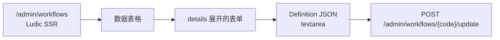
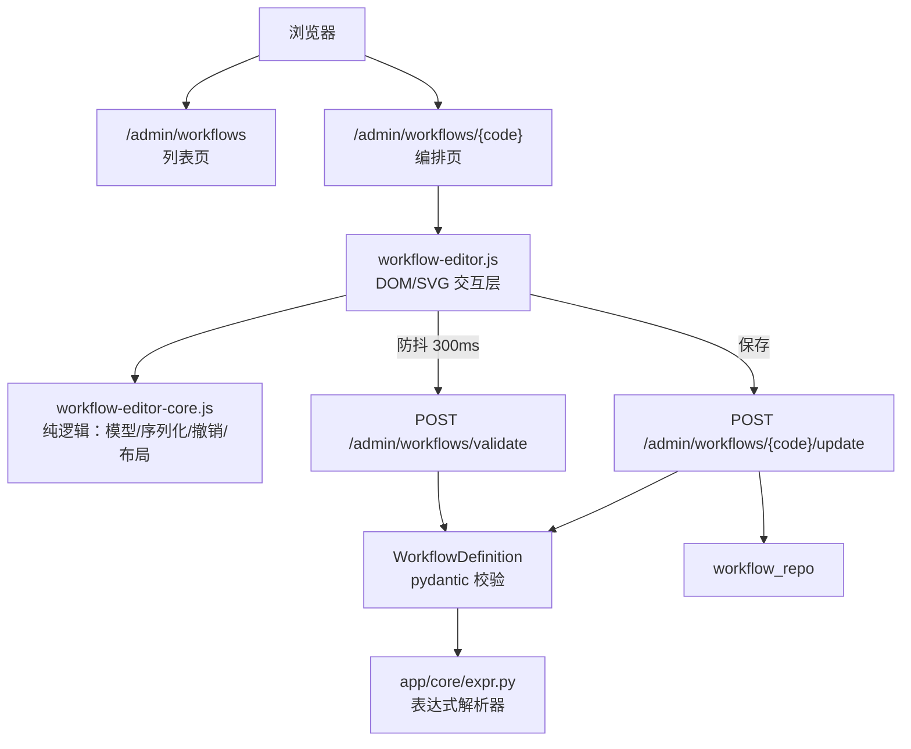

# V4.8：Workflow 可视化编排器

> 状态：设计已确认，实现待落地。本版在 V4.7 的独立 admin-web 之上，把
> `/admin/workflows` 的手写 JSON 编辑替换为拖拽画布编排；服务端图结构校验规则
> 一字不改，仍是唯一权威。

## 目标

把「写 Workflow 定义」从**手写 JSON** 变成**拖拽节点、拉箭头连线**：

1. 管理员在 `/admin/workflows/{code}` 的画布上编排工作流，不需要手写
   `nodes` / `edges` / `when` / `inputTemplate`；
2. 编辑过程中**实时**看到服务端校验结果，并能定位到出错的节点或边；
3. 支持**一个或多个** provider／agent／审批节点的组合，含条件分支；
4. 画布上看到的结构与保存下来的 definition **完全等价**，不引入第二份真相；
5. 不新增前端构建链，不引入第三方前端库，不新增数据库列。

## 背景：为什么手写 JSON「反人类」

问题不在 JSON 本身，而在于**反馈链路断了**。

服务端 `WorkflowDefinition`（`app/core/workflow_def.py`）的校验相当严：

- 节点 id 不能重复；
- 不能有环；
- 不能有从 `entry` 走不到的孤立节点；
- 汇聚节点的入边不许混条件边（LangGraph 会永远等不到）；
- 同一节点的出边不许条件边与无条件边混用；
- `when` 表达式只能引用 `user_input` 和真实存在的 `upstream.<outputKey>`，
  语法由 `app/core/expr.py` 的手写递归下降解析器判定；
- `inputTemplate` 里的 `{{变量}}` 必须可解析，且不接受 `{{upstream.x}}` 这种点号写法。

这些规则**每一条都是在挡真实事故**（走错分支、run 静默少跑一段、prompt 里出现
`{{pan}}` 这种模型看不懂的原文）。但现状是：管理员在一个 `<textarea>` 里写 JSON，
保存时只得到一句 `error=invalid` 和一个跳回列表页的 303。

于是一次「我只是想加个审批节点」的操作，变成了一次**没有反馈的猜谜**。

V4.8 的核心判断：**把校验结果实时摆到眼前，而不是把规则藏得更深**。

## 现状



- `services/admin_web/views.py::workflows_page` 渲染表格，每行一个
  `<details>` 折叠的编辑表单，核心是 `textarea(name="definition")`。
- 提交走 `POST /admin/workflows/{code}/update`，`definition` 以 JSON 字符串传入，
  经 `_json_object` 解析后由 `WorkflowUpdate.definition: WorkflowDefinition` 校验。
- 页面与组件权限已注册：页面 `workflow.read`，编辑组件 `workflow.write`。
- admin-web 是 Ludic SSR + 原生 JS/CSS，**没有 npm、没有构建步骤**；
  `static/admin-ui.js` 只做语言切换与外观偏好。

## 架构



三层边界：

- **core.js**：纯数据，不碰 DOM。定义 ↔ 画布模型的转换、撤销栈、分层布局算法。
  可用 `node --test` 直接测。
- **workflow-editor.js**：DOM/SVG 渲染与交互，只调用 core 的纯函数。
- **服务端**：唯一的校验权威。

## 数据模型

### 复用现有 definition，不动数据库

`definition` 是 JSON 列，加一个顶层键不需要迁移。加一个**节点级**字段也不需要
迁移——但节点模型是 `extra="forbid"`，所以必须显式声明。

### 节点增加可选 `label`

`app/core/workflow_def.py`：

```python
class WorkflowNode(BaseModel):
    ...
    id: str = Field(min_length=1, max_length=64)
    type: str = Field(default=NodeType.AGENT.value, max_length=16)
    label: str = Field(default="", max_length=128)   # 新增：仅用于展示
    agentCode: str = Field(default="", max_length=64)
    ...
```

- **纯展示字段**：运行期 `run_graph.py` 只读 `id` / `type` / `agentCode` /
  `outputKey` / `prompt` / 审批参数，不读 `label`；
- **向后兼容**：默认值 `""`，老 definition 一行都不用改；
- **为什么必须有**：审批节点没有 `agentCode`，只能靠 id 区分；画布上两个
  `review` / `approve` 节点用户根本分不出是哪个审批。

### 坐标存 definition 顶层 `layout`

```json
{
  "entry": "step1",
  "nodes": [...],
  "edges": [...],
  "inputTemplate": "...",
  "layout": {
    "nodes": {"step1": {"x": 80, "y": 120}},
    "viewport": {"x": 0, "y": 0, "scale": 1}
  }
}
```

- `WorkflowDefinition` 是 `extra="allow"`，`model_dump(by_alias=True,
  exclude_none=True)` 会把 extras 原样带过，因此 admin 端和客户端 API 两条更新
  路径都能完整保存 `layout`；
- 运行期只读 `nodes` / `edges`，顶层多出的 `layout` 被忽略；
- `viewport` 一并保存，用户下次打开画布还在同一个视角；
- **不新增数据库列**：坐标属于「这份 definition 的展示形态」，跟着 definition
  走最省事，也避免两处状态不一致。

## 页面结构

### 列表页 `/admin/workflows`（改造）

| 元素 | 变化 |
| --- | --- |
| 数据表格 | 保留；操作列去掉 JSON 编辑表单，换成「打开编排器」链接 |
| 创建表单 | 不再写 JSON：填 code / name / description / enabled + **「初始 Agent」下拉**（必填） |
| 骨架生成 | 后端用所选 Agent 生成 `{"entry":"step1","nodes":[{"id":"step1","type":"agent","agentCode":"<code>"}],"edges":[],"layout":{...}}` |
| 创建后 | 303 跳到 `/admin/workflows/{code}` |

「初始 Agent」下拉的选项来自**真实 Agent 列表**（`agent_repo.list`）。没有可用
Agent 时，创建按钮禁用并提示先去 `/admin/agents` 建一个——这样创建路径也永远
不需要用户理解 `nodes` 的结构。

### 编排页 `/admin/workflows/{code}`（新增）

```text
┌──────────────────────────────────────────────────────────────────────┐
│ ‹ 返回列表   客服工单分诊  v3  已启用   ↶ ↷   整理布局  JSON  保存   │
├──────────────┬─────────────────────────────────┬──────────────────────┤
│ 节点面板      │          SVG 画布                │ 属性检查器            │
│              │                                 │                      │
│ ▸ Agent 节点 │   ┌──────────┐                   │  选中节点:            │
│ ▸ 审批节点    │   │ 意图识别  │──upstream.intent──▶│   ID / 显示名         │
│              │   │ planner  │      == "退款"      │   Agent 下拉          │
│ 可用 Agent    │   └──────────┘              ┌──────┐│   输出键              │
│  · planner   │                              │ 复核  ││                      │
│  · writer    │                              └──────┘│  选中边:              │
│              │                                 │   条件 when            │
│              │                              ┌──────┐│                      │
│              │                              │人工审批││  未选中:              │
│              │                              └──────┘│   入口 / 输入模板     │
├──────────────┴─────────────────────────────────┴──────────────────────┤
│ ⚠ 节点 review 的入边混了条件边：条件不成立时它会永远等不到            │
└──────────────────────────────────────────────────────────────────────┘
```

三栏布局：左侧节点面板、中间画布、右侧属性检查器；顶部工具栏；底部错误条。

### 页面装配

- `shell()` 增加 `extra_scripts: list[str]` 参数，编排页额外挂
  `workflow-editor.css` / `workflow-editor-core.js` / `workflow-editor.js`；
  列表页不挂，避免为一次列表访问付出画布脚本的代价；
- 画布需要的初始数据（definition、可用 Agent 列表、只读/可写标记、CSRF）
  由服务端以 `data-*` 属性或内联 JSON 块下发，**不额外引入 API 往返**。

## 交互规范

### 画布

- SVG 画布，CSS 网格背景；节点尺寸 200×72；视图变换用 `translate + scale`；
- **缩放**：滚轮（以指针为中心），范围 0.5×–2×；工具栏另有「适应画布」；
- **适应画布**：把全部节点框进可视范围，只改视口（缩放 + 平移），
  **不改节点坐标、也不记撤销**；
- **平移**：空格 + 拖拽，或中键拖拽；
- 节点拖动带 8px 网格吸附；拖动中只更新本地视图，**拖动结束才记一次撤销**。

### 节点

- 圆角卡片；标题 = `label || outputKey || id`；
- 类型徽章：`Agent` / `审批`；
- 节点尺寸固定 200×72px；副标题单行省略（Agent 节点显示 Agent 名称，审批节点
  显示 `prompt` 首行），完整内容在检查器里看；
- 标题与副标题的省略**按显示宽度**收口，不按字符数：全角字符占一个 em、半角按
  0.55 em 估，标题最多 13 em、副标题最多 15 em（对应 13px / 11px 字号下约 176px
  的正文字宽）。只数字符会让 18 个汉字撑出 234px，直接溢出卡片；
- 入口节点左侧显示 `entry` 标记；
- 左侧输入连接点、右侧输出连接点；Agent 与审批节点的连接点行为一致。

### 连线

- 从节点右侧输出点按下并拖到目标节点 → 建立边（无条件）；
- 拖到空白处松手 → 取消；
- **条件边**：选中边后在检查器填 `when`；边在画布上画成**虚线 + 警示色**，
  并在路径中部标注条件摘要，与无条件边一眼可分；
- 禁止自环与重复边（客户端直接忽略并提示，服务端仍会兜底）。

### 属性检查器

| 选中对象 | 可编辑项 |
| --- | --- |
| Agent 节点 | `id`、`label`、`agentCode`（下拉）、`outputKey` |
| 审批节点 | `id`、`label`、`prompt`、`requiredApprovals`、`approvalTimeoutSec`、`approvalTimeoutAction` |
| 边 | `when`（文本框）+ **变量插入按钮**（列出 `user_input` 与本图全部 `outputKey`，点击插入到光标处） |
| 画布（未选中） | `entry`（下拉选节点）、`inputTemplate`（文本域，附变量提示） |

切换节点 `type` 时**自动清掉互斥字段**（`agent` → `approval` 清 `agentCode`；
反向清 `prompt` 与审批参数），与 `WorkflowNode._validate_node_shape` 的约束对齐。

改节点 `id` 是**完整改名**，不是只改那一个字段：`id` 是引用键，改名会同时改写
`edges[].from/to`、`entry` 和 `layout.nodes` 的**键**，布局坐标跟着节点走；
改成图中已存在的 `id` 会被拒绝并提示，不会产生重名节点。

### 撤销 / 重做

- 快照栈存**整个编辑器状态**（nodes / edges / entry / inputTemplate / layout），
  上限 50；`Ctrl+Z` 撤销、`Ctrl+Shift+Z` 重做；
- **记一步的时机**：增删节点、增删边、修改属性、拖拽结束、整理布局；
  拖拽过程中、输入框逐字输入时**不记**（否则撤销粒度会碎成一个个字符）；
- 连续输入框编辑按「失焦或 500ms 静默」合并成一步。

### 自动布局

「整理布局」按钮，算法：

1. **分层**：按最长路径计算层级——`level(n)=1+max(level(所有前驱))`，无前驱的
   节点落在第 0 层。不可达节点按自己的前驱分层（那种图本来就保存不了，
   布局只供查看，不做特殊处理）；
2. **摆放**：层内按 declaration 顺序自上而下排列，层间距 96px、层内间距 48px，
   整图从固定边距开始排布；
3. 结果**稳定可重现**：同一份 definition 每次整理得到同一布局；
4. 记一次撤销；
5. 只覆盖 `layout.nodes`，**保留**原有 `layout.viewport` —— 整理布局不动用户视角。

## 校验：服务端单一权威

**不在 JS 里重写校验规则。** 规则一旦在两处实现就会漂移，而漂移的方向恰恰是
最坏的方向：前端放行、后端拒绝，用户白忙一场；反过来更糟——用户以为存上了，
实际没存。

因此把服务端校验暴露成一个只读端点：

```http
POST /admin/workflows/validate
Content-Type: application/json
X-CSRF-Token: <csrf>

{"definition": { ... }}
```

```json
{"ok": true}
```

```json
{"ok": false, "errors": [
  {"message": "节点 review 的入边混了条件边（step1 --when--> review）…",
   "node": "review", "nodes": ["review"], "edge": "step1->review",
   "edges": ["step1->review"]}
]}
```

- 内部**直接复用** `WorkflowDefinition` 的 pydantic 校验与 `app/core/expr.py`，
  规则一份都不复制；
- 前端在编辑停止 300ms 后调用，把错误显示在底部错误条，并对相关节点/边加红框；
- 定位有两组字段，**并存**：
  - `node` / `edge`：首个定位目标（单值），先于整组字段存在，保留给按单值取用的调用方；
  - `nodes` / `edges`：整组定位（列表）。成环时是**整个环**的节点与边，
    孤立节点违规时是全部孤立节点，画布据此一次标红一整片，而不是只红一个节点
    让管理员自己顺着箭头找；
  - 两组都只在有条目时出现；没有节点/边可指的 issue（形状类、模板类）一个都不带。
- 从 pydantic 的错误消息里正则解析节点 id 是脆弱的，因此**规则本身要能吐结构化
  定位信息**（见下）。

### 校验规则要能「收集」而不只是「抛第一条」

现有 `_validate_graph` 在第一条违规处就抛 `ValueError`，pydantic 把它包成一个
`ValidationError`，定位信息（是哪个节点、哪条边）只存在于**消息文本**里。

V4.8 需要「一次看到全部问题 + 每条带定位」，因此在
`app/core/workflow_def.py` 增加一个**结构化收集层**：

```python
@dataclass(frozen=True)
class GraphIssue:
    message: str          # 与现有错误消息逐字一致
    node_ids: tuple[str, ...] = ()
    edge_refs: tuple[str, ...] = ()   # 形如 "from->to"

def collect_graph_issues(payload: dict) -> list[GraphIssue]: ...
```

- 原有各条规则（孤立节点、汇聚入边混条件边、出边条件混用、条件表达式
  校验、模板变量校验）的**检查顺序和消息文本一字不改**，只是从「抛异常」
  改为「产出 issue」——它们现在由 `collect_graph_issues` 及其内部的
  `_detect_*` 函数实现；
- `_validate_graph` 改为调用 `collect_graph_issues`，**在第一条 issue 处抛
  `ValueError(issue.message)`**——于是运行期行为、既有测试断言的错误消息完全不变；
- `validate` 端点调用 `collect_graph_issues` 拿到全部问题及其定位；
- **规则仍然只有一份**，不存在「运行期一套、校验端点一套」的分叉。

`WorkflowDefinition` 的 pydantic 校验（含节点字段组合、类型枚举等）仍然照常运行，
它负责「连 definition 本身都不合法」的情况；`collect_graph_issues` 负责图结构
层面的定位。两者是**串联**关系，不是二选一。

保存仍走现有的 `POST /admin/workflows/{code}/update`（隐藏字段提交 definition
JSON），CSRF + Origin 校验链路完全不动；服务端校验失败走现有 `_business_redirect`
错误提示。

### 为什么 validate 是 POST 而不是 GET

它需要 CSRF 双提交校验，而 GET 不带 body、不适合携带 CSRF 头。它是**只读**语义
的 POST——不写任何状态，只是不适合用 GET 表达鉴权要求。

## 后端端点

| 方法 | 路径 | 权限 | 说明 |
| --- | --- | --- | --- |
| GET | `/admin/workflows` | `workflow.read` | 列表页（改造） |
| GET | `/admin/workflows/{code}` | `workflow.read` | **新增**：渲染编排页 |
| POST | `/admin/workflows` | `workflow.write` | 创建（表单不再收 JSON，改收初始 Agent） |
| POST | `/admin/workflows/{code}/update` | `workflow.write` | 保存（复用，definition 由画布提交） |
| POST | `/admin/workflows/validate` | `workflow.write` | **新增**：校验 definition，不落库 |
| POST | `/admin/workflows/{code}/toggle` | `workflow.write` | 启停（不变） |
| POST | `/admin/workflows/{code}/delete` | `workflow.write` | 删除（不变） |

**客户端 API `/api/workflows` 一律不变**：它仍然接收完整的 `definition`，供程序化
调用方使用。V4.8 只改后台的**人机界面**，不改机器接口——已有脚本不会因为后台
换了个编辑器就断掉。

后台创建端点与客户端 API 的差异仅一处：后台创建表单收「初始 Agent 的 code」，
由服务端生成骨架 definition；客户端 API 仍收完整 definition。

`GET /admin/workflows/{code}` 与既有 `POST /admin/workflows/{code}/update` 不冲突
（方法不同），但要注意与 `GET /admin/workflows` 的路由顺序：`{code}` 是路径参数，
必须排在更具体的路径之后，且 `code` 需与 `[A-Za-z0-9_-]+` 匹配，避免吞掉
`/admin/workflows/validate` 之类的固定段——`validate` 是 POST，与 GET 不冲突。

## 权限与安全边界

- **页面级**：`workflow.read` 才能打开编排页；无权限返回 404（沿用现有
  `can_access_page` + `_not_found` 语义，不泄露资源是否存在）；
- **组件级**：编辑能力（新增/删除节点、拉线、改属性、保存、布局整理）要求
  `workflow.write`；只读用户看到**可看不可改**的画布（节点可选中查看属性，
  但不能拖动、不能保存）；
- **只读用户不发 validate 请求**：前端在只读模式下完全不发校验请求，避免
  403 变成底部的红色噪声；
- **validate 的权限与 update 一致**：都走 `workflow_editor` 组件权限检查
  （即 `workflow.write`），避免出现「能保存却不能校验」或反过来的割裂；
- **CSRF**：编排页的所有写操作走现有双提交 CSRF（`csrf_token` 隐藏字段 +
  Cookie 摘要校验）；`validate` 端点同样校验；
- **Origin**：沿用现有 Origin 校验；
- **审计**：保存沿用现有 `workflow.update` 审计事件；创建沿用 `workflow.create`；
- **不新增数据出口**：画布不引入任何外部资源（无 CDN、无字体、无图片），
  所有静态资源走已有的 `/admin/static` 挂载。

## 错误处理

| 场景 | 表现 |
| --- | --- |
| 画布图不合法（环 / 孤立节点 / 条件边混用） | 底部错误条 + 相关节点/边红框；保存按钮仍可点，但服务端会拒 |
| `when` 表达式语法错 | 错误条给出表达式错误原文与所在边 |
| 服务端保存时校验失败 | 沿用 `_business_redirect` → 列表页 flash 提示（现有行为） |
| `validate` 请求失败（网络/5xx） | 错误条显示「无法校验」，**不阻塞编辑**——本地编辑仍然可用，只是没有即时反馈 |
| 无 Agent 可选 | 节点面板显示提示，引导去 `/admin/agents` |
| 只读用户 | 工具栏隐藏保存/布局整理；画布禁用拖拽 |

## 验收用例

### 页面与权限

1. 有 `workflow.read` 的管理员访问 `/admin/workflows/{code}` 返回 200，页面含画布容器；
2. 无 `workflow.read` 的管理员访问返回 404；
3. 只有 `workflow.read` 没有 `workflow.write` 的管理员看到画布但没有保存按钮，
   拖动节点不生效；
4. `POST /admin/workflows/validate` 缺少 CSRF 或 Origin 不符时返回拒绝。

### 校验端点

5. 合法定义返回 `{"ok": true}`；
6. 有环的定义返回 `ok=false`，错误指向环上的节点——环上**每个**节点与每条边都带出来，
   成环时画布一次标红整个环；
7. 有孤立节点的定义返回 `ok=false`，错误指出孤立节点 id；
8. 汇聚节点入边混条件边返回 `ok=false`，错误指向该汇聚节点；
9. `when` 引用不存在的 `upstream.xxx` 返回 `ok=false`，错误指向那条边；
10. `when` 语法错误返回 `ok=false`，错误指向那条边；
11. 一个定义同时违反多条规则时，返回**全部**问题而不是只返回第一条；
12. `collect_graph_issues` 里每个**节点/边级别**的 issue 都带 `node_ids` 或 `edge_refs`。
    形状类 issue（`nodes` 不是数组…）指向的是数组下标，模板类 issue 指向定义级字段
    `inputTemplate`，两者没有节点或边可指，不在本条范围内；
13. `WorkflowDefinition` 抛出的错误消息与 V4.7 改动前**逐字一致**
    （`tests/test_workflow_def.py` 既有断言全绿）。

### 画布与保存

14. 从节点面板拖出一个 Agent 节点，画布出现该节点，检查器可选中并改 `agentCode`；
15. 从节点输出点拖到另一节点建立一条边，画布出现实线箭头；
16. 给边填 `when` 后，边变为虚线并带警示色；
17. 审批节点必填 `prompt`，删空后校验报错；
18. 节点 `type` 在 agent/approval 间切换时互斥字段被自动清空；
19. 「整理布局」后节点按层级排列，同一份定义重复整理结果一致；
20. `Ctrl+Z` 撤销上一步、`Ctrl+Shift+Z` 重做，栈上限 50；
21. 保存后重新打开编排页，节点结构、边、条件、坐标与保存前一致；
22. 保存的 definition 中不含任何 `label` 为 `None` 的残留，也不含 JS 内部字段；
23. `layout` 字段经 admin 保存与客户端 API 更新两条路径往返后均不丢失。

### 回归

24. `tests/test_admin_web.py` 全绿；`tests/test_workflow_def.py` 全绿；
25. 既有 Workflow 客户端 API（`/api/workflows`）行为不变。

## 明确不做

- **撤销/重做之外的编辑历史**：不做多分支历史、不做版本树；
- **多选与框选**：一次只操作一个节点或一条边；
- **节点复制/粘贴**：不做；
- **条件表达式可视化构建器**：`when` 保留文本框 + 变量插入按钮，不做点选式条件树；
- **迷你地图**：不做；
- **协同编辑 / 实时多人**：不做；
- **自动保存 / 草稿**：不做，保存是显式动作；
- **节点级运行调试**：不在画布上直接跑单个节点；
- **画布上改 Agent 的提示词、模型、工具**：这些仍在 `/admin/agents` 里编辑，
  画布只绑定 Agent；
- **不改运行时**：V1–V4.7 的执行语义、校验规则、审批与条件边求值全部不动。

## 落地清单

| 文件 | 改动 |
| --- | --- |
| `app/core/workflow_def.py` | `WorkflowNode` 增加 `label: str = ""`；新增 `GraphIssue` / `collect_graph_issues()`，现有规则改为「产出 issue」，`_validate_graph` 在第一条 issue 处抛同样的 `ValueError` |
| `services/admin_web/views.py` | 新增 `workflow_editor_page()`；`shell()` 增加 `extra_scripts`；`workflows_page()` 改造 |
| `services/admin_web/app.py` | 新增 `GET /admin/workflows/{code}`、`POST /admin/workflows/validate`；创建端点适配骨架生成 |
| `services/admin_web/static/workflow-editor.css` | 新增：画布 / 节点 / 检查器 / 错误条样式，复用现有 CSS 变量主题 |
| `services/admin_web/static/workflow-editor-core.js` | 新增：纯逻辑（模型转换、撤销栈、分层布局），无 DOM 依赖 |
| `services/admin_web/static/workflow-editor.js` | 新增：DOM/SVG 渲染与交互层 |
| `tests/test_workflow_def.py` | 新增 `label` 字段与 `layout` 顶层键的校验用例；新增 `collect_graph_issues` 的定位用例（并断言 `_validate_graph` 抛出的消息与改动前逐字一致） |
| `tests/test_admin_web.py` | 新增编排页、validate 端点、画布往返保存用例 |
| `tests/js/workflow-editor-core.test.mjs` | 新增：`node --test` 覆盖 core.js 纯逻辑 |
| `app/design/README.md` | 增加 V4.8 索引行 |
| `docs/design/TODO.md` | 记录「手写 JSON 编辑」的退役与可视化编排器的落地 |

## 相关文档

- [V3 编排、审批与条件边](../../app/design/v3-orchestration.md)：DAG 结构、审批节点、
  条件表达式文法与求值语义。
- [V4.7 独立 admin-web](../../app/design/v4.7-oauth-admin.md)：Ludic SSR、页面与组件
  权限、Casbin、审计与 CSRF 约束。
