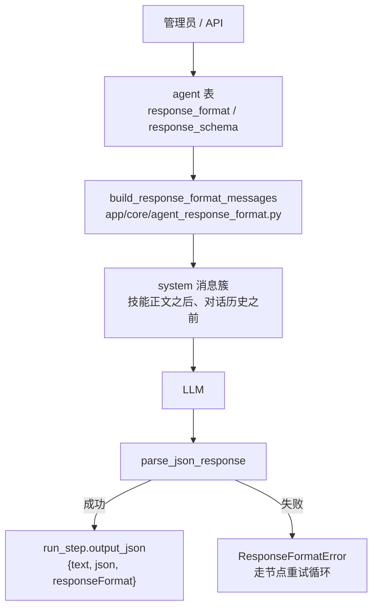

# V4.9：Agent JSON 响应值配置

> 状态：已实现。本版在 V4.8 之上给 Agent 增加「输出格式」与「JSON 结构要求」
> 两个配置项，让 Agent 的最终回答可以稳定地以 JSON 交付给下游——工作流的
> 上游节点、外部系统、或者直接读 `run_step.output_json` 的调用方。

## 目标

1. 管理员在后台给 Agent 选「纯文本 / JSON」；
2. JSON 模式下可附一份 JSON Schema，限定返回结构；
3. 服务端**保证**「配了 JSON 就一定拿得到 JSON」：拿不到就明确失败，而不是把
   一段散文塞给下游让调用方自己猜；
4. 提示词预览里看到的指令与运行时发出的**逐字一致**；
5. 不改 LLM 请求参数，不引入新的第三方依赖，不影响存量 Agent。

## 背景：只靠提示词是不够的

「请用 JSON 回答」写进 system prompt 之后，模型**大多数时候**会照做，但不是
每一次：

- 有时前面带一句「好的，结果如下：」，后面才是 JSON；
- 有时套一层 Markdown 代码围栏；
- 有时给出的是「我认为答案应该是这样的：{...}」这种带判断的散文；
- 有时干脆是一段自然语言总结——毕竟用户问的就是个自然语言问题。

对工作流来说，这些情况都是**下游拿到垃圾**。上游节点的输出会被渲染进下一个
节点的 prompt，`{` 开头的散文会污染上下文，最终节点产出的东西没人能解析。

所以本版的立场是：**JSON 是一种输出契约，需要服务端来守**。

## 范围边界（明确不做的事）

| 不做 | 原因 |
| --- | --- |
| 不改 LLM 请求参数（不发 `response_format={"type":"json_object"}`） | 并非所有 OpenAI 兼容端点都认这个字段，MiniMax 等端点会直接 400。需要端点级结构化输出时，仍由使用方通过 `extra_params` 自行选择 |
| 不做 JSON Schema 的**实例校验** | 本版只用 Schema 提示结构，服务端只校验「是合法 JSON」。真正按 Schema 校验需要引入 `jsonschema` 依赖并定义「不合 schema 时是重试还是直接失败」，留待后续版本 |
| 不做流式分片 JSON 解析 | SSE 仍按文本吐字；JSON 在节点结束时整体解析。边吐边解析需要处理「半个 JSON 片段」的中间态，收益有限 |
| 不改上游节点的渲染逻辑 | 上游输出渲染进 prompt 时**照旧是文本**。JSON 模式下游拿到的仍是那段 JSON 的文本形式——这保证「节点输出可以是任意 JSON 值」而下游模板不必分支处理 |

## 数据模型

`agent` 表新增两列：

| 列 | 类型 | 默认 | 说明 |
| --- | --- | --- | --- |
| `response_format` | `VARCHAR(16) NOT NULL` | `'text'` | `text` 或 `json` |
| `response_schema` | `JSON NULL` | `NULL` | JSON Schema 对象；`NULL` 表示只要求「是 JSON」，不限定结构 |

迁移文件：`alembic/versions/0020_agent_response_format.py`
（revision `c7d2e5a8b134`，down_revision `f4b7c1a9e2d5`）。

存量 Agent 的语义是「照常输出文本」，所以默认值必须是 `text`——**升级不改变
行为**。

「清空 JSON Schema」用哨兵值表达：仓储层的约定是「值为 `None` 的键跳过」
（`None` = 不修改），所以 `app/repo/agent_repo.py` 里加了 `CLEAR` 哨兵，
接口层在收到显式 `null` 时换成它，才真的会写 `NULL`。

## 架构



指令生成与解析放在**同一个模块**（`app/core/agent_response_format.py`），因为：

1. 编排器（发给模型）与提示词预览接口（给人看的「实际生效的提示词」）必须
   发出逐字一致的指令——两处各写一遍的话，预览迟早会跟真正发出去的内容对不上，
   而「后台看到的 = 模型收到的」是这个项目的硬约定；
2. 解析规则（围栏、前缀散文、非法 JSON 的措辞）只有一份实现，「配了 JSON
   就一定拿得到 JSON」才是个**能测的契约**，而不是各处口头约定。

## 提示词层

JSON 模式下，在 system 消息簇里追加一条消息：

```
【输出格式】本次回答必须且只能是一个 JSON 值。
硬性要求：
1. 不要输出任何解释、前言、结语或 Markdown 代码围栏（```）。
2. JSON 前后不要有多余文字——服务端会直接解析你的整段输出，多一个字都会导致解析失败。
3. JSON 必须满足下面这个 JSON Schema：
{ ... }
```

- 位置在**技能正文之后、对话历史之前**：离用户输入最近，模型最容易记住这条
  硬约束。
- 配了 Schema 时第 3 条是 Schema 原文（`json.dumps(..., indent=2, sort_keys=True)`
  序列化，保证同一份配置每次生成**逐字相同**的指令）；没配时第 3 条是
  「顶层必须是一个 JSON 对象」。
- **文本模式下一个字符都不多加**：`build_response_format_messages("text")`
  返回空列表。多插一条「输出格式说明」会让提示词预览、token 预算与实际调用
  三处对不上，而它对文本输出又毫无用处。

## 解析规则

`parse_json_response(text)` 返回 `(解析结果, 错误说明)`：

| 情况 | 结果 |
| --- | --- |
| 整段就是 JSON | 直接解析 |
| 整段套着代码围栏 | 剥掉围栏后解析 |
| 前面带一句散文、JSON 在围栏里 | 取围栏里的内容解析 |
| 空输出 | 失败，原因「模型没有返回任何内容」 |
| 都不是 | 失败，原因带 JSON 解析器的措辞与行列号 |

**刻意不做**「从散文里截一段 JSON」的猜测：截出来的片段多半是半截 JSON，
解析出来是错的数据——比失败更糟。

## 运行期

编排器拿到模型输出后：

- `response_format = text`：`output_json` 形如
  `{"text": ..., "toolCalls": ..., "toolRounds": ..., "responseFormat": "text"}`；
- `response_format = json`：解析成功时额外带上 `"json": <解析结果>`，
  `responseFormat` 为 `"json"`；**解析失败则抛 `ResponseFormatError`**。

`ResponseFormatError` 与 `ToolLoopExceeded` 的处理**故意相反**：

| | `ToolLoopExceeded` | `ResponseFormatError` |
| --- | --- | --- |
| 是否重试 | 不重试 | **重试** |
| 理由 | 模型陷在工具循环里，再跑一遍大概率一样，纯白烧 token | 模型没把 JSON 包好多半是偶发的（加了一句前言、套了围栏），再跑一次通常就好了 |

错误信息里只带**解析失败的原因**（行列号、解析器措辞），**不带模型原文**：
原文可能包含用户数据，而失败原因会落进 `run.error_msg`，之后被
`GET /api/runs/{id}` 原样回显。

## API 契约

| 接口 | 行为 |
| --- | --- |
| `POST /api/agents` | 接受 `response_format`（`text`/`json`）与 `response_schema`（对象）；非法取值返回 400（参数校验失败，带字段级错误） |
| `PUT /api/agents/{code}` | 同样接受两个字段；**显式传 `response_schema: null` 表示清空**，不传表示保持原样 |
| `GET /api/agents/{code}` | 回显 `response_format` 与 `response_schema` |
| `GET /api/agents/{code}/prompt-preview` | 返回的 messages 里包含 JSON 输出指令，与运行时**逐字一致** |

`response_schema` 走 `check_json_shape` 深度/规模守卫，与 `extra_params` 同款
——没有这道守卫时，一个 3000 层嵌套的对象会让 pydantic 序列化时抛未捕获的
「Circular reference detected」，接口返回 500 而不是「参数不合法」该有的 400。

## 管理端

`/admin/agents` 的创建/编辑表单新增两个字段：

- `response_format`：下拉选择 Plain text / JSON；
- `response_schema`：多行文本框，填 JSON Schema 原文（留空 = 不限定结构）。

列表页新增「Output」列：JSON 模式显示 `JSON`，并标注「Schema enforced」或
「Any JSON」。

表单写入路径的非法值会标到**具体字段**上（`_business_field_errors` 映射
`invalid_response_format` / `invalid_response_schema`），而不是一句笼统的
「保存失败」。

**清空语义**：表单里把 JSON Schema 清空（提交空串）= 「不限定结构」，要真的
写 NULL。仓储层的约定是「值为 None 的键跳过」（None = 不修改），所以管理端
写入路径与客户端 API 一样要把 None 换成 `CLEAR` 哨兵——否则旧 schema 会一直
留着，而列表页仍显示「Schema enforced」，用户看不出没保存成功。

## 验证

`tests/test_agent_response_format.py`（28 项）覆盖：

- 核心模块：格式归一化与严格解析、指令生成、围栏剥离、JSON 解析的四种情形、
  Schema 文本解析；
- API 层：创建 JSON 模式 Agent、非法输出格式与非法 Schema 被拒、显式 `null`
  清空 Schema、不传字段保持原样、**提示词预览与运行时指令逐字一致**；
- 运行期（真 HTTP 假 LLM）：模型返回 JSON 时 `run_step.output_json.json` 是
  解析后的对象；模型返回散文时节点重试后以「没有合法 JSON」失败；
- 管理端：非法输出格式与非法 Schema 的字段级错误映射。

全量回归：`1211 passed / 30 skipped`（跳过项为需要 Docker 的用例）。

## 遗留

- **按 Schema 校验实例**：本版只用 Schema 提示结构，服务端只校验「是合法
  JSON」。要真正拒绝「结构不对但语法对」的输出，需要引入校验依赖并定义
  重试策略。
- **端点级结构化输出**：本版不碰 LLM 请求参数。需要 `response_format` /
  structured output 的端点仍要通过 `extra_params` 自行配置，且不保证所有
  兼容端点都支持。
- **下游模板的 JSON 渲染**：上游节点的输出仍以文本形式渲染进下游 prompt，
  JSON 模式下不会自动展开成结构化字段。
