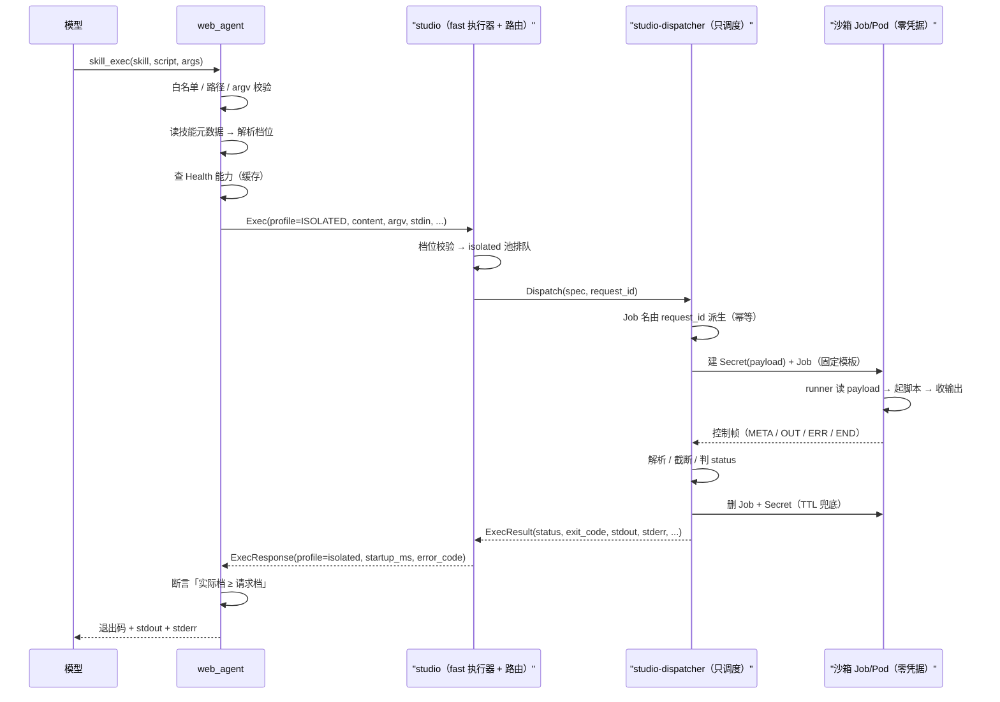
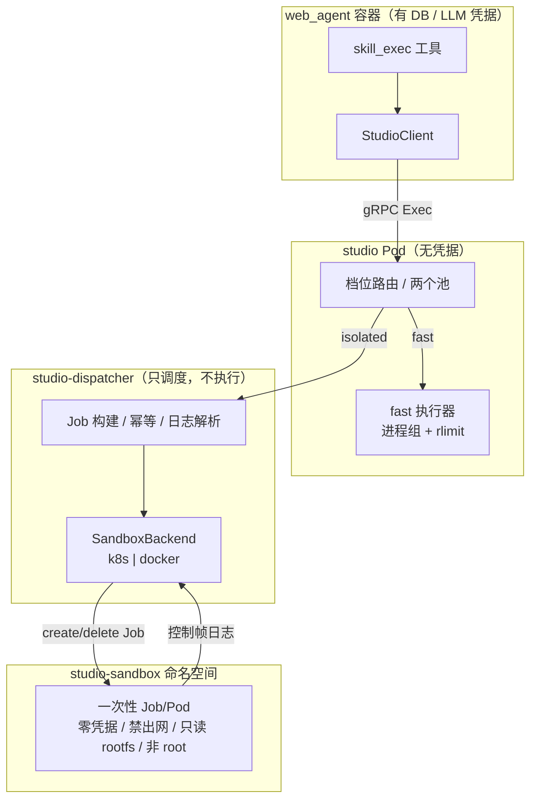

# isolated 隔离档：完整工作流设计与优化方案

> 状态：方案待评审（本文只做设计与拆解，没有改代码）｜日期：2026-11-03
> 配套：[`docs/skill-service.md`](../../skill-service.md) §2.4 / §8.4 / §14.3 / §18、[`docs/design.md`](../../design.md) §22.8

## 0. 一页纸结论

**现状不是「缺一个容器执行器」，而是缺四段闭环。**

| 已具备 | 缺口 |
| --- | --- |
| 档位路由（按技能码列表） | 技能自己**没法声明**「我需要强隔离 / 我需要哪个镜像」 |
| `isolated` 档独立并发池与队列 | 调用方**不知道**一次执行会走哪档，也没法拒绝降级 |
| 运行时缺失时明确报错、不悄悄退回 fast | **能力协商**：`Health` 不报 isolated 是否可用，启动期查不出来 |
| `IsolatedRuntime` 接口 | **执行本体**：沙箱怎么起、脚本怎么送、结果怎么回、超时/取消/清理怎么算 |
| 失败语义与指标骨架 | **生命周期治理**：幂等、孤儿回收、容量配额、跨副本去重、停机 |

**两个必须先定的判断：**

1. **谁跑用户代码，谁就不能持有创建容器的凭据。**
   studio 的 `fast` 档在 studio 进程所在容器里跑模型给的脚本。把 Docker socket 或
   K8s ServiceAccount 挂进这个容器，等于把「创建任意 Pod / 挂宿主目录」的能力交给
   脚本——这正是 §7「零凭据、无宿主挂载」要挡的事。所以不能由 studio 直接调容器
   运行时，必须加一个**只调度、不执行**的控制面（下文叫 `studio-dispatcher`）。

2. **档位不能只由部署环境的技能码列表决定。**
   `STUDIO_ISOLATED_SKILL_CODES` 是 fail-open 的：技能改名、漏配、某个副本配置漂移，
   都会让技能**静默**落回 `fast`。正确的方向是「技能元数据声明 → 请求携带 → 服务端
   校验 → 响应回显 → 调用方断言」，四件事一起才闭环；env 列表只保留为**只能升、不能降**
   的运维覆盖。

**交付节奏**：Phase 0（契约与能力协商，不改执行）→ Phase 1（Docker 沙箱后端，lab 真跑通）
→ Phase 2（K8s Job 后端，生产形态）→ Phase 3（声明/校验/UI 全链路）→ Phase 4（加固与优化）。
Phase 0 + 1 就能让 isolated 在现有 `docker-compose.lab.yml` 里真的跑起来，并且不给 studio
加任何凭据。

**已定（2026-11-03）**：Docker 优先、dispatcher 独立 Deployment、studio 版本直接 2.0.0；
`STUDIO_EXEC_MIN_VERSION` 默认 1.0.0（fast-only 部署不被卡），声明 isolated 的技能要求 `>= 2.0.0`。

---

## 1. 现在一条 isolated 请求实际怎么走

> 这一节记录的是 **Phase 0 之前**的现状，用来解释缺口；Phase 0/1 之后的落地情况见 §7。

### 1.1 调用链

```text
模型
 └─ skill_exec(skill, script, args)
     └─ app/core/skill_exec.py::exec_skill_script()
         ├─ 白名单 / 脚本路径 / argv 三道校验
         ├─ read_script()：从 DB 读正文
         └─ StudioClient.exec_script()  ── ExecRequest（**没有 profile 字段**）
             └─ services/studio/server.py::Exec()
                 ├─ _validate() / 语言检查 / 去重窗口
                 ├─ _profile_for(skill)：按 STUDIO_ISOLATED_SKILL_CODES 或 STUDIO_PROFILE 选档
                 ├─ isolated 池排队（独立信号量 + 队列）
                 └─ IsolatedLauncher.run()
                     └─ 有 runtime → runtime.run(spec)
                        没有 runtime → LauncherUnavailableError
                                        → FAILED_PRECONDITION「没有部署容器运行时」
```

### 1.2 代码事实

| 事实 | 位置 |
| --- | --- |
| 档位按**服务侧 env** 的技能码列表选，请求里没有档位 | `services/studio/server.py::_profile_for`、`services/studio/config.py`（`isolated_skill_codes`） |
| `isolated` 有独立并发池与队列 | `services/studio/server.py::_ExecutionPool`、`_isolated_pool` |
| 运行时缺失 → `FAILED_PRECONDITION`，不退回 fast | `services/studio/server.py::Exec`（`launcher.available` 分支） |
| 容器执行器**没有实现**，只留 `IsolatedRuntime` 接口 | `services/studio/launcher.py::IsolatedRuntime` |
| 测试用的是**假的** runtime，不是容器 | `tests/test_studio_isolated.py::_FakeIsolatedRuntime` |
| `Health` 只有一个 `profile` / 一份 `language_info` / 一个 `max_concurrency` | `proto/webagent/studio/v1/studio.proto` §HealthResponse |
| web_agent 启动期只看 `ready`，**不校验版本、不校验 isolated** | `app/core/studio.py::init_studio` |
| 技能内容里没有「运行档 / 镜像」这类字段 | `app/models/skill.py`（只有自由 JSON `metadata_`）、`app/core/skill_pack.py` |

**所以现在的 isolated 是「可路由、可排队、可报错」，但没有执行；而调用方全程不知道一个技能走哪档。**
这正是文档 §18 第 11 条写的「骨架」。

---

## 2. 缺口清单

按工作流分层，共 6 组。每行都给「现状证据 → 后果 → 修法 → 阶段」。

### 2.1 A 组：声明与配置（作者 ↔ 部署）

| # | 缺口 | 现状证据 | 后果 | 修法 | 阶段 |
| --- | --- | --- | --- | --- | --- |
| A1 | 技能无法声明「需要强隔离 / 需要哪个镜像」 | `skill_pack.py` 的 frontmatter 只有 name/description/license/compatibility/metadata/allowed-tools；档位在 env；且 `metadata` 的值被强制 `str()`（见 §4 决策 2 的「元数据形状」） | 作者写了依赖 numpy 的脚本，只能在部署侧记得加技能码；漏了就静默跑 fast 并 `ModuleNotFoundError` | 技能 `metadata` 声明 `runtime-profile` / `runtime-image` / `runtime-timeout-ms`，导入期校验 | 0 |
| A2 | 导入不检查脚本依赖与可执行性 | `skill_import.py` 只查 zip 结构；`scripts/` 内容原样入库 | fast 镜像没有第三方包，模型拿到 traceback 后会反复重试同一个脚本 | 导入期静态扫描 `import` / `curl` / shebang，给出「需要 isolated 镜像」的提示或拒绝 | 3 |
| A3 | Agent 绑定只校验 code 存在，不校验能不能跑 | `app/core/skill_names.py::normalize_skill_codes` 只对 `known` 集合 | 绑得上、跑不了；用户直到模型调用才发现 | 配置期用 `Health` 的档位能力做门禁（写路径严格） | 0 |
| A4 | 没有镜像目录 / 白名单 | `StudioConfig` 只有技能码列表，没有镜像概念 | 所有 isolated 技能被迫共用一个镜像；依赖不同的技能无法共存 | `STUDIO_ISOLATED_IMAGES`（name → image@digest）+ `Health` 上报 | 0/2 |
| A5 | 多副本配置一致性无校验 | 每个 studio Pod 各读一份 `STUDIO_ISOLATED_SKILL_CODES` | `round_robin` 下同一技能可能在这个副本走 isolated、那个副本走 fast | 档位随请求走（A1/B1），env 只作升级覆盖 | 0 |

### 2.2 B 组：契约与能力协商（调用方 ↔ studio）

| # | 缺口 | 现状证据 | 后果 | 修法 | 阶段 |
| --- | --- | --- | --- | --- | --- |
| B1 | `ExecRequest` 没有档位字段 | proto `ExecRequest` 1..10 | 调用方无法请求强隔离，也无法拒绝降级 | 加 `ExecProfile profile = 11`（只增不改） | 0 |
| B2 | 响应不回显实际档位 | proto `ExecResponse` 1..8 | 无法证明「这次真的是强隔离」；降级没有痕迹 | 加 `ExecResponse.profile`，调用方断言「实际档 ≥ 请求档」 | 0 |
| B3 | `Health` 表达不了 isolated 的可用性 | `HealthResponse.profile` 是单值；`language_info`/`max_concurrency` 只描述 fast | 启动期、配置期都没法判断「这个实例能不能跑我的 isolated 技能」 | 加 `repeated ProfileInfo profiles`、`repeated ImageInfo images` | 0 |
| B4 | 没有 studio 版本下限检查 | `init_studio` 只判 `ready`；`health.version` 只写日志 | 老 studio 会忽略新字段 = §14.3 自己写的「静默降级」风险 | `studio_exec_min_version` + 能力位 | 0 |
| B5 | 错误没有机器可读 code | `ExecResponse.error` 是自由文本 | 客户端只能字符串匹配；「镜像缺失 / 配额满 / 启动超时」无法区分处置 | 加 `error_code`（稳定枚举字符串） | 0 |
| B6 | `Health` 只在启动时探一次，之后不刷新 | `StudioClient.health_info` 只由 `init_studio` 赋值 | studio 滚动升级、镜像变化后，客户端拿的是旧能力；语言校验也会误判 | 加 TTL 缓存 + 在 `FAILED_PRECONDITION` 后强制刷新 | 0 |

### 2.3 C 组：沙箱执行本体

| # | 缺口 | 现状证据 | 后果 | 修法 | 阶段 |
| --- | --- | --- | --- | --- | --- |
| C1 | 没有 `IsolatedRuntime` 实现 | `launcher.py` 只有接口 | isolated 档不可用 | 新增沙箱后端（Docker / K8s） | 1/2 |
| C2 | 起容器需要运行时凭据，与「零凭据」冲突 | 设计文档 §2.4 已写明这个矛盾 | 把 socket/token 放进 studio = 把宿主 root 交给模型脚本 | 控制面/数据面分离：dispatcher 持凭据、沙箱零凭据 | 0/1 |
| C3 | 脚本 / argv / stdin 怎么送进容器没定义 | `ExecRequest.content` 上限 20 万字符；`stdin` 已被用户数据占用 | 实现者容易走 env（会泄进子进程、长度也危险）或把 stdin 当脚本通道 | 固定 payload 文件（K8s Secret / Docker 只读绑定），含 content/argv/stdin/nonce | 1 |
| C4 | 结果怎么回传没定义 | stdout 上限 1 MB；Docker `json-file` 单行 16 KB 会切行 | 直接拿容器日志当 stdout 会混入控制信息、截断语义也对不齐 | 沙箱内 runner 独占 fd1 发控制帧，dispatcher 解析、截断、判 status | 1 |
| C5 | 超时预算没定义 | 客户端 gRPC deadline 只有 `timeout_ms + 2s`；容器启动是秒级 | 启动慢就吃掉脚本时间；客户端先超时、服务端还在起容器 | 沿用「从发出算起」；加启动预算与 `startup_ms` | 0/1 |
| C6 | 取消没定义 | fast 档会 `killpg`；isolated 没有执行体可取消 | 用户点停止后容器继续跑，成孤儿 | 取消 → dispatcher 删 Job/容器；TTL + 巡检兜底 | 1 |
| C7 | OOM / 资源限制判定没定义 | fast 档靠退出码 + cgroup 佐证 | 容器消失后 cgroup 证据读不到，137 会被误判 | K8s 读 `terminated.reason=OOMKilled`；Docker 读 `State.OOMKilled` | 1/2 |
| C8 | isolated 镜像的语言矩阵与 fast 不同 | `Health.language_info` 只有一份；server 用常量 `_SUPPORTED_LANGUAGES` 判语言，不是 `config.languages` | 镜像里没 node 时，请求先通过校验、再以「启动失败」收场 | `ImageInfo.languages`；语言检查改用 `config.languages` / 目标镜像的语言集 | 0 |

### 2.4 D 组：生命周期与治理

| # | 缺口 | 现状证据 | 后果 | 修法 | 阶段 |
| --- | --- | --- | --- | --- | --- |
| D1 | 排队等待不受 deadline 约束 | `server.py::Exec` 里 `await pool.acquire()` 没有超时 | 超过时限的请求还占着队列位，最后返回一个「排队耗尽」的 TIMEOUT | `asyncio.wait_for(pool.acquire(), remaining)`，到点直接 TIMEOUT | 0 |
| D2 | 去重只在进程内，多副本各一份 | `StudioService._dedup` 是实例字典 | 重试落到另一个副本 → 重复起容器（isolated 尤其贵） | Job 名由 `request_id` 派生（创建幂等），并明确 at-least-once | 1/2 |
| D3 | 失败结果也被缓存 60 秒 | `_store_dedup` 对所有终态都存 | 瞬时故障（调度失败、拉镜像失败）重试被静默吞掉 | 只缓存 `COMPLETED` / `TIMEOUT` | 0 |
| D4 | 没有沙箱巡检 | `reaper.py` 只清进程和临时目录 | 崩溃/硬杀留下 Job、Pod、Secret 越攒越多 | 按 label + TTL 清理；dispatcher 启动巡检 | 1/2 |
| D5 | 没有容量治理 | 只有 studio 进程内信号量；没有命名空间配额/节点视图 | 多副本相乘后能把节点打爆；「几个慢脚本堵死所有人」只是换了个地方发生 | ResourceQuota + dispatcher 全局上限 + 背压（`RESOURCE_EXHAUSTED`） | 2 |
| D6 | 优雅停机只管 gRPC handler | `serve()` 只 `server.stop(grace)` | studio 重启时，已创建的沙箱成为无主 Job | 停机时按实例 label 删/等；TTL 兜底 | 2 |
| D7 | 语言检查用常量不用配置 | `server.py` 的 `_SUPPORTED_LANGUAGES` | 镜像装了 python 没装 node，仍可能被放进去 | 用 `config.languages` 与目标镜像的 `ImageInfo` | 0 |

### 2.5 E 组：可观测性

| # | 缺口 | 现状证据 | 后果 | 修法 | 阶段 |
| --- | --- | --- | --- | --- | --- |
| E1 | 耗时/排队指标没有 profile 标签 | `metrics.py::build_metrics` 的 `exec_duration` / `queue_wait` 标签只有 language | 看不出 isolated 的真实成本 | 加 `profile`（和 `image`） | 0 |
| E2 | 没有沙箱生命周期指标 | 只有 `exec_*` / `orphan_process_total` | 启动慢、镜像拉取失败、配额打满都看不见 | `sandbox_start_seconds`、`sandbox_total{phase}`、`sandbox_active`、`sandbox_orphan_total` | 1/2 |
| E3 | 日志缺关键字段 | `exec_log.py` 没有 profile / image / sandbox_id / startup_ms | 事后无法把一次执行与具体沙箱对上 | 补字段（仍然不记输出内容） | 1 |
| E4 | 没有 trace 传播 | 无 | 跨 web_agent → studio → dispatcher → 沙箱断链 | W3C `traceparent` 放进 payload meta；runner 日志带上 | 3 |
| E5 | `Health.ready` 不反映 isolated 降级 | `ready` 只在停机时置 false | readiness 通过，但 isolated 全挂；流量继续进来 | `profiles[].ready`；readiness 探针按实例职责选择是否要求 isolated | 0 |

### 2.6 F 组：测试

| # | 缺口 | 现状 | 后果 | 修法 | 阶段 |
| --- | --- | --- | --- | --- | --- |
| F1 | 只有假 runtime 的 9 条测试 | `tests/test_studio_isolated.py` | 证明不了任何容器行为 | `SandboxBackend` 契约测试（fake + docker 两套） | 1 |
| F2 | 没有真容器 isolated e2e | §19 自己标了「未在真容器里验过」 | 合并后才知道哪里不对 | Docker e2e + kind e2e，marker 隔离 | 1/2 |
| F3 | 没有能力协商/降级/取消/启动失败测试 | 现有测试只覆盖路由、队列、报错 | 最危险的「静默降级」没有回归保护 | 断言「声明 isolated 的技能，响应里绝不出现 fast」 | 0/1 |

---

## 3. 目标工作流

### 3.1 十段式

| # | 阶段 | 输入 | 输出 | 失败点 | 落点 |
| --- | --- | --- | --- | --- | --- |
| 1 | 作者声明 | `SKILL.md` + `scripts/` | `metadata` 里的 `runtime-profile` / `runtime-image` | 声明非法 | `skill_pack.py` / 导入 |
| 2 | 导入校验 | zip / SKILL.md | 技能行 + 资源 | 镜像不在目录、脚本依赖不满足 | `skill_import.py` / `skill.py` |
| 3 | Agent 绑定 | skill code 列表 | 绑定关系 | 该技能在本部署不可执行 | `skill_names.py` / `Health` |
| 4 | 提示词注入 | 技能正文 | system 消息 | 预算超限（与本次无关） | `skill_context.py` |
| 5 | 模型调用 | `skill_exec` 工具 | 参数 | 参数形态/白名单 | `tools.py` / `skill_exec.py` |
| 6 | 档位解析 | 技能元数据 + Health | `profile` | 能力不匹配 → 配置期或调用期拒绝 | `skill_exec.py` / `studio.py` |
| 7 | 服务端路由 | `ExecRequest.profile` | 实际档位 | 请求档 > 实例能力 → `FAILED_PRECONDITION` | `server.py` |
| 8 | 调度 | `ExecSpec` | 沙箱 Job/容器 | 镜像/配额/调度失败 | dispatcher |
| 9 | 执行 | payload | 控制帧结果 | 超时/OOM/输出超限/取消 | sandbox runner |
| 10 | 回传与审计 | 结果 | 模型可见文本 + 指标/日志 | 结果丢失 | dispatcher → studio → web_agent |

### 3.2 时序



---

## 4. 关键设计决策

### 决策 1：沙箱由谁创建

| 方案 | 凭据在哪 | 启动开销 | 隔离强度 | 结论 |
| --- | --- | --- | --- | --- |
| A. studio 直连 Docker / K8s API | **跑用户代码的进程** | 秒级 | 容器 | **否决**：脚本可读 socket / SA token |
| B. dispatcher 控制面 + 一次性沙箱 | 不跑用户代码的进程 | 秒级（调度 + 拉镜像） | 容器（可加 gVisor） | **推荐** |
| C. 预热 worker 池，一次性领取任务 | 无（worker 不建容器） | 毫秒~百毫秒 | 容器（一次性 Pod） | 二期优化，不进 v1 |
| D. 只把 fast 档换成 gVisor runtimeClass | 无 | 不变 | 内核级，但**执行之间仍有残留** | 补充加固，不替代 isolated |
| E. 外部沙箱服务（E2B / Modal / 云 Job） | dispatcher（供应商 key） | 百毫秒~秒级 | 取决于供应商 | 可选后端，不进 v1；省运维但要接受出网与第三方信任 |

**推荐 B 的形态：**

- `studio-dispatcher` 是独立 Deployment（lab 里可以用 sidecar 或同宿主机进程）；
- 它**只做四件事**：按固定模板建 payload Secret 与 Job、等、读有界日志、删；
- 它**没有**读取其它 Secret、exec 进容器、挂宿主目录的权限；
- 它的 ServiceAccount 只在 `studio-sandbox` 命名空间里有
  `create/delete jobs`、`get/list pods`、`get pods/log`、`create secrets`（只放 payload），
  **没有** `pods/exec`，**也没有** secrets 的 `get/list`；这个命名空间里**不放任何其它 Secret**；
- 它构造 Job 时**不接受请求里的 Pod 模板**：镜像只接受目录里的名字，资源、安全上下文、
  网络策略全部来自服务端模板。请求里能影响的只有 payload 与超时。

> **为什么 dispatcher 可以持有凭据而 studio 不行**：凭据的危险不在于「存在于集群里」，
> 而在于「跑模型代码的进程能读到它」。dispatcher 从不执行 `content`，它只把 `content`
> 写进一个沙箱的输入里——这本来就是它的职责。

**如果部署目标只有单机 Docker（现有 lab）**：dispatcher 直接挂 Docker socket，但**只挂
在 dispatcher 容器里**；studio 容器不挂。dispatcher 对 socket 的用法收敛成固定的
`create / start / logs / inspect / rm`，不暴露 `exec`、`build`、`mount` 类能力。
这比「studio 挂 socket」安全一个量级，因为 studio 才是跑脚本的那个。

`SandboxBackend` 这个接缝同时容纳 B/C/E：v1 只实现 Docker（Phase 1）与 K8s（Phase 2），
外部沙箱服务只留接口、不实现。这样换后端不需要改 studio 的契约、队列或调用方。

### 决策 2：档位由谁决定

现状是 env 单点决定，fail-open。目标规则是「**只能升，不能降**」：

| 来源 | 作用 | 冲突时 |
| --- | --- | --- |
| 技能 `metadata.runtime-profile` | 声明这个脚本需要什么 | 基准 |
| `ExecRequest.profile` | 调用方把声明带到服务端 | 服务端按「请求档 → 实际档」校验 |
| `STUDIO_ISOLATED_SKILL_CODES` | 运维强制升级（怀疑某技能时） | **只升不降**：fast 请求命中列表 → 实际走 isolated 并回显 |
| `STUDIO_PROFILE` | 实例默认档 | 请求未指定时的兜底 |

判定顺序（服务端）：

1. `request.profile == ISOLATED`：实例没有 isolated 能力 → `FAILED_PRECONDITION`，
   **绝不改走 fast**；
2. `request.profile == FAST`：技能码在运维覆盖列表里 → **升级**为 isolated 并回显
   `isolated`；否则 fast；
3. `request.profile == UNSPECIFIED`（老客户端）：沿用现有 env 路由，行为完全兼容；
4. 无论哪条，`ExecResponse.profile` 都必须回显**实际**档位。

调用方（web_agent）在收到响应后做最后一道断言：

```python
# fast < isolated。实际档低于请求档 = 静默降级，必须报错，不能把结果当成功用。
if PROFILE_RANK[result.profile] < PROFILE_RANK[requested]:
    raise StudioError("studio 实际以 fast 档执行了要求强隔离的技能，已拒绝该结果")
```

这条断言是「不悄悄退回 fast」唯一**可验证**的落点：不靠 studio 自觉，靠调用方对账。

**老 studio 的情况**：它不认识 `profile` 字段，回显只能是 `EXEC_PROFILE_UNSPECIFIED`。
所以断言要按「未知 = 不可信」处理：请求是 isolated、回显是 UNSPECIFIED 或 fast → 一律拒绝，
不能因为「字段缺失」就当成兼容而放行。

**为什么不再只靠 env**：技能会改名、会被复制到另一个环境、会被导入到一个没有配
`STUDIO_ISOLATED_SKILL_CODES` 的部署。env 是运维记忆，元数据是随技能走的事实。
两者都要，但事实优先。

**元数据的形状（当前实现的一个约束）**：`app/core/skill_pack.py::parse_skill_md` 在
第 182 行把 `metadata` 的每个值都 `str()` 了一遍——嵌套对象会被压成
`"{'profile': 'isolated'}"` 这样的字符串，再解析就不可靠了。所以 v1 用**扁平键**：

```yaml
metadata:
  runtime-profile: isolated
  runtime-image: ml-py311
  runtime-timeout-ms: "60000"
```

如果更想要嵌套写法（`runtime: {profile: isolated}`），要先改 `parse_skill_md` 保留
原始类型，并同步 `render_skill_md` 与导入/导出的往返测试——这是一个独立的小改动，
不阻塞 Phase 0。

### 决策 3：沙箱输入通道

**不用 env 传正文**：200 KB 的脚本进 env 会污染子进程环境，且 `ARG_MAX` 在部分运行时
不可靠。**不用 stdin 传正文**：`stdin` 已经是用户数据通道，两者会打架。

固定 payload 文件：

```json
{
  "nonce": "…",
  "language": "python",
  "script": "scripts/extract.py",
  "content": "…",
  "argv": ["--quarter", "Q3"],
  "stdin": "…",
  "limits": {"timeout_ms": 30000, "stdout_bytes": 1048576, "stderr_bytes": 262144},
  "traceparent": "00-…-…-01"
}
```

| 后端 | 送达方式 | 上限 |
| --- | --- | --- |
| K8s | 每次执行一个 Secret（`sbx-<hash>`），只读挂到 `/run/sandbox/payload.json`；Job 用 ownerReference 持有它 | Secret 1 MB；payload 总量必须 < 900 KB（content 200K + stdin 256K + argv 256K 仍有余量） |
| Docker | dispatcher 在 `DISPATCHER_PAYLOAD_DIR` 写 `<id>/payload.json`，再以只读 bind mount 挂到 `/run/sandbox` | 同上 |

沙箱内的 runner 只读这一个文件；它**不读环境变量**（除 `PATH` / `HOME` / `LANG` / `TZ`
这几个白名单），也不接受任何网络输入。

### 决策 4：结果回传通道

**不能让用户 stdout 直接进容器日志**：会和 runner 的控制信息混在一起，截断语义也对不齐
（fast 档是「超限即停止读取并杀进程组」）。

固定控制帧：runner 独占**容器 stdout（fd1）**发控制信息（容器 stderr 只留给 runner 自己
崩溃时用，不参与协议）；脚本的 stdout/stderr 被 runner 重定向到自己的管道。脚本结束后，
runner 按顺序输出：

```text
\x1eSTUDIO1 <nonce> META <base64(json{exit_code, truncated, stdout_bytes, stderr_bytes})>
\x1eSTUDIO1 <nonce> OUT <seq> <base64 4KB 分片>
\x1eSTUDIO1 <nonce> ERR <seq> <base64 4KB 分片>
\x1eSTUDIO1 <nonce> END <sha256(out||err)>
```

- 分片 4 KB：低于 Docker `json-file` 与 CRI 的 16 KB 切行阈值，切行后仍能按 `seq` 重排；
- 不以 `\x1eSTUDIO1` 开头的行视为上一片的续行（应对运行时切行）；
- dispatcher 读日志有**字节上限**（例如 2 MB），超限即停止读并删 Job；
- 缺少 `META`/`END` 或摘要不匹配 → `FAILED` + `error_code=sandbox_result_lost`，
  附带已读到的有界输出（便于模型判断）。

> 为什么不在沙箱里再起一个「结果上传」服务：那需要给沙箱一个凭据或一条出网通道，
> 与「零凭据 + 禁出网」直接冲突。日志是唯一一条**不需要给沙箱任何权限**的回传通道。

### 决策 5：超时预算

沿用 §8.1 的「**从发出算起**」，不引入第二套语义：

| 阶段 | 计入 `timeout_ms` | 说明 |
| --- | --- | --- |
| 排队 | 是 | 现状已如此 |
| 沙箱启动（调度 + 拉镜像） | 是 | 新增 `startup_ms` 上报 |
| 脚本执行 | 是 | 剩余时间即执行预算 |
| 结果回传 | 否 | 客户端 deadline 的 2 秒宽限覆盖 |

额外加一个**启动预算**（服务端配置，默认 15 秒）：

```text
startup_deadline = min(now + startup_budget, request_deadline)
```

启动预算用完仍没起来 → `status=FAILED`、`error_code=sandbox_start_timeout`，
`startup_ms` 照报。这样「镜像拉取卡住」不会把整个 `timeout_ms` 耗光，也不会让客户端
先超时、服务端还在起容器。

**镜像预热**是这条预算的真正解法：沙箱镜像用 `IfNotPresent` + 节点预拉
（DaemonSet 或 `prePull` 作业），让稳态启动落在几百毫秒而不是秒级。

### 决策 6：幂等与去重

| 层 | 机制 | 保证 |
| --- | --- | --- |
| web_agent | `request_id = hash(run, node, tool_call, skill, script, argv)`（现状） | 同一次逻辑调用重发同一个键 |
| studio | 进程内窗口（现状），只缓存 `COMPLETED` / `TIMEOUT` | 单副本内的快速重试不重复执行 |
| dispatcher | Job 名 = `sbx-` + `sha256(request_id)[:20]`；创建前先 `get` | 跨副本、跨 studio 重启的**创建**幂等 |
| 沙箱 | 每次执行仍是一个新容器 | 执行本身不保证只跑一次 |

**残余风险**：如果 Job 已结束且日志已被回收，dispatcher 只能报 `sandbox_result_lost`；
如果两个副本同时创建同名 Job，K8s 的 `AlreadyExists` 会让其中一个转去读结果。
这在语义上是 **at-least-once**，不是 exactly-once——脚本如果有副作用，必须自己幂等。
这一点与 §18 第 6 条同一口径，不新增承诺。

### 决策 7：能力协商与版本

`Health` 扩成「按档位报能力」：

```proto
message ProfileInfo {
  string name = 1;            // fast | isolated
  bool ready = 2;
  int32 max_concurrency = 3;
  int32 queue_depth = 4;
  string detail = 5;          // 不 ready 的原因
}

message ImageInfo {
  string name = 1;            // 目录名，如 default / ml-py311
  repeated string languages = 2;
  string digest = 3;          // image@sha256:...
}
```

启动检查（web_agent）：

| 检查 | 不通过时 |
| --- | --- |
| `version >= studio_exec_min_version` | `required=true` → 启动失败 |
| 有技能声明 isolated，但 `profiles[isolated].ready=false` | 启动失败（`required=true`）或显著警告 |
| 技能声明的镜像名不在 `images[]` | 该技能在配置期不可选（不是整个服务不可用） |
| 请求档位的语言不被目标镜像支持 | 配置期拒绝绑定 |

**老 studio 的兼容**：没有 `profiles` 字段 → 视为 fast-only；只要有任何技能声明 isolated，
就在启动期失败，而不是在运行时静默跑 fast。版本号从 `1.0.0` 升到 `2.0.0`
（语义变更：请求带档位、响应回显），`studio_exec_min_version` 默认设为 `2.0.0`。

### 决策 8：失败语义

沿用「gRPC 成功 ≠ 脚本成功」，并补一个 `error_code` 让客户端能分支：

| 情形 | gRPC | status | error_code | 模型看到的话 |
| --- | --- | --- | --- | --- |
| 请求档 = isolated，实例无能力 | `FAILED_PRECONDITION` | — | `capability_missing` | 该技能需要强隔离，本部署未启用 |
| dispatcher 不可达 | `UNAVAILABLE` | — | `sandbox_unavailable` | 强隔离执行暂不可用，可稍后重试或换技能 |
| 镜像名不在目录 | `FAILED_PRECONDITION` | — | `image_unknown` | 技能声明的镜像未在本部署登记 |
| 沙箱启动超时 | 成功 | `FAILED` | `sandbox_start_timeout` | 隔离环境启动超时（附 startup_ms） |
| 调度失败 / 配额满 | `RESOURCE_EXHAUSTED` | — | `sandbox_capacity` | 强隔离容量已满，请稍后 |
| 脚本自己 exit≠0 | 成功 | `COMPLETED` | — | 退出码 + stderr（现状） |
| 我们杀的超时 | 成功 | `TIMEOUT` | `sandbox_timeout` | 超时说明 |
| 容器 OOM | 成功 | `LIMITED` | `sandbox_oom` | 内存超出沙箱限额 |
| 输出超限 | 成功 | `LIMITED` | `sandbox_output_limit` | 输出超限，已截断 |
| 调用方取消 | RPC 以 `CANCELLED` 结束 | — | `sandbox_cancelled` | 客户端本地就是取消，不需要模型文案 |
| 没有结果帧 | 成功 | `FAILED` | `sandbox_result_lost` | 隔离环境未返回结果 |

**分界原则**：请求**还没被接受**（能力、镜像、配额）→ gRPC 错误；
请求**已被接受、沙箱开始跑**（启动、执行、输出）→ `ExecStatus` + `error_code`。
这样模型能区分「换个技能」与「这个技能这次没跑好」。

gRPC 错误没有 `ExecResponse` 可放 `error_code`，所以约定在 `details` 前加一段稳定前缀：
`"<code>: <人话>"`（例如 `"sandbox_capacity: 强隔离容量已满（20/20）"`）。客户端按第一个
冒号切分，拿不到就按 `internal` 处理——**不靠字符串匹配整句人话**。

---

## 5. 目标架构

### 5.1 组件



### 5.2 信任边界

| 组件 | 跑用户代码 | 凭据 | 能做什么 | 不能做什么 |
| --- | --- | --- | --- | --- |
| web_agent | 否 | DB、LLM key | 校验、发请求 | 不执行脚本 |
| studio | **是**（fast） | **无** | 进程组执行、路由、转发 isolated | 不碰容器运行时、不碰 DB |
| dispatcher | 否 | 仅沙箱命名空间的 Job/Pod 读日志权限 + 创建 payload Secret | 建/删 Job、读日志 | 不执行 content、不读其它 Secret、不 exec |
| sandbox | **是** | **无**（`automountServiceAccountToken: false`） | 只跑一个脚本 | 不出网、不挂宿主、不读其它 Pod |

### 5.3 沙箱的固定模板（不可由请求覆盖）

| 项 | 值 |
| --- | --- |
| 镜像 | 目录里的 `name@sha256:...`，`imagePullPolicy: IfNotPresent` |
| 用户 | 非 root（uid 1000），`runAsNonRoot: true` |
| rootfs | 只读；可写只有 `/tmp`（tmpfs，`sizeLimit`）与 `/run/sandbox`（只读 payload） |
| capabilities | 全部 drop；`allowPrivilegeEscalation: false`；`no-new-privileges` |
| seccomp | `RuntimeDefault`；建议 `runtimeClass: gvisor` |
| 网络 | `NetworkPolicy` 全禁（ingress/egress 都空）；不需要 DNS |
| SA token | `automountServiceAccountToken: false` |
| 资源 | `requests/limits` 来自模板；`activeDeadlineSeconds` 与 `timeout_ms` 对齐 |
| 清理 | `ttlSecondsAfterFinished` + dispatcher 主动删除 + 启动巡检 |
| 进程 | runner 是容器里的 1 号进程（或 1 号 init 的子进程），负责 `setrlimit`、杀进程组、收输出 |

---

## 6. 契约变更（只增不改）

```diff
+enum ExecProfile {
+  EXEC_PROFILE_UNSPECIFIED = 0;   // 老客户端：沿用服务端路由
+  EXEC_PROFILE_FAST = 1;
+  EXEC_PROFILE_ISOLATED = 2;
+}
+
 message ExecRequest {
   ...
+  ExecProfile profile = 11;       // 调用方请求的档位；服务端只能升、不能降
+  string image = 12;              // 镜像目录名（不是完整 ref）；空 = default
 }

 message ExecResponse {
   ...
+  ExecProfile profile = 9;        // **实际**使用的档位，必须回显
+  int64 startup_ms = 10;          // 沙箱启动耗时（fast 为 0）
+  string error_code = 11;         // 稳定枚举字符串，见决策 8
 }

 message HealthResponse {
   ...
+  repeated ProfileInfo profiles = 6;
+  repeated ImageInfo images = 7;
+  int64 isolated_startup_budget_ms = 8;
 }
```

兼容规则（§14.1）：

- 新字段对老客户端/老服务端是未知字段，会被忽略——所以**语义兼容不能靠 proto 自己**，
  必须靠决策 7 的版本下限 + 能力位；
- 枚举只追加；字段号不复用；
- `HealthResponse.profile` 保留（报实例默认档），新代码读 `profiles`；
- 三处逐字同步：`proto/` 文件、`docs/design.md` §22.8.3、`docs/skill-service.md` §5，
  `scripts/check_proto_contract.py` 会拦；
- 生成物 `webagent/studio/v1/` 用 `scripts/gen_proto.py` 重新生成，不手改。

---

## 7. 分阶段实施

### Phase 0：契约与能力协商（不改执行，先把「不知道」变成「知道」）

**目标**：即使 isolated 还没实现，也能在启动期/配置期准确说出「哪些技能跑不了、为什么」，
并且把「静默降级」这条路彻底堵死。

> **状态：已落地（2026-11-03）。** 代码位置见每条的括号。

- [x] proto 加 `ExecProfile`、`ExecRequest.profile/image`、`ExecResponse.profile/startup_ms/error_code`、
      `HealthResponse.profiles/images/isolated_startup_budget_ms`；同步两份文档；契约检查通过。
      （`proto/webagent/studio/v1/studio.proto`、`webagent/studio/v1/`）
- [x] `StudioConfig` 校验：`profile ∈ {fast, isolated}`；`isolated_skill_codes` / `isolated_images`
      非空但无 dispatcher 地址 → 启动失败。（`services/studio/config.py::validate`）
- [x] `Health` 按档位报 `ready` / `max_concurrency` / `queue_depth` / `detail`、镜像目录与启动预算；
      默认档不可用 → `ready=false`，非默认档不可用只降级那一档。（`server.py::Health`）
- [x] `Exec` 接受 `profile`，按决策 2 的「只升不降」判定；实际档位回显；语言检查改用
      `config.languages` / 目标镜像的语言集。（`server.py::Exec`、`_resolve_profile`）
- [x] 队列等待加 `asyncio.wait_for(remaining)`；去重只缓存 `COMPLETED/TIMEOUT`。
      （`server.py::Exec`）
- [x] `StudioClient`：解析新 Health；`init_studio` 加 `studio_exec_min_version`；能力缓存带 TTL、
      能力类失败后强制刷新；`exec_script` 带 `profile/image`；响应断言「实际档 ≥ 请求档」。
      （`app/core/studio.py`）
- [x] `metadata.runtime-*`（`runtime-profile` / `runtime-image` / `runtime-timeout-ms`）的解析与校验；
      非法声明导入即拒。（`app/core/skill_runtime.py`、`skill_pack.py`、`skill_exec.py`）
- [x] 启动期技能绑定审计（lifespan 里、DB 就绪后）。（`app/main.py::_audit_skill_runtime`）
- [x] 指标加 `profile` 标签；日志加 `profile/image/startup_ms/error_code`。
      （`services/studio/metrics.py`、`exec_log.py`）
- [x] 测试：档位优先级、回显/降级断言、老 studio 无 profiles、语言不匹配、队列超时、
      去重不缓存 FAILED、配置校验、技能元数据。
      （`tests/test_studio_isolated.py`、`test_studio_client.py`、`test_studio_config.py`、
      `test_skill_runtime.py`、`test_skill_exec.py`、`test_skill_pack.py`）

**启动检查放在哪**：`init_studio` 不碰数据库，只负责 studio 侧（版本、`ready`、能力）。
「哪些技能不可执行」的检查放在 lifespan 里、DB 初始化之后（`_audit_skill_runtime`）：
查一遍被 Agent 绑定的技能，按 `runtime-profile` 与 `Health` 对账；`required=true` 时失败。

**验收**：一个声明了 isolated 的技能，在一个 fast-only 的 studio 上，**启动期就报错**；
如果绕过启动检查直接调用，响应绝不出现 `profile=fast` 的成功结果。

### Phase 1：Docker 沙箱后端（lab 里真跑通）

**目标**：不依赖 K8s，在现有单机 Docker lab 里让 isolated 真正起一次性容器；把 D3/D4/D5/D6/C6/C7
全部用可执行的方式钉住。

- [x] `services/sandbox/`：`protocol.py`（`SandboxSpec`、控制帧编解码，纯函数）、`runner.py`
      （读 payload、设 rlimit、起脚本、收输出、发控制帧）、`Dockerfile`（最小镜像：
      python/bash/node + runner；镜像里**没有** studio 服务代码）。
- [x] `services/dispatcher/`：标准库 HTTP 服务；`DockerBackend`（socket 只在 dispatcher
      容器里）；固定模板 create：`network_disabled=True`、`read_only=True`、`user=1000:1000`、
      `cap_drop=["ALL"]`、`no-new-privileges`、`pids_limit=256`、`mem_limit=512m`、
      `nano_cpus=1e9`；payload 走只读 bind mount（`DISPATCHER_PAYLOAD_DIR`）；`logs` 有界；
      `remove(force=True)`。
- [x] `services/studio/dispatcher_runtime.py`：studio 侧用标准库 `asyncio.open_connection`
      调 dispatcher（studio 镜像仍只装 grpcio + protobuf，不引 HTTP 客户端）。
- [x] `deploy/docker-compose.lab.yml`：加 `studio-dispatcher`（挂 socket）与 `studio` 的
      `STUDIO_ISOLATED_DISPATCHER_ADDR`；`studio` 仍**不挂** socket。
- [x] `tests/test_sandbox_protocol.py`（8 条）：payload 往返、控制帧往返、缺 END / 摘要不符、
      切行续接、未知帧忽略。
- [x] `tests/test_sandbox_runner.py`：语言映射、env 白名单、未知语言；真跑脚本的两条在
      POSIX 上跑（Windows 沙箱起不了子进程，skip）。
- [x] `tests/test_dispatcher.py`（8 条）：健康、转发、镜像/参数校验、错误映射、饱和 503、404、关闭。
- [x] `tests/test_dispatcher_runtime.py`（4 条）：结果映射、HTTP 错误、不可达、坏地址。
- [x] `tests/test_docker_backend.py`（5 条）：固定模板/加固参数、控制帧解析、OOM、结果丢失、未知镜像。
- [ ] `tests/test_studio_isolated_e2e.py`（`@pytest.mark.docker`）：真 Docker，断言
      容器 `NetworkMode=none`、`ReadonlyRootfs=true`、非 root、无 env、无挂载、
      脚本读不到宿主文件。**待有 Docker 的环境**——本机沙箱起不了子进程。
- [x] 文档：`skill-service.md` §2.4 从「骨架」改为「Docker 后端已落地」；补执行链路与控制帧。

**验收**：lab 里一条 isolated 技能真的在独立容器里跑完；`docker inspect` 能证明加固项；
studio 容器内 `docker` 命令不存在、socket 不存在。

### Phase 2：K8s Job 后端（生产形态）

- [ ] `K8sJobBackend`：Job/Secret 模板、ownerReference、`AlreadyExists` 幂等、日志流、
      `OOMKilled` 判定、取消即删。
- [ ] `deploy/k8s/`：`studio-sandbox` 命名空间、ServiceAccount + Role/RoleBinding（最小权限）、
      ResourceQuota、LimitRange、NetworkPolicy（全禁）、PodSecurity `restricted`、`RuntimeClass: gvisor`。
- [ ] dispatcher Deployment：非 root、只读 rootfs、无其它 secret、egress 只到 K8s API。
- [ ] 启动巡检：按 label 清理超过 N 分钟的 Job/Secret；`ttlSecondsAfterFinished` 兜底。
- [ ] kind 集成测试（marker）：真 Job、真日志、真 OOM、配额满、Pod 被驱逐。
- [ ] 容量：`STUDIO_ISOLATED_MAX_INFLIGHT`（dispatcher）+ ResourceQuota + studio 池，三层背压。
- [ ] 文档：§13 部署扩缩补 dispatcher 与沙箱命名空间；§7 威胁模型补「dispatcher 持凭据但不执行」。

**验收**：K8s 上 isolated 技能起 Job；沙箱 Pod 无 SA token、无出网、只读 rootfs；
dispatcher 的 RBAC 用 `kubectl auth can-i --list` 证明没有 secrets/exec 权限。

### Phase 3：声明 / 校验 / UI 全链路

- [ ] 技能编辑页与导入结果展示 `runtime-profile` / `runtime-image`，不可用的镜像在下拉里不出现。
- [ ] Agent 绑定页对「本部署不可执行」的技能给出禁用原因（不是保存后才报错）。
- [ ] 导入期静态扫描：第三方 `import` / `requests` / `curl` / shebang 与扩展名不一致，
      给出「建议声明 isolated + 某镜像」的提示；`bash -n` / `python -m py_compile` 这类
      **只解析不执行**的检查可以在导入期做（在沙箱里做更稳妥，二者选一）。
- [ ] 管理接口 `GET /api/skills/runtime-check`：列出每个技能的档位、镜像、当前可用性。
- [ ] trace 传播（W3C `traceparent` 进 payload，runner 日志带上）。
- [ ] 文档：`design.md` §22.8.4 的工具描述补「强隔离脚本可能耗时数秒」，避免模型拿它跑
      毫秒级计算；`skill-service.md` §10 补镜像目录与依赖规范。

### Phase 4：加固与优化（可选）

- [ ] gVisor / Kata 作为默认 runtimeClass；自定义 seccomp。
- [ ] 镜像签名（cosign）+ 准入校验（Kyverno/OPA）：只允许目录内 digest。
- [ ] 预热池：N 个空闲 worker Pod，一次性领取任务（决策 1 的方案 C）。
- [ ] 按 Agent / 按技能的配额与预算（当前 §18 第 9 条是实例级）。
- [ ] 成本指标：`sandbox_seconds_total{skill,image}`，接计费/看板。

---

## 8. 验收标准

### 8.1 功能

- [ ] 声明 `runtime-profile=isolated` 的技能，执行时**真的**在一个独立容器/Job 里跑；
      studio 进程内没有为该脚本起子进程。
- [ ] `ExecResponse.profile == isolated`；web_agent 的断言不触发。
- [ ] 同一个 `request_id` 重试不会创建第二个 Job（`AlreadyExists` 后转读结果）。
- [ ] 取消后 5 秒内 Job/容器消失；或最迟被 TTL/巡检清掉。

### 8.2 安全

- [ ] 沙箱内读不到任何凭据：无 SA token、无 env、无挂载的 secret。
- [ ] 沙箱无出网：`NetworkPolicy` 全禁 / `--network none`；DNS 也解析不了。
- [ ] 沙箱 rootfs 只读；非 root；capabilities 全空；`no-new-privileges`。
- [ ] dispatcher 的 RBAC 不含 `secrets`、`pods/exec`、`pods/attach`。
- [ ] studio 容器内没有 docker socket、没有 kubeconfig、没有 SA token。

### 8.3 降级

- [ ] dispatcher 挂掉：isolated 技能返回明确的「强隔离暂不可用」，**fast 技能不受影响**。
- [ ] fast-only 部署 + isolated 技能：启动期失败（`required=true`）或配置期拒绝绑定；
      绝不会在运行时静默跑 fast。
- [ ] 镜像缺失：配置期/调用期给出 `image_unknown`，不进入排队。

### 8.4 可观测

- [ ] `studio_exec_total{profile="isolated"}`、`sandbox_start_seconds`、`sandbox_total{phase}` 有数。
- [ ] 一条执行日志能串起 `request_id` / `sandbox_id` / `image` / `startup_ms` / `error_code`，
      且**不含** stdout/stderr 内容。
- [ ] 告警：isolated 失败率、启动 p95、孤儿数、配额使用率。

### 8.5 测试矩阵

| 层 | 内容 |
| --- | --- |
| 单元 | 档位优先级、回显断言、控制帧编解码、payload 校验、错误码映射 |
| 契约 | proto vs 两份文档逐字一致（现有 `check_proto_contract.py`） |
| 后端契约 | `SandboxBackend` 同一套用例跑 fake / docker / k8s |
| 集成 | 真 Docker、真 kind；OOM、超时、取消、配额、日志缺失 |
| 端到端 | web_agent → studio → dispatcher → 沙箱 → 模型；假 LLM + 真容器 |
| 故障注入 | dispatcher down、镜像拉取失败、Pod 驱逐、client cancel、studio 重启 |

---

## 9. 风险与明确不做的事

| 风险 | 处置 |
| --- | --- |
| Job 冷启动 / 拉镜像慢 | 镜像 `IfNotPresent` + 节点预拉；启动预算单独计时；二期预热池 |
| dispatcher 成为新的单点 | 多副本 + 每 Pod 独立排队；K8s API 短暂不可用时快速失败（`UNAVAILABLE`） |
| dispatcher 的凭据被滥用 | 固定模板、镜像目录、准入策略、RBAC 最小化、不 exec 不读 secret |
| 沙箱逃逸（内核漏洞） | gVisor/Kata + seccomp + 无宿主挂载 + 及时打补丁；不承诺绝对隔离 |
| 多副本重复执行 | 明确 at-least-once；Job 名幂等；脚本自身要幂等 |
| 配额打满影响 fast | isolated 与 fast 在不同池、不同命名空间；fast 的可用性不依赖沙箱配额 |
| 镜像供应链 | 目录只放 digest；cosign 校验；镜像最小化 |

**明确不做**：

- exactly-once 执行（做不到，也不承诺）；
- 沙箱出网（需要外网走 MCP，不是脚本）；
- 二进制输入/输出（维持 §18 第 4 条）；
- 请求里传任意镜像 ref / Pod 模板（只接受目录名）；
- 宿主目录挂载（任何形态）；
- 把 Docker socket 放进 studio 容器（这是本方案的前提，不是可选项）。

---

## 10. 决策记录

> 2026-11-03 已定：

1. **执行顺序：Docker 优先。** Phase 1 先做 Docker 沙箱后端；K8s Job 后端放 Phase 2。
2. **dispatcher 独立 Deployment**（不是 studio sidecar）：安全边界清晰、可独立扩缩；
   lab 里也以独立容器运行。
3. **版本号直接 2.0.0。** `STUDIO_VERSION=2.0.0`；`STUDIO_EXEC_MIN_VERSION` 默认 `1.0.0`
   ——fast-only 部署不被这次语义变更卡住；声明 isolated 的技能另要求 `>= 2.0.0`。
4. **`metadata.runtime-*` 扁平键**，不加表列；将来要按档位查询再加生成列。
5. **预热池不进 v1**：先量真实启动分布。

## 11. 与现有文档的关系

| 文档 | 需要的改动 | 阶段 |
| --- | --- | --- |
| `docs/skill-service.md` §2.4 | 从「骨架」改为「Phase 1 Docker 后端 / Phase 2 K8s 后端」；补 dispatcher 与控制帧 | 1/2 |
| `docs/skill-service.md` §5 | proto 片段同步（逐字） | 0 |
| `docs/skill-service.md` §8.4 | 补「三层背压」：studio 池 / dispatcher inflight / 命名空间配额 | 2 |
| `docs/skill-service.md` §12 | 补沙箱指标与日志字段 | 1 |
| `docs/skill-service.md` §13/§15 | 补 dispatcher 部署、RBAC、沙箱命名空间、信任边界 | 2 |
| `docs/skill-service.md` §18/§19 | 删掉「isolated 未实现」；把验收项换成第 8 节 | 2 |
| `docs/design.md` §22.8.3 | proto 片段同步（逐字） | 0 |
| `docs/design.md` §22.8.4 | 工具描述补「强隔离脚本可能耗时数秒」 | 3 |
| `docs/design.md` §22.8.8 | 新增 `studio_exec_min_version` 等配置 | 0 |

---

*方案结束。下一步建议：先评审决策 1 与决策 2，再开 Phase 0。*
