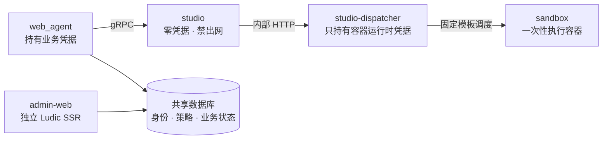

# 独立服务模块

`services/` 承载独立管理后台，以及不可信代码执行和容器调度边界。

## 服务拓扑

## 模块

| 模块 | 入口 | 职责 |
| --- | --- | --- |
| [admin-web](admin_web/README.md) | `services.admin_web` | OAuth/Casbin 管理、平台超级管理员、页面/组件权限和 Ludic SSR |
| [studio](studio/README.md) | `services.studio` | 接收已校验脚本，管理进程组、超时、输出和并发 |
| [dispatcher](dispatcher/README.md) | `services.dispatcher` | 提供内部 HTTP 接口并调度一次性沙箱 |
| [sandbox](sandbox/README.md) | 容器入口 | 在独立容器内解析控制帧并运行单个脚本 |

## 信任边界

- `web_agent` 持有 `SECRET_KEY`、数据库配置和模型凭据。
- admin-web 使用独立 Session、容器、静态资源和通知配置；客户端路由不承载后台页面。
- studio 不注入业务凭据，不挂 Docker socket，默认禁止出网。
- dispatcher 持有容器运行时权限，但只按固定模板创建、启动、读取日志和删除容器；它不执行脚本正文。
- sandbox 以非 root、只读根文件系统、无网络和无特权模式运行。

## 相关文档

- [studio 设计目录](studio/design/README.md)
- [部署说明](../deploy/README.md)
- [主服务文档目录](../README.md)
