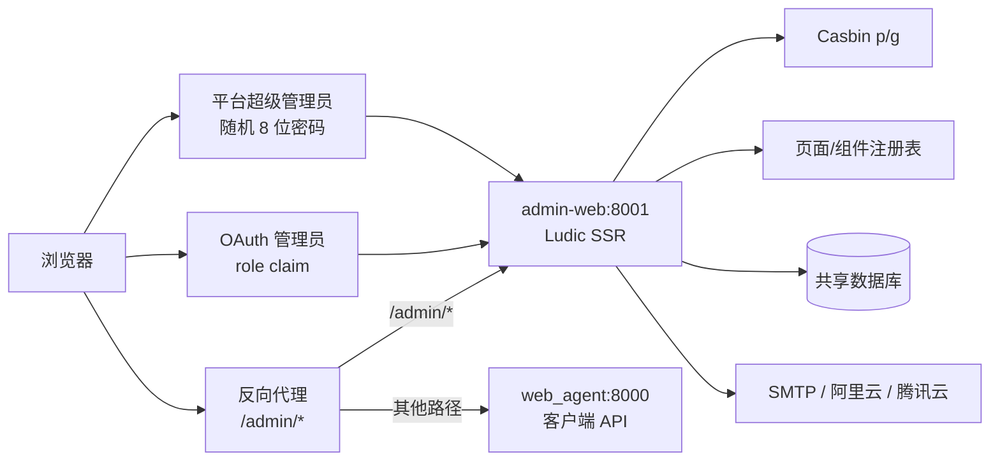

# 独立 admin-web

`services/admin_web/` 是基于 Ludic 的独立 ASGI 管理后台，入口为
`services.admin_web.app:app`，默认监听 `8001`。它与客户端 FastAPI 进程不共享
路由树、Cookie、静态资源或生命周期，只共享数据库、OAuth provider、用户身份和策略数据。

## 架构



## 身份链

| 主体 | Cookie/表 | 授权 |
| --- | --- | --- |
| OAuth 管理员 | `wa_admin_session` / `admin_session` | Casbin role + 页面/组件权限 |
| 平台超级管理员 | `wa_super_admin_session` / `super_admin_session` | 全部业务权限 |
| 普通客户端用户 | `wa_session` / `user_session` | 客户端用户接口 |

HTTPS 部署时使用对应的 `__Host-` Cookie。两条管理员 Session 同时出现时，服务会撤销
双方并要求重新登录。OAuth 管理员的角色同步版本和最大同步年龄在每次请求中校验。

## 启动

```bash
python -m alembic upgrade head
python -m scripts.bootstrap_superadmin --email ops@example.com --phone +8613800138000
uvicorn services.admin_web.app:app --host 0.0.0.0 --port 8001
```

本地无通知渠道时，只能在受控初始化场景使用一次性
`python -m scripts.bootstrap_superadmin --stdout`。不要在生产轮换或忘记密码流程使用
明文终端输出。

容器入口：

```bash
docker build -f Dockerfile.admin -t webagent/admin-web:local .
docker run --rm --memory=768m --cpus=1 --pids-limit=256 \
  --env-file .env -p 127.0.0.1:8001:8001 webagent/admin-web:local
```

`Ludic 1.x` 要求 Python 3.14，因此 admin 镜像使用独立 Python 运行时；客户端镜像版本
不受影响。

## 当前页面

- `/admin/`：概览。
- `/admin/access/pages`：页面权限与租户覆盖。
- `/admin/access/components`：组件权限与租户覆盖。
- `/admin/access/roles`：当前租户可见的 Casbin 规则。
- `/admin/access/mappings`：OAuth 外部角色到 Casbin role 的映射。
- `/admin/platform-admins`：仅 `owner_slot=superAdmin` 可访问的账号管理。
- `/admin/preferences`：Fluent、Cloudscape、Material 主题及深浅色/密度。

Workflow、Agent、Skill、MCP、LLM 和审计页面仍需按同一领域 service 边界继续迁移；
不能从浏览器调用旧客户端管理接口完成这些操作。

## 安全约束

- 所有修改请求校验 Origin、双提交 CSRF Cookie 和数据库 Session 中的 CSRF 摘要。
- 页面和组件权限在 SSR 阶段分别过滤；组件隐藏不作为 API 授权边界。
- 只允许枚举主题、色温、密度、页面 key、组件 key 和权限 object/action。
- 用户权限配置使用非空 `binding_scope` 唯一键，兼容 SQLite、PostgreSQL 和 MySQL
  对 `NULL` 唯一约束的不同语义。
- 平台超级管理员密码只保存 Argon2id 摘要，只能随机生成、重置或按 30 天周期轮换。
- 密码、Session、CSRF、SMTP 和云短信密钥不写日志、页面、URL 或审计正文。

## 测试

```bash
python -m pytest tests/test_admin_web.py tests/test_migrations.py -q
```

完整设计与验收项见 [V4.7 设计](../../app/design/v4.7-oauth-admin.md)。
