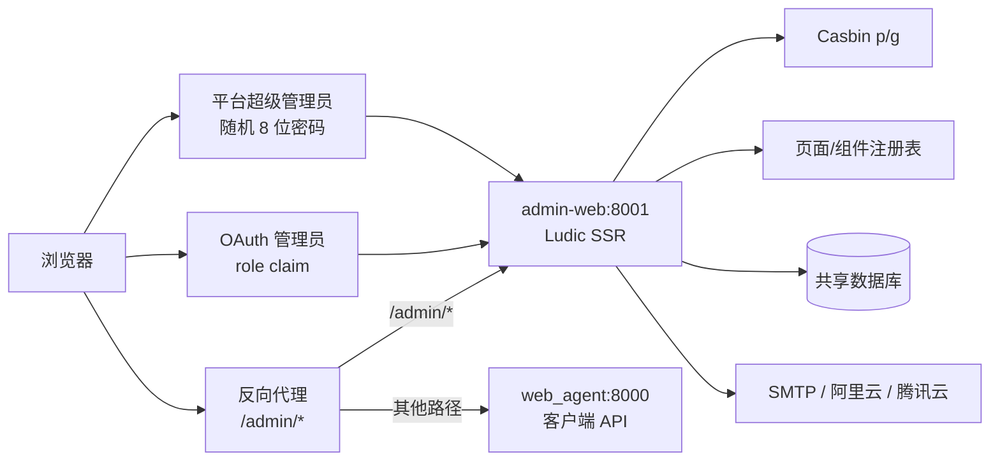

# 独立 admin-web

`services/admin_web/` 是基于 Ludic 的独立 ASGI 管理后台，入口为
`services.admin_web.app:app`，默认监听 `8001`。它与客户端 FastAPI 进程不共享
路由树、Cookie、静态资源或生命周期，只共享数据库、OAuth provider、用户身份和策略数据。

## 架构



业务页直接调用共享仓储与领域校验（Workflow、Agent、Skill、MCP、LLM、Tool Audit），
不通过浏览器转调客户端 `/api/*`。客户端管理 API 只验证同一套管理员 Session 和
Casbin 策略，浏览器不是权限边界。

## 身份链

| 主体 | Cookie/表 | 授权 |
| --- | --- | --- |
| OAuth 管理员 | `wa_admin_session` / `admin_session` | Casbin role + 页面/组件权限 |
| 平台超级管理员 | `wa_super_admin_session` / `super_admin_session` | 全部业务权限 |
| 普通客户端用户 | `wa_session` / `user_session` | 客户端用户接口 |

HTTPS 部署时使用对应的 `__Host-` Cookie。两条管理员 Session 同时出现时，服务会撤销
双方并要求重新登录。OAuth 管理员的角色同步版本和最大同步年龄在每次请求中校验。

## 启动

```bash
python -m alembic upgrade head
uvicorn services.admin_web.app:app --host 0.0.0.0 --port 8001
```

**容器里这一步是自动的**：镜像的 `ENTRYPOINT` 是
`scripts/admin_entrypoint.py`，它先把 `DATABASE_URL` 指向 `ADMIN_DATABASE_URL`
跑一遍 `alembic upgrade head`，成功后再 `exec` 成 `CMD` 里的 uvicorn（SIGTERM
能直达 uvicorn，不留中间进程）。迁移真的失败时容器**不会**带着旧结构启动；
唯一例外是「命令失败但库已经是 head」——那说明多副本里的另一个实例刚迁移完。
迁移由外部流水线负责时，用 `ADMIN_MIGRATE_ON_START=0` 关掉自动迁移。

首次启动时，如果 `super_admin_account` 中还没有固定 owner `superAdmin`，服务会生成
8 位随机密码、写入 Argon2id 摘要并输出一条 `WARNING` 日志：

```text
首次安装已创建平台超级管理员 superAdmin；初始密码仅本次日志输出：<8位密码>
```

该明文只出现一次，后续重启不会再次生成或记录。首次密码仍在 30 天轮换策略内，因此
部署方必须保护首次启动日志的访问权限。受控环境也可以在首次启动前运行
`python -m scripts.bootstrap_superadmin --stdout` 手工完成初始化。

容器入口：

```bash
docker build -f Dockerfile.admin -t webagent/admin-web:local .
docker run --rm --memory=768m --cpus=1 --pids-limit=256 \
  --env-file .env -p 127.0.0.1:8001:8001 webagent/admin-web:local
```

`Ludic 1.x` 要求 Python 3.14，因此 admin 镜像使用独立 Python 运行时；客户端镜像是
另一个独立镜像，同样基于 Python 3.14（两者不共享基础层，也不是同一个构建）。

## 当前页面

- `/admin/`：概览。
- `/admin/access/pages`：页面权限与租户覆盖。
- `/admin/access/components`：组件权限与租户覆盖。
- `/admin/access/roles`：当前租户可见的 Casbin 规则。
- `/admin/access/mappings`：OAuth 外部角色到 Casbin role 的映射。
- `/admin/platform-admins`：仅 `owner_slot=superAdmin` 可访问的账号管理。
- `/admin/preferences`：Fluent、Cloudscape、Material 主题及深浅色/密度。
- `/admin/workflows`：Workflow 图定义、启停和删除。
- `/admin/workflows/{code}`：Workflow 画布编排器（拖拽节点、连线、条件边、
  属性检查器、实时校验、撤销重做、自动布局）。
- `/admin/agents`：租户内 Agent、模型、提示词、工具与 Skill 绑定。
- `/admin/skills`：技能草稿/发布状态、正文修订和归档。
- `/admin/mcp`：MCP 连接、启停、删除和工具目录刷新。
- `/admin/llm`：LLM 接口优先级、启停和只写 API Key。
- `/admin/audit`：按 run、工具、来源和结果筛选脱敏工具审计。
- `/admin/oauth-providers`：动态配置客户端和管理端 OIDC Provider，包括 issuer、
  endpoints、client id/secret、scopes、claim、角色同步时效和登录用途。

客户端登录与管理员登录分别只读取 `client_login_enabled=1` 和
`admin_login_enabled=1` 的 Provider。一个 Provider 可以同时服务两端，也可以只开放
其中一端；client secret 只写不读，页面只显示是否已配置。

旧 `/api/admin-users` 统一返回 `410 Gone`。客户端不再接受 `X-Admin-Key`，环境变量
`ADMIN_KEY`、旧管理员仓储、旧请求模型和 Key 轮换逻辑均已删除。OAuth 管理员表只
保留 `app_user` 外键、provider、角色同步状态和 Session 版本；旧数据库列只为平滑迁移
保留，ORM 与业务不再读写。

## 安全约束

- 所有修改请求校验 Origin、双提交 CSRF Cookie 和数据库 Session 中的 CSRF 摘要。
- 同一浏览器同时存在普通用户 Session 时，后台 API 使用
  `X-Admin-CSRF-Token`，防止两套身份共用 `X-CSRF-Token` 时相互覆盖。
- 页面和组件权限在 SSR 阶段分别过滤；组件隐藏不作为 API 授权边界。
- 画布编排器的校验走 `POST /admin/workflows/validate`，与保存共用同一份
  `app/core/workflow_def.py` 规则；前端不自行判断图是否合法。
- 只允许枚举主题、色温、密度、页面 key、组件 key 和权限 object/action。
- 用户权限配置使用非空 `binding_scope` 唯一键，兼容 SQLite、PostgreSQL 和 MySQL
  对 `NULL` 唯一约束的不同语义。
- 平台超级管理员密码只保存 Argon2id 摘要，只能随机生成、重置或按 30 天周期轮换。
- 密码、Session、CSRF、SMTP 和云短信密钥不写日志、页面、URL 或审计正文。
- 首次 owner 密码按安装要求只输出一次启动日志；除此之外，密码和 client secret
  不进入日志。

## 测试

```bash
python -m pytest tests/test_admin_web.py tests/test_migrations.py -q
```

完整设计与验收项见 [V4.7 设计](../../app/design/v4.7-oauth-admin.md)。迁移结果：
OAuth 管理员角色固定租户；平台超级管理员绕过 Casbin 并按请求选择租户；普通用户
只能读取 `/api/catalog` 公开摘要。
