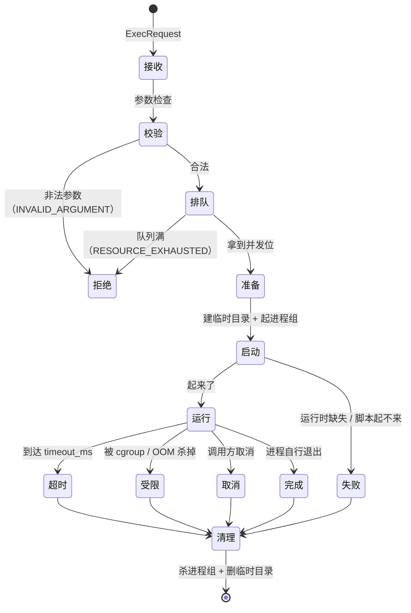

# V4：studio 当前服务设计

> 状态：V4 已实现；Docker isolated 后端与真 Docker 五场景已验证。

> 调用侧设计见 [V4 主设计](../../../app/design/v4-tools-skills.md)；全局目录与版本历史见 [设计总目录](../../../docs/design/README.md)。

> 章节编号沿用拆分前文档，便于旧链接与讨论继续使用。

---

## 1. 这份文档写什么

主设计文档 [§22.8](../../../app/design/v4-tools-skills.md#228-脚本执行grpc-调用-studio-容器)
写的是**调用侧视角**：
web_agent 怎么调、契约长什么样、为什么不在本进程起子进程。那是**接口**。

这份文档写的是**服务侧**：这个容器里面长什么样、一次执行的生命周期怎么走、隔离怎么落、
资源怎么管、镜像里装什么、怎么部署、怎么扩缩、怎么测、出了事怎么办。

一句话分工：

| | 主设计文档 §22.8 | 本文件 |
| --- | --- | --- |
| 视角 | 调用方（web_agent） | 服务方（studio） |
| 内容 | 为什么这样做、契约、工具语义、信任边界 | 容器内部、隔离、资源、部署、运维 |
| 读者 | 改 `app/core/tools.py` 的人 | 写 studio 的人、运维的人 |

**两份文档的 proto 必须逐字一致。** 契约文件本身在仓库里只有一份
（`proto/webagent/studio/v1/studio.proto`），两边引用同一份；CI 会校验两边贴出来的 proto
片段与文件一致（§16）。改契约要同时改三处：proto 文件、两份文档。

---

## 2. 服务定位与边界

### 2.1 一句话

**studio 是一台「只跑技能脚本的无状态执行机」**：给它一段脚本和一组参数，它在受限环境里
跑完，把 stdout / stderr / 退出码还回来。它不认识用户、不认识技能、不认识 web_agent。

### 2.2 职责

| 做 | 不做 |
| --- | --- |
| 在受限环境里执行一段脚本 | 不保管业务状态（无状态） |
| 回收资源、杀掉超时/残留进程 | 不做编排、不做重试策略（那是调用方的） |
| 限制 CPU / 内存 / 时长 / 输出大小 | 不判断脚本「该不该跑」（那是调用方的授权表） |
| 上报指标与结构化日志 | 不写业务数据库（它没有数据库连接） |
| 报告自己能跑哪些运行时 | 不做鉴权（网络层隔离，§11） |

### 2.3 它刻意不认识的东西

studio **没有技能的概念**。它收到的是「一段脚本正文 + 路径标识」，不是「技能 ID + 相对
路径」。这是刻意的：

- 技能存在 web_agent 的**数据库**里（主设计 §22.4、§22.5），不是文件。studio 要看到它就得
  连数据库——那就要给它数据库凭据，而它是「执行模型给的任意代码」的地方。**给它凭据等于
  把整个业务数据面交给模型**，所以绝不能给；
- 路径校验必须留在调用方（web_agent 侧做，主设计 §22.7），因为只有它知道「这个 Agent 绑定
  了哪些技能」；
- studio 保持**通用**：它只认「一段代码 + 参数」，不认「技能」这个业务概念。换一个调用方
  （比如别的服务）也能用。

### 2.4 隔离档位

| 档位 | 隔离强度 | 一次执行的开销 | 适用 |
| --- | --- | --- | --- |
| `fast`（默认） | 容器内**独立进程组** + 独立临时工作目录 + 只读 rootfs | 几十~几百毫秒 | 纯计算：解析、转换、统计 |
| `isolated` | 每次执行起一个**一次性容器** | 秒级 | 触碰第三方库、需要完整依赖树的脚本 |

**`fast` 档与 `isolated` Docker 后端均已实现。** 请求档位、响应回显、
`Health` 按档位报能力、启动期审计，以及
`services/sandbox/`（runner + 控制帧 + 镜像）与 `services/dispatcher/`（只调度的控制面）。

档位由**技能声明**（`metadata.runtime-profile`）算出来，随请求的 `profile` 带到服务端；
服务端只能升、不能降，并在响应里回显**实际**档位。`STUDIO_ISOLATED_SKILL_CODES` 是
运维的**升级覆盖**（只升不降），`STUDIO_PROFILE` 是实例默认档；老客户端不带 `profile`
时沿用旧路由。版本门槛见 §14.3。

**执行链路**（isolated）：

```text
studio.Exec(profile=isolated)
  └─ DispatcherRuntime  ── POST /v1/exec ──▶  dispatcher
                                               ├─ 按固定模板 create 一次性容器
                                               ├─ 只读 bind mount(payload)
                                               ├─ start / wait / logs
                                               └─ remove
                                                   └─ services/sandbox/runner
                                                       └─ 控制帧（META/OUT/ERR/END）
```

**部件状态**：

| 部件 | 状态 |
| --- | --- |
| `Launcher` 抽象（两个档位对外形状一致） | ✅ |
| 路由（实例默认档 / 运维覆盖列表 / 请求档位，只升不降） | ✅ |
| `isolated` 档**自己的**并发池与等待队列（§8.4） | ✅ |
| 请求档位 `ExecProfile` + 响应回显（Phase 0） | ✅ |
| `Health` 按档位报能力（`profiles` / `images`，Phase 0） | ✅ |
| 启动期版本下限 + 技能绑定审计（Phase 0） | ✅ |
| Docker 执行体：`DispatcherRuntime` + dispatcher + 沙箱镜像（Phase 1） | ✅ |
| 控制帧协议（4 KB 分片 + END 摘要） | ✅ `services/sandbox/protocol.py` |
| 真实 Docker 环境 e2e | ✅ 2026-11-04 用正式镜像跑通（§20） |

**为什么不让 studio 直接起容器**：起容器需要挂 Docker socket，而 studio
里跑着模型指定的代码——这等于把宿主 root 等价权限交给脚本，与 §7 的「零凭据、无宿主
挂载」直接冲突。所以 Docker socket 只在 **dispatcher** 里，studio 通过内部 HTTP 调它；
dispatcher 只按固定模板建容器，从不执行 `content`。

**绝不悄悄退回 `fast` 档**：悄悄退回是最坏的一种降级——调用方以为拿到的是强隔离，
实际不是，而且**没有任何痕迹**。所以档位不可用时必须明确说出来（§12 的失败模式表
是同一口径：「studio 不可用」要回灌给模型，「isolated 档不可用」同理）。

---

## 3. 内部架构

### 3.1 进程模型

studio 是一个**单进程 gRPC 服务**（不是一个容器起 N 个进程的池）：

```text
studio 容器
└── studio 进程
    ├── gRPC server（asyncio）
    ├── 并发闸门（信号量，max_concurrency）
    ├── 队列（等待位，超出深度则拒绝）
    └── 执行器
        └── 每次 Exec：起一个独立进程组
            ├── 独立 cwd（临时目录）
            ├── 环境变量白名单
            ├── stdin/stdout/stderr 管道
            └── 跑完 → 杀进程组 → 删临时目录
```

**为什么不在 studio 里面再套一层容器**：每个请求起一个容器的开销是秒级，而技能脚本大多
是「解析一下 CSV、算个指标」这种毫秒级操作。秒级开销会让技能执行在经济上不可用。

`fast` 档的隔离弱于容器边界——同一容器内先后两次执行之间理论上存在残留（临时目录、环境
变量）。对策是三条：**独立进程组**（§6）、**独立临时目录**（§9.2）、**只读 rootfs**（§7）。
真正需要强隔离的，走 `isolated` 档。

### 3.2 为什么是 asyncio

web_agent 全异步（主设计 §1.2「全异步纪律」），studio 与它同构：

- gRPC 用 `grpc.aio`；
- 脚本执行是**同步阻塞**的（`subprocess` + 管道读），**必须**放进
  `asyncio.to_thread` 或独立线程池，否则一个卡住的脚本会把整个 studio 的事件循环堵死，
  连 `Health` 都答不上；
- 管道读取用 `asyncio` 的连接器（`loop.connect_read_pipe`）或线程池里的 `read()`，不能
  在事件循环里直接 `read()`。

**「不让一个脚本拖垮整个服务」是这条纪律的核心**：studio 的并发能力取决于
`max_concurrency` 而不是线程数。

---

## 4. 执行生命周期

一次 `Exec` 的状态流转：



「清理」这一步**必须做**，而且**必须对所有终态都做**（包括失败路径）。漏一次就漏一个孤儿
进程；孤儿进程会占着内存直到容器被回收——而容器的回收周期是分钟级，不是秒级。

### 4.1 各终态对应的 `ExecStatus`

| 情形 | `status` | `exit_code` | `error` |
| --- | --- | --- | --- |
| 脚本自己退出（0 或非 0） | `COMPLETED` | 脚本的退出码 | 空 |
| 运行时缺失 / 脚本起不来 / 参数非法 | `FAILED` | `-1` | 说明文字 |
| 到达 `timeout_ms` 被杀 | `TIMEOUT` | `-1` | 说明文字 |
| 被 cgroup / OOM 杀掉 | `LIMITED` | `-1` | 说明文字 |
| 调用方取消 | `CANCELLED` | `-1` | 说明文字 |

**脚本自己 `exit 1` 是 `COMPLETED` 而不是 `FAILED`。** 这是本契约最重要的一条语义：

> gRPC 层面「成功」= **studio 正常工作**；脚本成功与否由 `status` 与 `exit_code` 表达。

理由在主设计 §17.5：工具执行失败要把错误**回灌给模型**，让模型有机会自己纠正。调用方看到
`exit_code=1` + stderr，会把它当成「脚本跑完了但失败了」，回灌给模型；而如果 studio 用 gRPC
错误码报「脚本失败」，调用方就只能当成**服务不可用**处理——那语义完全错了，模型也拿不到
stderr 的细节。

---

## 5. gRPC 契约（规范版）

> 这一节是**规范**。proto 文件在 `proto/webagent/studio/v1/studio.proto`，两边贴的片段必须
> 与它一致。

```proto
syntax = "proto3";
package webagent.studio.v1;

// studio：技能脚本的受限执行容器。
// 调用侧视角见主设计文档 §22.8。
service Studio {
  // 执行一个脚本，同步返回结果
  rpc Exec(ExecRequest) returns (ExecResponse);
  // 探活：容器是否就绪、装了哪些运行时
  rpc Health(HealthRequest) returns (HealthResponse);
}

// 执行档位。请求里带上它，服务端只能升、不能降；响应里回显**实际**档位。
enum ExecProfile {
  EXEC_PROFILE_UNSPECIFIED = 0;  // 老客户端：沿用服务端路由
  EXEC_PROFILE_FAST = 1;         // 容器内独立进程组（默认）
  EXEC_PROFILE_ISOLATED = 2;     // 每次执行起一次性沙箱
}

// 执行结果的状态。
// **gRPC 层面成功 ≠ 脚本成功**：脚本自己 exit 1 是 COMPLETED + exit_code=1，
// 业务失败要靠 status/exit_code 表达，不能用 gRPC status 报错——调用方要把
// 失败信息回灌给模型（主设计 §17.5）。
enum ExecStatus {
  EXEC_STATUS_UNSPECIFIED = 0;
  EXEC_STATUS_COMPLETED = 1;  // 脚本跑完了，exit_code 有意义
  EXEC_STATUS_FAILED = 2;      // 没能跑起来（运行时缺失、启动失败、非法脚本）
  EXEC_STATUS_TIMEOUT = 3;     // 超时被杀
  EXEC_STATUS_LIMITED = 4;     // 被资源限制杀掉（OOM / cgroup 限额）
  EXEC_STATUS_CANCELLED = 5;   // 调用方取消
}

message ExecRequest {
  string skill = 1;           // 技能 code（审计用）
  string script = 2;          // 相对技能根目录的脚本路径，如 scripts/extract.py
  string language = 3;        // python | bash | node
  string content = 4;         // 脚本正文（调用方读出来随请求带上）
  repeated string argv = 5;   // 传给脚本的参数
  string stdin = 6;           // 标准输入（文本）
  int64 timeout_ms = 7;       // 执行时限；服务端还会再按上限收一道
  string run_id = 8;          // 关联一次 run（审计）
  string node_id = 9;         // 关联一个节点
  string request_id = 10;     // 追踪键；同键在去重窗口内不重复执行
  ExecProfile profile = 11;   // 调用方请求的档位；服务端只能升、不能降
  string image = 12;          // 镜像目录名（不是完整 ref）；空 = default
  string traceparent = 13;    // W3C Trace Context；贯穿 studio / dispatcher / sandbox
  string tenant_id = 14;      // 租户标识；只用于共享配额与计费标签，不传给脚本环境
}

message ExecResponse {
  ExecStatus status = 1;
  int32 exit_code = 2;        // 仅 COMPLETED 时有意义
  string stdout = 3;
  string stderr = 4;
  bool truncated = 5;          // 输出被截断
  int64 duration_ms = 6;
  string error = 7;            // 服务级错误说明（不是脚本的 stderr）
  string stdout_digest = 8;    // stdout 的 sha256，用于审计与去重
  ExecProfile profile = 9;     // **实际**使用的档位，必须回显
  int64 startup_ms = 10;       // 沙箱启动耗时（fast 为 0）
  string error_code = 11;      // 稳定枚举字符串；见 services/studio/design/v4-current.md §5.1
  int64 image_startup_ms = 12; // 容器启动调用本身的耗时（fast 为 0）
  double cpu_seconds = 13;     // 沙箱 cgroup 统计的 CPU 秒数
  int64 peak_memory_bytes = 14; // 沙箱 cgroup 内存峰值
}

message HealthRequest {}

message HealthResponse {
  bool ready = 1;
  string version = 2;
  repeated LanguageInfo language_info = 3;
  int32 max_concurrency = 4;
  string profile = 5;          // 当前隔离档：fast | isolated（兼容字段）
  repeated ProfileInfo profiles = 6;   // 按档位报能力
  repeated ImageInfo images = 7;       // isolated 可用的镜像目录
  int64 isolated_startup_budget_ms = 8;  // 沙箱启动预算（毫秒）
}

// 一个档位现在能不能用。`ready=false` 时 `detail` 说明原因。
message ProfileInfo {
  string name = 1;             // fast | isolated
  bool ready = 2;
  int32 max_concurrency = 3;
  int32 queue_depth = 4;
  string detail = 5;
}

// isolated 可用的镜像（目录名，不是完整 ref）。
message ImageInfo {
  string name = 1;             // 如 default / ml-py311
  repeated string languages = 2;   // 该镜像能跑的运行时
  string digest = 3;           // image@sha256:...
}

message LanguageInfo {
  string name = 1;             // python
  string version = 2;          // 3.11.9
  repeated string extensions = 3;   // .py
}
```

### 5.1 gRPC status code 的用法

gRPC status 只用来表达**「studio 自己的问题」**，不用来表达脚本的业务失败：

| 情形 | gRPC status | 说明 |
| --- | --- | --- |
| 参数非法（`content` 空、`language` 不认识、`argv` 超长） | `INVALID_ARGUMENT` | 调用方的 bug |
| 请求的 `language` 本实例不支持 | `FAILED_PRECONDITION` | 查 `Health.language_info` |
| 队列满 / 并发超限 | `RESOURCE_EXHAUSTED` | 调用方应退避重试 |
| 实例正在下线 | `UNAVAILABLE` | 调用方重试到别的实例 |
| studio 内部错误 | `INTERNAL` | —— |

**`ExecResponse.error` 与 gRPC status 的分工**：`error` 是**服务级**错误说明（服务内部出错、
运行时缺失这类），`stderr` 是**脚本级**输出（脚本自己写的）。两者语义不同，模型看到的反应
也不同（主设计 §22.8.3）。

**`ExecResponse.error_code` 与 gRPC details 的约定**：响应级失败用 `error_code`
（`timeout` / `limited` / `failed` / `sandbox_result_lost` …）；gRPC 级失败把 code 放在
details 的稳定前缀里——`"<code>: <人话>"`（如 `"capability_missing: …"`）。调用方按
code 分支，**不匹配整句人话**。

### 5.2 `request_id` 与去重

`request_id` 由调用方生成，服务端在**去重窗口**（默认 60 秒）内看到同一个 `request_id`，
直接返回上次的结果，**不重复执行**。

用途：调用方超时重试时，重发同一个 `request_id` 就不会把脚本跑第二遍。取消已有独立传播
路径，但重试去重仍需幂等键。这比 MCP 那边强——MCP 协议没提供幂等键，主设计
§21.14 第 6 条只能列为已知限制。

**注意**：去重是**尽力而为**，不是事务保证。窗口过期、或 studio 重启后，重复执行仍可能发生。
要真正幂等，得由脚本自己在业务层做（主设计 §21.9 的同一结论）。

---

## 6. 进程隔离

### 6.1 独立进程组

每次执行都用 `os.setsid()`（或 `start_new_session=True`）起子进程，让它成为**新 session
的组长**。这样它的所有后代都在同一个进程组里。

**为什么必须杀进程组而不是杀进程**：脚本常常会再起子进程（`sh -c` 里调别的工具、python 起
一个 worker）。只杀父进程的话，孙进程会继续跑、继续占内存、继续持有打开的文件——而容器
不会立刻回收它。

超时/取消时的处置顺序：

1. `os.killpg(pgid, SIGTERM)` —— 给 2 秒优雅退出；
2. 还活着 → `os.killpg(pgid, SIGKILL)` —— 强杀；
3. 无论哪条路径，都要 `wait()` 回收子进程，否则留下 zombie。

### 6.2 工作目录

每次执行用 `tempfile.mkdtemp()` 建一个**独立**的工作目录，跑完 `shutil.rmtree`。
工作目录与技能资产无关——studio 看不到任何技能内容（§11.2），所以技能要写文件就写 cwd（临时目录），
写完即弃。

### 6.3 环境变量白名单

只保留固定的几个：`PATH`、`HOME`（指向临时目录）、`LANG`、`TZ`、`PYTHONUNBUFFERED=1`、
`PYTHONDONTWRITEBYTECODE=1`。**其余一律不传**——studio 容器里本来也没有凭据（§7），但
调用方在请求里带的东西也不能直接进环境。

### 6.4 资源限额（进程内）

| 项 | 值 | 挡什么 |
| --- | --- | --- |
| `RLIMIT_FSIZE` | 64 MB | 脚本写爆磁盘 |
| `RLIMIT_NOFILE` | 256 | 打开文件数失控 |
| `RLIMIT_NPROC` | 64 | fork 炸弹 |
| `RLIMIT_CORE` | 0 | 不产生 core dump（core dump 里可能有数据） |
| `RLIMIT_CPU` | 与 `timeout_ms` 对齐 | CPU 时间超限（墙钟超限由 §8 的定时器兜） |

容器级的 `memory` / `cpu` limit 由 cgroup 负责（§13.2），进程内的 `setrlimit` 是第二道。

### 6.5 残留清理

除了「每次执行后清理」，studio 进程启动时要**巡检并杀掉不属于本次运行的残留进程**——
上一次崩溃可能留下孤儿。启动时按「进程组的启动时间晚于 studio 启动时间」筛一遍。

---

## 7. 沙箱加固

容器层面的加固**不在 studio 里做**：Docker 后端由 dispatcher 的固定模板设置
（`services/dispatcher/docker_backend.py` 的 `containers.create(...)`）；沙箱镜像本身
只负责「非 root + 不装多余的东西」
（`services/sandbox/Dockerfile`）。runner 里的进程组 / ulimit / 临时目录是第二道。

| 项 | 要求 | 为什么 |
| --- | --- | --- |
| 凭据 | **零**（不注入任何 env、不挂载任何 secret） | 它执行的是模型指定的代码 |
| rootfs | **只读** | 脚本只往 cwd（临时目录）写 |
| 可写目录 | 只有 cwd 与 `/tmp`（tmpfs 或空卷） | 写完即弃 |
| 特权 | `privileged=false`、`no-new-privileges` | 阻止权限提升 |
| capabilities | 全部 drop（含 `CAP_NET_RAW`） | —— |
| 用户 | 非 root（uid 1000 之类） | —— |
| `no-new-privileges` | 开 | 阻止 setuid 提权 |
| seccomp | 使用运行时默认 profile（可按部署策略收紧） | 挡 syscall 面 |
| PID 限额 | `pidsLimit`（如 256） | fork 炸弹的容器级兜底 |
| 出网 | **禁**（Docker `network_disabled=true`） | 见 §11 |
| 宿主挂载 | **只有一个只读 payload**，不给 Docker socket 或业务目录 | 逃逸的最短路径 |

> **「零凭据」是这一整节的重点。** studio 容器里如果有一个能用的 API key，那么一次
> 提示词注入就够了：模型让脚本读出那个 key 并打印到 stdout，脚本的结果会被回灌进 prompt，
> 再由模型写进最终答案。**没有任何凭据可偷，这条链就断了。**

---

## 8. 资源治理

### 8.1 并发闸门与队列

- 每个实例有 `max_concurrency`（默认 `CPU 核数 × 2`）：**同时**在跑的脚本数上限；
- 超出并发上限的请求进入**等待队列**（深度上限 `max_queue`，默认 `max_concurrency × 4`）；
- 队列满 → `RESOURCE_EXHAUSTED`（调用方退避重试）；
- **排队时间计入 `timeout_ms`**：调用方给的时限是「从发出算起」还是「从开始执行算起」，
  必须定死。本设计取**从发出算起**——调用方等不了「排在第 3 位还要再等 20 秒」。

### 8.2 超时

- 调用方给的 `timeout_ms` 是**上限**，服务端再按自己的 `max_timeout_ms`（默认 60 秒）收
  一道，取**较小值**；
- 墙钟定时器由事件循环负责，到点杀进程组（§6.1）；
- `RLIMIT_CPU` 也设上，作为「脚本用满 CPU 但没卡住」的兜底。

### 8.3 取消

gRPC 的取消会传播到服务端的 handler，studio 应当：

1. 停止等待输出；
2. 杀进程组；
3. isolated 档调用 dispatcher 的 `/v1/exec/{execution_id}/cancel`；
4. dispatcher 对运行中的容器执行强制删除；
5. 返回 `CANCELLED`（或直接让 RPC 以 `CANCELLED` 结束）。

取消信号本身不会跨网络自动传到 Docker 容器，所以 studio 必须显式调用 dispatcher；服务端
自设时限仍是清理失效时的兜底。真实 Docker 用例要求取消后 5 秒内容器消失。

### 8.4 隔离档的资源差异

`isolated` 档（每请求起一次性容器）的开销是秒级、资源占用高一个数量级。它必须**单独排队**，
不能和 `fast` 档抢同一个并发池——否则几个慢脚本能把快脚本全堵死。

**已实现**：两个档位各有自己的并发池与等待队列（`STUDIO_ISOLATED_MAX_CONCURRENCY` /
`STUDIO_ISOLATED_MAX_QUEUE`），并支持静态技能级配额
（`STUDIO_SKILL_QUOTAS` / `STUDIO_SKILL_QUEUE`）。这条是**可执行验证**的：
`tests/test_studio_isolated.py`
用假 runtime 占住 `isolated` 档的并发位，`fast` 档照常立刻返回（§19 的测试条目）。
Phase 1 之后，dispatcher 的 `DISPATCHER_MAX_INFLIGHT` 是第二层并发上限——studio 的
池按实例算，dispatcher 的池按它自己算，两层都要撑住。

---

## 9. 输入输出契约

### 9.1 输入

| 通道 | 类型 | 上限 | 说明 |
| --- | --- | --- | --- |
| `content` | 脚本正文（文本） | 200 KB | 调用方侧校验 |
| `argv` | 参数数组 | 64 项 / 单项 4 KB | 不接受 shell 拼接，**不经过 shell 解析** |
| `stdin` | 文本 | 256 KB | 二进制不做 base64（不支持） |

**`argv` 绝不拼成 shell 字符串。** 直接 `execve` 式传参，参数里的 `;` `|` `` ` `` 就是普通
字符。否则调用方或模型传一个 `foo; rm -rf /` 就是一次命令注入——虽然在容器里，但仍然是
不必要的风险面。

**输入文件怎么办**：脚本要读数据，走 `stdin`（文本）或由调用方从库里读出内容后内联。studio
**不接受文件路径作为输入**——它没有文件系统视图（§11.2）。

### 9.2 输出

| 通道 | 上限 | 超限处置 |
| --- | --- | --- |
| stdout | 1 MB | 截断，`truncated=true`，**停止读取** |
| stderr | 256 KB | 同上 |

**停止读取是关键**：如果只截断但继续读，一个 `cat /dev/urandom` 就能把 studio 的内存吃光。
超限后要主动关掉管道并杀进程组。

stdout 还会附一个 `stdout_digest`（sha256）——审计用，也让调用方能判断「结果是不是同一份」。

### 9.3 编码

- stdout / stderr 按 **UTF-8** 解码，解码失败用 `errors="replace"`；
- 脚本输出非 UTF-8 二进制（比如图片）——**不支持**。要走二进制就设计成「脚本算出结果、
  写到 stdout 的 base64」，由调用方解码。

---

## 10. 运行时矩阵

### 10.1 装哪些语言

默认镜像装三种：**python**（3.11+）、**bash**（系统）、**node**（20 LTS）。理由是这三样
覆盖了绝大多数「技能脚本」的用途，且都是解释型语言、无需编译。

| 语言 | 运行时 | 扩展名 | 备注 |
| --- | --- | --- | --- |
| python | `python3` | `.py` | 需要 `pip install` 的第三方包**不装进基础镜像** |
| bash | `bash` | `.sh` | 系统自带 |
| node | `node` | `.js` / `.mjs` | —— |

**第三方依赖怎么办**：基础镜像保持干净。需要依赖的技能要么把依赖**内联到脚本里**（单文件
自包含），要么走 `isolated` 档用带依赖的定制镜像。这一条要在技能规范里写清楚，否则作者会
理所当然地 `pip install`——而容器里**禁出网**，装不上。

### 10.2 怎么声明与发现

- 服务端配置声明本实例支持的语言；
- `Health.language_info` 把实际可用的语言与版本报出来；
- 调用方在**配置期**校验「这个脚本的语言在本实例可用吗」，不在就拒（主设计 §21.8 的
  同一套「写的时候严格」）。

### 10.3 版本漂移

`Health` 报出来的语言版本会随镜像升级而变。调用方**不应**依赖具体版本号，只依赖
`LanguageInfo.name`。需要特定版本的脚本，走 `isolated` 档的定制镜像。

---

## 11. 出网与文件系统策略

### 11.1 出网

**默认完全禁出网**（含 DNS）。理由：studio 里的代码是被模型驱动的，出网就等于给了它一条
外传通道——把容器里读到的任何东西 POST 出去。

需要外网的脚本怎么办：

- **不走脚本**——走 MCP 工具（主设计 §21）。MCP 工具是**受控**的、有白名单的、经过协议
  的外部访问路径，比在脚本里 `curl` 强得多；
- 当前 Docker sandbox 固定关闭网络，不提供脚本级出网开关。

### 11.2 文件系统

studio 容器里**看不到**任何业务文件：

| 路径 | 内容 |
| --- | --- |
| `/` | 只读，基础镜像 |
| cwd | 本次执行的临时目录（唯一可写） |
| `/tmp` | tmpfs，执行期间可写 |
| 技能内容 | **不存在**（studio 不连数据库，也没有任何技能挂载） |
| `/proc` `/sys` | 容器自己的，无宿主信息 |

**技能资产不进容器**是刻意的：那些文件是「模型会读的内容」，让执行环境也能看到它们，等于
把提示词注入面直接搬到了沙箱里。

---

## 12. 可观测性

### 12.1 指标

| 指标 | 类型 | 标签 | 说明 |
| --- | --- | --- | --- |
| `studio_exec_total` | counter | `status`, `language`, `profile` | 执行次数 |
| `studio_exec_duration_seconds` | histogram | `language`, `profile` | 端到端耗时 |
| `studio_exec_active` | gauge | —— | 当前在跑的脚本数 |
| `studio_exec_queue_wait_seconds` | histogram | `profile` | 排队时长 |
| `studio_exec_timeout_total` | counter | `language` | 超时次数 |
| `studio_exec_output_truncated_total` | counter | `language` | 输出被截断次数 |
| `studio_exec_failed_total` | counter | `reason` | 启动失败的原因分布 |
| `studio_orphan_process_total` | counter | —— | 启动巡检发现的残留进程数 |

`studio_exec_failed_total{reason}` 的 `reason` 取值：`runtime_missing` / `spawn_failed` /
`invalid_request` / `unknown_language` / `isolated_unavailable` / `capability_missing` /
`image_unknown`。

`isolated_unavailable` / `capability_missing` 是「这个技能走 `isolated` 档，但本实例
没有部署容器运行时」——它是一个**启动失败**，所以进这个指标；同时会以
`FAILED_PRECONDITION` 回给调用方（§2.4）。

**落地**（`services/studio/metrics.py`）：`/metrics` 端点监听 `STUDIO_METRICS_PORT`
（默认 `9090`，设成 `0` 就不启用），输出 **Prometheus 文本 exposition 格式**
（`text/plain; version=0.0.4`）。

**没有引第三方库**：studio 的镜像**只装两个包**（grpcio + protobuf），这是有意的——
容器里跑的是模型指定的代码，镜像越小、依赖越少，被供应链投毒后能拿到的东西就越少
（`services/studio/requirements.txt` 的开头就写着这条）。为了导指标再引一个
`prometheus_client`，等于把这条原则让出去一半。exposition 格式本身就是
counter / gauge / histogram 三种类型，自己写一百来行就够，HTTP 端点用
`asyncio.start_server` 起，犯不着为一个 GET 端点引一个 Web 框架。

### 12.2 日志

结构化 JSON，**每条执行一条汇总日志**（不是逐行转发脚本输出——那会淹掉日志）：

```json
{"ts":"...","level":"info","event":"exec.done","request_id":"...","run_id":"...",
 "node_id":"...","skill":"financial-report","script":"scripts/extract.py",
 "language":"python","status":"COMPLETED","exit_code":0,
 "duration_ms":143,"stdout_bytes":2048,"stderr_bytes":0,"truncated":false,
 "stdout_digest":"sha256:...","profile":"fast","image":"",
 "startup_ms":0,"error_code":""}
```

**不要把 stdout / stderr 的内容写进日志**——脚本输出可能含敏感数据（主设计 §22.10 第 2
条）。只记字节数与摘要。

**落地**（`services/studio/exec_log.py`）：logger 名 `services.studio.exec`，每次执行
记**一行** JSON。`status` 用 proto 的枚举名（`COMPLETED` / `FAILED` / `TIMEOUT` /
`LIMITED` / `CANCELLED`），`stdout_digest` 带 `sha256:` 前缀，其余字段与样本一一对应。

`profile` 是**实际**档位，`image` 是镜像目录名（fast 为空），`startup_ms` 是沙箱启动
耗时（fast 为 0），`error_code` 是机器可读的失败码。有它们，事后才能把一次执行与
「哪个档、哪个镜像、启动花了多久」对上——而不是只看到 `status=FAILED`。

**那一行是「纯 JSON」，不带普通日志的前缀**。这个 logger 有自己的 handler（格式
`%(message)s`），而且 `propagate=False`——不然它会往根 logger 冒泡，被普通格式化器
再打一遍，变成「同一件事出现两次：一次纯 JSON，一次带时间戳前缀」。

`stdout_bytes` / `stderr_bytes` 是**原始字节数**（不是解码后的字符数）——解码失败会
用 `errors="replace"` 兜底，那时的字符数与字节数对不上，审计要用字节数。

### 12.3 链路追踪

按 OTel 规范开 span，属性带 `request_id` / `run_id` / `node_id` / `skill` / `language`。
与 web_agent 侧的 span 用 trace context 连起来——主设计 §11 把可观测性列为 V4 的另一项，
这里先占好位置。

---

## 13. 部署与扩缩

### 13.1 编排形态

Docker Compose 部署由三部分组成：

| 组件 | 建议 | 理由 |
| --- | --- | --- |
| `studio` | 1 CPU / 2 GB 内存上限 | 解释器、队列与 fast 档执行 |
| `studio-dispatcher` | 1 CPU / 256 MB 内存上限 | 只持有 Docker socket，不执行脚本正文 |
| 一次性 sandbox | 1 CPU / 512 MB / 256 PIDs | 每次执行独立创建并删除 |

生产部署应使用 `deploy/docker-compose.lab.yml` 的网络与加固配置，并按宿主机容量设置
并发和队列。studio 无状态，可以启动多个实例；调用方可用 DNS 多地址与 `round_robin`
分配请求。

### 13.2 内存与 `LIMITED`

容器的 memory limit 被突破时，进程会被 OOM killer 干掉。studio 要能识别这一点：子进程被
`SIGKILL` 时，判为 `LIMITED` 而不是「脚本自己 kill 了自己」。

**退出码有两种形状，都要认**（`services/studio/oom.py`）：

| 形状 | 出处 |
| --- | --- |
| `-9` | POSIX 上 Python 的 `subprocess`：被信号 N 杀死时 `returncode` 是 `-N` |
| `137` | `128 + 信号号`：容器运行时与 shell 的惯例（脚本里再套一层 shell 时常见） |

判定的落地（`services/studio/executor.py`）：进程自行退出、但退出码是上面两种之一时，
状态是 `LIMITED`、`exit_code` 按契约是 `-1`、原因写进 `error`。**超时是我们自己杀的
进程**（`TIMEOUT`）、**输出超限**（`LIMITED`，但说的是「输出超限」）——两者都不走这条路。

**「为什么被杀」靠 cgroup 佐证**：退出码只能说明「被 SIGKILL 了」，说明不了「为什么」。
cgroup v2 的 `/sys/fs/cgroup/memory.events` 里有 `oom_kill` 计数——**执行期间它涨了**，
就说明确实是 OOM killer 干的，说明文字里才敢写「内存超出容器限额」；读不到（没有
cgroup v2、权限不够）时照样按退出码判定，只是话术留余地（「多半是内存超出容器限额，
也可能是脚本自己 kill 了自己」）。

**别让 studio 自己成为受害者**：内核的 OOM killer 按内存占用挑进程——吃内存的脚本本来
就是首选，但「碰巧」不等于「必然」。所以脚本子进程的 `oom_score_adj` 被调到 1000
（`STUDIO_OOM_SCORE_ADJ`，最大 = 优先被挑中）。这一手实测下来有坑：

- `prctl(PR_SET_OOM_SCORE_ADJ, 1000)` 在容器里**返回 0 却什么都不做**（带不带
  `argtypes`、uid 1000 还是 uid 0，都一样。原因未查清）——**不能信它的返回值**；
- **写 `/proc/self/oom_score_adj` 才有效**，uid 1000 就能写，fork 出来的子进程里写
  也生效。所以实现走 `/proc` 路径，并且**回读验证**；
- 内核只允许把值往「更易被杀」的方向调（往下调要 `CAP_SYS_RESOURCE`）——正好是我们
  要的语义。

**实测（真容器）**：256 MB 限额下跑一个申请 1 GB 的脚本 → 内核 OOM killer 杀掉脚本、
studio 存活 → 返回 `LIMITED` + `exit_code=-1` + 「内存超出容器限额」的说明，
cgroup 的 `oom_kill` 计数 +1。

### 13.3 探针

| 探针 | 实现 | 为什么 |
| --- | --- | --- |
| `startup` | 调 `Health`，返回 ready | 慢启动（解释器预热）不算失败 |
| `liveness` | 调 `Health` | 卡死的实例要被重启 |
| `readiness` | 调 `Health` **且** `ready=true` | 队列满时可以不接流量 |

`Health` 必须**便宜**：不能跑脚本、不能读文件。

### 13.4 gRPC 多后端

gRPC 使用 HTTP/2 长连接，`pick_first` 只使用第一个解析地址。多个 studio 实例通过同一个
DNS 名字暴露时，客户端应使用 `dns:///` 与 `round_robin`，或使用明确的服务发现方案；
只有单实例时不需要额外配置。

### 13.5 优雅停机

收到 `SIGTERM`：

1. 立刻把 readiness 置为 false（从负载均衡摘掉）；
2. 停止接受新请求；
3. 等在跑的执行结束，最多 `drain_timeout`（默认 30 秒）；
4. 超时未结束的直接杀进程组；
5. 清理临时目录后退出。

第 1 步必须**先于**第 3 步，否则新的请求会一直进来，drain 永远结束不了。

### 13.6 isolated 的部署形态（Phase 1 Docker）

`isolated` 是**三个长期组件 + 一个一次性容器**：

| 组件 | 凭什么 | 注意 |
| --- | --- | --- |
| `studio` | 无凭据 | 不挂 Docker socket；`STUDIO_ISOLATED_DISPATCHER_ADDR` 指向 dispatcher |
| `studio-dispatcher` | 只持 Docker socket | 只调度、不执行 `content`；`DISPATCHER_IMAGES` 与 studio 的 `STUDIO_ISOLATED_IMAGES` 必须一致 |
| 一次性沙箱 | 零凭据 | `network_disabled` / `read_only` / `1000:1000` / caps 全 drop / pids/mem/cpu 限额 |

payload 走**只读 bind mount**：dispatcher 写一个对 Docker daemon 可见的目录
（`DISPATCHER_PAYLOAD_DIR`），再挂到沙箱的 `/run/sandbox`。不用 `put_archive` 是因为
沙箱 rootfs 是只读的，Docker 会拒绝写容器文件系统。

studio 启动时会探一次 dispatcher 的 `/health`：探不到就把 isolated 标成不可用
（`Health.profiles[isolated].ready=false`），**不会**悄悄退回 fast。dispatcher 在运行期
挂掉时，isolated 请求返回 `status=failed` + `error_code=sandbox_unavailable`。

---

## 14. 版本与兼容

### 14.1 proto 的兼容规则

- **只增不改**：加字段可以（proto3 的新字段对老客户端是未知的，会被忽略）；
- **删字段 / 改字段号 / 改类型 = 破坏性变更**，必须升 `package` 主版本；
- **枚举值只能追加**，不能复用旧编号（复用会让老客户端误解含义）；
- 新增 RPC 方法对老客户端是未知的，调用会返回 `UNIMPLEMENTED`——调用方要能容忍。

### 14.2 studio 版本与 web_agent 版本的兼容

`Health.version` 报 studio 的版本。web_agent 侧在**启动时**做一次兼容性检查：

| 检查 | 不通过时 |
| --- | --- |
| studio 版本 ≥ 要求的最低版本 | 启动失败（主设计 §22.8.6 的口径） |
| 契约里的必需字段 studio 都支持 | 启动失败 |
| `Health.language_info` 覆盖技能需要的语言 | 该技能**不可用**（不是整个服务不可用） |

**「契约分叉」是这里最现实的风险**：web_agent 和 studio 各自维护一份 proto 文件时，改了一边
忘了另一边，症状是运行时才炸（字段错位、枚举值不认识）。对策只有一条：

> **proto 文件在仓库里只有一份**，两边都从它生成代码；CI 里跑一个检查，比较
> `services/studio/design/v4-current.md` 与
> `app/design/v4-tools-skills.md` 里贴出的 proto 片段与文件内容一致。

### 14.3 `isolated` 档是破坏性变更

给 `ExecRequest` 加 `profile` 字段是**加字段**，按 §14.1 规则不破坏兼容——但对**老 studio**
来说，多出来的字段会被忽略，于是「请求了 isolated 档、老 studio 按 fast 档跑」= **静默降级**。
这是最危险的一种不一致。

所以 `isolated` 档上线时必须**同时**要求 studio 版本 ≥ 某值，web_agent 在启动检查里卡住。

**2.0.0 的落地方式**（Phase 0）：

1. studio 版本升到 **2.0.0**，`Health` 按档位报能力（`profiles[].ready` / `images[]`）；
2. web_agent 启动期检查 `STUDIO_EXEC_MIN_VERSION`；声明了 isolated 的技能另外要求
   `>= 2.0.0` 且 `profiles[isolated].ready=true`（`app/core/skill_runtime.py` 的启动审计）；
3. 执行期对账：`ExecResponse.profile` 必须回显**实际**档位，低于请求档位就直接拒绝结果
   （`StudioDowngradeError`）。老 studio 不回显 → 视为未知，同样拒绝。

三道闸的任何一道不通过都**不会**把 isolated 请求改走 fast；宁可这次执行失败。

---

## 15. 安全威胁模型

| 威胁 | 对策 | 残余风险 |
| --- | --- | --- |
| 脚本读到 web_agent 的凭据并外传 | studio 零凭据 + 只读 rootfs + 禁出网（§7、§11） | 无（只要容器配置正确） |
| 脚本写坏宿主机 | 只读 rootfs + 无宿主挂载 + 非 root + 只往 cwd 写 | 依赖容器运行时正确性 |
| 逃逸到宿主 | seccomp + capabilities drop + no-new-privileges + 用户命名空间 | 依赖内核与运行时版本，需及时打补丁 |
| fork 炸弹 / 内存打爆 | `pidsLimit` + `RLIMIT_NPROC` + cgroup memory limit（§6.4、§13.1） | 容器内 OOM 会波及同容器其它执行 |
| 磁盘写爆 | `RLIMIT_FSIZE` + 只读 rootfs + tmpfs 容量上限 | tmpfs 占的是容器内存，要单独限额 |
| 输出打爆内存 | stdout/stderr 上限 + **超限停止读取**（§9.2） | 无 |
| 僵尸进程堆积 | 进程组杀 + 启动巡检（§6.1、§6.5） | 巡检窗口内可能短暂占用 |
| 命令注入 | `argv` 直接传参，**不经 shell 解析**（§9.1） | 无 |
| 提示词注入 → 模型指定恶意参数 | 能力最小化：脚本只能做容器环境允许的事 | 脚本仍可消耗 CPU/内存（配额内） |
| 路径穿越读到宿主机文件 | studio 无宿主挂载、看不到技能内容；调用方侧先校验（§11.2、主设计 §22.7） | 无 |
| 数据外传 | 禁出网 | 需要外网的脚本做不了（**有意**） |
| studio 被当成跳板访问内网 | 禁出网 + 独立节点标签 + 无凭据 | —— |
| 供应链（镜像被投毒） | 生产默认要求 digest 固定 + 镜像目录白名单 + 最小基础镜像 | 自定义 seccomp 尚未实现 |

**残余风险里最值得盯的一条**：同容器内多次执行之间的残留。`fast` 档做不到进程级之外的
强隔离。`isolated` 档能解决，代价是秒级开销。

---

## 16. 测试策略

| 层级 | 测什么 | 怎么测 |
| --- | --- | --- |
| 单元 | 进程组、超时、输出截断、env 白名单、argv 直传、`killpg` 顺序 | 单进程 fake 脚本（`python -c` / `sh -c`） |
| 协议 | payload 往返、控制帧编解码、切行、摘要校验 | `tests/test_sandbox_protocol.py` |
| dispatcher | 镜像/参数校验、饱和 503、错误映射、健康 | `tests/test_dispatcher.py`、`test_dispatcher_runtime.py` |
| Docker 后端 | 固定模板/加固参数、OOM、结果丢失、未知镜像 | `tests/test_docker_backend.py`（假 Docker 客户端） |
| 契约 | proto 与生成代码一致；两边文档里的片段与 proto 文件一致 | CI 里跑一个比较脚本 |
| 集成 | 真起容器、真脚本、真实 gRPC | Docker Compose 起一套 studio |
| 真 Docker | 无网络、只读 rootfs、非 root、读不到宿主凭据、取消后容器删除 | `tests/test_sandbox_docker_e2e.py`（没有 Docker 时 skip） |
| 跨语言 | python / bash / node 各跑通一遍 | 三个各一个最小脚本 |
| 故障注入 | studio 被 kill / 超时 / OOM / 队列满 / dispatcher 挂 | 集成测试里人为构造 |
| 端到端 | 从 web_agent 发起 `skill_exec` 到模型收到结果 | 起真实 uvicorn + 真实 studio（主设计 §22.13 的验收项） |

**故障注入是这里最容易被跳过、也最值钱的一层。**「studio 挂掉」是生产环境一定会遇到的
事，它在 web_agent 侧的表现必须是 §22.8.6 与 §22.13 写的那样（启动失败 / 节点不失败 /
错误回灌给模型），而不是「web_agent 也跟着挂」。

---

## 17. 失败模式与降级

| 故障 | studio 侧 | web_agent 侧 | 依据 |
| --- | --- | --- | --- |
| studio 进程崩溃 | 被 liveness 探针发现并重启 | 在跑的 RPC 报 `UNAVAILABLE`，节点不失败 | 主设计 §17.5 |
| studio 全部实例不可达 | —— | **启动时**就失败（`STUDIO_EXEC_REQUIRED=true`） | 主设计 §22.8.6 |
| 队列满 | `RESOURCE_EXHAUSTED` | 回灌给模型，模型自己决定换路 | 主设计 §17.5 |
| 脚本超时 | 杀进程组，返回 `TIMEOUT` | 回灌「超时」说明 | 主设计 §22.8.5 |
| 脚本 OOM | 返回 `LIMITED` | 回灌说明 | §13.2 |
| 语言运行时缺失 | `FAILED_PRECONDITION` | 配置期就该拒（§10.2） | 主设计 §21.8 |
| 孤儿进程残留 | 启动巡检杀掉 | —— | §6.5 |

**降级的边界**：studio 不可用时，**只有脚本执行能力消失**，其它能力（LLM 调用、SSE、工具
闭环、MCP）完全不受影响。所以降级不是「半个系统」，是「少一个工具」。

---

## 18. 已知限制

1. **`fast` 档不是强隔离**。同一容器内先后两次执行之间理论上存在残留（临时目录、环境
   变量、打开的文件）。需要强隔离的走 `isolated` 档；Docker 后端已在 Phase 1 落地
   （§2.4、§13.6）并已完成真 Docker e2e（§20）。
2. **禁出网**。需要外网的脚本做不了——这是有意的（§11.1），但会让一部分技能写不出来。
3. **无凭据**。需要 API key / 数据库口令的脚本做不了。这类需求应该走 MCP 工具。
4. **输入只支持文本**。二进制输入、二进制输出都不支持（§9.1、§9.3）。
5. **去重是尽力而为**。`request_id` 的窗口过期或 studio 重启后，重复执行仍可能发生（§5.2）。
6. **单镜像多运行时**。镜像体积随运行时数量线性增长；某语言用得少时应该拆成多个
   独立服务实例并按 language 路由（§10.1、§10.3）。
7. **多实例扩缩容需要服务发现配合**。gRPC 长连接会固定到单个实例；增删容器时必须同步
   更新解析结果，并让客户端连接均衡策略感知这些变化（§13.4）。
8. **技能配额是单实例静态配置**。已有实例级、isolated 档级和技能级并发限制，但尚无跨
   实例全局配额、预算与预热池。
9. **日志里没有脚本输出**。为了不落敏感数据，stdout/stderr 只进执行结果不进日志
    （§12.2）。事后排查只能靠 `stdout_digest`。
10. **`isolated` 只提供 Docker 后端**。实现位于 `services/sandbox/` +
    `services/dispatcher/` + `DispatcherRuntime`，studio 自己不挂 socket；控制帧、超时、
    OOM、取消由 dispatcher/runner 处理。真 Docker 下的加固和五类真实故障已跑通（§20）。

---

## 19. 实施清单

> 勾选状态对应 **Phase 3**，以及 isolated 的 **Phase 0/1** 落地情况。每一项后面标了
> 它落在哪、或者钉它的测试。

- [x] `proto/webagent/studio/v1/studio.proto` 落库，生成 Python 桩代码；
      → `proto/webagent/studio/v1/studio.proto`、`webagent/studio/v1/`
- [x] web_agent 与 studio **共用同一份 proto**（不各抄一份）；
      → 生成代码放在仓库根的 `webagent/` 包下，包名就是 proto 里的 `package`，生成代码
      一行都不用改；studio 容器不装 web_agent 的代码，只拷这个目录即可。
- [x] studio 服务：gRPC server + 并发闸门 + 队列 + 执行器；
      → `services/studio/server.py`、`services/studio/executor.py`
- [x] `isolated` 隔离档的 **Docker 后端**（每请求起一次性容器）；
      → Phase 0（`services/studio/launcher.py`）：`Launcher` 抽象、档位路由（实例默认 /
      运维列表 / 请求档位，**只升不降**）、`isolated` 档自己的并发池与等待队列（§8.4）、
      运行时缺失时明确的 `FAILED_PRECONDITION`（**不悄悄退回 fast 档**）、`ExecProfile`
      请求/回显、`Health.profiles/images`、启动期版本与绑定审计、响应档位对账。
      → Phase 1：`services/sandbox/`（runner + 控制帧 + 镜像）、`services/dispatcher/`
      （只调度的控制面，socket 只在这里）、`services/studio/dispatcher_runtime.py`
      （studio 用标准库 HTTP 调 dispatcher，自己不挂 socket）。
      → 测试：`tests/test_studio_isolated.py`（16 条）+ `tests/test_sandbox_protocol.py`（8）、
      `test_sandbox_runner.py`、`test_dispatcher.py`（8）、`test_dispatcher_runtime.py`（4）、
      `test_docker_backend.py`（5）。
      **真 Docker e2e 已于 2026-11-04 跑通**（§20）。
- [x] 进程隔离：新 session、独立 cwd、env 白名单、`killpg` + `wait` 回收；
      → `services/studio/executor.py`（`start_new_session` / `CREATE_NEW_PROCESS_GROUP`）
- [x] 超时：墙钟定时器 + `RLIMIT_CPU` 双保险；
      → `services/studio/executor.py::_collect`、`_make_preexec`
- [x] 输出：stdout/stderr 双上限，**超限停止读取**；
      → `services/studio/executor.py::_drain`
- [x] 容器加固：只读 rootfs、非 root、drop capabilities、no-new-privileges、seccomp、
      `pidsLimit`、零凭据、禁出网；
      → `deploy/docker-compose.yml`、`deploy/docker-compose.lab.yml` 与
      `services/dispatcher/docker_backend.py` 的固定模板。
      **已在真 Docker 上实测**（只读 rootfs、非 root、capabilities 全 0、
      `NoNewPrivs=1`、禁出网、零凭据、环境变量白名单——11 项全过）。
- [x] 启动巡检：杀残留进程；
      → `services/studio/reaper.py`（按 cwd 在临时目录里判定，不按进程名匹配；没有 `/proc`
      的平台上不做任何事）
- [x] **容器 PID 1 是 init 进程**（回收被重新挂上来的孤儿，避免僵尸堆积）；
      → `services/studio/Dockerfile` 的 `ENTRYPOINT ["/usr/bin/tini", "--"]`。
      实测发现：脚本被超时杀掉后，它自己起的子进程会被重新挂到 PID 1 底下，
      python 不是 init、不回收孤儿，被杀死的孙进程会变成僵尸（`/proc/<pid>` 还在、
      状态 `Z`），PID 表被慢慢占满。→ `tests/test_studio_runtime_guards.py`
- [x] 优雅停机：先摘 readiness，再 drain；
      → `services/studio/__init__.py::serve`。
      **踩过的坑**：取消 grpc 的 `wait_for_termination()` 那个 task 会让后面的
      `server.stop()` 直接抛 CancelledError——停机路径整个断掉。已修，见
      `tests/test_studio_service.py::test_graceful_shutdown_drops_readiness_before_draining`。
- [x] **不在 gRPC 进程里 fork**（gRPC 的 atfork 处理器会让子进程在 exec 前就 abort）；
      → `services/studio/__init__.py` 顶层设 `GRPC_ENABLE_FORK_SUPPORT=0`，
      必须在 `import grpc` **之前**（gRPC 的 C 核心只在首次初始化时读这个变量）。
      实测现象：脚本间歇性以 `exit_code=-6`（SIGABRT）收场、stdout/stderr 全空，
      而且**本地测不出来**（要「fork 时别的线程正在 gRPC 里」才触发）。
      → `tests/test_studio_runtime_guards.py`
- [x] 指标与结构化日志（含 `stdout_digest`，**不含**输出内容）；
      → `services/studio/metrics.py`（`/metrics` 端点，Prometheus 文本格式，
      `STUDIO_METRICS_PORT` 默认 9090、设 0 关闭）、`services/studio/exec_log.py`
      （每次执行一条 JSON 汇总日志，logger 名 `services.studio.exec`）。
      **没有引第三方库**——studio 镜像只装 grpcio + protobuf 是有意的原则，
      为导指标引一个包等于把这条让出去一半。
      → `tests/test_studio_metrics.py`（14 条：exposition 格式、标签转义、端点、
      一次执行记全了什么、失败原因分类、日志里**没有输出内容**）
- [x] `Health` 实现（便宜、可做探针）；
      → `services/studio/server.py::Health`；探针命令行工具 `services/studio/healthcheck.py`
      （调用本项目契约里的 `Health`，服务端输出明确就绪状态）
- [x] 镜像：python / bash / node 三运行时，版本固定；
      → `services/studio/Dockerfile`。**已在真 Docker 上构建并跑通**（369 MB）；
      多阶段构建、node 二进制拷贝、apt 装 bash/tini 都验过了。
      另外补了一条静态守卫：镜像只装 `services/studio/requirements.txt` 里的包，
      而生成的桩 `from google.protobuf import descriptor`——**protobuf 是运行期依赖**，
      只装 `grpcio` 会在容器里直接 `ModuleNotFoundError: No module named 'google'`
      （本地开发机被 `grpcio-tools` 顺带装上了，所以本地全绿）。
      → `tests/test_studio_deps.py`
- [x] 部署：Docker 镜像 + Compose 编排 + 健康检查；
      → `deploy/docker-compose.yml`、`deploy/docker-compose.lab.yml`。多实例场景的服务发现
      与客户端连接均衡策略见 `app/core/studio.py::channel_target`。
- [x] web_agent 侧：gRPC 客户端、启动期兼容性检查、`skill_exec` 工具、路径校验；
      → `app/core/studio.py`、`app/core/skill_exec.py`、`app/core/tools.py`
- [x] 契约一致性 CI 检查（proto 文件 vs 两份文档里的片段）；
      → `scripts/check_proto_contract.py`、`tests/test_proto_contract.py`
- [x] 故障注入测试：studio 被 kill / 超时 / OOM / 队列满；
      → studio 被 kill、超时、输出超限（OOM 的近亲）、队列满：
      `tests/test_studio_e2e.py`。
      **真容器里补测过**：队列满（并发 2 + 队列 4，发 12 个 → 接受 6 拒 6）、
      studio 被 `docker stop`（web_agent 侧拿到「连不上 studio」且不打断 run）、
      进程组隔离（超时后整个进程组被杀）。
      → **容器级 OOM 也测了**（§13.2 的判定本轮才实现）：256 MB 限额的容器里跑一个
      申请 1 GB 的脚本 → 内核 OOM killer 杀脚本、**studio 存活** → 返回 `LIMITED`
      + `exit_code=-1` + 「内存超出容器限额」的说明，cgroup 的 `oom_kill` 计数 +1。
      → 判定与佐证逻辑的单测：`tests/test_studio_oom.py`；
      调用方侧把 `LIMITED` 说成人话：`tests/test_skill_exec.py`。
- [x] 端到端：web_agent → studio → 模型收到结果（主设计 §22.13 的验收项）。
      → `tests/test_studio_e2e.py`（真 studio + 真 uvicorn + 假 LLM）。
      → **真部署上也跑通了**（真 Docker + 真 MySQL + 真 MiniMax M3.1 Flash）：四个场景
      （正常 / 超时 / 忙不过来 / studio 宕机）全部符合预期，happy 场景里模型把脚本的
      退出码与 stdout **逐字转述**了（主设计 §22.14.2）。
      → 期间逼出**第 7 个 bug**：工具 schema 没告诉模型技能 code，真模型只能猜。
      修法见主设计 §22.8.4。
      → 本轮又加了**第五个场景：OOM**——模型拿到的是 `status: limited` +
      「内存超出容器限额」的说明，并把它原样转述给用户，run 本身没失败。

---

## 20. 2026-11-04 isolated 真 Docker 复验

测试机为 4 vCPU / 1.8 GB RAM，使用正式 `services/studio/Dockerfile`、
`services/dispatcher/Dockerfile` 和 `services/sandbox/Dockerfile` 构建的镜像，
串行启动真实 MySQL、Redis、web_agent、studio、dispatcher 与一次性 sandbox。

### 20.1 镜像与运行时

- 正式 studio 容器以非 root、只读 rootfs、`cap-drop=ALL`、
  `no-new-privileges`、192/256 MB 内存限制运行。
- `Health` 报告 `python`、`bash`、`node` 三种运行时。
- 三个脚本分别返回 `PY_OK`、`BASH_OK`、`NODE_OK`，均为
  `COMPLETED + exit_code=0`。

### 20.2 真 sandbox 加固

在实际创建的 sandbox 容器上通过 `docker inspect` 和容器内探测确认：

- `Config.NetworkDisabled=true`，运行期没有网络端点；DNS 和外连均被阻断。
- rootfs 只读，写 `/pwned` 失败；运行用户为 `1000:1000`。
- `CapDrop=["ALL"]`、`CapAdd` 为空、`Privileged=false`。
- `no-new-privileges`、`PidsLimit=256`、`Memory=512 MiB`、`NanoCpus=1 CPU`。
- 只挂载只读 payload，没有 Docker socket、数据库口令、应用密钥或模型 Key。
- 执行完成后一次性容器自动删除，无 sandbox 残留。

### 20.3 真实 MiniMax 五场景

使用 `MiniMax-M3.1-Flash`、端点 `https://api.minimax.cn/v1`，技能声明
`runtime-profile=isolated`，完整链路为 web_agent → studio → dispatcher →
一次性 sandbox → 模型结果回灌。

| 场景 | 工具结果 | run |
| --- | --- | --- |
| happy | `ok=true`，`profile=isolated`，`exit_code=0`，stdout 含 `FULLSTACK_OK_1357` | ✅ done |
| timeout | `ok=false`，`status=timeout`，`error_code=sandbox_timeout` | ✅ done，未失败 |
| busy | `ok=false`，等待队列满（0），模型得到“studio 忙不过来” | ✅ done，未失败 |
| studio down | `ok=false`，`Connection refused`，模型得到“连不上 studio” | ✅ done，未失败 |
| sandbox OOM | `ok=false`，`status=limited`，`exit_code=-1`，`error_code=sandbox_oom` | ✅ done，未失败 |

### 20.4 真实验证发现并修复的问题

1. dispatcher 从 `/tmp` 启动 `python -m services.sandbox.runner`，而包在 `/app`，
   导致所有 isolated 请求在执行前失败。修复为工作目录 `/app`，脚本自身仍在独立
   `/tmp` 工作目录运行。
2. `mkdtemp` 默认 `0700`，uid 1000 的 sandbox 无法读取 payload。修复为执行目录
   `0755`、payload `0644`，同时保持 payload 只读挂载。
3. 只有 runner 的子脚本被 cgroup OOM killer 杀掉时，容器级 `OOMKilled` 可能为
   false。runner 现在比较 cgroup v1/v2 的累计 `oom_kill`，返回
   `LIMITED + sandbox_oom`，避免误报成模糊的 `sandbox_signal`。

本次验证范围只覆盖 Docker 部署与一次性 sandbox。

---

*文档结束*
